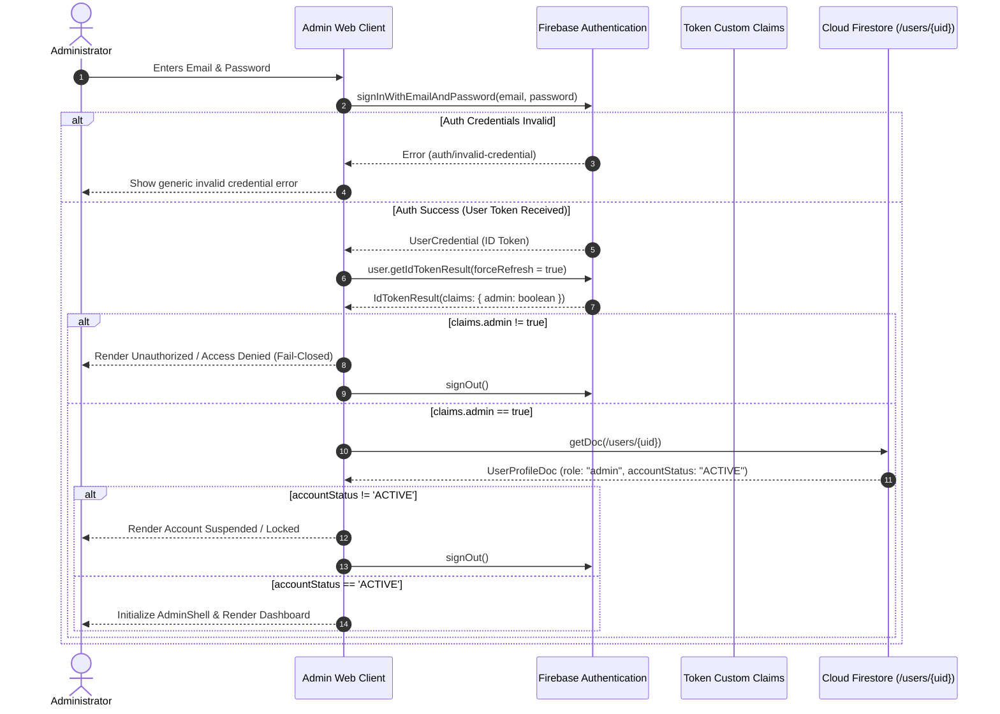

# WASTELINK ADMIN WEB — ARCHITECTURAL SPECIFICATION & SYSTEM DESIGN
**Document Version:** 1.0.0-ENTERPRISE  
**Date:** November 5, 2026  
**Status:** FOUNDATION ARCHITECTURAL BASELINE  
**Workspace:** `C:\Users\JogerBee\Desktop\WasteLink-Admin`  
**Branch:** `feature/admin-web`  
**Target Environments:** Local Emulator, Staging (`wastelink-27595`), Production (`wastelink-prod-2026`)  
**Shared Authority:** Firebase Authentication & Cloud Firestore (co-authoritative with Android)  

---

## 1. Executive Summary & Philosophy

WasteLink Admin Web is the dedicated, centralized desktop-first operational platform for municipal waste management authorities, dispatch supervisors, customer dispute arbitrators, and system administrators. 

### 1.1 Architectural Axioms
1. **Single Source of Truth**: The Admin Web and the Android mobile client operate on the identical backend infrastructure and domain schemas. Admin Web must **never** maintain an independent, out-of-sync database or invent diverging operational models.
2. **True Security Boundary**: Client-side UI gating (hiding buttons or routes) is an ergonomics feature, **never** an authorization mechanism. Administrative authorization is strictly derived from cryptographically signed Firebase Auth ID tokens containing server-provisioned custom claims (`request.auth.token.admin == true`).
3. **Fail-Closed by Default**: If an identity token lacks explicit administrative proof or if authentication state cannot be cryptographically validated, all administrative actions, data subscriptions, and privileged routes must fail closed immediately.
4. **Flow-First Engineering**: Every administrative control must belong to an explicitly documented, auditable workflow. Dead buttons, fake actions, simulated server mutations, and mock data masquerading as live platform state are strictly prohibited.
5. **Decoupled Deployment & Isolation**: The Admin Web application is housed in the top-level `admin-web/` workspace. It builds, lints, tests, and deploys independently of the Android Gradle build pipeline without modifying Android source code.

---

## 2. Technology Stack & Justification

| Layer | Selected Technology | Version | Architectural Justification |
| :--- | :--- | :---: | :--- |
| **Runtime & Core** | React | `^19.0.0` | Industry standard declarative UI engine; concurrent rendering, robust ecosystem, unmatched maintainability for enterprise dashboards. |
| **Language** | TypeScript | `^5.7.0` | Strict static typing (`strict: true`, `noImplicitAny: true`); end-to-end type safety between shared domain definitions and UI states. |
| **Build & Tooling** | Vite | `^6.1.0` | Sub-second HMR, optimized Rollup production bundling, native ESM support, zero overhead compared to legacy Webpack. |
| **Styling & Tokens** | Tailwind CSS | `^3.4.0` | Utility-first CSS ensuring strict visual consistency, zero runtime CSS overhead, accessible dark/light tokens aligned with the mobile design system. |
| **Icons** | Lucide React | `^0.475.0` | Lightweight, accessible, tree-shakeable SVG icon set with consistent 24px stroke metrics. |
| **Routing** | React Router DOM | `^7.1.0` | Industry standard client-side router supporting data loaders, nested layout shells, declarative auth guards, and search-param state. |
| **Backend Integration** | Firebase JS SDK (Modular) | `^11.3.0` | Tree-shaken `@firebase/auth` and `@firebase/firestore` modules; native multi-environment emulator routing; real-time listener subscriptions. |
| **State Management** | React Context + Custom Hooks | Native | Zero external state library bloat for UI session state; server state is synchronized via real-time Firestore reactive snapshot listeners. |
| **Mapping Engine** | MapLibre GL JS / Leaflet (Modular) | Ready | Zero-cost tile rendering (aligned with Android MapLibre OpenFreeMap policy); supports polygon boundary editing for service zones. |
| **Testing Framework** | Vitest + React Testing Library | `^3.0.0` | Fast in-memory unit/component testing; jsdom emulation; identical configuration syntax to Vite. |
| **Linting & Quality** | ESLint + TypeScript ESLint | `^9.0.0` | Enforces code cleanliness, React hook rules, and prevents unintended type escapes. |

---

## 3. Repository & Workspace Topology

```
WasteLink/  (Root Git Monorepo)
├── app/                        # Android Application Module
├── core/                       # Android Shared Core Modules (:common, :domain, :data, :firebase, :nav, :design-system)
├── feature/                    # Android Feature Modules (:feature:auth, :feature:resident)
├── firestore-rules-tests/      # Automated Firestore Security Rules Test Suite
├── docs/                       # Shared Enterprise Architecture Documentation
│   ├── ADMIN_WEB_ARCHITECTURE.md        <-- This Document
│   ├── ADMIN_WEB_USER_JOURNEYS.md       <-- Workflow Specifications
│   ├── ADMIN_WEB_BACKEND_CONTRACTS.md   <-- Operation Inventory
│   ├── MODULAR_ARCHITECTURE.md
│   ├── MODULE_1_AUTH_ARCHITECTURE.md
│   └── MODULE_2_RESIDENT_REQUEST_ARCHITECTURE.md
├── admin-web/                  # Dedicated Web Application Workspace
│   ├── public/                 # Static brand assets & favicon
│   ├── src/
│   │   ├── app/                # Application entry point, router, and root providers
│   │   ├── assets/             # Vector icons and brand marks
│   │   ├── components/         # Reusable design system primitives
│   │   │   ├── ui/             # Buttons, Cards, Inputs, Badges, Modals, Tables
│   │   │   ├── layout/         # AdminShell, Sidebar, Header, PageContainer
│   │   │   └── feedback/       # ErrorBoundary, LoadingSpinner, EmptyState, AlertBanner
│   │   ├── config/             # Environment variables, Firebase app initialization, feature flags
│   │   ├── context/            # AuthContext, NotificationContext, ThemeContext
│   │   ├── domain/             # Authoritative domain types, enums, validators, and mappers
│   │   │   ├── models/         # User, WasteRequest, WasteCategory, ServiceZone, Dispute, AuditLog
│   │   │   └── validators/     # State transition guards, schema validators
│   │   ├── hooks/              # Reusable React hooks (useAuth, useFirestoreQuery, useZoneContainment)
│   │   ├── routes/             # Route guards and route definitions
│   │   ├── services/           # Backend adapters (AuthService, UserService, RequestService, AuditService)
│   │   └── views/              # Module screen layouts
│   │       ├── auth/           # LoginView, UnauthorizedView, SessionExpiredView
│   │       ├── dashboard/      # Executive operational metrics & anomaly radar
│   │       ├── users/          # Resident, Collector & Admin user management
│   │       ├── categories/     # Waste category administration & special handling rules
│   │       ├── zones/          # Interactive map-based service zone boundaries
│   │       ├── pricing/        # Authoritative tariff & volume tier configuration
│   │       ├── requests/       # Dispatch allocation & request lifecycle inspection
│   │       ├── disputes/       # Formal grievance arbitration & resolution
│   │       ├── fleet/          # Collector vehicle registry & operational inspection
│   │       ├── reports/        # Municipal operational analytics & CSV exports
│   │       └── audit/          # Append-only immutable administrative audit log
│   ├── tests/                  # Unit, component, and routing test suites
│   ├── index.html              # HTML shell
│   ├── package.json            # Node.js manifest & dependencies
│   ├── tailwind.config.js      # Design tokens, color palette, responsive breakpoints
│   ├── tsconfig.json           # Strict TypeScript configuration
│   └── vite.config.ts          # Vite build & test configuration
├── firestore.rules             # Authoritative Firestore Security Rules
├── firestore.indexes.json      # Firestore Composite Query Indexes
├── firebase.json               # Firebase Emulator & Hosting Configuration
└── .firebaserc                 # Project Alias Mapping (staging / prod)
```

---

## 4. Authentication, Authorization & Identity Architecture

### 4.1 Dual-Token Authentication Lifecycle


### 4.2 Security Boundary Invariants & Distinction Between UI Standing and Backend Authorization

1. **Authoritative Backend Authorization (`request.auth.token.admin == true`)**:
   In `firestore.rules`, authorization is enforced cryptographically by the server:
   ```javascript
   function isAdmin() {
     return request.auth != null
       && ('admin' in request.auth.token)
       && request.auth.token.admin == true;
   }
   ```
   Having `role: "admin"` in a Firestore profile document without `request.auth.token.admin == true` grants **zero privilege**.
   Security rules evaluate tokens minted and signed by Google's backend. The client web app cannot mint, alter, or forge custom claims.

2. **Crucial Distinction: Client-Side Account Standing vs Authoritative Privilege Revocation**:
   - **UI Account-Standing Verification**: The client `AuthContext` queries `/users/{uid}` and strictly checks `accountStatus === 'ACTIVE'`. If the document is missing, malformed, or has `accountStatus` in `['SUSPENDED', 'BANNED', 'RESTRICTED']`, the web application fails closed, purges local session state, and executes `signOut(auth)` to lock the user out of the admin console.
   - **Backend Authorization Remains Claim-Bound**: Client-side UI checks **do not by themselves revoke administrative privileges on the Firebase backend**. If an administrator's profile document is marked `SUSPENDED` in Firestore, their existing Firebase Auth ID token will continue to satisfy `request.auth.token.admin == true` in `firestore.rules` until:
     a) The 60-minute token lifetime expires, OR
     b) A trusted backend operation (Cloud Function or server-side Admin SDK script) calls `admin.auth().setCustomUserClaims(uid, { admin: false })` and `admin.auth().revokeRefreshTokens(uid)`.
   - Therefore, the UI check is an essential defensive front-line gate, but true administrative revocation is an authoritative backend responsibility.

3. **Server-Side Admin Provisioning & Revocation Only**:
   - Client web code is **never** equipped with service accounts or administrative keys.
   - Administrators are provisioned and de-provisioned exclusively server-side via trusted scripts (`scripts/provision-admin.mjs` or Cloud Functions using `firebase-admin`).

4. **Fail-Closed & Race-Free Client Authentication**:
   - Missing or unreadable `/users/{uid}` profiles immediately fail closed with access denied.
   - No synthetic fallback profiles are generated under any circumstances.
   - An asynchronous generation sequence counter (`evalSeqRef`) prevents older or out-of-order authentication callbacks from overwriting a newer session state.

---

## 5. Data Flow & Backend Integration Strategy

### 5.1 Reactive Firestore Subscriptions & Caching
The Admin Web communicates directly with Cloud Firestore using the modular Firebase SDK.
- **Real-Time Data**: High-frequency operational streams (e.g. active requests in `PENDING_DISPATCH`, live dispute count) utilize reactive `onSnapshot` subscriptions.
- **Paged Historical Data**: High-volume collections (Audit logs, completed requests, user registries) utilize cursor-based pagination (`startAfter`, `limit`) to prevent unbounded memory allocation and excessive reads.
- **Fail-Safe Offline/Unsynced State**: The web app explicitly communicates whether data is live, cached, or offline using visual status badges.

### 5.2 Atomic Operations & Cross-Document Consistency
Where complex operations span multiple documents (e.g., vetting a collector, resolving a dispute with an audit log entry), the Admin Web executes atomic `writeBatch` or `runTransaction` operations matching Firestore security rule constraints:
```
Collector Approval Transaction:
1. update(/collector_submissions/{uid}) -> status: 'APPROVED', reviewedByUid: adminUid
2. update(/users/{uid}) -> collectorVerificationStatus: 'APPROVED', isVerified: true
3. create(/collector_submissions/{uid}/history/{attemptId}) -> eventType: 'APPROVED'
4. create(/admin_actions_log/{logId}) -> action: 'COLLECTOR_APPROVED'
```

---

## 6. Visual Design System & UI Architecture

### 6.1 Theme & Palette Alignment
The visual identity directly reflects WasteLink's emerald and dark slate palette, adapted for a crisp, high-density desktop operations console:

| Token Name | Hex Value | Purpose |
| :--- | :--- | :--- |
| **`brand-emerald-500`** | `#10B981` | Primary brand accent, active state indicator, primary CTA. |
| **`brand-emerald-600`** | `#059669` | Hover state for primary buttons. |
| **`brand-emerald-950`** | `#064E3B` | Subtle green badge backgrounds and active navigation highlights. |
| **`surface-dark`** | `#0F172A` | Primary application canvas background (Slate 900). |
| **`surface-card`** | `#1E293B` | Card surfaces, modal containers, and elevated panes (Slate 800). |
| **`surface-border`** | `#334155` | Subtle container borders and table dividers (Slate 700). |
| **`text-primary`** | `#F8FAFC` | High-contrast body text and titles (Slate 50). |
| **`text-secondary`** | `#94A3B8` | Metadata, helper labels, table headers (Slate 400). |
| **`status-pending`** | `#F59E0B` | Amber 500 — Awaiting dispatch, pending verification. |
| **`status-active`** | `#10B981` | Emerald 500 — En route, in progress, approved, healthy. |
| **`status-alert`** | `#EF4444` | Red 500 — Disputes, failed collections, banned accounts. |
| **`status-info`** | `#3B82F6` | Blue 500 — Informational flags, audit events. |

### 6.2 Component Hierarchy & Usability Standards
- **High-Density Data Tables**: Clean row spacing, sticky headers, sorting, multi-attribute filtering, keyboard navigation, and explicit zero-state indicators.
- **Responsive Layout Shell**: Collapsible sidebar navigation for 1024px+ desktops, accessible drawer for tablets (768px - 1023px).
- **Honest Feedback UI**: Every action features distinct states:
  - *Idle*: Available interactive control with clear tooltip.
  - *Loading*: Disabled control with inline spinner preventing double-submission.
  - *Success*: Ephemeral banner confirmation.
  - *Failure*: Persistent error banner detailing root cause without leaking server credentials.
  - *Unavailable / Future*: Clearly marked pill (`Future Backend Dependency`).

---

## 7. Multi-Environment & Deployment Strategy

### 7.1 Environment Profiles
The application uses Vite's `.env` configuration files:

```bash
# .env.development (Local Firebase Emulators)
VITE_FIREBASE_ENV="EMULATOR"
VITE_FIREBASE_PROJECT_ID="wastelink-27595"
VITE_FIREBASE_AUTH_EMULATOR_URL="http://127.0.0.1:9099"
VITE_FIREBASE_FIRESTORE_EMULATOR_HOST="127.0.0.1"
VITE_FIREBASE_FIRESTORE_EMULATOR_PORT="8080"

# .env.staging (Remote Staging Cloud)
VITE_FIREBASE_ENV="STAGING"
VITE_FIREBASE_PROJECT_ID="wastelink-27595"
VITE_FIREBASE_API_KEY="AIzaSy..."
VITE_FIREBASE_AUTH_DOMAIN="wastelink-27595.firebaseapp.com"

# .env.production (Production Cloud — Fails Closed)
VITE_FIREBASE_ENV="PRODUCTION"
VITE_FIREBASE_PROJECT_ID="wastelink-prod-2026"
```

### 7.2 Security Invariants for Environment Keys
- `VITE_` variables in browser code are **publicly readable**. Never embed private service account JSON keys or administrator master passwords in `.env` files.
- Production builds fail closed if required environment variables are absent.

---

## 8. Testing & Quality Verification Strategy

| Test Layer | Tools | Scope & Responsibilities |
| :--- | :--- | :--- |
| **Static Verification** | TypeScript Compiler (`tsc`) | Verifies strict type-checking across all domain models, views, and services. |
| **Code Style & Linting** | ESLint | Enforces React hook rules, prevents unused imports and accidental type leaks. |
| **Unit & Component Tests** | Vitest, RTL, jsdom | Tests UI components, custom hooks, transition validators, formatters, and authentication guards. |
| **Route & Navigation Tests** | React Router MemoryRouter | Verifies that unauthenticated or non-admin users are strictly redirected to login or unauthorized screens. |
| **Production Build** | Vite Build | Verifies zero-error bundling, asset optimization, chunk splitting, and tree shaking. |
