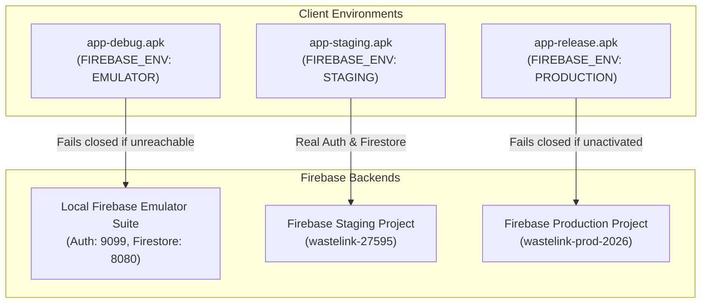

# WasteLink — Firebase Multi-Environment Architecture

**Authoritative Specification**  
**Date**: November 5, 2026  
**Status**: APPROVED & ACTIVE  
**Branch**: `rebuild/modular-workspace`  

---

## 1. Overview & Core Invariants

WasteLink enforces strict multi-environment isolation across its development lifecycle. The application strictly prohibits unified "catch-all" configurations or silent fallbacks between environments.



### Architectural Invariants:
1. **Zero Root Fallback**: No single `app/google-services.json` exists in the repository root. Gradle resolves Google Services strictly per source set:
   - `app/src/debug/google-services.json`
   - `app/src/staging/google-services.json`
   - `app/src/release/google-services.json`
2. **Compile-Time Build Project Binding**: Each build variant in `app/build.gradle.kts` declares `FIREBASE_ENV` and `FIREBASE_PROJECT_ID`.
3. **Runtime Validation & Fail-Closed Guard**: `WasteLinkApplication.onCreate()` checks the runtime `FirebaseApp.options.projectId` against `BuildConfig.FIREBASE_PROJECT_ID`. Any mismatch immediately throws an `IllegalStateException` before any service or repository can execute requests.
4. **Emulator Isolation**:
   - `LOCAL_EMULATOR` connects strictly to local endpoints (Auth 9099, Firestore 8080).
   - `REMOTE_STAGING` and `PRODUCTION` reject connection if an emulator is detected.
   - `PRODUCTION` fails closed unless `FirebaseEnvironmentManager.isProductionActivated()` is explicitly set.

---

## 2. Environment Matrix

| Attribute | Local Emulator (`debug`) | Remote Staging (`staging`) | Remote Production (`release`) |
| :--- | :--- | :--- | :--- |
| **Build Variant** | `debug` | `staging` | `release` |
| **Package Name** | `com.waste.link` | `com.waste.link` | `com.waste.link` |
| **`FIREBASE_ENV`** | `"EMULATOR"` | `"STAGING"` | `"PRODUCTION"` |
| **`FIREBASE_PROJECT_ID`**| `"wastelink-27595"` | `"wastelink-27595"` | `"wastelink-prod-2026"` |
| **Config Location** | `app/src/debug/google-services.json` | `app/src/staging/google-services.json` | `app/src/release/google-services.json` |
| **Firebase App ID** | `1:161365383144:android:3448bf6fac95de1cc4f65d` | `1:161365383144:android:3448bf6fac95de1cc4f65d` | `1:992880418114:android:1e663fb7d502414860bcdb` |
| **Auth Destination** | `10.0.2.2:9099` / `127.0.0.1:9099` | Remote Firebase Identity Toolkit | Remote Firebase Identity Toolkit |
| **Firestore Destination**| `10.0.2.2:8080` / `127.0.0.1:8080` | `projects/wastelink-27595/databases/(default)` | `projects/wastelink-prod-2026/databases/(default)` |
| **Security Rules** | Live-tested locally via `@firebase/rules-unit-testing` | Deployed via `npx firebase-tools deploy` | Deployed via `npx firebase-tools deploy` |
| **FCM Behavior** | Logged locally; no real remote push | Active token registered in `/users/{uid}/fcmToken` | Active token registered in `/users/{uid}/fcmToken` |
| **Fail-Closed Behavior** | Fails closed if emulator endpoints unreachable | Fails closed on auth error or missing network | Fails closed if not explicitly activated |

---

## 3. Firebase CLI Aliases (`.firebaserc`)

To prevent accidental deployments to the wrong project, `.firebaserc` defines explicit environment aliases without a default alias:

```json
{
  "projects": {
    "staging": "wastelink-27595",
    "prod": "wastelink-prod-2026"
  }
}
```

All deployment and administrative operations must explicitly specify their target project:

```powershell
# Deploying to Staging:
npx firebase-tools deploy --only firestore:rules,firestore:indexes --project staging

# Deploying to Production:
npx firebase-tools deploy --only firestore:rules,firestore:indexes --project prod
```

---

## 4. Runtime Initialization Lifecycle

```mermaid
sequenceDiagram
    participant App as WasteLinkApplication
    participant Mgr as FirebaseEnvironmentManager
    participant Hilt as Hilt (FirebaseModule)
    participant SDK as FirebaseApp / Firebase.auth / Firebase.firestore

    App->>SDK: FirebaseInitProvider initializes default FirebaseApp
    App->>App: Read BuildConfig.FIREBASE_ENV & FIREBASE_PROJECT_ID
    App->>Mgr: validateProjectConfiguration(expectedProjectId, actualProjectId)
    App->>Mgr: setEnvironment(env)
    App->>Hilt: Injects FirebaseAuth & FirebaseFirestore
    App->>Mgr: configureFirebase(firebaseAuth, firestore, env)
    alt env == LOCAL_EMULATOR
        Mgr->>SDK: firebaseAuth.useEmulator(host, 9099)
        Mgr->>SDK: firestore.useEmulator(host, 8080)
    else env == REMOTE_STAGING
        Mgr->>Mgr: Assert emulator not connected; verify remote endpoints
    else env == PRODUCTION
        Mgr->>Mgr: Assert emulator not connected; assert isProductionActivated()
    end
```

---

## 5. Security & Verification Guarantees

1. **Client Identity Binding**:
   - `users/{uid}` writes in Firestore rules enforce `request.resource.data.id == request.auth.uid` and `request.resource.data.email == request.auth.token.email`.
   - Role escalation is strictly rejected (only `RESIDENT` and `COLLECTOR` are registrable).
2. **Access Privacy**:
   - Unauthenticated reads and writes are blocked with `HTTP 403 PERMISSION_DENIED`.
   - Cross-resident read attempts are rejected.
3. **API Key Safety**:
   - Client API keys contained in `google-services.json` are public identifiers restricted by Android package name (`com.waste.link`) and SHA-1 certificate fingerprints.
   - Zero administrative credentials, private service account keys, or OAuth secrets exist in the repository or APK binaries.
