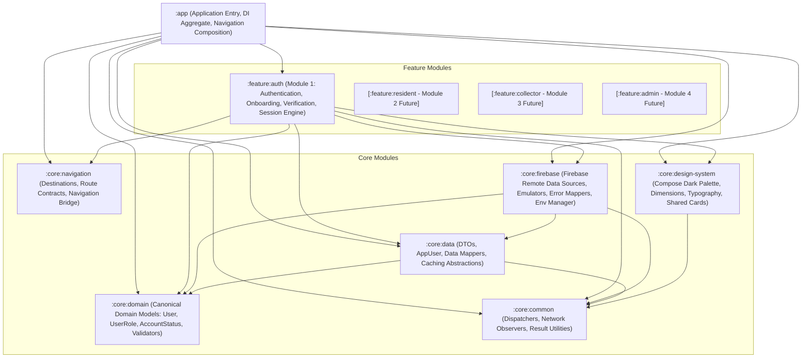

# WasteLink Modular Architecture Specification (Phase 0)

## 1. Executive Summary & Modular Philosophy

WasteLink has transitioned from a monolithic application structure into a strictly decoupled, modular Gradle architecture. This architectural evolution guarantees:
- **Legacy Preservation**: The original baseline application remains permanently preserved in the immutable Git reference branch `legacy/original-app` (`188b2a1021eedd94c720bbfe1ca93a4ba77363c4`).
- **Clear Architectural Boundaries**: Domain models and business invariants are pure Kotlin, strictly isolated from platform frameworks, UI libraries, and remote persistence.
- **Incremental Feature Delivery**: Every functional module (`:feature:auth`, `:feature:resident`, `:feature:collector`, `:feature:admin`) develops against clear contracts without cross-feature leakage.
- **Fail-Safe Multi-Environment Separation**: Runtime configurations strictly isolate local development (emulators), remote staging (`wastelink-4791b`), and production (fails closed until signed activation).

---

## 2. Dependency Graph & Module Hierarchy



### Module Boundary Rules
1. **No Circular Dependencies**: All dependencies flow strictly downwards. Core modules NEVER depend on feature modules.
2. **Pure Domain Core (`:core:domain`)**: Zero Android SDK imports, zero Firebase dependencies, zero Compose dependencies. Contains only pure Kotlin domain entities, value objects, domain enumerations, and validation rules.
3. **Pure Design System (`:core:design-system`)**: Contains visual tokens, colors, typography, layout dimensions, and foundational Compose cards (`GlassCard`, `ErrorCard`, `SwipeToActionButton`). Feature-specific banners and screens reside in their respective feature modules.
4. **Isolated Navigation Contract (`:core:navigation`)**: Declares canonical destination routes and backward-compatible navigation bridges without importing Compose UI screen implementations.
5. **Encapsulated Remote Infrastructure (`:core:firebase`)**: Contains Firebase initialization, Firestore/Auth wrappers, connection managers, and emulator routing. No secrets or service account keys are stored in code or assets.

---

## 3. Module Inventory & Responsibilities

| Module | Namespace | Primary Responsibilities | Dependencies |
| :--- | :--- | :--- | :--- |
| **`:app`** | `com.waste.link` | Application entry point (`WasteLinkApplication`), Hilt singleton container, `MainActivity`, top-level `WasteLinkNavGraph`, build variant environment dispatch, and explicit honest future module placeholders. | `:core:common`, `:core:domain`, `:core:data`, `:core:firebase`, `:core:navigation`, `:core:design-system`, `:feature:auth` |
| **`:core:common`** | `com.waste.link.core.common` | Cross-cutting utilities, coroutine dispatchers, `NetworkConnectivityObserver`, result types, and injection abstractions. | Standard Kotlin libraries, `javax.inject` |
| **`:core:domain`** | `com.waste.link.core.domain` | Canonical domain models (`User`, `UserRole`, `AccountStatus`, `CollectorVerificationStatus`, `OnboardingStatus`, `SessionState`, `CollectorSubmission`), domain validation logic (`AuthValidator`). Pure Kotlin. | `:core:common` |
| **`:core:data`** | `com.waste.link.core.data` | Data Transfer Objects (`UserDto`), legacy entity adapters (`AppUser`, legacy `User`), domain mappers (`UserMapper`), and data source contracts. | `:core:common`, `:core:domain`, `firebase-firestore` |
| **`:core:firebase`** | `com.waste.link.core.firebase` | Remote Auth and Firestore data source abstractions (`AuthRemoteDataSource`, `FirebaseAuthDataSource`), Firebase emulator management (`FirebaseEmulatorConfig`), error translation (`FirebaseErrorMapper`), and environment runtime dispatch (`FirebaseEnvironmentManager`). | `:core:common`, `:core:domain`, `:core:data`, Firebase BoM (`firebase-auth`, `firebase-firestore`, `firebase-storage`), `hilt-android` |
| **`:core:navigation`** | `com.waste.link.core.navigation` | Route strings, canonical destination contracts (`Destinations`, `Screen`), bottom navigation tab definitions (`BnbTab`), and backward-compatible navigation bridge (`DestinationsBridge`). | Standard Kotlin |
| **`:core:design-system`** | `com.waste.link.core.designsystem` | Jetpack Compose theme (`WasteLinkTheme`), dark visual tokens (`EmeraldGreen`, `DarkBackground`, `DarkCard`, `DarkBorder`), typography scale (`WasteLinkTypography`), layout dimensions (`Dimensions`), and shared components (`GlassCard`, `ErrorCard`, `SwipeToActionButton`). | Jetpack Compose BoM, Compose Material3, Compose UI Tooling |
| **`:feature:auth`** | `com.waste.link.feature.auth` | Complete Module 1 implementation: Authentication repositories (`AuthRepositoryImpl`, `CollectorVerificationRepositoryImpl`), session state resolver (`SessionNavigationResolver`), presentation state holder (`AuthViewModel`), auth design components (`AuthDesignComponents`), all 8 auth screens (`SplashScreen`, `LoginScreen`, `RegisterScreen`, `VerifyEmailScreen`, `CompleteProfileScreen`, `OnboardingScreen`, `CollectorVerificationStatusScreen`, `AccountStatusLockScreen`), and comprehensive unit test suites. | `:core:common`, `:core:domain`, `:core:data`, `:core:firebase`, `:core:navigation`, `:core:design-system`, Hilt, Coroutines Test |

---

## 4. Multi-Environment Build Configuration

WasteLink provides 3 distinct build variants configured in `:app/build.gradle.kts` via `buildConfigField`:

```kotlin
buildTypes {
    debug {
        buildConfigField("String", "FIREBASE_ENV", "\"EMULATOR\"")
        applicationIdSuffix = ".debug"
        isDebuggable = true
    }
    create("staging") {
        initWith(getByName("debug"))
        buildConfigField("String", "FIREBASE_ENV", "\"STAGING\"")
        applicationIdSuffix = ".staging"
        matchingFallbacks += listOf("debug")
    }
    release {
        buildConfigField("String", "FIREBASE_ENV", "\"PRODUCTION\"")
        isMinifyEnabled = false
        proguardFiles(getDefaultProguardFile("proguard-android-optimize.txt"), "proguard-rules.pro")
    }
}
```

### Runtime Environment Mapping (`FirebaseEnvironmentManager`)

- **`EMULATOR` (Debug Variant)**:
  - Routes Firebase Auth to `10.0.2.2:9099` (or `127.0.0.1:9099` on host).
  - Routes Firebase Firestore to `10.0.2.2:8080` (or `127.0.0.1:8080` on host).
  - Configures Firestore host settings without SSL.
  - Zero network egress to Google Cloud; 100% locally contained.
- **`STAGING` (Staging Variant)**:
  - Connects to remote staging Firebase project (`wastelink-4791b`).
  - Requires real network connectivity and valid Firebase security rules evaluation.
  - Ideal for remote QA, device farm testing, and cross-device testing.
- **`PRODUCTION` (Release Variant)**:
  - Production environment is unactivated and **fails closed**.
  - Production Google Services configuration will be activated in Phase 5 under strict release signing.
  - Zero private keys, credentials, or service account tokens exist in Git or the APK binary.

---

## 5. Uncompleted Module Placeholders

To maintain structural and functional honesty, features scheduled for Modules 2, 3, and 4 do NOT contain dead or unverified legacy code. Instead, `:app` registers explicit, informative placeholder composables in `com.waste.link.ui.placeholders`:

1. **`ResidentHomePlaceholder` (`Destinations.RESIDENT_HOME`)**:
   - Indicates that Resident Request, Tracking, and History features will activate in **Module 2 (Resident Operations)**.
   - Shows active resident profile information and a functional "Sign Out" button to allow testing session termination.
2. **`CollectorDashboardPlaceholder` (`Destinations.COLLECTOR_DASHBOARD`)**:
   - Indicates that Fleet Dispatch, Turn-by-Turn Routing, and Proof-of-Collection will activate in **Module 3 (Collector Operations)**.
   - Confirms verified collector KYC credentials and provides a functional "Sign Out" action.
3. **`AdminShellPlaceholder` (`Destinations.ADMIN_SHELL`)**:
   - Confirms cryptographic administrative custom claim (`token.admin == true`).
   - Indicates that Municipal Dispatch, God Panel, and Audit Logs will activate in **Module 4 (Administrator Operations)**.
   - Provides a functional "Sign Out" action.

---

## 6. Verification Pipeline & Acceptance Standards

Every module and changeset must pass the four-tier verification pipeline:

1. **JVM Unit Test Suite**:
   ```powershell
   .\gradlew.bat testDebugUnitTest
   ```
   *Covers*: AuthRepository, SessionNavigationResolver, AuthViewModel, AuthValidator, UserMapper, CollectorVerificationRepository.
2. **Firestore Security Rules Integration Suite**:
   ```powershell
   cd firestore-rules-tests && npm test
   ```
   *Covers*: 32 automated security assertions across 9 suites testing collections, subcollections, role constraints, and wildcard fallback.
3. **Connected Android Instrumentation Suite**:
   ```powershell
   .\gradlew.bat connectedDebugAndroidTest
   ```
   *Covers*: 31 instrumentation tests running on Pixel 9a against local Firebase emulators (Auth, Complete Profile, Onboarding, Verification, Lockouts, Snapshot Synchronization).
4. **Debug APK Compilation**:
   ```powershell
   .\gradlew.bat assembleDebug
   ```
   *Covers*: Full compilation, resource linking, KSP code generation, Hilt dependency injection assembly across all 8 modules.
