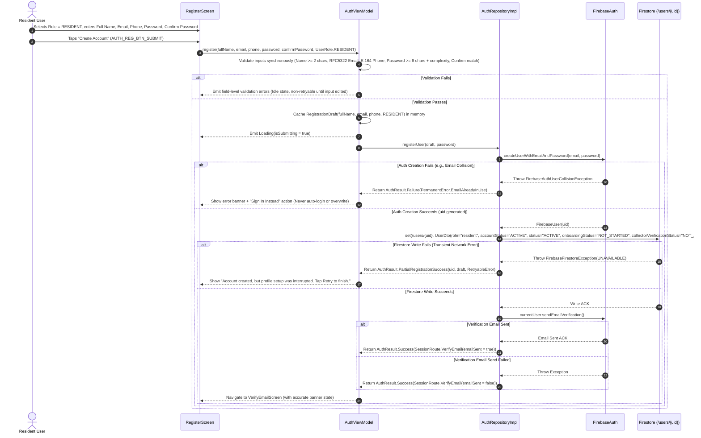
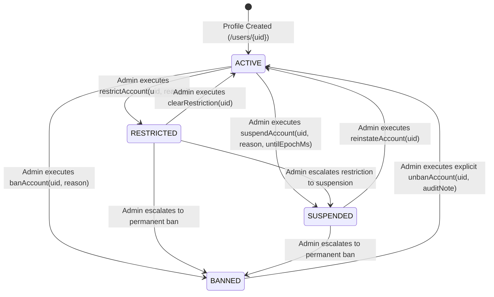
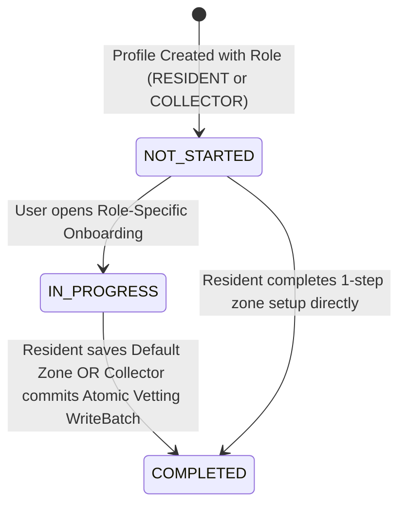
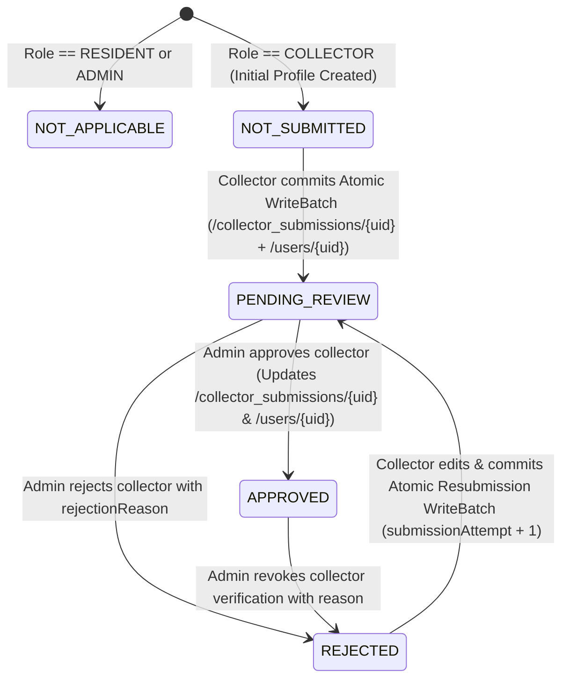
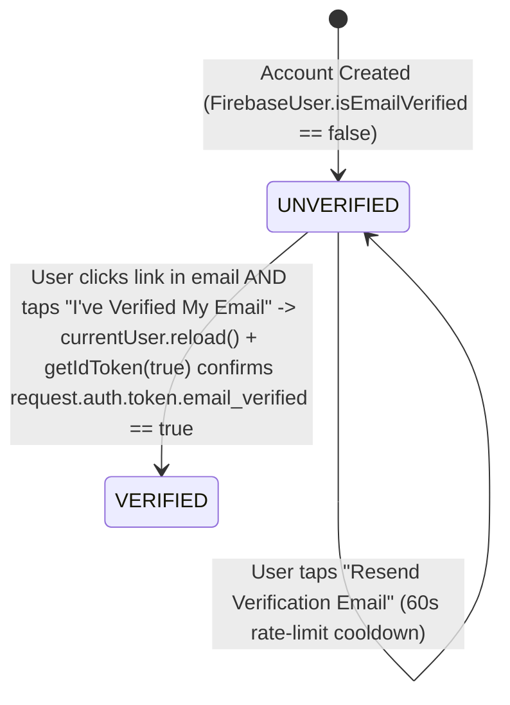
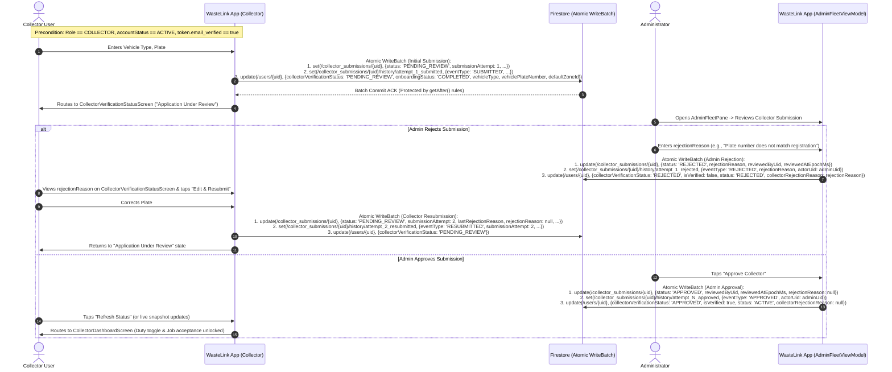

# WASTELINK — MODULE 1: IDENTITY, AUTHENTICATION, USER PROFILES & ROLE-BASED ONBOARDING
## Final Architecture & Workflow Design Specification (v2.1 — Final Pre-Implementation Baseline)

- **Document Status:** Final Corrected Architecture Specification (v2.1) — Awaiting Final Implementation Authorization
- **Target Branch:** `rebuild/foundation`
- **Module Scope:** Module 1 (Identity, Authentication, User Profiles, Role-Based Onboarding, Collector Verification, Session Restoration, Security Rules)
- **Execution Authorization:** Documentation & Design Corrections Only (Zero Application Code Modified)

---

## Table of Contents

1. [Corrected Canonical User Model & Email Verification Authority](#1-corrected-canonical-user-model--email-verification-authority)
2. [Complete Registration and Recovery Workflows](#2-complete-registration-and-recovery-workflows)
3. [Final Account Lifecycle State Machine & Restriction Policy](#3-final-account-lifecycle-state-machine--restriction-policy)
4. [Corrected Role and Permission Matrix](#4-corrected-role-and-permission-matrix)
5. [Secure Firestore Rules Design, Collector Submission Security & Emulator Plan](#5-secure-firestore-rules-design-collector-submission-security--emulator-plan)
6. [Server-Side Administrator Provisioning & Git Security History Remediation](#6-server-side-administrator-provisioning--git-security-history-remediation)
7. [Collector Approval & Resubmission Workflow](#7-collector-approval--resubmission-workflow)
8. [Corrected Session Management, Error Recovery & Navigation Architecture](#8-corrected-session-management-error-recovery--navigation-architecture)
9. [Existing Data Compatibility, Legacy Adapter & Migration Strategy](#9-existing-data-compatibility-legacy-adapter--migration-strategy)
10. [Complete Authentication Interaction Registry](#10-complete-authentication-interaction-registry)
11. [Expanded Testing and Acceptance Criteria](#11-expanded-testing-and-acceptance-criteria)
12. [Final Implementation Sequence and File Impact Manifest](#12-final-implementation-sequence-and-file-impact-manifest)
13. [Remaining Product-Owner Decisions Before Coding](#13-remaining-product-owner-decisions-before-coding)
14. [FINAL SECURITY AND WORKFLOW ACCEPTANCE REVIEW](#14-final-security-and-workflow-acceptance-review)

---

## 1. Corrected Canonical User Model & Email Verification Authority

### 1.1 Architectural Separation of Concerns

In the legacy codebase ([`AppUser.kt`](file:///C:/Users/JogerBee/Desktop/WasteLink/app/src/main/java/com/waste/link/data/models/AppUser.kt) and [`User.kt`](file:///C:/Users/JogerBee/Desktop/WasteLink/app/src/main/java/com/waste/link/data/models/User.kt)), account standing, onboarding progress, email verification, collector fleet approval, and moderation metadata were conflated into overloaded string and boolean fields (`status = "UNVERIFIED"`, `role = "unassigned"`, `isVerified = false`).

The Module 1 v2.1 architecture enforces strict orthogonality across **six distinct domain dimensions** with **zero competing sources of truth**:

1. **`UserRole` (Immutable Business Identity):** Selected **once** during registration (`RESIDENT` or `COLLECTOR`) or provisioned server-side (`ADMIN`). There is **no `UNASSIGNED` role**. Once persisted in `/users/{uid}`, `role` is permanently immutable by the client.
2. **`AccountStatus` (Administrative Account Standing):** Represents whether the user's account is in good standing (`ACTIVE`, `RESTRICTED`, `SUSPENDED`, `BANNED`). New accounts always initialize as `ACTIVE`. Only an authorized Administrator (`request.auth.token.admin == true`) or backend Cloud Function may transition `AccountStatus`.
3. **`OnboardingStatus` (Role-Specific Setup Progress):** Tracks whether the user has completed their post-registration role setup (`NOT_STARTED`, `IN_PROGRESS`, `COMPLETED`). Device runtime permissions (notifications, location) are **never** required to transition `OnboardingStatus` to `COMPLETED`.
4. **Email Verification Authority (Single Source of Truth — Firebase Authentication):**
   - **Authoritative Source:** Firebase Authentication is the **sole authoritative source of truth** for email verification:
     - **In Firestore Security Rules:** Enforced directly via `request.auth.token.email_verified == true` on protected operations.
     - **In Android Client Domain State:** Derived strictly from `FirebaseAuth.currentUser.isEmailVerified` after calling `currentUser.reload()` and `currentUser.getIdToken(true)` (which refreshes the ID token so `request.auth.token.email_verified` is immediately `true` for subsequent Firestore writes).
   - **No Client-Writable Verification Fields in Firestore:** Clients are **never** permitted to write or update email verification booleans in Firestore. No duplicate `isEmailVerified` field is maintained in Firestore.
   - **Legacy `isVerified` Migration Rule:** In the legacy codebase, [`AdminFleetViewModel.kt`](file:///C:/Users/JogerBee/Desktop/WasteLink/app/src/main/java/com/waste/link/ui/screens/admin/AdminFleetViewModel.kt#L39-L79) used `isVerified: Boolean` on `/users/{uid}` to filter and approve Collectors (`whereEqualTo("role", "collector").whereEqualTo("isVerified", false)`). Therefore:
     - `isVerified` on `/users/{uid}` is strictly a **legacy admin-only projection of collector approval** (`collectorVerificationStatus == APPROVED`), initialized to `false` on creation and **immutable by the user**.
     - Only an administrator (`isAdmin()`) may update `isVerified` alongside `collectorVerificationStatus`. It is **never** used to represent email verification.
5. **`PhoneVerification` (Contact Attribute Only in Module 1):** `phoneNumber` is collected and validated (E.164 format) as **contact metadata only**, with `isPhoneVerified = false` hardcoded in the domain model. No Firestore field or client workflow treats `phoneNumber` as a verified authentication factor in Module 1.
6. **`CollectorVerificationStatus` (Operational Fleet Vetting):** Separates collector credential/vehicle vetting (`NOT_APPLICABLE`, `NOT_SUBMITTED`, `PENDING_REVIEW`, `APPROVED`, `REJECTED`) from `AccountStatus`. A newly registered collector has `AccountStatus.ACTIVE` and `CollectorVerificationStatus.NOT_SUBMITTED`.

### 1.2 Separation of Public/Owner Profile vs. Internal Moderation Data

To prevent ordinary users from reading internal administrative audit trails or mutating moderation timers (`bannedUntil`, `contractUntil`, `deletedAt`, `moderationNotes`), user data is partitioned across three Firestore structures:

- **`/users/{uid}`:** The primary user profile document readable by the authenticated owner (`request.auth.uid == uid`) and administrators (`request.auth.token.admin == true`). Contains `accountStatus` (`ACTIVE`, `RESTRICTED`, `SUSPENDED`, `BANNED`), read-only admin-populated `statusReason`, `suspendedUntilEpochMs`, `collectorVerificationStatus`, and `collectorRejectionReason` so the client app can render accurate status screens without exposing internal admin notes.
- **`/user_moderation/{uid}`:** Restricted administrative moderation ledger readable and writable **only** by administrators (`request.auth.token.admin == true`). Stores `bannedUntil`, `suspendedUntil`, `contractUntil`, `deletedAt`, `moderatedByUid`, `moderatedAtEpochMs`, and internal `adminNotes`.
- **`/collector_submissions/{uid}` (and `/collector_submissions/{uid}/history/{attemptId}`):** Stores collector vetting details submitted during Collector Onboarding (`vehicleType`, `vehiclePlateNumber`, `licenseNumber`, `serviceZoneId`, `submissionAttempt`, `status`, `submittedAtEpochMs`), admin review metadata (`reviewedByUid`, `reviewedAtEpochMs`, `rejectionReason`), and an immutable append-only `/history/{attemptId}` subcollection preserving every prior submission and review decision.

### 1.3 Canonical Domain Models (`domain/model/User.kt`)

`com.waste.link.domain.model.User` is the **single canonical domain model** across the application.

```kotlin
package com.waste.link.domain.model

enum class UserRole(val firestoreValue: String) {
    RESIDENT("resident"),
    COLLECTOR("collector"),
    ADMIN("admin");

    companion object {
        /**
         * Centralized, case-insensitive role parser supporting canonical and legacy Firestore values.
         * Returns null for "unassigned", blank, or unrecognized strings so SessionRouter triggers
         * authenticated profile completion recovery.
         */
        fun fromFirestoreValue(value: String?): UserRole? = when (value?.trim()?.uppercase()) {
            "RESIDENT", "CLIENT" -> RESIDENT
            "COLLECTOR", "WASTE_COMPANY" -> COLLECTOR
            "ADMIN" -> ADMIN
            else -> null
        }
    }
}

enum class AccountStatus {
    ACTIVE,
    RESTRICTED,
    SUSPENDED,
    BANNED;

    companion object {
        fun fromFirestoreValue(value: String?): AccountStatus = when (value?.trim()?.uppercase()) {
            "RESTRICTED" -> RESTRICTED
            "SUSPENDED" -> SUSPENDED
            "BANNED" -> BANNED
            // Legacy "UNVERIFIED" or "REJECTED" on AppUser.status map to ACTIVE account standing
            // because email verification (FirebaseAuth) and collector vetting (CollectorVerificationStatus)
            // are tracked on dedicated orthogonal axes.
            else -> ACTIVE
        }
    }
}

enum class OnboardingStatus {
    NOT_STARTED,
    IN_PROGRESS,
    COMPLETED
}

enum class CollectorVerificationStatus {
    NOT_APPLICABLE,
    NOT_SUBMITTED,
    PENDING_REVIEW,
    APPROVED,
    REJECTED
}

data class User(
    val id: String,                                              // Matches FirebaseAuth UID
    val fullName: String,
    val email: String,
    val phoneNumber: String,                                     // E.164 normalized contact number
    val role: UserRole,                                          // Immutable: RESIDENT, COLLECTOR, ADMIN
    val accountStatus: AccountStatus = AccountStatus.ACTIVE,     // Admin-controlled standing
    val statusReason: String? = null,                            // Admin-supplied reason for RESTRICTED / SUSPENDED / BANNED
    val suspendedUntilEpochMs: Long? = null,                     // Read-only expiration timestamp when SUSPENDED
    val onboardingStatus: OnboardingStatus = OnboardingStatus.NOT_STARTED,
    val isEmailVerified: Boolean = false,                        // Populated EXCLUSIVELY from FirebaseAuth.currentUser.isEmailVerified
    val isPhoneVerified: Boolean = false,                        // Always false in Module 1 (contact info only)
    val collectorVerificationStatus: CollectorVerificationStatus = CollectorVerificationStatus.NOT_APPLICABLE,
    val collectorRejectionReason: String? = null,                // Admin feedback when collectorVerificationStatus == REJECTED
    val defaultZoneId: String? = null,                           // Resident default pickup zone / Collector operating zone
    val vehicleType: String? = null,                             // Collector vehicle classification
    val vehiclePlateNumber: String? = null,                      // Collector license plate
    val preferredLanguage: String = "en",
    val createdAtEpochMs: Long = 0L,
    val updatedAtEpochMs: Long = 0L
)
```

---

## 2. Complete Registration and Recovery Workflows

### 2.1 Role Selection Consolidation (Eliminating Duplicate Selection)

In the legacy codebase, [`RegisterScreen.kt`](file:///C:/Users/JogerBee/Desktop/WasteLink/app/src/main/java/com/waste/link/ui/screens/auth/RegisterScreen.kt) collected `name`, `email`, `phone`, and `password` without a role selector, persisted `role = "unassigned"`, and then [`OnboardingScreen.kt`](file:///C:/Users/JogerBee/Desktop/WasteLink/app/src/main/java/com/waste/link/ui/screens/onboarding/OnboardingScreen.kt) asked the user to choose `"resident"` or `"collector"` in Step 1.

**Corrected Rule:**
- The user selects their account type (`RESIDENT` or `COLLECTOR`) **once** directly on [`RegisterScreen.kt`](file:///C:/Users/JogerBee/Desktop/WasteLink/app/src/main/java/com/waste/link/ui/screens/auth/RegisterScreen.kt) via a two-card segmented selector before submitting registration.
- `ADMIN` is **never** selectable in client registration or onboarding.
- When `/users/{uid}` is created, `role` is immediately written as `"resident"` or `"collector"` (via `UserRole.firestoreValue`) and enforced as permanently immutable by Firestore Security Rules.
- [`OnboardingScreen.kt`](file:///C:/Users/JogerBee/Desktop/WasteLink/app/src/main/java/com/waste/link/ui/screens/onboarding/OnboardingScreen.kt) is refactored into **Role-Specific Onboarding**:
  - **Resident Onboarding:** Configures the resident's primary pickup area/neighborhood (`defaultZoneId`) and optional notification opt-in.
  - **Collector Onboarding:** Collects operational vetting details (`vehicleType`, `vehiclePlateNumber`, `licenseNumber`, `serviceZoneId`) and executes an **atomic Firestore `WriteBatch`** that creates `/collector_submissions/{uid}`, writes `/collector_submissions/{uid}/history/attempt_1`, and transitions `/users/{uid}` `collectorVerificationStatus` from `NOT_SUBMITTED` to `PENDING_REVIEW`.

### 2.2 Workflow A: Resident Registration



### 2.3 Workflow B: Collector Registration

- **Starting Screen:** [`RegisterScreen.kt`](file:///C:/Users/JogerBee/Desktop/WasteLink/app/src/main/java/com/waste/link/ui/screens/auth/RegisterScreen.kt) (`Destinations.REGISTER`)
- **User Input:** Same identity fields as Resident Registration, with `selectedRole = UserRole.COLLECTOR`.
- **Firestore Operations:**
  - Writes `/users/{uid}` with:
    - `role`: `"collector"`
    - `accountStatus`: `"ACTIVE"`, `status`: `"ACTIVE"`
    - `onboardingStatus`: `"NOT_STARTED"`
    - `collectorVerificationStatus`: `"NOT_SUBMITTED"`
    - `isVerified`: `false` (legacy admin projection of collector approval)
- **Next Destination:** Routes to `VerifyEmailScreen` (`Destinations.VERIFY_EMAIL`). Once email is verified (`request.auth.token.email_verified == true`), `SessionRouter` routes the collector to Collector Onboarding (`Destinations.ONBOARDING`), where submitting vehicle/license details atomically transitions `collectorVerificationStatus` from `NOT_SUBMITTED` to `PENDING_REVIEW`.

### 2.4 Workflow C: Corrected Ghost Account & Partial Registration Recovery

A **Ghost Account** (or partial registration state) occurs when `FirebaseAuth.createUserWithEmailAndPassword` succeeds on Google's servers, creating a `FirebaseUser` with a `uid`, but the subsequent Firestore `set(/users/{uid})` fails due to network drop, process death, or timeout.

#### Strict Architectural Rules for Recovery
1. **Never create a second Firebase Authentication account** to recover a missing profile.
2. **Never fabricate placeholder user data** (such as `name = "User"` or `phone = "Not provided"` as found in legacy [`AuthRepositoryImpl.kt`](file:///C:/Users/JogerBee/Desktop/WasteLink/app/src/main/java/com/waste/link/data/repository/AuthRepositoryImpl.kt#L68-L80)).
3. **Never treat `FirebaseAuthUserCollisionException` (`ERROR_EMAIL_ALREADY_IN_USE`) during `register()` as proof of account ownership.** An unauthenticated caller typing an existing email on `RegisterScreen` has not proven they own that account until they authenticate with its password.
4. **Require successful authentication (`auth.currentUser != null`) before any profile recovery write.**
5. **Key all profile creation idempotently by `auth.currentUser.uid`.**

| Scenario | Trigger Condition | System State | Exact Recovery Mechanism |
| :--- | :--- | :--- | :--- |
| **Scenario 1: Same-Session Write Interruption** | `createUserWithEmailAndPassword` succeeds, `set(/users/{uid})` fails with transient `UNAVAILABLE` / `DEADLINE_EXCEEDED`. | `auth.currentUser != null` (`uid` is active). `AuthViewModel` holds `RegistrationDraft(fullName, email, phone, role)`. | `RegisterScreen` locks email/password fields and transforms primary CTA into **"Retry Profile Setup"** (`AUTH_REG_BTN_RETRY_PROFILE`). Tapping it calls `authRepository.completeProfileInitialization(draft)` which writes `/users/{uid}` idempotently without calling `createUserWithEmailAndPassword` again. |
| **Scenario 2: Registration Email Collision** | User submits `RegisterScreen` with an email that already exists in `FirebaseAuth`. | `createUserWithEmailAndPassword` throws `FirebaseAuthUserCollisionException`. Caller is unauthenticated. | Reject registration immediately (non-retryable). Display banner: *"This email is already registered. Please sign in to access or finish setting up your account."* Provide a **"Go to Sign In"** button that navigates to `LoginScreen` with the email pre-populated. |
| **Scenario 3: Authenticated Ghost Account (Cross-Session / Post-Restart / Legacy `"unassigned"`)** | User signs in via `LoginScreen` (proving ownership via password) OR app cold-starts with an active `FirebaseAuth.currentUser`, and a **server-confirmed** read of `/users/{uid}` returns `!snapshot.exists()` (or legacy `role == "unassigned"` / blank `fullName`). | `auth.currentUser != null` (ownership verified), but `/users/{uid}` is missing or incomplete. | Route the authenticated user to **`CompleteProfileScreen` (`Destinations.COMPLETE_PROFILE`)**. The screen displays `auth.currentUser.email` (read-only) and requires the user to input their real `Full Name`, `Phone Number`, and `UserRole` (`RESIDENT` or `COLLECTOR`). Submitting performs an idempotent `set(/users/{uid})` and advances to `VerifyEmailScreen` or Role-Specific Onboarding. |
| **Scenario 4: Permanent Firestore Permission or Validation Rejection** | Client attempts to write invalid data or rules reject the operation (`PERMISSION_DENIED` or `INVALID_ARGUMENT`). | Non-retryable error without state/input change. | Do **not** offer a blind retry loop. Log structured diagnostic event, display clear error banner explaining the validation/policy rejection, allow input correction if on a form, and always expose a **"Sign Out"** action so the user is never trapped. |

---

## 3. Final Account Lifecycle State Machine & Restriction Policy

Because `AccountStatus`, `OnboardingStatus`, `EmailVerification`, and `CollectorVerificationStatus` represent orthogonal dimensions, each has a deterministic, non-overlapping state machine.

### 3.1 `AccountStatus` State Machine & Restriction Lifecycle



#### Exact Behavioral Specification of `AccountStatus` States

To prevent user confusion, **the application never automatically signs out a user merely because their `AccountStatus` changed to `RESTRICTED`, `SUSPENDED`, or `BANNED`**. Keeping the session authenticated allows the user to read the exact administrative reason, see when a suspension expires, or submit an appeal/contact support.

| AccountStatus | Meaning | Available Application Functionality | Blocked Application Functionality | Responsible Admin Operation | Recovery / Appeal Behavior |
| :--- | :--- | :--- | :--- | :--- | :--- |
| **`ACTIVE`** | Account is in good standing. | Full access to all role-authorized workflows (subject to email verification, onboarding completion, and collector approval for Collectors). | None (within role boundaries). | Default on registration; restored via `AdminModerationViewModel.reinstateClient(uid)`. | N/A (Normal operating state). |
| **`RESTRICTED`** | Targeted operational limitation (e.g., open dispute under investigation or minor policy warning). | User accesses their normal Dashboard (`CLIENT_DASHBOARD` or `COLLECTOR_DASHBOARD`) with a prominent **Restricted Account Banner** displaying `statusReason`. User can view pickup history, inspect active/past disputes, submit dispute evidence/appeals, view notifications, edit contact profile, and sign out. | **Residents:** Cannot create *new* waste pickup requests (`CREATE_REQUEST` blocked in UI and `firestore.rules`).<br/>**Collectors:** Cannot go on duty or accept *new* collection jobs. | `AdminModerationViewModel.restrictClient(uid, reason)` sets `accountStatus = "RESTRICTED"`, `status = "RESTRICTED"`, `statusReason = reason` on `/users/{uid}` and logs to `/user_moderation/{uid}`. | User responds to open dispute or contacts support from within the app; Admin reviews and calls `reinstateClient(uid)` (`RESTRICTED -> ACTIVE`). |
| **`SUSPENDED`** | Temporary, time-bound full operational freeze due to policy violation or compliance issue. | **No automatic sign-out.** `SessionRouter` routes user to **`AccountStatusLockScreen` (`Destinations.ACCOUNT_STATUS_LOCK`)** in *Suspended Mode*, displaying:<br/>1. Status badge (`SUSPENDED`)<br/>2. Admin `statusReason`<br/>3. Expiration date/time (`suspendedUntilEpochMs`)<br/>4. **"Contact Support / Appeal"** action (opens pre-addressed support intent with UID & reference)<br/>5. **"Refresh Account Status"** button (`AUTH_LOCK_BTN_REFRESH`)<br/>6. **"Sign Out"** button (`AUTH_LOCK_BTN_LOGOUT`). | All dashboards (`CLIENT_DASHBOARD`, `COLLECTOR_DASHBOARD`), onboarding, profile edits, and operational Firestore writes (`firestore.rules` requires `accountStatus == 'ACTIVE'` for profile/submission mutations). | `AdminModerationViewModel.suspendClient(uid, reason, durationDays)` sets `accountStatus = "SUSPENDED"`, `status = "SUSPENDED"`, `statusReason = reason`, `suspendedUntilEpochMs` on `/users/{uid}` and records audit entry in `/user_moderation/{uid}`. | User submits appeal via Support action or waits for suspension period to conclude; once Admin calls `reinstateClient(uid)` (`SUSPENDED -> ACTIVE`), user taps **"Refresh Account Status"** on `AccountStatusLockScreen` and is routed directly back to their dashboard. |
| **`BANNED`** | Permanent account termination for severe fraud, safety violation, or repeated abuse. | **No silent automatic sign-out.** While authenticated, `SessionRouter` routes user to **`AccountStatusLockScreen` (`Destinations.ACCOUNT_STATUS_LOCK`)** in *Permanent Ban Mode*, displaying:<br/>1. Status badge (`BANNED — Account Terminated`)<br/>2. Admin `statusReason`<br/>3. Formal appeal reference instructions<br/>4. **"Sign Out"** button (`AUTH_LOCK_BTN_LOGOUT`). | All dashboards, all profile edits, all collector submissions, and all operational reads/writes. | `AdminModerationViewModel.banClient(uid, reason)` sets `accountStatus = "BANNED"`, `status = "BANNED"`, `isActive = false`, `statusReason = reason` on `/users/{uid}` and records permanent audit entry in `/user_moderation/{uid}`. | Permanent termination. Can only be reversed if an Administrator explicitly executes an audited `unbanClient(uid, auditReason)` action (`BANNED -> ACTIVE`). |

### 3.2 `OnboardingStatus` State Machine (Role Setup Progress)



### 3.3 `CollectorVerificationStatus` State Machine (Fleet Vetting)



### 3.4 `EmailVerification` Lifecycle (Authoritative in Firebase Auth)



---

## 4. Corrected Role and Permission Matrix

### 4.1 Email Verification Enforcement Policy (Token-Enforced)

- **Authoritative Check:** Both the client `SessionRouter` (`currentUser.isEmailVerified`) and `firestore.rules` (`request.auth.token.email_verified == true`) enforce email verification before allowing post-verification mutations.
- **When `isEmailVerified` Transitions from `false` to `true`:**
  - When the user clicks **"I've Verified My Email"** (`AUTH_VERIFY_BTN_CHECK`) on `VerifyEmailScreen`, `AuthRepositoryImpl` executes:
    1. `currentUser.reload().await()` (fetches updated `isEmailVerified` state from Firebase Auth server).
    2. If `currentUser.isEmailVerified == true`, immediately calls `currentUser.getIdToken(true).await()` to force-refresh the local Firebase ID token so that `request.auth.token.email_verified == true` is present on all subsequent Firestore requests.
- **Allowed before Email Verification (`request.auth.token.email_verified == false`):**
  - Initial creation of `/users/{uid}` during registration or `CompleteProfileScreen` recovery.
  - Viewing `VerifyEmailScreen`, triggering `sendEmailVerification()` (60s cooldown), calling `reload()`, or signing out.
  - Viewing `AccountStatusLockScreen` if `SUSPENDED` or `BANNED`.
- **Blocked until Email Verification (`request.auth.token.email_verified == true`):**
  - Completing Resident Onboarding (`onboardingStatus -> COMPLETED`) or accessing `CLIENT_DASHBOARD`.
  - Creating or updating `/collector_submissions/{uid}`, transitioning `collectorVerificationStatus -> PENDING_REVIEW`, or accessing `COLLECTOR_DASHBOARD`.

### 4.2 Comprehensive Role, Status & Verification Matrix

| Actor / State | `AccountStatus` | `token.email_verified` | `OnboardingStatus` | `CollectorVerificationStatus` | Allowed Actions | Blocked Actions | Target Navigation Destination |
| :--- | :--- | :--- | :--- | :--- | :--- | :--- | :--- |
| **Unauthenticated** | N/A | N/A | N/A | N/A | Login, Register, Password Reset | All authenticated routes & Firestore reads/writes | `Destinations.LOGIN` |
| **Authenticated Ghost Account** | Missing `/users/{uid}` | Any | N/A | N/A | Submit `CompleteProfileScreen`, Sign Out | All dashboards, onboarding, operational features | `Destinations.COMPLETE_PROFILE` |
| **Any Role (Suspended / Banned)** | `SUSPENDED` or `BANNED` | Any | Any | Any | View `AccountStatusLockScreen` (reason, expiry, appeal link, refresh status), Sign Out | All operational dashboards, profile edits, collector submissions, pickup creation | `Destinations.ACCOUNT_STATUS_LOCK` |
| **Resident (Unverified Email)** | `ACTIVE` or `RESTRICTED` | `false` | Any | `NOT_APPLICABLE` | Resend verification email, tap "I've Verified" (`reload()` + `getIdToken(true)`), Sign Out | Resident onboarding completion, Resident Dashboard, creating pickups | `Destinations.VERIFY_EMAIL` |
| **Resident (Onboarding Incomplete)** | `ACTIVE` | `true` | `NOT_STARTED` / `IN_PROGRESS` | `NOT_APPLICABLE` | Select primary neighborhood/zone, optional notification prompt, Sign Out | Creating pickup requests until onboarding completed | `Destinations.ONBOARDING` |
| **Resident (Active & Verified)** | `ACTIVE` | `true` | `COMPLETED` | `NOT_APPLICABLE` | Full Resident Dashboard, schedule pickups, track requests, view history, edit own name/phone/zone | Collector routes, Admin routes, modifying own `role`, `accountStatus`, or verification fields | `Destinations.CLIENT_DASHBOARD` |
| **Resident (Restricted)** | `RESTRICTED` | `true` | `COMPLETED` | `NOT_APPLICABLE` | View Resident Dashboard with Restriction Banner (`statusReason`), view pickup history, view/appeal disputes, Sign Out | Creating new pickup requests while restriction is active | `Destinations.CLIENT_DASHBOARD` |
| **Collector (Unverified Email)** | `ACTIVE` | `false` | Any | Any | Resend verification email, tap "I've Verified" (`reload()` + `getIdToken(true)`), Sign Out | Submitting collector verification, viewing jobs, going on duty | `Destinations.VERIFY_EMAIL` |
| **Collector (Not Submitted)** | `ACTIVE` | `true` | `NOT_STARTED` / `IN_PROGRESS` | `NOT_SUBMITTED` | Fill & submit Collector Onboarding (`WriteBatch` to `/collector_submissions/{uid}` + `/users/{uid}`), Sign Out | Going on duty, viewing/accepting pickup assignments | `Destinations.ONBOARDING` |
| **Collector (Pending Review)** | `ACTIVE` | `true` | `COMPLETED` | `PENDING_REVIEW` | View `CollectorVerificationStatusScreen` ("Under Review"), refresh status, view submitted details, Sign Out | Editing submission while `PENDING_REVIEW`, going on duty, accepting pickup assignments | `Destinations.COLLECTOR_VERIFICATION_STATUS` |
| **Collector (Rejected)** | `ACTIVE` | `true` | `COMPLETED` | `REJECTED` | View `collectorRejectionReason` on `CollectorVerificationStatusScreen`, edit & resubmit collector application (`REJECTED -> PENDING_REVIEW`), Sign Out | Going on duty, accepting pickup assignments | `Destinations.COLLECTOR_VERIFICATION_STATUS` |
| **Collector (Approved & Active)** | `ACTIVE` | `true` | `COMPLETED` | `APPROVED` | Full Collector Dashboard, toggle On-Duty/Off-Duty, accept & complete assigned pickups, edit own contact info | Resident request creation, Admin routes, mutating own approval status | `Destinations.COLLECTOR_DASHBOARD` |
| **Collector (Approved & Restricted)** | `RESTRICTED` | `true` | `COMPLETED` | `APPROVED` | View Collector Dashboard with Restriction Banner (`statusReason`), view past job history, respond to disputes, Sign Out | Going on duty or accepting new collection assignments | `Destinations.COLLECTOR_DASHBOARD` |
| **Administrator** | `ACTIVE` | `true` | `COMPLETED` | `NOT_APPLICABLE` | Requires `request.auth.token.admin == true` custom claim + `role == ADMIN`. Approve/reject collectors, moderate users, manage disputes, view analytics | Self-provisioning from client without server custom claim | `Destinations.ADMIN_DASHBOARD` |

---

## 5. Secure Firestore Rules Design, Collector Submission Security & Emulator Plan

### 5.1 Core Security Rules Guarantees

1. **Email Verification Enforced via Auth Token (`request.auth.token.email_verified == true`):**
   - Clients **cannot** write `isEmailVerified` or mutate `isVerified` on `/users/{userId}`.
   - Protected owner mutations (updating profile / completing onboarding on `/users/{userId}`, or creating/resubmitting `/collector_submissions/{userId}`) require `request.auth.token.email_verified == true`.
2. **Complete `/collector_submissions/{userId}` Security & Audit History:**
   - **Who can create:** Only the authenticated owner (`isOwner(userId)`) when `request.auth.token.email_verified == true`, their `/users/{userId}` profile has `role in ['COLLECTOR', 'collector']` and `accountStatus == 'ACTIVE'`, and no submission exists yet (`resource == null`).
   - **Who can read:** `get` is permitted only to `isOwner(userId) || isAdmin()`. `list` is permitted **only** to `isAdmin()`.
   - **Collector-editable fields on `create`:** `userId`, `vehicleType`, `vehiclePlateNumber`, `licenseNumber`, `serviceZoneId`, `status` (must be `'PENDING_REVIEW'`), `submissionAttempt` (must be `1`), `submittedAtEpochMs`, while admin-only review fields (`reviewedByUid`, `reviewedAtEpochMs`, `rejectionReason`, `adminNotes`, `lastRejectionReason`, `lastReviewedByUid`, `lastReviewedAtEpochMs`) must be `null`.
   - **Collector-editable fields on resubmission (`update`):** Allowed **only** when `resource.data.status == 'REJECTED'`. The collector may update `vehicleType`, `vehiclePlateNumber`, `licenseNumber`, `serviceZoneId`, `submittedAtEpochMs`, increment `submissionAttempt == resource.data.submissionAttempt + 1`, set `status == 'PENDING_REVIEW'`, and copy the prior decision into `lastRejectionReason == resource.data.rejectionReason`, `lastReviewedByUid == resource.data.reviewedByUid`, `lastReviewedAtEpochMs == resource.data.reviewedAtEpochMs` while resetting active `rejectionReason == null`, `reviewedByUid == null`, `reviewedAtEpochMs == null` and leaving `adminNotes == resource.data.adminNotes` untouched.
   - **Admin-only fields & decisions:** Only `isAdmin()` can set `status` to `'APPROVED'` or `'REJECTED'` or write `reviewedByUid`, `reviewedAtEpochMs`, `rejectionReason`, and `adminNotes`.
   - **Cross-Document Atomic Integrity (`getAfter`):** An owner cannot transition `/users/{userId}.collectorVerificationStatus` to `'PENDING_REVIEW'` unless `getAfter(/databases/$(database)/documents/collector_submissions/$(userId)).data.status == 'PENDING_REVIEW'` in the same atomic `WriteBatch`.
   - **Immutable Submission History (`/collector_submissions/{userId}/history/{attemptId}`):** Append-only subcollection (`allow create: if isOwner(userId) || isAdmin(); allow update, delete: if false;`) preserving every historical submission and admin review decision.

### 5.2 Complete Firestore Security Rules Specification (`firestore.rules`)

```javascript
rules_version = '2';
service cloud.firestore {
  match /databases/{database}/documents {

    // =========================================================================
    // HELPER FUNCTIONS
    // =========================================================================

    function isAuthenticated() {
      return request.auth != null;
    }

    function isOwner(userId) {
      return isAuthenticated() && request.auth.uid == userId;
    }

    // Authoritative email verification check from cryptographically signed Firebase Auth ID token
    function isEmailVerifiedInToken() {
      return isAuthenticated() && request.auth.token.email_verified == true;
    }

    // Trusted server-provisioned custom claim check (Security Boundary)
    function isAdmin() {
      return isAuthenticated() && request.auth.token.admin == true;
    }

    function isValidNonEmptyString(val, minLen, maxLen) {
      return val is string && val.size() >= minLen && val.size() <= maxLen;
    }

    function userDoc(userId) {
      return get(/databases/$(database)/documents/users/$(userId));
    }

    function isActiveCollectorOwner(userId) {
      let u = userDoc(userId).data;
      return isOwner(userId)
        && isEmailVerifiedInToken()
        && u.role in ['COLLECTOR', 'collector']
        && u.accountStatus == 'ACTIVE';
    }

    // =========================================================================
    // USERS COLLECTION: /users/{userId}
    // =========================================================================
    match /users/{userId} {

      // Users may only read their own profile; Admins may read/query all profiles.
      allow get: if isOwner(userId) || isAdmin();
      allow list: if isAdmin();

      // Profile Creation (Self-Registration or Authenticated Profile Recovery)
      allow create: if isOwner(userId)
        && request.resource.data.keys().hasOnly([
             'id', 'uid', 'fullName', 'name', 'email', 'phoneNumber', 'phone',
             'role', 'accountStatus', 'status', 'statusReason', 'suspendedUntilEpochMs',
             'onboardingStatus', 'isVerified', 'collectorVerificationStatus',
             'collectorRejectionReason', 'defaultZoneId', 'vehicleType',
             'vehiclePlateNumber', 'preferredLanguage', 'createdAtEpochMs', 'updatedAtEpochMs'
           ])
        // Strict UID & Email binding to FirebaseAuth token
        && request.resource.data.id == userId
        && request.resource.data.uid == userId
        && request.resource.data.email == request.auth.token.email
        && isValidNonEmptyString(request.resource.data.fullName, 2, 80)
        && request.resource.data.name == request.resource.data.fullName
        && isValidNonEmptyString(request.resource.data.phoneNumber, 8, 20)
        && request.resource.data.phone == request.resource.data.phoneNumber
        // Role must be RESIDENT or COLLECTOR (stored as lowercase 'resident'/'collector' or uppercase)
        && request.resource.data.role in ['RESIDENT', 'COLLECTOR', 'resident', 'collector']
        // Initial standing must be ACTIVE; moderation fields must be null/false
        && request.resource.data.accountStatus == 'ACTIVE'
        && request.resource.data.status == 'ACTIVE'
        && request.resource.data.statusReason == null
        && request.resource.data.suspendedUntilEpochMs == null
        && request.resource.data.onboardingStatus == 'NOT_STARTED'
        // Client can NEVER set legacy collector approval projection (isVerified) to true
        && request.resource.data.isVerified == false
        && request.resource.data.collectorRejectionReason == null
        // Collector verification initial state check
        && (
             (request.resource.data.role in ['RESIDENT', 'resident']
              && request.resource.data.collectorVerificationStatus == 'NOT_APPLICABLE')
             ||
             (request.resource.data.role in ['COLLECTOR', 'collector']
              && request.resource.data.collectorVerificationStatus == 'NOT_SUBMITTED')
           );

      // Owner Profile Update (Requires Verified Email Token & ACTIVE AccountStatus)
      allow update: if (isOwner(userId)
        && isEmailVerifiedInToken()
        && resource.data.accountStatus == 'ACTIVE'
        && request.resource.data.keys().hasOnly([
             'id', 'uid', 'fullName', 'name', 'email', 'phoneNumber', 'phone',
             'role', 'accountStatus', 'status', 'statusReason', 'suspendedUntilEpochMs',
             'onboardingStatus', 'isVerified', 'collectorVerificationStatus',
             'collectorRejectionReason', 'defaultZoneId', 'vehicleType',
             'vehiclePlateNumber', 'preferredLanguage', 'createdAtEpochMs', 'updatedAtEpochMs',
             // Legacy fields preserved untouched if already present on document:
             'bannedUntil', 'contractUntil', 'deletedAt', 'isActive', 'isEmailVerified', 'isPhoneVerified'
           ])
        // IMMUTABLE FIELDS FOR OWNER:
        // Client cannot modify identity, role, standing, verification, or moderation fields.
        && !request.resource.data.diff(resource.data).affectedKeys().hasAny([
             'id', 'uid', 'email', 'role', 'accountStatus', 'status', 'statusReason',
             'suspendedUntilEpochMs', 'isVerified', 'createdAtEpochMs',
             'collectorRejectionReason', 'bannedUntil', 'contractUntil',
             'deletedAt', 'isActive', 'isEmailVerified', 'isPhoneVerified'
           ])
        // Collector verification status transition guard for Owner:
        // 1. Residents cannot change collectorVerificationStatus.
        // 2. Collectors can ONLY transition from NOT_SUBMITTED or REJECTED to PENDING_REVIEW,
        //    AND only in an atomic WriteBatch where /collector_submissions/{userId} is PENDING_REVIEW.
        && (
             request.resource.data.collectorVerificationStatus == resource.data.collectorVerificationStatus
             || (
                  resource.data.role in ['COLLECTOR', 'collector']
                  && resource.data.collectorVerificationStatus in ['NOT_SUBMITTED', 'REJECTED']
                  && request.resource.data.collectorVerificationStatus == 'PENDING_REVIEW'
                  && getAfter(/databases/$(database)/documents/collector_submissions/$(userId)).data.status == 'PENDING_REVIEW'
                )
           )
        && isValidNonEmptyString(request.resource.data.fullName, 2, 80)
        && request.resource.data.name == request.resource.data.fullName
        && isValidNonEmptyString(request.resource.data.phoneNumber, 8, 20)
        && request.resource.data.phone == request.resource.data.phoneNumber
      ) || isAdmin();

      // Users can never delete their own profile document directly; only Admins.
      allow delete: if isAdmin();
    }

    // =========================================================================
    // COLLECTOR VETTING SUBMISSIONS: /collector_submissions/{userId}
    // =========================================================================
    match /collector_submissions/{userId} {

      allow get: if isOwner(userId) || isAdmin();
      allow list: if isAdmin();

      // Initial Submission by Collector (Allowed only when NOT_SUBMITTED)
      allow create: if isActiveCollectorOwner(userId)
        && userDoc(userId).data.collectorVerificationStatus == 'NOT_SUBMITTED'
        && request.resource.data.keys().hasOnly([
             'userId', 'vehicleType', 'vehiclePlateNumber', 'licenseNumber',
             'serviceZoneId', 'status', 'submissionAttempt', 'submittedAtEpochMs',
             'reviewedByUid', 'reviewedAtEpochMs', 'rejectionReason', 'adminNotes',
             'lastRejectionReason', 'lastReviewedByUid', 'lastReviewedAtEpochMs'
           ])
        && request.resource.data.userId == userId
        && request.resource.data.status == 'PENDING_REVIEW'
        && request.resource.data.submissionAttempt == 1
        && request.resource.data.submittedAtEpochMs is int
        && isValidNonEmptyString(request.resource.data.vehicleType, 2, 40)
        && isValidNonEmptyString(request.resource.data.vehiclePlateNumber, 3, 20)
        && isValidNonEmptyString(request.resource.data.licenseNumber, 4, 40)
        && isValidNonEmptyString(request.resource.data.serviceZoneId, 2, 60)
        // Admin-only review fields must be null on initial creation
        && request.resource.data.reviewedByUid == null
        && request.resource.data.reviewedAtEpochMs == null
        && request.resource.data.rejectionReason == null
        && request.resource.data.adminNotes == null
        && request.resource.data.lastRejectionReason == null
        && request.resource.data.lastReviewedByUid == null
        && request.resource.data.lastReviewedAtEpochMs == null
        // Must atomically transition /users/{userId}.collectorVerificationStatus to PENDING_REVIEW
        && getAfter(/databases/$(database)/documents/users/$(userId)).data.collectorVerificationStatus == 'PENDING_REVIEW';

      // Resubmission by Collector (Allowed ONLY when current status is REJECTED)
      // OR Moderation Decision by Admin (APPROVED / REJECTED)
      allow update: if (
        isActiveCollectorOwner(userId)
        && resource.data.status == 'REJECTED'
        && request.resource.data.keys().hasOnly([
             'userId', 'vehicleType', 'vehiclePlateNumber', 'licenseNumber',
             'serviceZoneId', 'status', 'submissionAttempt', 'submittedAtEpochMs',
             'reviewedByUid', 'reviewedAtEpochMs', 'rejectionReason', 'adminNotes',
             'lastRejectionReason', 'lastReviewedByUid', 'lastReviewedAtEpochMs'
           ])
        && request.resource.data.userId == userId
        && request.resource.data.status == 'PENDING_REVIEW'
        && request.resource.data.submissionAttempt == resource.data.submissionAttempt + 1
        && request.resource.data.submittedAtEpochMs is int
        && isValidNonEmptyString(request.resource.data.vehicleType, 2, 40)
        && isValidNonEmptyString(request.resource.data.vehiclePlateNumber, 3, 20)
        && isValidNonEmptyString(request.resource.data.licenseNumber, 4, 40)
        && isValidNonEmptyString(request.resource.data.serviceZoneId, 2, 60)
        // Preserve previous rejection metadata for audit continuity
        && request.resource.data.lastRejectionReason == resource.data.rejectionReason
        && request.resource.data.lastReviewedByUid == resource.data.reviewedByUid
        && request.resource.data.lastReviewedAtEpochMs == resource.data.reviewedAtEpochMs
        // Reset current review decision fields for the new review cycle; preserve adminNotes
        && request.resource.data.reviewedByUid == null
        && request.resource.data.reviewedAtEpochMs == null
        && request.resource.data.rejectionReason == null
        && request.resource.data.adminNotes == resource.data.adminNotes
        // Must atomically transition /users/{userId}.collectorVerificationStatus to PENDING_REVIEW
        && getAfter(/databases/$(database)/documents/users/$(userId)).data.collectorVerificationStatus == 'PENDING_REVIEW'
      ) || isAdmin();

      allow delete: if isAdmin();

      // Immutable Submission & Review History Subcollection
      match /history/{attemptId} {
        allow get, list: if isOwner(userId) || isAdmin();
        allow create: if (
          isActiveCollectorOwner(userId)
          && request.resource.data.keys().hasOnly([
               'attemptId', 'userId', 'eventType', 'vehicleType', 'vehiclePlateNumber',
               'licenseNumber', 'serviceZoneId', 'submissionAttempt', 'timestampEpochMs',
               'actorUid', 'rejectionReason'
             ])
          && request.resource.data.userId == userId
          && request.resource.data.actorUid == userId
          && request.resource.data.eventType in ['SUBMITTED', 'RESUBMITTED']
        ) || isAdmin();
        // History records are strictly append-only and can never be modified or deleted
        allow update, delete: if false;
      }
    }

    // =========================================================================
    // INTERNAL ADMIN MODERATION LEDGER: /user_moderation/{userId}
    // =========================================================================
    match /user_moderation/{userId} {
      // Strictly inaccessible to ordinary users
      allow read, write: if isAdmin();
    }
  }
}
```

### 5.3 Mandatory Firebase Emulator Rules Verification Plan

During Module 1 implementation, the automated rules test suite (`firestore-rules-tests/auth_rules.spec.ts` executed via `firebase emulators:exec`) must verify:

1. **`RULES-01` (Self-Registration Allowlist):** Authenticated user `uid_1` can create `/users/uid_1` with `role = 'resident'` or `'collector'`, `accountStatus = 'ACTIVE'`, `isVerified = false`.
2. **`RULES-02` (Cross-UID Creation & Read Isolation):** Authenticated user `uid_1` cannot create or `get` `/users/uid_2` or `list` `/users` (`PERMISSION_DENIED`).
3. **`RULES-03` (Admin Self-Provisioning Blocked):** Authenticated user `uid_1` cannot create `/users/uid_1` with `role = 'ADMIN'` or `'admin'` (`PERMISSION_DENIED`).
4. **`RULES-04` (Immutable Identity, Role, Standing & Verification Fields):** Authenticated user `uid_1` cannot update `role`, `accountStatus`, `status`, `statusReason`, `isVerified`, `isEmailVerified`, `isPhoneVerified`, or `createdAtEpochMs` on `/users/uid_1` (`PERMISSION_DENIED`).
5. **`RULES-05` (Email Verification Token Requirement):** Authenticated user `uid_1` with `email_verified: false` in their Auth token cannot update `/users/uid_1` or create `/collector_submissions/uid_1` (`PERMISSION_DENIED`).
6. **`RULES-06` (Atomic Collector Submission & Self-Approval Prevention):**
   - Verified collector `uid_col` can commit an atomic `WriteBatch` creating `/collector_submissions/uid_col` (`status = 'PENDING_REVIEW'`, `submissionAttempt = 1`) and updating `/users/uid_col` (`collectorVerificationStatus = 'PENDING_REVIEW'`).
   - Attempting to update `/users/uid_col` to `'PENDING_REVIEW'` *without* creating `/collector_submissions/uid_col` fails (`getAfter` check).
   - Attempting to set `status = 'APPROVED'` or modify `reviewedByUid` / `adminNotes` as collector fails (`PERMISSION_DENIED`).
   - Attempting to modify `/collector_submissions/uid_col` while `status == 'PENDING_REVIEW'` fails (`PERMISSION_DENIED`).
7. **`RULES-07` (Collector Resubmission & History Immutability):**
   - When an admin sets `status = 'REJECTED'` with `rejectionReason = 'Blurry plate'`, the collector can resubmit via atomic `WriteBatch` only if `submissionAttempt == 2`, `status == 'PENDING_REVIEW'`, and `lastRejectionReason == 'Blurry plate'`.
   - Attempting to `update` or `delete` any document in `/collector_submissions/uid_col/history/{attemptId}` fails (`PERMISSION_DENIED`).
8. **`RULES-08` (Suspended / Banned Account Lockout):** A user whose `/users/uid_1` has `accountStatus == 'SUSPENDED'` or `'BANNED'` cannot update `/users/uid_1` or submit `/collector_submissions/uid_1` (`PERMISSION_DENIED`).

---

## 6. Server-Side Administrator Provisioning & Git Security History Remediation

### 6.1 Server-Side Administrator Provisioning

Administrator accounts are provisioned **exclusively outside the mobile client** using a trusted Node.js Firebase Admin SDK script (`scripts/provision-admin.mjs`) executed by DevOps using a local Google Cloud Service Account (excluded via `.gitignore`):

1. Sets custom claims on the target Firebase Auth account: `admin.auth().setCustomUserClaims(uid, { admin: true, role: "ADMIN" })`.
2. Marks the Auth account email as verified: `admin.auth().updateUser(uid, { emailVerified: true })`.
3. Upserts `/users/{uid}` with `role = "admin"`, `accountStatus = "ACTIVE"`, `status = "ACTIVE"`, `onboardingStatus = "COMPLETED"`, `collectorVerificationStatus = "NOT_APPLICABLE"`, `isVerified = true`.
4. On the Android client, `SessionRouter` requires **both** `idTokenResult.claims["admin"] == true` **and** `/users/{uid}.role == UserRole.ADMIN` before routing to `Destinations.ADMIN_DASHBOARD`.

### 6.2 Security History Audit & Credential Rotation Protocol

Per project governance, the historical baseline branch `legacy-baseline` and tag `v0.1.0-legacy-baseline` (`188b2a1021eedd94c720bbfe1ca93a4ba77363c4`) are preserved intact as the immutable pre-takeover audit record and **must never be history-rewritten or force-destroyed**.

Because the legacy commit history contains historical security exposures, the following **Mandatory Credential & Access Remediation Protocol** is established:

| Historical Exposure in Legacy Git History | Location in `v0.1.0-legacy-baseline` | Code Remediation on `rebuild/foundation` | Mandatory Operational / Cloud Remediation |
| :--- | :--- | :--- | :--- |
| **Hardcoded Admin Portal Credentials** (`username == "admin"`, `password == "wastelink2026"`) | `app/src/main/java/com/waste/link/ui/screens/admin/AdminLoginScreen.kt` | `AdminLoginScreen.kt` and `Destinations.ADMIN_LOGIN` are deleted in Module 1. Client-side string comparison is completely removed. | Ensure the password string `"wastelink2026"` is **never** used on any Firebase Auth user, Google Workspace account, or GitHub account. Rotate any test account that ever used this password. |
| **Hardcoded Admin Email Backdoor & Genesis Protocol** (`email == "collinobeid@gmail.com"` & `users.limit(1).get().isEmpty`) | `app/src/main/java/com/waste/link/data/repository/AuthRepositoryImpl.kt` | Removed in Module 0 (commit `5797c50`). In Module 1, `firestore.rules` enforces `request.auth.token.admin == true` custom claims, so knowing an email address grants zero privilege. | 1. Rotate the password and enable 2FA on `collinobeid@gmail.com`.<br/>2. Audit existing `/users` documents in Firebase Console for any non-admin account that acquired `role == "admin"` via the legacy Genesis Protocol and demote/disable them.<br/>3. Run `scripts/provision-admin.mjs` only for the verified Product Owner admin UID. |
| **Anonymous Auth Bypass on Splash Screen** (`FirebaseAuth.getInstance().signInAnonymously()`) | `app/src/main/java/com/waste/link/ui/screens/splash/SplashScreen.kt` | Removed in Module 1 (`SplashScreen.kt`). | Disable the **Anonymous** sign-in provider in Firebase Console -> Authentication -> Sign-in method, and delete orphaned anonymous UIDs in Firebase Auth. |
| **Google Maps API Key & Firebase Config** | `AndroidManifest.xml` & `app/google-services.json` | Redundant hardcoded key removed from `AndroidManifest.xml` in Module 0 (commit `5797c50`). | In Google Cloud Console -> APIs & Services -> Credentials, restrict the Android API keys by **Android app package name (`com.waste.link`) + SHA-1/SHA-256 certificate fingerprint** and restrict API scope to Firebase/Maps SDKs only. |

---

## 7. Collector Approval & Resubmission Workflow

### 7.1 Atomic Submission, Admin Review & Resubmission Sequence

To guarantee that `/collector_submissions/{uid}`, `/collector_submissions/{uid}/history/{attemptId}`, and `/users/{uid}` never fall out of sync due to partial writes, **every submission, approval, rejection, and resubmission is executed as an atomic Firestore `WriteBatch` (`db.runBatch`)**:



---

## 8. Corrected Session Management, Error Recovery & Navigation Architecture

### 8.1 Error Classification & Deterministic Recovery Policy

To eliminate infinite retry loops, silent failures, and misleading success messages, all errors in `AuthRepositoryImpl` and `AuthViewModel` are mapped into a strongly typed `AuthError` hierarchy with explicit retry semantics:

| Error Category | Concrete Exceptions / Codes | Retryable? | Retry Mechanism & User Experience Contract |
| :--- | :--- | :--- | :--- |
| **1. Transient Network / Availability Failures** | `FirebaseNetworkException`, `FirebaseFirestoreException` with `Code.UNAVAILABLE`, `Code.DEADLINE_EXCEEDED`, `Code.ABORTED` | **Yes (Bounded)** | **Read operations (Session restore):** Up to 2 automatic retries with exponential backoff (`500ms`, `1500ms`), then fallback to Firestore local disk cache (`Source.CACHE`). If cache misses, halt automatic retries and render manual **"Retry Connection"** button (`AUTH_CONN_ERR_BTN_RETRY`).<br/>**Write operations (Profile setup / Onboarding):** Zero automatic background loops; immediately surface inline retry CTA (`AUTH_REG_BTN_RETRY_PROFILE`) preserving all form inputs. |
| **2. Rate-Limited / Quota Failures** | `FirebaseTooManyRequestsException`, `FirebaseFirestoreException(Code.RESOURCE_EXHAUSTED)` | **Cooldown-Gated Only** | Immediately disable the trigger button and start a visible **60-second countdown timer** (*"Too many attempts. Try again in 60s"*). Never auto-retry. |
| **3. Input Validation & Credential Errors** | Local field validation failures, `FirebaseAuthInvalidCredentialsException`, `FirebaseAuthWeakPasswordException` | **No (Requires User Edit)** | Highlight the specific invalid field(s) and keep the form in `Idle` editable state. Submitting identical invalid input is blocked until the user modifies the field. |
| **4. Identity Collision Errors** | `FirebaseAuthUserCollisionException` (`ERROR_EMAIL_ALREADY_IN_USE`) | **No (Redirect Required)** | Never auto-login or retry `createUser`. Display collision banner with **"Sign In to Existing Account"** button (`AUTH_REG_BTN_GO_LOGIN`) that navigates to `LoginScreen` with email pre-filled. |
| **5. Session Revocation Errors** | `FirebaseAuthInvalidUserException` (`ERROR_USER_DISABLED`, `ERROR_USER_NOT_FOUND`, `ERROR_USER_TOKEN_EXPIRED`) | **No (Re-Auth Required)** | Execute `auth.signOut()`, clear non-authoritative UI preferences, and route to `Destinations.LOGIN` with banner: *"Your session is no longer valid. Please sign in again."* |
| **6. Permanent Security / Permission Errors** | `FirebaseFirestoreException(Code.PERMISSION_DENIED)`, `Code.INVALID_ARGUMENT`, missing Admin Custom Claim | **No (Halt Immediately)** | Never retry an operation rejected by `firestore.rules`. Display explicit policy/permission error banner and always expose a **"Sign Out"** escape button (`AUTH_LOCK_BTN_LOGOUT`) so the user cannot be trapped. |
| **7. Secondary Operation Partial Failure** | `sendEmailVerification()` fails after `createUser` + `set(/users/{uid})` succeed | **Yes (On Next Screen)** | **Never display a false "Email sent!" toast if `sendEmailVerification()` threw an exception.** Route to `VerifyEmailScreen` with `initialEmailSent = false`, displaying warning banner: *"Your account was created, but we couldn't send the verification email yet. Tap 'Resend Verification Email' below."* |

### 8.2 Route and Navigation Integrity Verification

All navigation routes are defined as **static, lowercase, human-readable constants** inside `Destinations` in [`Screen.kt`](file:///C:/Users/JogerBee/Desktop/WasteLink/app/src/main/java/com/waste/link/ui/navigation/Screen.kt). Generated identifiers or user UIDs are **never** used as route names.

#### Complete Verified Route Manifest (`Screen.kt` & `WasteLinkNavGraph.kt`)

| Constant Name in `Destinations` | Exact Route String | Status in Codebase | Purpose & Access Control |
| :--- | :--- | :--- | :--- |
| `Destinations.SPLASH` | `"splash"` | Existing (Refactored) | Cold-start branded loading screen & offline connection retry gate (`SplashScreen.kt`). Anonymous login and admin bypass removed. |
| `Destinations.LOGIN` | `"login"` | Existing (Refactored) | Email/Password sign-in and Forgot Password bottom sheet (`LoginScreen.kt`). |
| `Destinations.REGISTER` | `"register"` | Existing (Refactored) | Single-step Resident/Collector role selection + account registration & same-session profile retry (`RegisterScreen.kt`). |
| `Destinations.VERIFY_EMAIL` | `"verify_email"` | **New in Module 1** | Email verification gate (`VerifyEmailScreen.kt`): triggers `reload()` + `getIdToken(true)`, resends email with 60s cooldown, or signs out. |
| `Destinations.COMPLETE_PROFILE` | `"complete_profile"` | **New in Module 1** | Authenticated Ghost Account recovery screen (`CompleteProfileScreen.kt`) when `/users/{uid}` is missing or legacy `role == "unassigned"`. |
| `Destinations.ONBOARDING` | `"onboarding"` | Existing (Refactored) | Role-Specific Onboarding (`OnboardingScreen.kt`): Resident default zone setup vs. Collector vehicle/plate/license vetting form. |
| `Destinations.COLLECTOR_VERIFICATION_STATUS` | `"collector_verification_status"` | **New in Module 1** | Collector vetting gate (`CollectorVerificationStatusScreen.kt`) for `PENDING_REVIEW` and `REJECTED` (with edit & resubmit flow). |
| `Destinations.ACCOUNT_STATUS_LOCK` | `"account_status_lock"` | **New in Module 1** | Account standing screen (`AccountStatusLockScreen.kt`) for `SUSPENDED` and `BANNED` users (displays `statusReason`, expiry, support appeal, status refresh, and sign out). |
| `Destinations.CLIENT_DASHBOARD` | `"client_dashboard"` | Existing (Preserved) | Resident main dashboard (`ClientDashboardScreen.kt`). Displays restriction banner if `accountStatus == RESTRICTED`. |
| `Destinations.COLLECTOR_DASHBOARD` | `"collector_dashboard"` | Existing (Preserved) | Approved Collector main dashboard (`CollectorDashboardScreen.kt`). Accessible only when `collectorVerificationStatus == APPROVED`. |
| `Destinations.ADMIN_DASHBOARD` | `"admin_dashboard"` | Existing (Preserved) | Administrator portal (`AdminDashboardScreen.kt`). Requires both `token.admin == true` custom claim and `role == ADMIN`. |
| `Destinations.MAP_VIEW` | `"map_view"` | Existing (Preserved) | Map screen (`MapScreen.kt`). |
| `Destinations.HISTORY` | `"history"` | Existing (Preserved) | Pickup history screen (`HistoryScreen.kt`). |
| `Destinations.NOTIFICATIONS` | `"notifications"` | Existing (Preserved) | Alerts & notifications screen (`NotificationsScreen.kt`). |
| `Destinations.PROFILE` | `"profile"` | Existing (Preserved) | User profile screen (`ProfileScreen.kt`). |
| `Destinations.SETTINGS` | `"settings"` | Existing (Preserved) | App settings screen (`SettingsScreen.kt`). |
| `Destinations.CREATE_REQUEST` | `"create_request"` | Existing (Preserved) | Resident pickup creation screen (`CreateWasteRequestScreen.kt`). |
| ~~`Destinations.ADMIN_LOGIN`~~ | ~~`"admin_login"`~~ | **Removed in Module 1** | Decommissioned hardcoded backdoor screen (`AdminLoginScreen.kt`). Admins sign in via `Destinations.LOGIN`. |

---

## 9. Existing Data Compatibility, Legacy Adapter & Migration Strategy

### 9.1 `AppUser` as a Strictly Temporary Legacy Adapter

To ensure **only one canonical domain model (`com.waste.link.domain.model.User`) exists**, [`com.waste.link.data.models.AppUser`](file:///C:/Users/JogerBee/Desktop/WasteLink/app/src/main/java/com/waste/link/data/models/AppUser.kt) is demoted to a **temporary legacy adapter** annotated with `@Deprecated("Temporary compatibility adapter for Modules 2-4; use com.waste.link.domain.model.User")`.

- **Architectural Boundary Rule:**
  - `AuthRepository`, `AuthRepositoryImpl`, `SessionRouter`, `AuthViewModel`, `LoginScreen`, `RegisterScreen`, `VerifyEmailScreen`, `CompleteProfileScreen`, `OnboardingScreen`, `CollectorVerificationStatusScreen`, and `AccountStatusLockScreen` operate **exclusively** on `com.waste.link.domain.model.User`.
  - `AppUser` is never used inside the Module 1 authentication or session routing pipeline; it is retained solely as a data-transfer projection so the remaining unmigrated Admin and Profile screens continue compiling and querying Firestore without breaking prior to their scheduled module upgrades.

### 9.2 Complete Inventory of the 13 Dependent Source Files & Migration Schedule

| # | Source File Path | Current `AppUser` Usage | Module 1 Disposition | Scheduled Decommissioning Module |
| :--- | :--- | :--- | :--- | :--- |
| 1 | [`app/src/main/java/com/waste/link/data/repository/AuthRepository.kt`](file:///C:/Users/JogerBee/Desktop/WasteLink/app/src/main/java/com/waste/link/data/repository/AuthRepository.kt) | Returns `AppUser` in `getCurrentUserProfile()` | **Migrated in Module 1** to canonical `domain.model.User` | Migrated in Module 1 |
| 2 | [`app/src/main/java/com/waste/link/data/repository/AuthRepositoryImpl.kt`](file:///C:/Users/JogerBee/Desktop/WasteLink/app/src/main/java/com/waste/link/data/repository/AuthRepositoryImpl.kt) | Reads/writes `AppUser` directly | **Migrated in Module 1** to `UserDto` -> canonical `domain.model.User` | Migrated in Module 1 |
| 3 | [`app/src/main/java/com/waste/link/ui/screens/auth/AuthViewModel.kt`](file:///C:/Users/JogerBee/Desktop/WasteLink/app/src/main/java/com/waste/link/ui/screens/auth/AuthViewModel.kt) | Exposes `AppUser` in Auth state | **Migrated in Module 1** to canonical `domain.model.User` & `SessionRoute` | Migrated in Module 1 |
| 4 | [`app/src/main/java/com/waste/link/ui/screens/admin/AdminFleetViewModel.kt`](file:///C:/Users/JogerBee/Desktop/WasteLink/app/src/main/java/com/waste/link/ui/screens/admin/AdminFleetViewModel.kt) | Queries `/users` into `AppUser` for collector approval | **Updated in Module 1** to write atomic approval/rejection batches (`collectorVerificationStatus` + `isVerified` adapter) | Full migration to `User` in Module 4 (Admin & Moderation) |
| 5 | [`app/src/main/java/com/waste/link/ui/screens/admin/panes/AdminFleetPane.kt`](file:///C:/Users/JogerBee/Desktop/WasteLink/app/src/main/java/com/waste/link/ui/screens/admin/panes/AdminFleetPane.kt) | Renders `AppUser` list for pending/approved collectors | Compatible via `AppUser` adapter fields | Module 4 (Admin & Moderation) |
| 6 | [`app/src/main/java/com/waste/link/ui/screens/admin/AdminModerationViewModel.kt`](file:///C:/Users/JogerBee/Desktop/WasteLink/app/src/main/java/com/waste/link/ui/screens/admin/AdminModerationViewModel.kt) | Queries `/users` into `AppUser` for ban/suspend actions | Compatible via dual-field writes (`accountStatus` + `status`) | Module 4 (Admin & Moderation) |
| 7 | [`app/src/main/java/com/waste/link/ui/screens/admin/panes/AdminClientsPane.kt`](file:///C:/Users/JogerBee/Desktop/WasteLink/app/src/main/java/com/waste/link/ui/screens/admin/panes/AdminClientsPane.kt) | Renders `AppUser` list for resident moderation | Compatible via `AppUser` adapter | Module 4 (Admin & Moderation) |
| 8 | [`app/src/main/java/com/waste/link/ui/screens/admin/AdminDisputesViewModel.kt`](file:///C:/Users/JogerBee/Desktop/WasteLink/app/src/main/java/com/waste/link/ui/screens/admin/AdminDisputesViewModel.kt) | Reads `/users` into `AppUser` for dispute resolution | Compatible via `AppUser` adapter | Module 4 (Admin & Moderation) |
| 9 | [`app/src/main/java/com/waste/link/ui/screens/admin/panes/AdminDisputesPane.kt`](file:///C:/Users/JogerBee/Desktop/WasteLink/app/src/main/java/com/waste/link/ui/screens/admin/panes/AdminDisputesPane.kt) | Displays `AppUser` details on disputes | Compatible via `AppUser` adapter | Module 4 (Admin & Moderation) |
| 10 | [`app/src/main/java/com/waste/link/ui/screens/profile/ProfileViewModel.kt`](file:///C:/Users/JogerBee/Desktop/WasteLink/app/src/main/java/com/waste/link/ui/screens/profile/ProfileViewModel.kt) | Reads `/users/{uid}` into `AppUser` | Compatible via dual-field mapping (`name`/`fullName`, `phone`/`phoneNumber`) | Module 5 (Profile & Settings) |
| 11 | [`app/src/main/java/com/waste/link/ui/screens/profile/ProfileScreen.kt`](file:///C:/Users/JogerBee/Desktop/WasteLink/app/src/main/java/com/waste/link/ui/screens/profile/ProfileScreen.kt) | Renders `AppUser` fields | Compatible via `AppUser` adapter | Module 5 (Profile & Settings) |
| 12 | [`app/src/main/java/com/waste/link/data/models/User.kt`](file:///C:/Users/JogerBee/Desktop/WasteLink/app/src/main/java/com/waste/link/data/models/User.kt) | Orphaned legacy model used only by `AdminUsersViewScreen.kt` | Marked `@Deprecated` in Module 1 | Deleted in Module 4 alongside `AdminUsersViewScreen.kt` |
| 13 | [`app/src/main/java/com/waste/link/ui/screens/admin/AdminUsersViewScreen.kt`](file:///C:/Users/JogerBee/Desktop/WasteLink/app/src/main/java/com/waste/link/ui/screens/admin/AdminUsersViewScreen.kt) | Orphaned unrouted screen using `data.models.User` | Untouched in Module 1 | Deleted in Module 4 |

### 9.3 Exact Field Mapping & Firestore Document Compatibility (`UserDto`)

When `UserDto` reads or writes `/users/{uid}`, it applies the following deterministic mapping so both pre-existing Firestore documents and newly created documents work seamlessly:

| Canonical `domain.model.User` Property | Firestore Canonical Key | Legacy `AppUser` Key Written in Parallel | Deserialization Rule for Pre-Existing Firestore Documents |
| :--- | :--- | :--- | :--- |
| `id: String` | `id` | `uid` | `doc.getString("id") ?: doc.getString("uid") ?: doc.id` |
| `fullName: String` | `fullName` | `name` | `doc.getString("fullName") ?: doc.getString("name") ?: ""` |
| `email: String` | `email` | `email` | `doc.getString("email") ?: firebaseUser.email ?: ""` |
| `phoneNumber: String` | `phoneNumber` | `phone` | `doc.getString("phoneNumber") ?: doc.getString("phone") ?: ""` |
| `role: UserRole` | `role` (`"resident"`, `"collector"`, `"admin"`) | `role` | `UserRole.fromFirestoreValue(doc.getString("role"))` (Returns `null` if `"unassigned"`, routing user to `CompleteProfileScreen`) |
| `accountStatus: AccountStatus` | `accountStatus` | `status` | `AccountStatus.fromFirestoreValue(doc.getString("accountStatus") ?: doc.getString("status"))` |
| `statusReason: String?` | `statusReason` | N/A | `doc.getString("statusReason")` |
| `suspendedUntilEpochMs: Long?` | `suspendedUntilEpochMs` | `bannedUntil` (fallback read) | `doc.getLong("suspendedUntilEpochMs") ?: doc.getLong("bannedUntil")` |
| `onboardingStatus: OnboardingStatus` | `onboardingStatus` | *(Inferred if absent)* | Reads `onboardingStatus`; if absent on a legacy document with a valid `role`, infers `OnboardingStatus.COMPLETED` so existing users are not forced to re-onboard |
| `isEmailVerified: Boolean` | *(Not stored as authoritative in Firestore)* | *(None)* | Always populated from `firebaseUser.isEmailVerified` after `reload()` |
| `isPhoneVerified: Boolean` | *(Not stored in Module 1)* | *(None)* | Always `false` in Module 1 |
| `collectorVerificationStatus` | `collectorVerificationStatus` | `isVerified` + `status` | Reads `collectorVerificationStatus`; if absent on a legacy collector doc: `if (doc.getBoolean("isVerified") == true) APPROVED else if (doc.getString("status") == "REJECTED") REJECTED else PENDING_REVIEW` |
| `collectorRejectionReason: String?` | `collectorRejectionReason` | N/A | `doc.getString("collectorRejectionReason")` |

### 9.4 Decommissioning Criteria for `AppUser.kt`
`AppUser.kt` and the duplicate legacy keys (`uid`, `name`, `phone`, `status`, `isVerified`) will be permanently removed once:
1. Module 4 migrates `AdminFleetViewModel`, `AdminModerationViewModel`, and `AdminDisputesViewModel` to `domain.model.User`.
2. Module 5 migrates `ProfileViewModel` and `ProfileScreen` to `domain.model.User`.
3. `git grep "AppUser"` returns zero references across `app/src/`.

---

## 10. Complete Authentication Interaction Registry

Every interactive control in Module 1 has a deterministic functional contract and automated test mapping.

| Interaction ID | Screen & Component | User Action | Preconditions | Business & Firebase Operation | Target Destination | Loading State | Success Behavior | Error Behavior | Authorization | Test ID |
| :--- | :--- | :--- | :--- | :--- | :--- | :--- | :--- | :--- | :--- | :--- |
| `AUTH_LOGIN_INPUT_EMAIL` | `LoginScreen` — Email TextField | Enters email | Unauthenticated | Updates `email` state, clears inline error | Same screen | Disabled while submitting | Updates text field | Inline error if blank/invalid on submit | Public | `T-M1-01` |
| `AUTH_LOGIN_INPUT_PASSWORD` | `LoginScreen` — Password TextField | Enters password + toggles visibility icon | Unauthenticated | Updates `password` state / toggles masking | Same screen | Disabled while submitting | Updates field / visibility | Inline error if blank on submit | Public | `T-M1-01` |
| `AUTH_LOGIN_BTN_SUBMIT` | `LoginScreen` — "Sign In" Button | Taps "Sign In" | Valid email & non-empty password | `auth.signInWithEmailAndPassword` -> `reload()` -> `getIdToken(false)` -> fetch `/users/{uid}` -> `SessionRouter` | Determined by `SessionRouter` (`CLIENT_DASHBOARD`, `COLLECTOR_DASHBOARD`, `ADMIN_DASHBOARD`, `VERIFY_EMAIL`, `ONBOARDING`, `COMPLETE_PROFILE`, `COLLECTOR_VERIFICATION_STATUS`, or `ACCOUNT_STATUS_LOCK`) | Spinner inside button; inputs disabled | Navigates to resolved route and clears `LOGIN` from backstack | Specific banner: invalid credentials (non-retryable), network error (retryable), or rate limit (60s cooldown) | Public | `T-M1-02` |
| `AUTH_LOGIN_BTN_FORGOT_PW` | `LoginScreen` — "Forgot Password?" TextButton | Taps "Forgot Password?" | Unauthenticated | Opens password reset modal sheet pre-filled with typed email | `ForgotPasswordSheet` on `LoginScreen` | N/A | Displays reset sheet | N/A | Public | `T-M1-03` |
| `AUTH_PW_RESET_BTN_SEND` | `LoginScreen` (`ForgotPasswordSheet`) — "Send Reset Link" | Taps "Send Reset Link" | Valid RFC 5322 email | `auth.sendPasswordResetEmail(email)` | Same screen (Confirmation state) | Spinner on sheet CTA | Shows enumeration-safe confirmation: *"If an account exists for `<email>`, a reset link has been sent."* | Network error snackbar with Retry; rate-limit cooldown if throttled | Public | `T-M1-03` |
| `AUTH_LOGIN_BTN_GO_REGISTER` | `LoginScreen` — "Create Account" TextButton | Taps "Create Account" | Unauthenticated | Navigates to `Destinations.REGISTER` | `RegisterScreen` | Disabled while submitting | Navigates to `RegisterScreen` | N/A | Public | `T-M1-04` |
| `AUTH_REG_ROLE_RESIDENT` | `RegisterScreen` — "Resident" Role Selector Card | Taps "Resident" card | Unauthenticated | Sets `selectedRole = UserRole.RESIDENT` | Same screen | Disabled while submitting | Highlights Resident card | N/A | Public | `T-M1-05` |
| `AUTH_REG_ROLE_COLLECTOR` | `RegisterScreen` — "Waste Collector" Role Selector Card | Taps "Waste Collector" card | Unauthenticated | Sets `selectedRole = UserRole.COLLECTOR` | Same screen | Disabled while submitting | Highlights Collector card | N/A | Public | `T-M1-06` |
| `AUTH_REG_BTN_SUBMIT` | `RegisterScreen` — "Create Account" Button | Taps "Create Account" | Role selected, valid Name, Email, E.164 Phone, Password >= 8 chars, Confirm match | `createUserWithEmailAndPassword` -> idempotent `set(/users/{uid})` -> `sendEmailVerification()` | `Destinations.VERIFY_EMAIL` | Spinner inside button; all fields disabled | Creates Auth + Profile, attempts verification email, routes to `VerifyEmailScreen` with accurate `emailSent` flag | Email collision -> shows "Sign In Instead" CTA; Transient network drop after Auth -> shows `AUTH_REG_BTN_RETRY_PROFILE` | Public | `T-M1-05`, `T-M1-06` |
| `AUTH_REG_BTN_RETRY_PROFILE` | `RegisterScreen` — "Retry Profile Setup" Button | Taps "Retry Profile Setup" | `auth.currentUser != null` after same-session transient Firestore failure | Executes idempotent `set(/users/{uid})` using cached `RegistrationDraft` (never calls `createUser` again) | `Destinations.VERIFY_EMAIL` | Spinner inside retry button | Completes profile creation and advances to `VerifyEmailScreen` | Remains in retryable state if offline; shows Sign Out escape if permission denied | Authenticated (`uid` owner) | `T-M1-07` |
| `AUTH_REG_BTN_GO_LOGIN` | `RegisterScreen` — "Already have an account? Sign In" | Taps "Sign In" | Unauthenticated (or email collision banner) | Navigates to `Destinations.LOGIN` (pre-filling typed email if collision occurred) | `LoginScreen` | Disabled while submitting | Navigates to `LoginScreen` | N/A | Public | `T-M1-08` |
| `AUTH_VERIFY_BTN_CHECK` | `VerifyEmailScreen` — "I've Verified My Email" Button | Taps button after clicking link in inbox | Authenticated (`currentUser.isEmailVerified == false`) | Calls `currentUser.reload()`, then if `isEmailVerified == true` calls `currentUser.getIdToken(true)` to refresh token claims | `SessionRouter` next route (`Destinations.ONBOARDING` or Dashboard) | Spinner inside button | Refreshes token (`email_verified == true`) and navigates to Onboarding/Dashboard | Shows info message: *"Email not verified yet. Please check your inbox or spam folder."* | Authenticated | `T-M1-09` |
| `AUTH_VERIFY_BTN_RESEND` | `VerifyEmailScreen` — "Resend Verification Email" Button | Taps "Resend Verification Email" | Authenticated (`isEmailVerified == false`) & 60s cooldown elapsed | Calls `currentUser.sendEmailVerification()` and starts 60-second countdown timer | Same screen | Disabled during API call and during 60s countdown (`"Resend in 59s"`) | Banner/Snackbar: *"Verification email sent to `<email>`."* | Error banner if network down or rate-limited (`FirebaseTooManyRequestsException`) | Authenticated | `T-M1-10` |
| `AUTH_VERIFY_BTN_LOGOUT` | `VerifyEmailScreen` — "Sign Out" Button | Taps "Sign Out" | Authenticated | Calls `authRepository.logout()` (`auth.signOut()`) | `Destinations.LOGIN` | Immediate | Clears session and returns to `LoginScreen` | Always clears local Auth session | Authenticated | `T-M1-11` |
| `AUTH_RECOVER_BTN_SUBMIT` | `CompleteProfileScreen` — "Complete Account Setup" Button | Taps submit after entering real Name, Phone, and Role | Authenticated (`currentUser != null`), `/users/{uid}` missing or `role == "unassigned"` | Validates inputs -> executes idempotent `set(/users/{currentUser.uid})` | `SessionRouter` next route (`Destinations.VERIFY_EMAIL` or `Destinations.ONBOARDING`) | Spinner inside button | Creates canonical `/users/{uid}` document and advances | Displays retryable network error or validation error + Sign Out option | Authenticated (`uid` owner) | `T-M1-12` |
| `AUTH_ONBOARD_RES_BTN_FINISH` | `OnboardingScreen` (Resident Mode) — "Complete Setup" Button | Selects default zone + taps "Complete Setup" (with optional notification toggle) | Authenticated `RESIDENT`, `token.email_verified == true`, `accountStatus == ACTIVE` | Updates `/users/{uid}` (`defaultZoneId`, `onboardingStatus = COMPLETED`) | `Destinations.CLIENT_DASHBOARD` | Spinner inside button | Completes onboarding and opens Resident Dashboard | Displays retryable snackbar on transient Firestore failure | Authenticated `RESIDENT` | `T-M1-13` |
| `AUTH_ONBOARD_COL_BTN_SUBMIT` | `OnboardingScreen` (Collector Mode) — "Submit for Verification" Button | Enters Vehicle Type, Plate, License #, Service Zone & taps Submit | Authenticated `COLLECTOR`, `token.email_verified == true`, `accountStatus == ACTIVE`, status in `NOT_SUBMITTED` / `REJECTED` | Executes atomic `WriteBatch`: creates/updates `/collector_submissions/{uid}`, appends `/history/{attemptId}`, and updates `/users/{uid}` (`collectorVerificationStatus = PENDING_REVIEW`, `onboardingStatus = COMPLETED`) | `Destinations.COLLECTOR_VERIFICATION_STATUS` | Spinner inside button | Atomically commits submission + user status and routes to Collector Verification Status screen | Field validation error or retryable network error | Authenticated `COLLECTOR` | `T-M1-14` |
| `AUTH_COL_STATUS_BTN_REFRESH` | `CollectorVerificationStatusScreen` — "Refresh Status" Button | Taps "Refresh Status" | Authenticated `COLLECTOR` (`PENDING_REVIEW` or `REJECTED`) | Re-fetches `/users/{uid}` and `/collector_submissions/{uid}` from server | `Destinations.COLLECTOR_DASHBOARD` if `APPROVED`, else stays | Spinner on refresh button | Navigates to Collector Dashboard once approved | Shows current status or transient network error | Authenticated `COLLECTOR` | `T-M1-15` |
| `AUTH_COL_STATUS_BTN_RESUBMIT` | `CollectorVerificationStatusScreen` — "Edit & Resubmit" Button | Taps button when `collectorVerificationStatus == REJECTED` | Authenticated `COLLECTOR`, status == `REJECTED` | Navigates to `Destinations.ONBOARDING` (Collector Mode) pre-filled with existing submission | `OnboardingScreen` (Collector Mode) | N/A | Opens editable vetting form showing prior rejection reason | N/A | Authenticated `COLLECTOR` | `T-M1-16` |
| `AUTH_CONN_ERR_BTN_RETRY` | `SplashScreen` (`ConnectionErrorView`) — "Retry Connection" Button | Taps "Retry Connection" | Cold start with `currentUser != null` when offline & no cached profile | Re-runs `authRepository.resolveSession()` | Resolved route once online | Spinner | Proceeds to user's dashboard/flow | Keeps connection error state visible | Authenticated | `T-M1-17` |
| `AUTH_LOCK_BTN_REFRESH` | `AccountStatusLockScreen` — "Refresh Account Status" Button | Taps "Refresh Account Status" | Authenticated user with `accountStatus == SUSPENDED` | Re-fetches `/users/{uid}` from Firestore | Resolved dashboard if reinstated (`ACTIVE`), else stays on lock screen | Spinner inside button | Routes back to Dashboard if suspension lifted | Displays current suspension status or network message | Authenticated | `T-M1-18` |
| `AUTH_LOCK_BTN_APPEAL` | `AccountStatusLockScreen` — "Contact Support / Appeal" Button | Taps "Contact Support / Appeal" | Authenticated user with `SUSPENDED` or `BANNED` status | Launches `Intent.ACTION_SENDTO` (`mailto:support@wastelink.ug`) pre-populated with user UID, status, and `statusReason` | External Email Client (with fallback copy-to-clipboard if no email app installed) | N/A | Opens support appeal draft | Copies support email & reference ID to clipboard with Snackbar if no email app | Authenticated | `T-M1-18` |
| `AUTH_LOCK_BTN_LOGOUT` | `AccountStatusLockScreen` / `SettingsScreen` / `ProfileScreen` — "Sign Out" Button | Taps "Sign Out" | Any authenticated user | Calls `authRepository.logout()` (`auth.signOut()`), stops active Firestore listeners | `Destinations.LOGIN` (backstack cleared) | Immediate | Returns to `LoginScreen` | Always succeeds locally | Authenticated | `T-M1-18` |

---

## 11. Expanded Testing and Acceptance Criteria

All automated tests **must never write to or mutate the production Firebase project**. Tests are tiered into JVM Unit Tests, Firebase Local Emulator Suite Tests, and Android Instrumented UI Tests.

### 11.1 JVM Unit Tests (`app/src/test/java/com/waste/link/auth/`)

1. **`InputValidationTest` (`T-M1-01`):**
   - Verifies name length (`2..80`), RFC 5322 email validation, Uganda/international E.164 phone normalization (`0772123456` -> `+256772123456`), password strength rules (`>= 8` chars, upper, lower, digit), and confirm-password matching.
2. **`UserDtoCompatibilityTest` (`T-M1-19`):**
   - Verifies centralized `UserRole.fromFirestoreValue` across `"resident"`, `"RESIDENT"`, `"CLIENT"`, `"collector"`, `"COLLECTOR"`, `"WASTE_COMPANY"`, `"admin"`, `"ADMIN"`, and `"unassigned"` (`null`).
   - Verifies deserialization of legacy `AppUser` Firestore maps into canonical `domain.model.User` objects without data loss, and verifies `isEmailVerified` is populated strictly from `FirebaseAuth` state rather than untrusted Firestore fields.
3. **`SessionRouterUnitTest` (`T-M1-02`, `T-M1-09`..`T-M1-18`):**
   - Exhaustively tests every branch of the session decision tree:
     - Unauthenticated -> `Destinations.LOGIN`
     - Authenticated + Missing `/users/{uid}` (or `role == null`) -> `Destinations.COMPLETE_PROFILE`
     - `SUSPENDED` / `BANNED` -> `Destinations.ACCOUNT_STATUS_LOCK` (with no automatic sign-out)
     - `RESIDENT` + `isEmailVerified = false` -> `Destinations.VERIFY_EMAIL`
     - `RESIDENT` + `isEmailVerified = true` + `onboardingStatus = NOT_STARTED` -> `Destinations.ONBOARDING`
     - `RESIDENT` + `isEmailVerified = true` + `onboardingStatus = COMPLETED` (both `ACTIVE` and `RESTRICTED`) -> `Destinations.CLIENT_DASHBOARD`
     - `COLLECTOR` + `NOT_SUBMITTED` -> `Destinations.ONBOARDING`
     - `COLLECTOR` + `PENDING_REVIEW` / `REJECTED` -> `Destinations.COLLECTOR_VERIFICATION_STATUS`
     - `COLLECTOR` + `APPROVED` (both `ACTIVE` and `RESTRICTED`) -> `Destinations.COLLECTOR_DASHBOARD`
     - `ADMIN` + `hasAdminClaim = true` -> `Destinations.ADMIN_DASHBOARD`
     - `ADMIN` + `hasAdminClaim = false` -> Blocked (`UnauthorizedAdminError`)
     - Offline `UNAVAILABLE` + Cached Profile -> Routes to cached role destination (never logs user out).
     - Offline `UNAVAILABLE` + No Cached Profile -> `SessionRoute.ConnectionError` (never assumes Ghost Account or logs user out).
4. **`GhostAccountAndErrorRecoveryTest` (`T-M1-07`, `T-M1-12`):**
   - Verifies that when `createUserWithEmailAndPassword` succeeds and `set(/users/{uid})` fails with `UNAVAILABLE`, calling `retryProfileInitialization()` executes **only** `set(/users/{uid})` with the cached `RegistrationDraft` and **never** calls `createUserWithEmailAndPassword` a second time.
   - Verifies that `FirebaseAuthUserCollisionException` during registration **never** calls `signInWithEmailAndPassword` or overwrites `/users/{uid}`.
   - Verifies that permanent `PERMISSION_DENIED` errors do not trigger retry loops, and `sendEmailVerification()` failures accurately set `emailSent = false` on `SessionRoute.VerifyEmail`.

### 11.2 Firebase Local Emulator Security Rules Tests (`firestore-rules-tests/auth_rules.spec.ts`)

5. **`FirestoreSecurityRulesTest` (`RULES-01`..`RULES-08`):**
   - Executed against the local Firestore Emulator (`127.0.0.1:8080`) verifying all 8 security invariants defined in Section 5.3.

### 11.3 Android Instrumented / Emulator UI Tests (`app/src/androidTest/java/com/waste/link/auth/`)

6. **`AuthFlowInstrumentedTest`:**
   - Connected to local Firebase Emulators (or Fake `AuthRepository` in Hilt test module):
     - Full Resident registration -> Email verification gate -> Resident onboarding (skipping notification permission) -> Resident Dashboard.
     - Full Collector registration -> Email verification gate -> Collector onboarding atomic submission -> Collector Verification Status (`PENDING_REVIEW`) -> Rejected state -> Resubmission -> Approved state -> Collector Dashboard.
     - Suspended/Banned user routing to `AccountStatusLockScreen` -> Refresh status after reinstatement -> Dashboard.
     - Ghost account login -> `CompleteProfileScreen` -> Dashboard.
     - Logout -> Back button press does not return to authenticated screen.

---

## 12. Final Implementation Sequence and File Impact Manifest

When approved for implementation, Module 1 will be executed in **6 sequential, verifiable steps**:

### Step 1: Canonical Domain Models, DTOs & Legacy Compatibility Layer
- **Create:** `app/src/main/java/com/waste/link/domain/model/User.kt` (`User`, `UserRole`, `AccountStatus`, `OnboardingStatus`, `CollectorVerificationStatus`, `RegistrationDraft`, `CollectorSubmission`, `SessionRoute`, `AuthError`)
- **Create:** `app/src/main/java/com/waste/link/data/models/UserDto.kt` (Dual-field Firestore serializer/deserializer mapping `/users/{uid}` to canonical `domain.model.User` while maintaining backward compatibility for `AppUser`)
- **Modify:** [`app/src/main/java/com/waste/link/data/models/AppUser.kt`](file:///C:/Users/JogerBee/Desktop/WasteLink/app/src/main/java/com/waste/link/data/models/AppUser.kt) (Annotate `@Deprecated` as legacy adapter; add `collectorVerificationStatus`, `onboardingStatus`, `statusReason`, `collectorRejectionReason` fields and adapter functions `toDomainUser()` / `fromDomainUser()`)
- **Modify:** [`app/src/main/java/com/waste/link/data/models/User.kt`](file:///C:/Users/JogerBee/Desktop/WasteLink/app/src/main/java/com/waste/link/data/models/User.kt) (Annotate `@Deprecated` ahead of Module 4 deletion)
- **Modify:** [`app/src/main/java/com/waste/link/utils/PreferencesManager.kt`](file:///C:/Users/JogerBee/Desktop/WasteLink/app/src/main/java/com/waste/link/utils/PreferencesManager.kt) (Deprecate authoritative role/login getters; restrict to non-authoritative UI preferences)

### Step 2: Repository, Atomic Batch Operations & Session Router Implementation
- **Modify:** [`app/src/main/java/com/waste/link/data/repository/AuthRepository.kt`](file:///C:/Users/JogerBee/Desktop/WasteLink/app/src/main/java/com/waste/link/data/repository/AuthRepository.kt)
- **Modify:** [`app/src/main/java/com/waste/link/data/repository/AuthRepositoryImpl.kt`](file:///C:/Users/JogerBee/Desktop/WasteLink/app/src/main/java/com/waste/link/data/repository/AuthRepositoryImpl.kt) (Implement reactive `AuthStateListener`, `reload()` + `getIdToken(true)`, custom claim verification, bounded retry with offline cache fallback, idempotent profile creation, Ghost Account recovery, and atomic `WriteBatch` for `/collector_submissions/{uid}` + `/history/{attemptId}` + `/users/{uid}`)
- **Create:** `app/src/main/java/com/waste/link/domain/router/SessionRouter.kt` (Pure, deterministic routing engine)

### Step 3: ViewModel & UI State Machine Refactoring
- **Modify:** [`app/src/main/java/com/waste/link/ui/screens/auth/AuthViewModel.kt`](file:///C:/Users/JogerBee/Desktop/WasteLink/app/src/main/java/com/waste/link/ui/screens/auth/AuthViewModel.kt) (Support role selection at registration, cached `RegistrationDraft` for same-session retry, transient vs. permanent `AuthError` handling, password reset sheet, email verification reload + 60s cooldown, profile recovery, and collector atomic submission/resubmission)
- **Delete:** [`app/src/main/java/com/waste/link/ui/screens/auth/RegisterViewModel.kt`](file:///C:/Users/JogerBee/Desktop/WasteLink/app/src/main/java/com/waste/link/ui/screens/auth/RegisterViewModel.kt) (Orphaned duplicate ViewModel)

### Step 4: Auth, Verification, Recovery, Lock & Onboarding Screens
- **Modify:** [`app/src/main/java/com/waste/link/ui/screens/splash/SplashScreen.kt`](file:///C:/Users/JogerBee/Desktop/WasteLink/app/src/main/java/com/waste/link/ui/screens/splash/SplashScreen.kt) (Remove `signInAnonymously()` and `"Admin Portal ->"` button; add offline connection retry state)
- **Modify:** [`app/src/main/java/com/waste/link/ui/screens/auth/LoginScreen.kt`](file:///C:/Users/JogerBee/Desktop/WasteLink/app/src/main/java/com/waste/link/ui/screens/auth/LoginScreen.kt) (Add Forgot Password modal bottom sheet, email pre-fill support from collision redirect, and `SessionRoute` navigation binding)
- **Modify:** [`app/src/main/java/com/waste/link/ui/screens/auth/RegisterScreen.kt`](file:///C:/Users/JogerBee/Desktop/WasteLink/app/src/main/java/com/waste/link/ui/screens/auth/RegisterScreen.kt) (Add `RESIDENT` / `COLLECTOR` role selector cards, confirm password field, E.164 phone validation, same-session `"Retry Profile Setup"` recovery mode, and collision redirect to `LoginScreen`)
- **Create:** `app/src/main/java/com/waste/link/ui/screens/auth/VerifyEmailScreen.kt` (`Destinations.VERIFY_EMAIL`)
- **Create:** `app/src/main/java/com/waste/link/ui/screens/auth/CompleteProfileScreen.kt` (`Destinations.COMPLETE_PROFILE`)
- **Create:** `app/src/main/java/com/waste/link/ui/screens/auth/CollectorVerificationStatusScreen.kt` (`Destinations.COLLECTOR_VERIFICATION_STATUS`)
- **Create:** `app/src/main/java/com/waste/link/ui/screens/auth/AccountStatusLockScreen.kt` (`Destinations.ACCOUNT_STATUS_LOCK`)
- **Modify:** [`app/src/main/java/com/waste/link/ui/screens/onboarding/OnboardingScreen.kt`](file:///C:/Users/JogerBee/Desktop/WasteLink/app/src/main/java/com/waste/link/ui/screens/onboarding/OnboardingScreen.kt) (Replace duplicate role selection with Role-Specific Onboarding: Resident Zone Setup + optional Notification step vs. Collector Vehicle/Plate/License Vetting Form)
- **Modify:** [`app/src/main/java/com/waste/link/ui/screens/admin/AdminFleetViewModel.kt`](file:///C:/Users/JogerBee/Desktop/WasteLink/app/src/main/java/com/waste/link/ui/screens/admin/AdminFleetViewModel.kt) (Update `approveCollector` and `rejectCollector` to execute atomic `WriteBatch` across `/collector_submissions/{uid}`, `/collector_submissions/{uid}/history/{attemptId}`, and `/users/{uid}`)
- **Delete:** [`app/src/main/java/com/waste/link/ui/screens/admin/AdminLoginScreen.kt`](file:///C:/Users/JogerBee/Desktop/WasteLink/app/src/main/java/com/waste/link/ui/screens/admin/AdminLoginScreen.kt)

### Step 5: Navigation Graph & Security Rules
- **Modify:** [`app/src/main/java/com/waste/link/ui/navigation/Screen.kt`](file:///C:/Users/JogerBee/Desktop/WasteLink/app/src/main/java/com/waste/link/ui/navigation/Screen.kt) (Add `VERIFY_EMAIL`, `COMPLETE_PROFILE`, `COLLECTOR_VERIFICATION_STATUS`, `ACCOUNT_STATUS_LOCK`; remove `ADMIN_LOGIN`)
- **Modify:** [`app/src/main/java/com/waste/link/ui/navigation/WasteLinkNavGraph.kt`](file:///C:/Users/JogerBee/Desktop/WasteLink/app/src/main/java/com/waste/link/ui/navigation/WasteLinkNavGraph.kt) (Wire new routes, remove `preferencesManager.userRole` routing bypass, enforce `SessionRouter`)
- **Create:** `firestore.rules` (Root-level Firestore Security Rules file matching Section 5.2)
- **Create:** `scripts/provision-admin.mjs` (Server-side Firebase Admin SDK custom-claim provisioning utility)

### Step 6: Automated Unit, Rules & Emulator Tests
- **Create:** `app/src/test/java/com/waste/link/auth/InputValidationTest.kt`
- **Create:** `app/src/test/java/com/waste/link/auth/UserDtoCompatibilityTest.kt`
- **Create:** `app/src/test/java/com/waste/link/auth/SessionRouterUnitTest.kt`
- **Create:** `app/src/test/java/com/waste/link/auth/GhostAccountAndErrorRecoveryTest.kt`
- **Create:** `firestore-rules-tests/auth_rules.spec.ts`

---

## 13. Remaining Product-Owner Decisions Before Coding

No architectural blockers remain. The following operational step will be executed by the Product Owner / DevOps when connecting to the live Firebase environment:
- **Admin Custom Claim Provisioning & Credential Rotation:** Run `node scripts/provision-admin.mjs --email <admin-email>` once using a local Firebase Service Account key to stamp `{ admin: true, role: "ADMIN" }` onto the official administrator Firebase Auth account, and complete the password/key rotation steps documented in Section 6.2.

---

## 14. FINAL SECURITY AND WORKFLOW ACCEPTANCE REVIEW

### 14.1 Verification of All v2.1 Final Corrections

| Review Item | Resolution in v2.1 Specification | Section Reference |
| :--- | :--- | :--- |
| **1. Email Verification Authority** | Firebase Authentication (`FirebaseUser.isEmailVerified` on client after `reload()` + `getIdToken(true)`, and `request.auth.token.email_verified == true` in `firestore.rules`) is established as the sole source of truth. Clients cannot write or modify email verification fields in Firestore. Legacy `isVerified` is isolated strictly as an admin-only collector approval projection (`isVerified == false` on creation, immutable by owner). | [Section 1.1](#11-architectural-separation-of-concerns), [Section 4.1](#41-email-verification-enforcement-policy-token-enforced), [Section 5.2](#52-complete-firestore-security-rules-specification-firestorerules) |
| **2. Collector Submission Security** | Complete rules defined for `/collector_submissions/{userId}` and append-only `/collector_submissions/{userId}/history/{attemptId}`. Collectors can only create when `NOT_SUBMITTED` and update when `REJECTED` (incrementing `submissionAttempt` and preserving `lastRejectionReason`). Admin-only fields (`reviewedByUid`, `reviewedAtEpochMs`, `rejectionReason`, `adminNotes`, and `status in ['APPROVED', 'REJECTED']`) are locked to `isAdmin()`. Atomic `WriteBatch` + `getAfter()` rules prevent partial writes between `/collector_submissions/{uid}` and `/users/{uid}`. | [Section 5.1](#51-core-security-rules-guarantees), [Section 5.2](#52-complete-firestore-security-rules-specification-firestorerules), [Section 7.1](#71-atomic-submission-admin-review--resubmission-sequence) |
| **3. Account Restriction Lifecycle** | Explicit behavioral contracts defined for `ACTIVE`, `RESTRICTED` (dashboard access with restriction banner; new pickups/jobs blocked; dispute appeal allowed), `SUSPENDED` (routed to `AccountStatusLockScreen` showing reason, expiration, support appeal, status refresh, and sign out), and `BANNED` (routed to `AccountStatusLockScreen` showing permanent termination reason and sign out). Automatic silent sign-outs on restriction/suspension/ban are prohibited. | [Section 3.1](#31-accountstatus-state-machine--restriction-lifecycle) |
| **4. Backward Compatibility** | `com.waste.link.domain.model.User` is the sole canonical domain model. `AppUser` is marked `@Deprecated` as a temporary adapter with centralized `UserRole.fromFirestoreValue()` conversion, dual-field mapping in `UserDto`, full tracking of all 13 dependent files, and explicit decommissioning criteria in Modules 4–5. | [Section 1.3](#13-canonical-domain-models-domainmodeluserkt), [Section 9](#9-existing-data-compatibility-legacy-adapter--migration-strategy) |
| **5. Error Recovery** | Explicit 7-tier error taxonomy separating transient network failures (bounded backoff on reads, manual retry CTA on writes), rate-limited failures (60s cooldown timer), input/credential errors, email collisions, token revocation, and permanent security/configuration errors (`PERMISSION_DENIED` halts immediately with Sign Out escape). Secondary failure of `sendEmailVerification()` surfaces an honest warning banner instead of a misleading success state. | [Section 8.1](#81-error-classification--deterministic-recovery-policy) |
| **6. Route & Navigation Integrity** | Every route verified against `Screen.kt` and `WasteLinkNavGraph.kt`. All routes use stable, lowercase, snake_case constants in `Destinations` (`"splash"`, `"login"`, `"register"`, `"verify_email"`, `"complete_profile"`, `"onboarding"`, `"collector_verification_status"`, `"account_status_lock"`, `"client_dashboard"`, `"collector_dashboard"`, `"admin_dashboard"`). No dynamic UIDs or generated IDs are used as route names. | [Section 8.2](#82-route-and-navigation-integrity-verification) |
| **7. Security History Remediation** | Historical credential exposures in `v0.1.0-legacy-baseline` (`"wastelink2026"`, `collinobeid@gmail.com` backdoor, Genesis Protocol, anonymous splash login, and API keys) are documented with concrete password rotation, anonymous auth disablement, Firestore admin audit, and GCP key restriction procedures—preserving the protected legacy git baseline intact without history rewriting. | [Section 6.2](#62-security-history-audit--credential-rotation-protocol) |

### 14.2 Remaining Assumptions

1. **Phone Numbers in Module 1:** Collected and normalized to E.164 format (`+256...`) as contact metadata only (`isPhoneVerified = false`). SMS OTP verification is deferred to a future module if requested by the Product Owner.
2. **Support Appeal Channel:** The `"Contact Support / Appeal"` button (`AUTH_LOCK_BTN_APPEAL`) on `AccountStatusLockScreen` uses a standard `Intent.ACTION_SENDTO` (`mailto:support@wastelink.ug`) pre-populated with the user's UID and status metadata, with an automatic clipboard fallback if the device has no email client configured.
3. **Existing Pre-Module 1 Users:** Existing Firestore `/users/{uid}` documents that already have a valid role (`"resident"` or `"collector"`) but lack the new `onboardingStatus` field will default to `OnboardingStatus.COMPLETED` during `UserDto` deserialization so existing accounts are not forced to repeat onboarding.

### 14.3 Module 1 Implementation Acceptance Criteria Checklist

Module 1 implementation will be considered complete and ready for QA/Product Owner sign-off **only** when every criterion below passes verification:

- [ ] **AC-01 (Single Canonical Domain Model):** `com.waste.link.domain.model.User` is the sole user model used across `AuthRepository`, `SessionRouter`, `AuthViewModel`, and all Module 1 screens; `AppUser` is marked `@Deprecated` and acts strictly as a compatibility adapter for unmigrated Module 4/5 screens.
- [ ] **AC-02 (Single Role Selection at Registration):** Users select `RESIDENT` or `COLLECTOR` once on `RegisterScreen`; `role` is persisted on `/users/{uid}` creation and cannot be changed afterward. `OnboardingScreen` performs role-specific onboarding without re-asking for role selection.
- [ ] **AC-03 (Authoritative Email Verification):** Email verification is checked via `FirebaseUser.isEmailVerified` (after `reload()` + `getIdToken(true)`) on the client and enforced via `request.auth.token.email_verified == true` in `firestore.rules`. Clients cannot write email verification flags to Firestore.
- [ ] **AC-04 (Ghost Account Recovery Safety):** Email collisions on `RegisterScreen` never auto-sign-in or overwrite profiles. Same-session Firestore write failures retry only `set(/users/{uid})` using the cached `RegistrationDraft`. Cross-session authenticated users missing `/users/{uid}` (or with `role == "unassigned"`) are routed to `CompleteProfileScreen` to enter real profile data—never dummy placeholders.
- [ ] **AC-05 (Atomic Collector Vetting & History):** Submitting or resubmitting collector verification executes a single atomic Firestore `WriteBatch` updating `/collector_submissions/{uid}`, appending to `/collector_submissions/{uid}/history/{attemptId}`, and setting `/users/{uid}.collectorVerificationStatus = "PENDING_REVIEW"`. Unapproved collectors cannot access `CollectorDashboardScreen`.
- [ ] **AC-06 (Account Standing & Non-Destructive Lock Screen):** `RESTRICTED` users see a restriction banner on their dashboard and are blocked from creating new pickups/jobs. `SUSPENDED` and `BANNED` users are routed to `AccountStatusLockScreen` (without automatic sign-out) where they can view `statusReason`, appeal, refresh status, or sign out.
- [ ] **AC-07 (Elimination of Legacy Auth Backdoors):** `AdminLoginScreen.kt`, `Destinations.ADMIN_LOGIN`, `RegisterViewModel.kt`, `SplashScreen` anonymous sign-in (`signInAnonymously()`), and the `"Admin Portal ->"` bypass button are completely removed. Admin access requires `request.auth.token.admin == true` + `role == ADMIN`.
- [ ] **AC-08 (Error Handling & Offline Resilience):** Transient offline states during session restoration fall back to Firestore cache or `ConnectionErrorView` without logging out valid users. Permanent errors (`PERMISSION_DENIED`, invalid credentials) halt without retry loops.
- [ ] **AC-09 (Automated Verification Gate):** `./gradlew testDebugUnitTest assembleDebug` passes 100%, all unit tests (`InputValidationTest`, `UserDtoCompatibilityTest`, `SessionRouterUnitTest`, `GhostAccountAndErrorRecoveryTest`) pass, and all Firestore Security Rules tests (`RULES-01`..`RULES-08`) pass against the local emulator without touching production Firebase.
