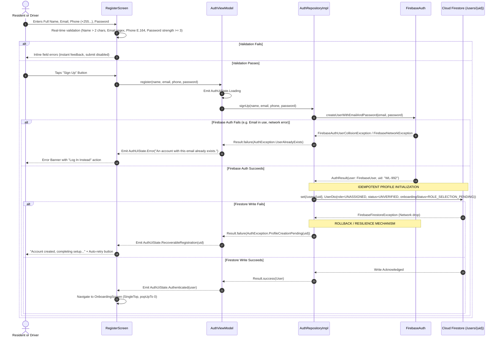
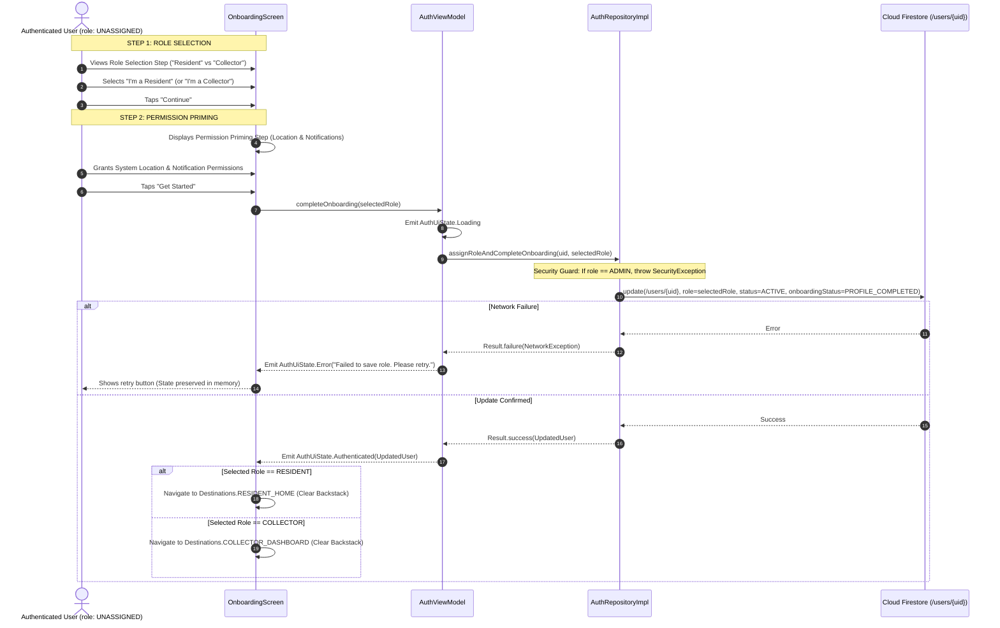
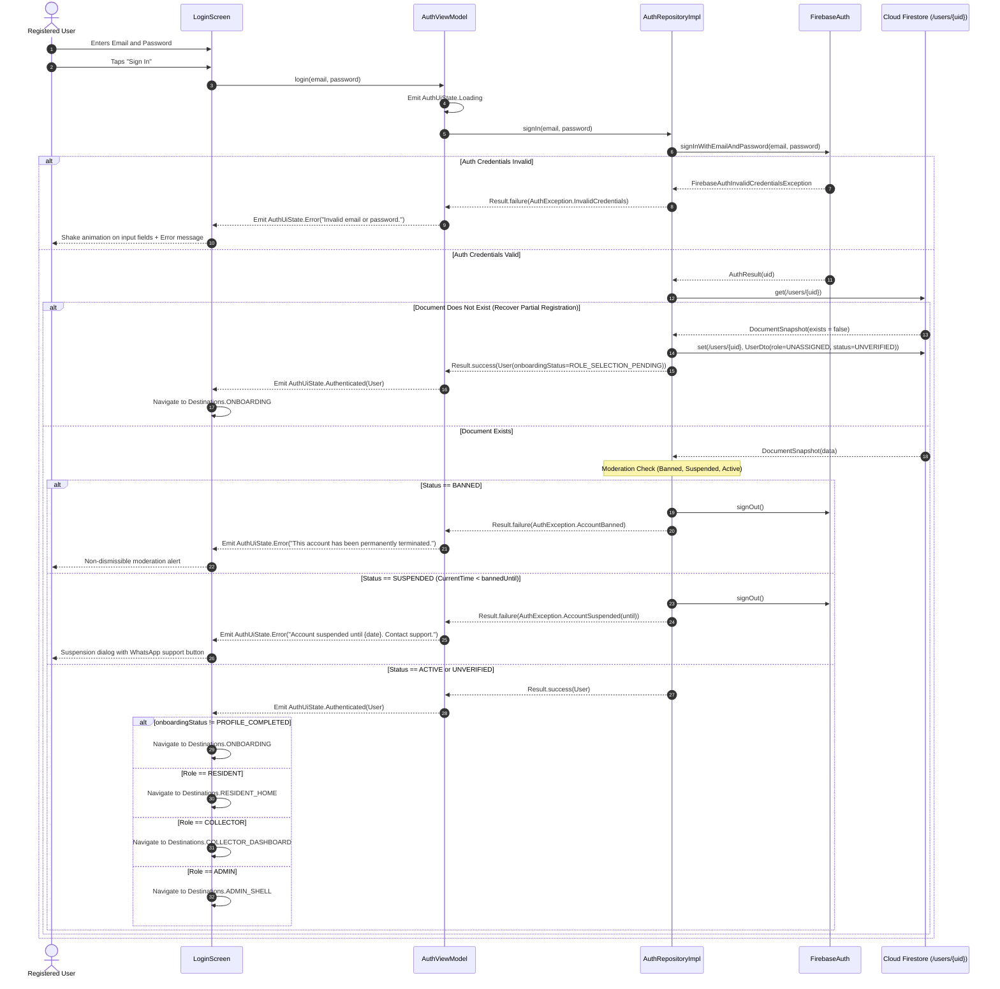
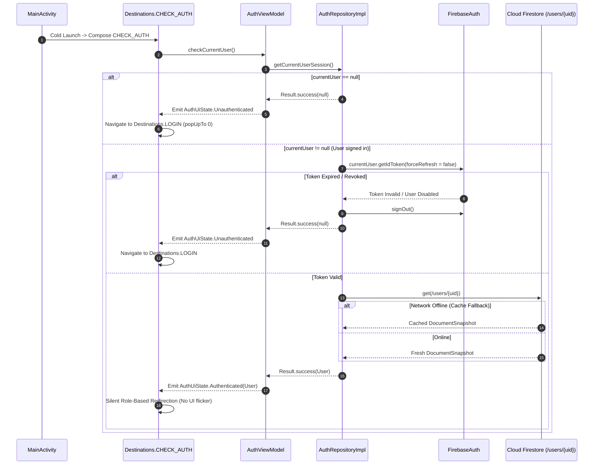
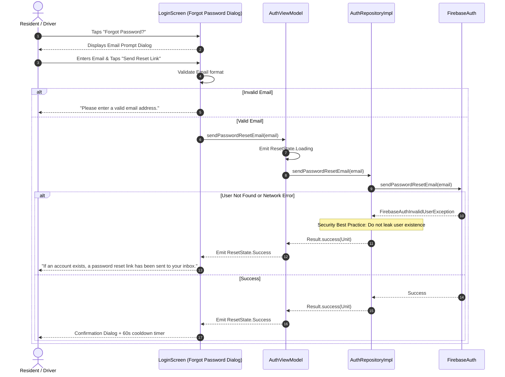
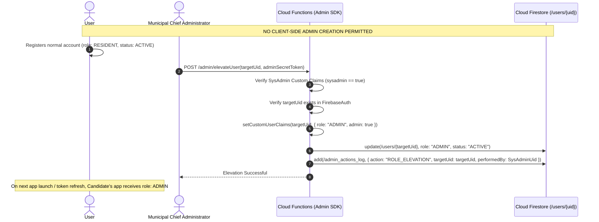

# WASTELINK — MODULE 1: AUTHENTICATION, USER IDENTITY & ROLE-BASED ONBOARDING ARCHITECTURE

**Document Version:** 1.0.0-DESIGN  
**Status:** PROPOSED ARCHITECTURAL SPECIFICATION (DESIGN-ONLY)  
**Date:** November 4, 2026  
**Audience:** Product Owner, Lead Technical Authority (ChatGPT), Mobile Engineering Team  
**Governing Principles:** Flow-First Development, Zero Dummy Interactions, Strict Idempotency, Zero Client Elevation  

---

## 1. Existing Authentication Architecture Assessment

A comprehensive audit of the existing authentication implementation on branch `rebuild/foundation` revealed several operational strengths, alongside critical structural vulnerabilities and architectural fragmentation:

### 1.1 Current Architecture & Flow
- **Entry Gate:** [WasteLinkNavGraph.kt](file:///C:/Users/JogerBee/Desktop/WasteLink/app/src/main/java/com/waste/link/ui/WasteLinkNavGraph.kt) sets `startDestination = Destinations.CHECK_AUTH`. A `LaunchedEffect` triggers `authViewModel.checkCurrentUser()`.
- **Session Check:** [AuthViewModel.kt](file:///C:/Users/JogerBee/Desktop/WasteLink/app/src/main/java/com/waste/link/ui/auth/AuthViewModel.kt) checks `authRepository.getCurrentUserId()`. If null, it transitions to `AuthState.Idle`, routing to `Destinations.LOGIN`. If non-null, it calls `authRepository.getUserRole(uid)` and transitions to `AuthState.Authenticated(user)`.
- **Navigation Dispatch:** [WasteLinkNavGraph.kt](file:///C:/Users/JogerBee/Desktop/WasteLink/app/src/main/java/com/waste/link/ui/WasteLinkNavGraph.kt#L60-L70) redirects based on `user.role`:
  - `"unassigned"` -> `Destinations.ONBOARDING` ([OnboardingScreen.kt](file:///C:/Users/JogerBee/Desktop/WasteLink/app/src/main/java/com/waste/link/ui/auth/OnboardingScreen.kt))
  - `"collector"` -> `Destinations.COLLECTOR_DASHBOARD`
  - `"admin"` or `"resident"` -> `Destinations.RESIDENT_HOME`
- **Role Assignment:** In [OnboardingScreen.kt](file:///C:/Users/JogerBee/Desktop/WasteLink/app/src/main/java/com/waste/link/ui/auth/OnboardingScreen.kt), the user selects "Resident" or "Collector", which calls `authViewModel.setRole(role)`, executing [AuthRepositoryImpl.kt](file:///C:/Users/JogerBee/Desktop/WasteLink/app/src/main/java/com/waste/link/data/repository/AuthRepositoryImpl.kt#L44-L56) to mutate `/users/{uid}.role` from `"unassigned"` to `"resident"` or `"collector"`.

### 1.2 Critical Deficiencies & Fragility Points in Current Code
1. **Severe Model Divergence (`AppUser` vs `User`):**
   - [AppUser.kt](file:///C:/Users/JogerBee/Desktop/WasteLink/app/src/main/java/com/waste/link/data/models/AppUser.kt) is used by [AuthRepository.kt](file:///C:/Users/JogerBee/Desktop/WasteLink/app/src/main/java/com/waste/link/data/repository/AuthRepository.kt) and [AuthViewModel.kt](file:///C:/Users/JogerBee/Desktop/WasteLink/app/src/main/java/com/waste/link/ui/auth/AuthViewModel.kt). It uses lowercase String roles (`"resident"`, `"collector"`, `"admin"`, `"unassigned"`) and Long millisecond timestamps.
   - [User.kt](file:///C:/Users/JogerBee/Desktop/WasteLink/app/src/main/java/com/waste/link/data/models/User.kt) exists in parallel in `com.waste.link.data.models`. It uses uppercase String roles (`"CLIENT"`, `"WASTE_COMPANY"`, `"ADMIN"`), `@DocumentId`, `@ServerTimestamp`, and `java.util.Date`.
   - This creates an architectural fracture where different parts of the application expect different field names and casing.
2. **The "Ghost Account" Failure (Partial Registration):**
   - In [AuthRepositoryImpl.kt](file:///C:/Users/JogerBee/Desktop/WasteLink/app/src/main/java/com/waste/link/data/repository/AuthRepositoryImpl.kt#L21-L37), `signUp()` first executes `auth.createUserWithEmailAndPassword(email, password).await()`, and immediately attempts `firestore.collection("users").document(uid).set(appUser).await()`.
   - **Vulnerability:** If the network drops, or Firestore rules reject the write, or the app process is terminated between lines 21 and 37, the Firebase Auth account exists, but the Firestore user document is never written.
   - **Resulting Bug:** When the user subsequently attempts to log in, `getUserRole(uid)` throws `Exception("User document not found")`. In `AuthViewModel.kt` lines 36-40, this failure simply triggers `authRepository.signOut()` and dumps the user back to `AuthState.Idle`. The user is permanently locked out—they cannot register again (Firebase reports "email already in use") and cannot log in (app reports document missing).
3. **Unchecked Client Fallback in `signIn()`:**
   - In [AuthRepositoryImpl.kt](file:///C:/Users/JogerBee/Desktop/WasteLink/app/src/main/java/com/waste/link/data/repository/AuthRepositoryImpl.kt#L65-L75), when `getUserRole(uid)` fails during sign-in, the repository silently creates a synthetic dummy user document:
     ```kotlin
     val appUser = AppUser(uid = uid, name = "User", email = email, phone = "Not provided", role = "resident", status = "ACTIVE")
     firestore.collection("users").document(uid).set(appUser).await()
     ```
   - **Vulnerability:** This bypasses onboarding, ignores collector profile fields, and fabricates fake profile data without user consent or validation.
4. **Lack of Input Sanitization & Pre-Flight Validation:**
   - [RegisterScreen.kt](file:///C:/Users/JogerBee/Desktop/WasteLink/app/src/main/java/com/waste/link/ui/auth/RegisterScreen.kt) collects `name`, `email`, `phone`, `password`, but sends raw strings directly to `signUp()` on button click without pre-validating email format regex, phone number formatting, or minimum password complexity.
5. **Orphaned Legacy Auth Screens:**
   - [SplashScreen.kt](file:///C:/Users/JogerBee/Desktop/WasteLink/app/src/main/java/com/waste/link/ui/auth/SplashScreen.kt) contains obsolete `signInAnonymously()` calls and an unauthenticated `Admin Portal ->` bypass button.
   - [AdminLoginScreen.kt](file:///C:/Users/JogerBee/Desktop/WasteLink/app/src/main/java/com/waste/link/ui/admin/AdminLoginScreen.kt) contains hardcoded credentials (`admin@wastelink.co.tz` / `admin123`).
   - Both screens are currently orphaned from navigation and must be purged or replaced by standard role-guarded routes.

---

## 2. Canonical User Model Proposal

To eliminate schema divergence, we establish a strict separation between the **Domain Model** (pure Kotlin business entity), the **Data Transfer Object (DTO)** (Firebase Firestore mapping), and the **Local Database Entity** (Room SQLite offline caching).

### 2.1 Domain Layer: Canonical Entity (`domain/model/User.kt`)

```kotlin
package com.waste.link.domain.model

enum class UserRole {
    RESIDENT,       // Municipal resident or business creating waste pickups
    COLLECTOR,      // Waste truck driver or private fleet operator
    ADMIN,          // Municipal regulator or operations dispatcher
    UNASSIGNED      // Newly registered user awaiting onboarding role selection
}

enum class AccountStatus {
    UNVERIFIED,     // Registered, pending phone/email or document verification
    ACTIVE,         // Fully authorized for daily operations
    RESTRICTED,     // Limited operations (e.g., driver contract review, dispute flag)
    SUSPENDED,      // Temporarily blocked due to policy violations (until timestamp)
    BANNED          // Permanently terminated
}

enum class OnboardingStatus {
    ROLE_SELECTION_PENDING, // Needs to pick Resident vs Collector
    PERMISSIONS_PENDING,    // Needs location & push notification priming
    PROFILE_COMPLETED       // Fully ready for primary dashboard
}

data class User(
    val id: String,                         // Firebase Auth UID
    val email: String,                      // Primary contact & login email
    val fullName: String,                   // Display & billing name
    val phoneNumber: String,                // E.164 formatted phone number (+255...)
    val role: UserRole,                     // Canonical user role
    val status: AccountStatus,              // Lifecycle status
    val onboardingStatus: OnboardingStatus, // Progression through onboarding
    val isEmailVerified: Boolean,           // Firebase Auth email verification flag
    val isPhoneVerified: Boolean,           // SMS OTP verification flag
    val preferredLanguage: String,          // "en" or "sw"
    val avatarUrl: String?,                 // Storage URL or null
    val createdAt: Long,                    // Epoch millis
    val updatedAt: Long,                    // Epoch millis
    val bannedUntil: Long?,                 // Epoch millis if SUSPENDED, else null
    val suspensionReason: String?           // Human-readable reason for moderation
) {
    val isOperational: Boolean
        get() = status == AccountStatus.ACTIVE && onboardingStatus == OnboardingStatus.PROFILE_COMPLETED

    val canAccessAdmin: Boolean
        get() = role == UserRole.ADMIN && status == AccountStatus.ACTIVE
}
```

### 2.2 Data Layer: Firestore DTO (`data/model/UserDto.kt`)

```kotlin
package com.waste.link.data.model

import com.google.firebase.firestore.DocumentId
import com.google.firebase.firestore.ServerTimestamp
import com.waste.link.domain.model.AccountStatus
import com.waste.link.domain.model.OnboardingStatus
import com.waste.link.domain.model.User
import com.waste.link.domain.model.UserRole
import java.util.Date

/**
 * Firestore serialization schema for /users/{uid}
 */
data class UserDto(
    @DocumentId
    val id: String = "",
    val email: String = "",
    val fullName: String = "",
    val phoneNumber: String = "",
    val role: String = UserRole.UNASSIGNED.name,
    val status: String = AccountStatus.UNVERIFIED.name,
    val onboardingStatus: String = OnboardingStatus.ROLE_SELECTION_PENDING.name,
    val isEmailVerified: Boolean = false,
    val isPhoneVerified: Boolean = false,
    val preferredLanguage: String = "en",
    val avatarUrl: String? = null,
    val bannedUntil: Long? = null,
    val suspensionReason: String? = null,
    @ServerTimestamp
    val createdAt: Date? = null,
    @ServerTimestamp
    val updatedAt: Date? = null
) {
    fun toDomain(): User = User(
        id = id,
        email = email,
        fullName = fullName,
        phoneNumber = phoneNumber,
        role = try { UserRole.valueOf(role) } catch (e: Exception) { UserRole.UNASSIGNED },
        status = try { AccountStatus.valueOf(status) } catch (e: Exception) { AccountStatus.UNVERIFIED },
        onboardingStatus = try { OnboardingStatus.valueOf(onboardingStatus) } catch (e: Exception) { OnboardingStatus.ROLE_SELECTION_PENDING },
        isEmailVerified = isEmailVerified,
        isPhoneVerified = isPhoneVerified,
        preferredLanguage = preferredLanguage,
        avatarUrl = avatarUrl,
        createdAt = createdAt?.time ?: System.currentTimeMillis(),
        updatedAt = updatedAt?.time ?: System.currentTimeMillis(),
        bannedUntil = bannedUntil,
        suspensionReason = suspensionReason
    )

    companion object {
        fun fromDomain(user: User): UserDto = UserDto(
            id = user.id,
            email = user.email,
            fullName = user.fullName,
            phoneNumber = user.phoneNumber,
            role = user.role.name,
            status = user.status.name,
            onboardingStatus = user.onboardingStatus.name,
            isEmailVerified = user.isEmailVerified,
            isPhoneVerified = user.isPhoneVerified,
            preferredLanguage = user.preferredLanguage,
            avatarUrl = user.avatarUrl,
            bannedUntil = user.bannedUntil,
            suspensionReason = user.suspensionReason
        )
    }
}
```

---

## 3. End-to-End Authentication Workflow Specifications

### 3.1 Resident & Collector Registration Workflow



### 3.2 Role-Based Onboarding & Permission Priming Workflow



### 3.3 Login & Session Recovery Workflow



### 3.4 Cold Start Session Restoration Workflow



### 3.5 Password Recovery Workflow



### 3.6 Secure Administrator Provisioning Workflow



---

## 4. Partial Registration Recovery & Idempotency Strategy

### The Problem
If network disconnects after Firebase Auth creates an account, but before Firestore writes the initial document, standard registration fails and subsequent registration attempts are blocked with `ERROR_EMAIL_ALREADY_IN_USE`.

### The Solution: 3-Tier Idempotent Reconciler
1. **Pre-Creation Check:** Before attempting `createUserWithEmailAndPassword`, check if credentials belong to an interrupted registration.
2. **Atomic Recovery Interceptor:** When `createUserWithEmailAndPassword` throws `FirebaseAuthUserCollisionException`:
   - Attempt `signInWithEmailAndPassword` using the provided credentials.
   - If sign-in succeeds, check Firestore for `/users/{uid}`.
   - If document is missing or `role == UNASSIGNED`, execute the document creation transparently and proceed to `Destinations.ONBOARDING`.
3. **Session Recovery Gate in `checkCurrentUser()`:**
   - If an authenticated session has no Firestore document, auto-initialize a minimal document with `role = UNASSIGNED` and `onboardingStatus = ROLE_SELECTION_PENDING` so the user is guided directly through onboarding rather than thrown to a broken state.

---

## 5. Complete Button & Interaction Registry (Module 1)

| Interaction ID | Screen / Component | Element Description | Preconditions | Triggered Business Action | Destination / UI Effect | Loading State | Failure Behavior |
| :--- | :--- | :--- | :--- | :--- | :--- | :--- | :--- |
| `INT-AUTH-001` | `LoginScreen` | "Sign In" Button | Email & password non-empty | `authViewModel.signIn(email, password)` | Route to role shell based on Firestore | Button spinner | Error banner with shake animation |
| `INT-AUTH-002` | `LoginScreen` | "Create Account" Link | None | Navigate | `Destinations.REGISTER` | None | Instant navigation |
| `INT-AUTH-003` | `LoginScreen` | "Forgot Password?" Button | None | Opens reset dialog | Reset Dialog appears | None | Instant popup |
| `INT-AUTH-004` | `LoginScreen` | "Send Reset Link" Button | Valid email in dialog | `authViewModel.sendPasswordResetEmail(email)` | Confirmation dialog with 60s cooldown | Button spinner | Error message in dialog |
| `INT-AUTH-005` | `RegisterScreen` | "Sign Up" Button | Name, Email, Phone, Password pass regex | `authViewModel.signUp(...)` | `Destinations.ONBOARDING` | Button spinner | Inline red error text under failed field |
| `INT-AUTH-006` | `RegisterScreen` | "Already have account? Login" | None | Navigate | `Destinations.LOGIN` (Pop backstack) | None | Pops to login |
| `INT-AUTH-007` | `OnboardingScreen` | "I'm a Resident" Card | In Onboarding step 1 | Selects `resident` in state | Card highlights with white border | None | Instant state change |
| `INT-AUTH-008` | `OnboardingScreen` | "I'm a Collector" Card | In Onboarding step 1 | Selects `collector` in state | Card highlights with white border | None | Instant state change |
| `INT-AUTH-009` | `OnboardingScreen` | "Continue" Button | Role is selected | Advances to step 2 | Transitions to Permission Priming | None | Disabled if no role selected |
| `INT-AUTH-010` | `OnboardingScreen` | "Allow Notifications" Button | In Onboarding step 2 | Requests POST_NOTIFICATIONS permission | System permission sheet | None | Icon changes to checkmark |
| `INT-AUTH-011` | `OnboardingScreen` | "Get Started" Button | In Onboarding step 2 | `authViewModel.setRole(selectedRole)` | Route to `resident_home` or `collector_dashboard` | Button spinner | Error dialog with retry action |
| `INT-AUTH-012` | `ProfileScreen` | "Log Out" Button | Authenticated | `authViewModel.signOut()` | Clears backstack -> `Destinations.LOGIN` | Modal spinner | Error toast |

---

## 6. Comprehensive Test Plan for Module 1

### 6.1 Domain Unit Tests (`app/src/test/java/com/waste/link/domain/`)
1. **`UserValidationTest`**:
   - Asserts valid emails pass, invalid formats (`test@`, `@domain`, `plainaddress`) fail.
   - Asserts E.164 phone formats (`+255712345678`) pass, invalid lengths fail.
   - Asserts password strength scoring correctly grades weak (< 8 chars, no digits) vs strong (upper + digit + special).
2. **`UserRoleSecurityTest`**:
   - Asserts `UserRole.valueOf("ADMIN")` cannot be assigned via client onboarding logic.
   - Asserts `canAccessAdmin` returns `true` only when `role == ADMIN` and `status == ACTIVE`.

### 6.2 Repository Integration Tests (`app/src/test/java/com/waste/link/data/repository/`)
1. **`AuthRepositorySignUpTest`**:
   - Test successful sign-up initializes Firestore document with `UNASSIGNED` and `UNVERIFIED`.
   - Test network failure during Firestore write triggers recoverable state.
   - Test email collision invokes partial registration recovery.
2. **`AuthRepositorySignInTest`**:
   - Test invalid password returns user-friendly `AuthException.InvalidCredentials`.
   - Test user with status `BANNED` triggers immediate sign-out and throws ban exception.
   - Test user with status `SUSPENDED` and future `bannedUntil` throws suspension exception with date.
   - Test missing Firestore document auto-recovers into `ONBOARDING` route.
3. **`AuthRepositorySetRoleTest`**:
   - Test setting `"resident"` updates document and returns `ACTIVE` status.
   - Test setting `"collector"` updates document and returns `ACTIVE` status.
   - Test setting `"admin"` throws `IllegalArgumentException` and rejects write.

### 6.3 ViewModel State Tests (`app/src/test/java/com/waste/link/ui/auth/`)
1. **`AuthViewModelTest`**:
   - Test `checkCurrentUser()` with null UID emits `AuthState.Idle`.
   - Test `signIn()` emits `AuthState.Loading` followed by `AuthState.Authenticated`.
   - Test `signIn()` error emits `AuthState.Error` without crashing.
   - Test `signOut()` resets state to `AuthState.Idle`.

### 6.4 Emulator End-to-End User Journey Tests (`connectedAndroidTest`)
1. **Resident Registration Journey**: Launch -> Register -> Select Resident -> Grant Permissions -> Verify Landing on Resident Home Screen.
2. **Collector Registration Journey**: Launch -> Register -> Select Collector -> Verify Landing on Collector Dashboard.
3. **Incorrect Login Journey**: Launch -> Login with wrong password -> Verify Error Banner visible -> Verify retry works.
4. **App Restart Session Restore Journey**: Authenticate as Resident -> Kill process (`am kill`) -> Relaunch -> Verify landing directly on Resident Home Screen without login prompt.

---

## 7. Definition of Done for Module 1

Module 1 is complete only when:
- [ ] Canonical `User` domain model and `UserDto` are implemented, replacing competing `AppUser` and `User` models.
- [ ] `AuthRepository` and `AuthRepositoryImpl` implement idempotent sign-up, secure sign-in, role setting, and partial registration recovery.
- [ ] `RegisterScreen` features real-time input validation and password strength indicators.
- [ ] `LoginScreen` handles invalid credentials, account suspension, and password resets with zero crashes.
- [ ] Client-side admin elevation is strictly prohibited and tested.
- [ ] All 12 interaction contracts in the Interaction Registry are functional.
- [ ] 100% of Module 1 unit tests pass (`./gradlew testDebugUnitTest`).
- [ ] End-to-end registration, login, and session restoration journeys are verified on the Android emulator.
- [ ] Code is committed and pushed to `rebuild/foundation` with a descriptive message.

---

## 8. Outstanding Product Owner Decisions

1. **Phone Number Verification Requirement:**  
   - *SRS REQ-AUTH-001* specifies Firebase Phone Auth with SMS Retriever API, while *REQ-002* specifies Email/Password registration.
   - *Current Implementation:* Uses Email/Password + Phone number collection.
   - *Architectural Recommendation:* Maintain Email/Password as primary authentication for Module 1, collecting phone numbers as an identity field. In Module 8, add optional Firebase SMS OTP verification to prevent SMS cost overhead during early rollout.
2. **Collector Identity Verification Gate:**  
   - Should a newly registered Collector be immediately allowed to accept jobs (`status: ACTIVE`), or must an administrator verify driving license and vehicle registration in `AdminFleetPane` before status changes from `UNVERIFIED` to `ACTIVE`?
   - *Architectural Recommendation:* Default newly registered collectors to `status = UNVERIFIED` and display a "Pending Approval" card on the collector dashboard until municipal admin approves them.
3. **Password Reset Medium:**  
   - Confirm that standard Firebase email reset links (`sendPasswordResetEmail`) are acceptable for Tanzanian metropolitan users, or if an SMS-based OTP reset workflow is strictly required.

---

## 9. Exact Files Expected to Change During Module 1 Implementation

### New Files to Create:
1. `app/src/main/java/com/waste/link/domain/model/User.kt` (Canonical Domain Entity)
2. `app/src/main/java/com/waste/link/data/model/UserDto.kt` (Firestore DTO)
3. `app/src/main/java/com/waste/link/domain/util/AuthValidator.kt` (Regex & Password Strength Helper)
4. `app/src/test/java/com/waste/link/domain/UserValidationTest.kt` (Unit tests)
5. `app/src/test/java/com/waste/link/data/repository/AuthRepositoryTest.kt` (Repository unit tests)
6. `app/src/test/java/com/waste/link/ui/auth/AuthViewModelTest.kt` (ViewModel unit tests)

### Existing Files to Modify / Refactor:
1. `app/src/main/java/com/waste/link/data/repository/AuthRepository.kt` (Migrate from `AppUser` to canonical `User`)
2. `app/src/main/java/com/waste/link/data/repository/AuthRepositoryImpl.kt` (Implement idempotent recovery, validation, canonical DTO)
3. `app/src/main/java/com/waste/link/ui/auth/AuthViewModel.kt` (Clean state management, validation flows, reset email cooldown)
4. `app/src/main/java/com/waste/link/ui/auth/RegisterScreen.kt` (Add inline regex feedback, password strength bar)
5. `app/src/main/java/com/waste/link/ui/auth/LoginScreen.kt` (Add forgot password dialog, error banner styling)
6. `app/src/main/java/com/waste/link/ui/auth/OnboardingScreen.kt` (Bind canonical UserRole, permission priming callback)
7. `app/src/main/java/com/waste/link/ui/WasteLinkNavGraph.kt` (Ensure route guard passes canonical user to destinations)
8. `app/src/main/java/com/waste/link/ui/profile/ProfileViewModel.kt` (Update user references to canonical model)

### Obsolete Files to Delete in Module 1:
1. `app/src/main/java/com/waste/link/data/models/AppUser.kt` (Superseded by canonical model)
2. `app/src/main/java/com/waste/link/data/models/User.kt` (Superseded by canonical model)
3. `app/src/main/java/com/waste/link/ui/auth/SplashScreen.kt` (Dead code with insecure anonymous sign-in)
4. `app/src/main/java/com/waste/link/ui/admin/AdminLoginScreen.kt` (Dead code with hardcoded credentials)

---
*End of Module 1 Authentication Architecture Proposal.*
