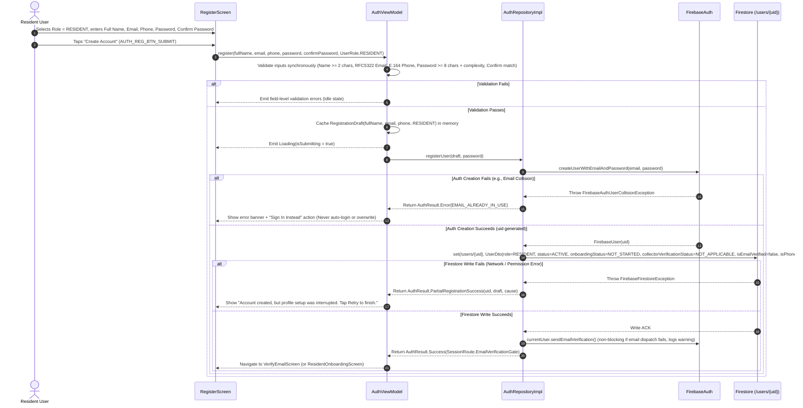
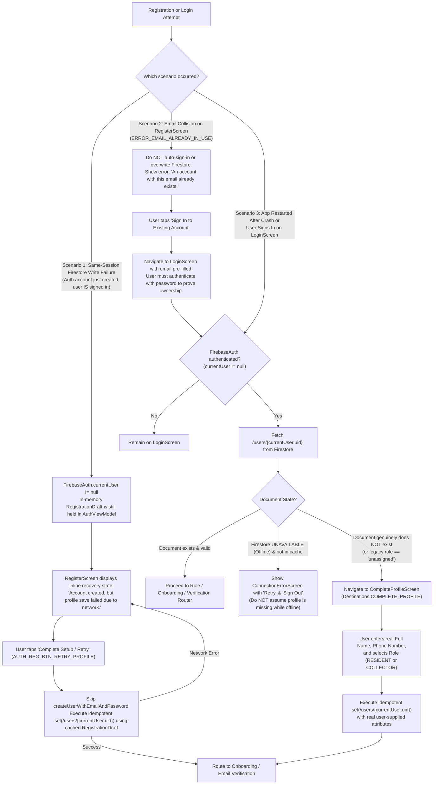
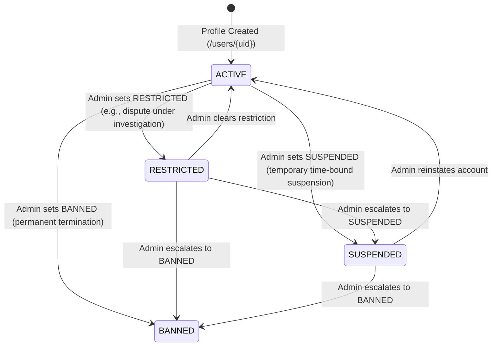
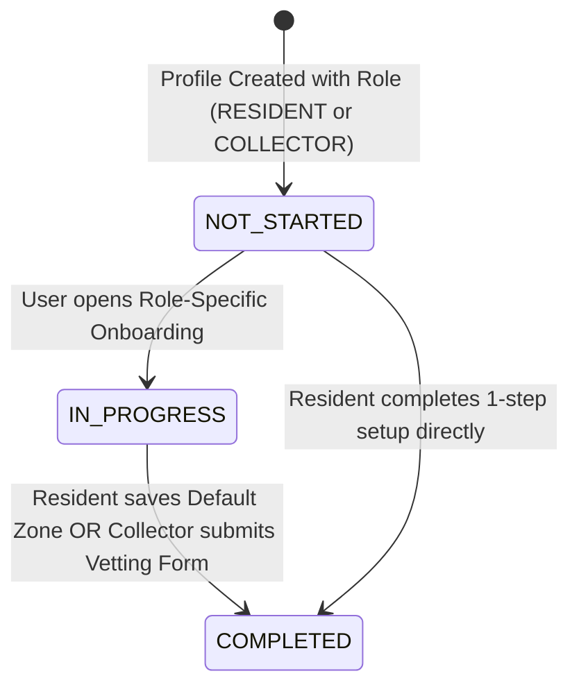
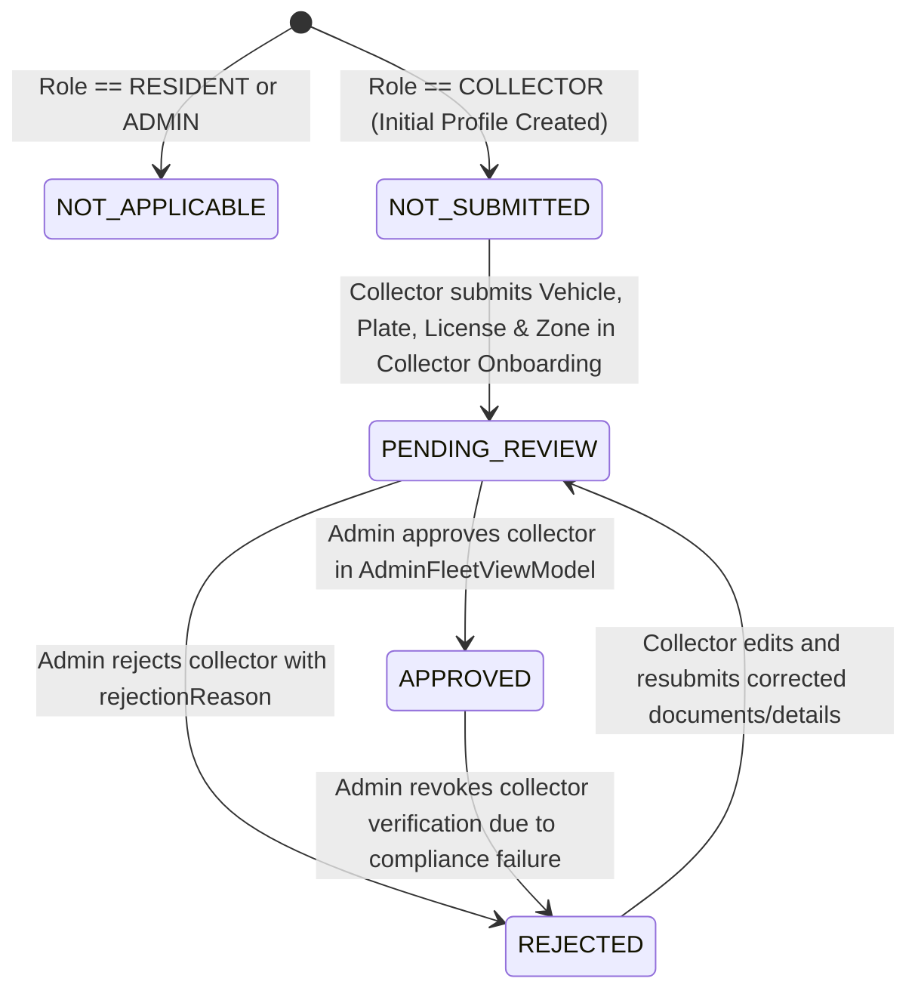
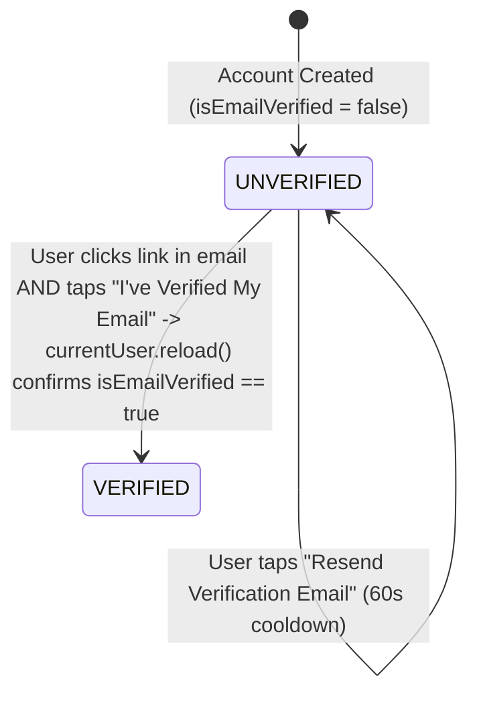
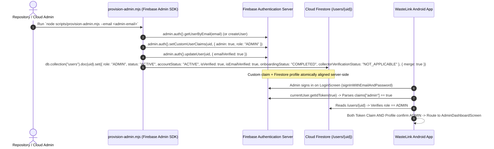
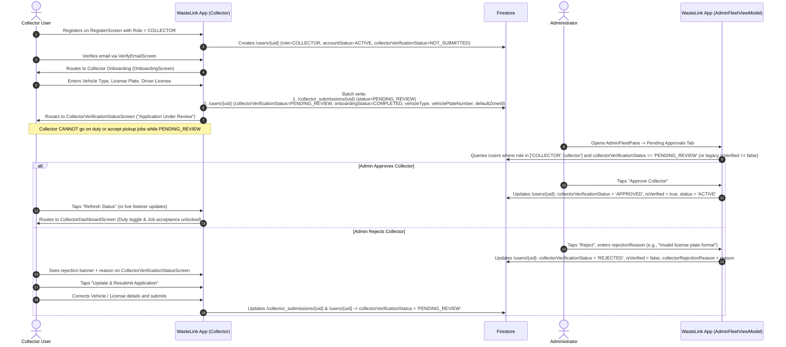
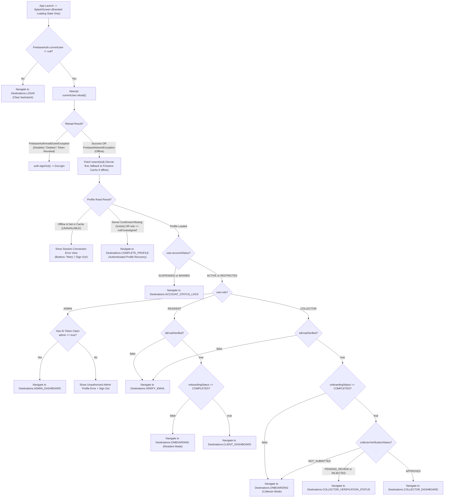

# WASTELINK — MODULE 1: IDENTITY, AUTHENTICATION, USER PROFILES & ROLE-BASED ONBOARDING
## Revised Architecture & Workflow Design Specification (v2.0 — Post-Architecture Review)

- **Document Status:** Revised Final Design Proposal — Awaiting Lead Architect (ChatGPT) & Product Owner Approval
- **Target Branch:** `rebuild/foundation`
- **Module Scope:** Module 1 (Identity, Authentication, User Profiles, Role-Based Onboarding, Collector Verification, Session Restoration, Security Rules)
- **Execution Authorization:** Documentation & Design Corrections Only (Zero Application Code Modified)

---

## Table of Contents

1. [Corrected Canonical User Model](#1-corrected-canonical-user-model)
2. [Complete Registration and Recovery Workflows](#2-complete-registration-and-recovery-workflows)
3. [Final Account Lifecycle State Machine](#3-final-account-lifecycle-state-machine)
4. [Corrected Role and Permission Matrix](#4-corrected-role-and-permission-matrix)
5. [Secure Firestore Rules Design & Emulator Verification Plan](#5-secure-firestore-rules-design--emulator-verification-plan)
6. [Server-Side Administrator Provisioning](#6-server-side-administrator-provisioning)
7. [Collector Approval Workflow](#7-collector-approval-workflow)
8. [Corrected Session Management and Navigation Architecture](#8-corrected-session-management-and-navigation-architecture)
9. [Existing Data Compatibility and Migration Strategy](#9-existing-data-compatibility-and-migration-strategy)
10. [Complete Authentication Interaction Registry](#10-complete-authentication-interaction-registry)
11. [Expanded Testing and Acceptance Criteria](#11-expanded-testing-and-acceptance-criteria)
12. [Final Implementation Sequence and File Impact Manifest](#12-final-implementation-sequence-and-file-impact-manifest)
13. [Remaining Product-Owner Decisions Before Coding](#13-remaining-product-owner-decisions-before-coding)

---

## 1. Corrected Canonical User Model

### 1.1 Architectural Separation of Concerns

In the legacy codebase ([`AppUser.kt`](file:///C:/Users/JogerBee/Desktop/WasteLink/app/src/main/java/com/waste/link/data/models/AppUser.kt) and [`User.kt`](file:///C:/Users/JogerBee/Desktop/WasteLink/app/src/main/java/com/waste/link/data/models/User.kt)), account standing, onboarding progress, email verification, collector fleet approval, and moderation metadata were conflated into overloaded string and boolean fields (`status = "UNVERIFIED"`, `role = "unassigned"`, `isVerified = false`).

The revised Module 1 architecture enforces strict orthogonality across **six distinct domain dimensions**:

1. **`UserRole` (Immutable Business Identity):** Selected **once** during registration (`RESIDENT` or `COLLECTOR`) or provisioned server-side (`ADMIN`). There is **no `UNASSIGNED` role**. Once persisted in `/users/{uid}`, `role` is permanently immutable by the client.
2. **`AccountStatus` (Administrative Account Standing):** Represents whether the user's account is in good standing (`ACTIVE`, `RESTRICTED`, `SUSPENDED`, `BANNED`). New accounts always initialize as `ACTIVE`. Only an authorized Administrator or backend Cloud Function may transition `AccountStatus`.
3. **`OnboardingStatus` (Role-Specific Setup Progress):** Tracks whether the user has completed their post-registration role setup (`NOT_STARTED`, `IN_PROGRESS`, `COMPLETED`). Device runtime permissions (notifications, location) are **never** required to transition `OnboardingStatus` to `COMPLETED`.
4. **`EmailVerification` (Authentication Identity Proof):** Derived from `FirebaseAuth.currentUser.isEmailVerified` after calling `currentUser.reload()`. Stored in Firestore only as a read-only projection synced after verification; never trusted from arbitrary client writes.
5. **`PhoneVerification` (Contact Attribute vs. Verified Claim):** In Module 1, `phoneNumber` is collected and validated (E.164 format) as **contact metadata only**, with `isPhoneVerified = false`. No workflow may treat `phoneNumber` as verified until Firebase Phone Auth OTP or a trusted backend SMS verification service is implemented.
6. **`CollectorVerificationStatus` (Operational Fleet Vetting):** Separates collector credential/vehicle vetting (`NOT_APPLICABLE`, `NOT_SUBMITTED`, `PENDING_REVIEW`, `APPROVED`, `REJECTED`) from `AccountStatus`. A newly registered collector has `AccountStatus.ACTIVE` and `CollectorVerificationStatus.NOT_SUBMITTED`.

### 1.2 Separation of Public/Owner Profile vs. Internal Moderation Data

To prevent ordinary users from reading internal administrative audit trails or mutating moderation timers (`bannedUntil`, `contractUntil`, `deletedAt`, `moderationNotes`), user data is split across two Firestore collections:

- **`/users/{uid}`:** The primary user profile document readable by the authenticated owner (`request.auth.uid == uid`) and administrators (`request.auth.token.admin == true`). Contains `status` (`ACTIVE`, `RESTRICTED`, `SUSPENDED`, `BANNED`) and `collectorVerificationStatus` so the client app can render appropriate status screens, plus read-only `statusReason` / `rejectionReason` strings written exclusively by admins.
- **`/user_moderation/{uid}`:** Restricted administrative moderation ledger readable and writable **only** by administrators (`request.auth.token.admin == true`). Stores `bannedUntil`, `suspendedUntil`, `contractUntil`, `deletedAt`, `moderatedByUid`, `moderatedAt`, and internal `adminNotes`.
- **`/collector_submissions/{uid}`:** Stores collector vetting details submitted during Collector Onboarding (`vehicleType`, `plateNumber`, `licenseNumber`, `serviceZone`, `submittedAt`, `reviewedByUid`, `reviewedAt`, `rejectionReason`).

### 1.3 Canonical Domain Models (`domain/model/User.kt`)

```kotlin
package com.waste.link.domain.model

enum class UserRole {
    RESIDENT,
    COLLECTOR,
    ADMIN;

    companion object {
        fun fromLegacyString(value: String?): UserRole? = when (value?.trim()?.uppercase()) {
            "RESIDENT", "CLIENT" -> RESIDENT
            "COLLECTOR", "WASTE_COMPANY" -> COLLECTOR
            "ADMIN" -> ADMIN
            else -> null // "unassigned" or null returns null, triggering profile completion recovery
        }
    }
}

enum class AccountStatus {
    ACTIVE,
    RESTRICTED,
    SUSPENDED,
    BANNED;

    companion object {
        fun fromLegacyString(value: String?): AccountStatus = when (value?.trim()?.uppercase()) {
            "RESTRICTED" -> RESTRICTED
            "SUSPENDED" -> SUSPENDED
            "BANNED" -> BANNED
            // Legacy "UNVERIFIED" or "REJECTED" on AppUser.status mapped to ACTIVE account standing
            // because verification and collector rejection are now tracked on dedicated axes.
            else -> ACTIVE
        }
    }
}

enum class OnboardingStatus {
    NOT_STARTED,
    IN_PROGRESS,
    COMPLETED
}

enum class CollectorVerificationStatus {
    NOT_APPLICABLE,
    NOT_SUBMITTED,
    PENDING_REVIEW,
    APPROVED,
    REJECTED
}

data class User(
    val id: String,                                              // Matches FirebaseAuth UID
    val fullName: String,
    val email: String,
    val phoneNumber: String,                                     // E.164 normalized contact number
    val role: UserRole,                                          // Immutable: RESIDENT, COLLECTOR, ADMIN
    val accountStatus: AccountStatus = AccountStatus.ACTIVE,     // Admin-controlled standing
    val onboardingStatus: OnboardingStatus = OnboardingStatus.NOT_STARTED,
    val isEmailVerified: Boolean = false,                        // Authoritative source: FirebaseUser.isEmailVerified
    val isPhoneVerified: Boolean = false,                        // Always false in Module 1 (contact info only)
    val collectorVerificationStatus: CollectorVerificationStatus = CollectorVerificationStatus.NOT_APPLICABLE,
    val collectorRejectionReason: String? = null,                // Admin feedback when REJECTED
    val defaultZoneId: String? = null,                           // Resident default pickup zone / Collector operating zone
    val vehicleType: String? = null,                             // Collector vehicle classification
    val vehiclePlateNumber: String? = null,                      // Collector license plate
    val preferredLanguage: String = "en",
    val createdAtEpochMs: Long = 0L,
    val updatedAtEpochMs: Long = 0L
)
```

---

## 2. Complete Registration and Recovery Workflows

### 2.1 Role Selection Consolidation (Eliminating Duplicate Selection)

In the legacy codebase, [`RegisterScreen.kt`](file:///C:/Users/JogerBee/Desktop/WasteLink/app/src/main/java/com/waste/link/ui/screens/auth/RegisterScreen.kt) collected `name`, `email`, `phone`, and `password` without a role selector, persisted `role = "unassigned"`, and then [`OnboardingScreen.kt`](file:///C:/Users/JogerBee/Desktop/WasteLink/app/src/main/java/com/waste/link/ui/screens/onboarding/OnboardingScreen.kt) asked the user to choose `"resident"` or `"collector"` in Step 1.

**Corrected Rule:**
- The user selects their account type (`RESIDENT` or `COLLECTOR`) **once** directly on [`RegisterScreen.kt`](file:///C:/Users/JogerBee/Desktop/WasteLink/app/src/main/java/com/waste/link/ui/screens/auth/RegisterScreen.kt) via a two-card segmented selector before submitting registration.
- `ADMIN` is **never** selectable in client registration or onboarding.
- When `/users/{uid}` is created, `role` is immediately written as `"RESIDENT"` or `"COLLECTOR"` and enforced as immutable by Firestore Security Rules.
- [`OnboardingScreen.kt`](file:///C:/Users/JogerBee/Desktop/WasteLink/app/src/main/java/com/waste/link/ui/screens/onboarding/OnboardingScreen.kt) is refactored into **Role-Specific Onboarding**:
  - **Resident Onboarding:** Configures the resident's primary pickup area/neighborhood (`defaultZoneId`) and optional notification opt-in.
  - **Collector Onboarding:** Collects operational vetting details (`vehicleType`, `vehiclePlateNumber`, `licenseNumber`, `serviceZone`), writes `/collector_submissions/{uid}`, and transitions `collectorVerificationStatus` from `NOT_SUBMITTED` to `PENDING_REVIEW`.

### 2.2 Workflow A: Resident Registration



#### Specification Details — Resident Registration
- **Starting Screen:** [`RegisterScreen.kt`](file:///C:/Users/JogerBee/Desktop/WasteLink/app/src/main/java/com/waste/link/ui/screens/auth/RegisterScreen.kt) (`Destinations.REGISTER`)
- **User Input:**
  - `selectedRole`: `UserRole.RESIDENT` (selected via segmented role card)
  - `fullName`: `String` (trimmed, 2–80 chars)
  - `email`: `String` (trimmed, lowercased)
  - `phoneNumber`: `String` (normalized to E.164, e.g., `+2567XXXXXXXX` or international `+` format)
  - `password`: `String` (8–64 chars, at least 1 uppercase, 1 lowercase, 1 digit)
  - `confirmPassword`: `String` (must match `password`)
- **Firebase Auth Operations:**
  1. `auth.createUserWithEmailAndPassword(email, password)`
  2. `auth.currentUser?.sendEmailVerification()`
- **Firestore Operations:**
  - Single idempotent document write to `/users/{uid}` where document ID strictly equals `auth.currentUser.uid`:
    - `id`: `uid`
    - `fullName`: `fullName`
    - `email`: `email`
    - `phoneNumber`: `normalizedPhone`
    - `role`: `"RESIDENT"`
    - `accountStatus`: `"ACTIVE"`
    - `onboardingStatus`: `"NOT_STARTED"`
    - `isEmailVerified`: `false`
    - `isPhoneVerified`: `false`
    - `collectorVerificationStatus`: `"NOT_APPLICABLE"`
    - `createdAt`: `FieldValue.serverTimestamp()`
    - `updatedAt`: `FieldValue.serverTimestamp()`

### 2.3 Workflow B: Collector Registration

- **Starting Screen:** [`RegisterScreen.kt`](file:///C:/Users/JogerBee/Desktop/WasteLink/app/src/main/java/com/waste/link/ui/screens/auth/RegisterScreen.kt) (`Destinations.REGISTER`)
- **User Input:** Same identity fields as Resident Registration, with `selectedRole = UserRole.COLLECTOR`.
- **Firestore Operations:**
  - Writes `/users/{uid}` with:
    - `role`: `"COLLECTOR"`
    - `accountStatus`: `"ACTIVE"`
    - `onboardingStatus`: `"NOT_STARTED"`
    - `collectorVerificationStatus`: `"NOT_SUBMITTED"`
    - `isEmailVerified`: `false`
    - `isPhoneVerified`: `false`
- **Next Destination:** Routes to Collector Onboarding (`Destinations.ONBOARDING`), where the collector submits vehicle type, plate number, driver/operator license number, and operating zone to transition `collectorVerificationStatus` from `NOT_SUBMITTED` to `PENDING_REVIEW` and `onboardingStatus` to `COMPLETED`.

### 2.4 Workflow C: Corrected Ghost Account & Partial Registration Recovery

A **Ghost Account** (or partial registration state) occurs when `FirebaseAuth.createUserWithEmailAndPassword` succeeds on Google's servers, creating a `FirebaseUser` with a `uid`, but the subsequent Firestore `set(/users/{uid})` fails due to network drop, process death, or timeout.

#### Strict Architectural Rules for Recovery
1. **Never create a second Firebase Authentication account** to recover a missing profile.
2. **Never fabricate placeholder user data** (such as `name = "User"` or `phone = "Not provided"` as found in legacy [`AuthRepositoryImpl.kt`](file:///C:/Users/JogerBee/Desktop/WasteLink/app/src/main/java/com/waste/link/data/repository/AuthRepositoryImpl.kt#L68-L80)).
3. **Never treat `FirebaseAuthUserCollisionException` (`ERROR_EMAIL_ALREADY_IN_USE`) during `register()` as proof of account ownership.** An unauthenticated caller typing an existing email on `RegisterScreen` has not proven they own that account until they authenticate with its password.
4. **Require successful authentication (`auth.currentUser != null`) before any profile recovery write.**
5. **Key all profile creation idempotently by `auth.currentUser.uid`.**



#### Detailed Recovery Scenarios

| Scenario | Trigger Condition | System State | Exact Recovery Mechanism |
| :--- | :--- | :--- | :--- |
| **Scenario 1: Same-Session Write Interruption** | `createUserWithEmailAndPassword` succeeds, `set(/users/{uid})` fails with `UNAVAILABLE` / `DEADLINE_EXCEEDED`. | `auth.currentUser != null` (`uid` is active). `AuthViewModel` holds `RegistrationDraft(fullName, email, phone, role)`. | `RegisterScreen` locks email/password fields and transforms primary CTA into **"Retry Profile Setup"**. Tapping it calls `authRepository.completeProfileInitialization(draft)` which writes `/users/{uid}` idempotently without calling `createUserWithEmailAndPassword` again. |
| **Scenario 2: Registration Email Collision** | User submits `RegisterScreen` with an email that already exists in `FirebaseAuth`. | `createUserWithEmailAndPassword` throws `FirebaseAuthUserCollisionException`. Caller is unauthenticated or authenticated as a different user. | Reject registration immediately. Display banner: *"This email is already registered. Please sign in to access or finish setting up your account."* Provide a **"Go to Sign In"** button that navigates to `LoginScreen` with the email pre-populated. |
| **Scenario 3: Authenticated Ghost Account (Cross-Session / Post-Restart / Legacy `"unassigned"`)** | User signs in via `LoginScreen` (proving ownership via password) OR app cold-starts with an active `FirebaseAuth.currentUser`, and a **server-confirmed** read of `/users/{uid}` returns `!snapshot.exists()` (or legacy `role == "unassigned"` / blank `fullName`). | `auth.currentUser != null` (ownership verified), but `/users/{uid}` is missing or incomplete. | Route the authenticated user to **`CompleteProfileScreen` (`Destinations.COMPLETE_PROFILE`)**. The screen pre-fills `auth.currentUser.email` (read-only) and requires the user to input their real `Full Name`, `Phone Number`, and `UserRole` (`RESIDENT` or `COLLECTOR`). Submitting performs an idempotent `set(/users/{uid})` and advances to Role-Specific Onboarding. |
| **Scenario 4: Firestore Permission Denied Error** | Client attempts to write a disallowed field or mismatched `uid`. | `FirebaseFirestoreException(PERMISSION_DENIED)` | Log structured non-PII diagnostic event, surface clear error state on screen (*"Profile creation was rejected by security policy. Please check your inputs or sign out and try again."*), and expose a **Sign Out** escape hatch so the user is never trapped. |

---

## 3. Final Account Lifecycle State Machine

Because `AccountStatus`, `OnboardingStatus`, `EmailVerification`, and `CollectorVerificationStatus` represent orthogonal dimensions, each has a deterministic, non-overlapping state machine.

### 3.1 `AccountStatus` State Machine (Administrative Standing)



### 3.2 `OnboardingStatus` State Machine (Role Setup Progress)



### 3.3 `CollectorVerificationStatus` State Machine (Fleet Vetting)



### 3.4 `EmailVerification` Lifecycle



---

## 4. Corrected Role and Permission Matrix

### 4.1 Email Verification Enforcement Policy

To balance security against onboarding friction:
- **Allowed before Email Verification (`isEmailVerified == false`):**
  - Completing Profile Recovery (`CompleteProfileScreen`) if `/users/{uid}` was missing.
  - Viewing the Email Verification Gate (`VerifyEmailScreen`), triggering `sendEmailVerification()` (with 60-second rate-limit cooldown), calling `currentUser.reload()` via **"I've Verified My Email"**, viewing account email, and signing out.
- **Blocked until Email Verification (`isEmailVerified == true`):**
  - Accessing the Resident Dashboard, creating waste pickup requests, or filing disputes (`RESIDENT`).
  - Submitting Collector Verification documents, toggling duty status, or accepting collection jobs (`COLLECTOR`).
- **Admin Exemption:** Server-provisioned `ADMIN` accounts (`request.auth.token.admin == true`) have `emailVerified = true` set via Firebase Admin SDK at provisioning time.

### 4.2 Phone Verification Policy (Module 1)

- `phoneNumber` is required during registration and validated against E.164 format (`^\+[1-9]\d{7,14}$` or local Uganda `^07\d{8}$` normalized to `+2567...`).
- Stored as `phoneNumber: String` with `isPhoneVerified = false`.
- **Used strictly as contact information** for pickup coordination. No security rule or navigation gate treats `isPhoneVerified` as an authentication factor in Module 1.

### 4.3 Comprehensive Role, Status & Verification Matrix

| Actor / State | `AccountStatus` | `isEmailVerified` | `OnboardingStatus` | `CollectorVerificationStatus` | Allowed Actions | Blocked Actions | Target Navigation Destination |
| :--- | :--- | :--- | :--- | :--- | :--- | :--- | :--- |
| **Unauthenticated** | N/A | N/A | N/A | N/A | Login, Register, Password Reset | All authenticated routes & Firestore reads/writes | `Destinations.LOGIN` |
| **Authenticated Ghost Account** | Missing `/users/{uid}` | Any | N/A | N/A | Submit `CompleteProfileScreen`, Sign Out | All dashboards, onboarding, operational features | `Destinations.COMPLETE_PROFILE` |
| **Any Role (Suspended / Banned)** | `SUSPENDED` or `BANNED` | Any | Any | Any | View `AccountStatusLockScreen` (reason, support contact), Sign Out | All operational dashboards, profile edits, pickup creation | `Destinations.ACCOUNT_STATUS_LOCK` |
| **Resident (Unverified Email)** | `ACTIVE` or `RESTRICTED` | `false` | Any | `NOT_APPLICABLE` | Resend verification email, tap "I've Verified" (`reload()`), Sign Out | Resident onboarding completion, Resident Dashboard, creating pickups | `Destinations.VERIFY_EMAIL` |
| **Resident (Onboarding Incomplete)** | `ACTIVE` | `true` | `NOT_STARTED` / `IN_PROGRESS` | `NOT_APPLICABLE` | Select primary neighborhood/zone, optional notification prompt, Sign Out | Creating pickup requests until onboarding completed | `Destinations.ONBOARDING` (Resident Mode) |
| **Resident (Active & Verified)** | `ACTIVE` | `true` | `COMPLETED` | `NOT_APPLICABLE` | Full Resident Dashboard, schedule pickups, track requests, view history, edit own name/phone/zone | Collector routes, Admin routes, modifying own `role` or `status` | `Destinations.CLIENT_DASHBOARD` |
| **Resident (Restricted)** | `RESTRICTED` | `true` | `COMPLETED` | `NOT_APPLICABLE` | View existing pickup history, view dispute status, view profile, Sign Out | Creating new pickup requests while restriction is active | `Destinations.CLIENT_DASHBOARD` (Restricted Banner) |
| **Collector (Unverified Email)** | `ACTIVE` | `false` | Any | Any | Resend verification email, tap "I've Verified" (`reload()`), Sign Out | Submitting collector verification, viewing jobs, going on duty | `Destinations.VERIFY_EMAIL` |
| **Collector (Not Submitted)** | `ACTIVE` | `true` | `NOT_STARTED` / `IN_PROGRESS` | `NOT_SUBMITTED` | Fill & submit Collector Onboarding (vehicle type, plate, license, zone), Sign Out | Going on duty, viewing/accepting pickup assignments | `Destinations.ONBOARDING` (Collector Mode) |
| **Collector (Pending Review)** | `ACTIVE` | `true` | `COMPLETED` | `PENDING_REVIEW` | View `CollectorVerificationStatusScreen` ("Under Review"), refresh status, view profile, Sign Out | Going on duty, accepting or mutating pickup assignments | `Destinations.COLLECTOR_VERIFICATION_STATUS` |
| **Collector (Rejected)** | `ACTIVE` | `true` | `COMPLETED` | `REJECTED` | View rejection reason on `CollectorVerificationStatusScreen`, edit & resubmit collector application (`-> PENDING_REVIEW`), Sign Out | Going on duty, accepting pickup assignments | `Destinations.COLLECTOR_VERIFICATION_STATUS` |
| **Collector (Approved)** | `ACTIVE` | `true` | `COMPLETED` | `APPROVED` | Full Collector Dashboard, toggle On-Duty/Off-Duty, accept & complete assigned pickups, edit own contact info | Resident request creation, Admin routes, mutating own approval status | `Destinations.COLLECTOR_DASHBOARD` |
| **Administrator** | `ACTIVE` | `true` | `COMPLETED` | `NOT_APPLICABLE` | Requires `request.auth.token.admin == true` custom claim + `role == ADMIN`. Approve/reject collectors, moderate users, manage disputes, view analytics | Self-provisioning from client without server custom claim | `Destinations.ADMIN_DASHBOARD` |

---

## 5. Secure Firestore Rules Design & Emulator Verification Plan

### 5.1 Security Principles Enforced by `firestore.rules`

1. **Zero Client-Side Role Elevation:** A user creating `/users/{userId}` can **only** specify `role in ['RESIDENT', 'COLLECTOR']`. Attempting to create or update `role == 'ADMIN'` from a client is unconditionally rejected.
2. **Trusted Custom Claims for Admin Authorization:** Administrator privileges in Firestore Security Rules are gated strictly by `request.auth != null && request.auth.token.admin == true` (server-minted Firebase Auth custom claim), **never** by reading the client's mutable or self-authored document alone.
3. **Strict Field Allowlists (`hasOnly`):** Every `create` and `update` rule validates the exact set of allowed document keys so clients cannot inject arbitrary extra fields.
4. **Immutable Field Enforcement on Owner Updates:** Once `/users/{userId}` is created, the owner is **strictly prohibited** from modifying:
   - `id` / `uid`
   - `email`
   - `role`
   - `accountStatus` / `status`
   - `isPhoneVerified`
   - `createdAt` / `createdAtEpochMs`
   - `collectorRejectionReason`
5. **Email Verification Sync Integrity:** An owner can only set `isEmailVerified == true` if `request.auth.token.email_verified == true` in their cryptographically signed Firebase ID token.
6. **Collector Verification State Transition Guard:** A collector cannot set `collectorVerificationStatus` to `'APPROVED'` or `'isVerified'` to `true`. A collector may only transition `collectorVerificationStatus` from `'NOT_SUBMITTED'` or `'REJECTED'` to `'PENDING_REVIEW'`. Only an admin (`request.auth.token.admin == true`) can set `'APPROVED'` or `'REJECTED'`.
7. **Horizontal Privacy Isolation:** Ordinary users can only `get` their own `/users/{userId}` document (`request.auth.uid == userId`). They cannot `list` or read other users' profiles.

### 5.2 Complete Firestore Security Rules Specification (`firestore.rules`)

```javascript
rules_version = '2';
service cloud.firestore {
  match /databases/{database}/documents {

    // =========================================================================
    // HELPER FUNCTIONS
    // =========================================================================

    function isAuthenticated() {
      return request.auth != null;
    }

    function isOwner(userId) {
      return isAuthenticated() && request.auth.uid == userId;
    }

    // Trusted server-provisioned custom claim check (Security Boundary)
    function isAdmin() {
      return isAuthenticated() && request.auth.token.admin == true;
    }

    function isValidNonEmptyString(val, minLen, maxLen) {
      return val is string && val.size() >= minLen && val.size() <= maxLen;
    }

    // =========================================================================
    // USERS COLLECTION: /users/{userId}
    // =========================================================================
    match /users/{userId} {

      // Users may only read their own profile; Admins may read/query all profiles.
      allow get: if isOwner(userId) || isAdmin();
      allow list: if isAdmin();

      // Profile Creation (Self-Registration or Authenticated Profile Recovery)
      allow create: if isOwner(userId)
        && request.resource.data.keys().hasOnly([
             'id', 'uid', 'fullName', 'name', 'email', 'phoneNumber', 'phone',
             'role', 'accountStatus', 'status', 'onboardingStatus',
             'isEmailVerified', 'isPhoneVerified', 'isVerified',
             'collectorVerificationStatus', 'collectorRejectionReason',
             'defaultZoneId', 'vehicleType', 'vehiclePlateNumber',
             'preferredLanguage', 'createdAtEpochMs', 'updatedAtEpochMs'
           ])
        // Identity & UID binding
        && request.resource.data.id == userId
        && request.resource.data.uid == userId
        && request.resource.data.email == request.auth.token.email
        && isValidNonEmptyString(request.resource.data.fullName, 2, 80)
        && isValidNonEmptyString(request.resource.data.phoneNumber, 8, 20)
        // Role must be RESIDENT or COLLECTOR (legacy lowercase 'resident'/'collector' also prevented on new writes or mapped strictly)
        && request.resource.data.role in ['RESIDENT', 'COLLECTOR', 'resident', 'collector']
        // Initial standing must be ACTIVE
        && request.resource.data.accountStatus == 'ACTIVE'
        && request.resource.data.status == 'ACTIVE'
        && request.resource.data.onboardingStatus == 'NOT_STARTED'
        // Verification flags cannot be spoofed at creation
        && (request.resource.data.isEmailVerified == false
            || (request.resource.data.isEmailVerified == true && request.auth.token.email_verified == true))
        && request.resource.data.isPhoneVerified == false
        && request.resource.data.isVerified == false
        // Collector verification initial state check
        && (
             (request.resource.data.role in ['RESIDENT', 'resident']
              && request.resource.data.collectorVerificationStatus == 'NOT_APPLICABLE')
             ||
             (request.resource.data.role in ['COLLECTOR', 'collector']
              && request.resource.data.collectorVerificationStatus == 'NOT_SUBMITTED')
           );

      // Owner Profile Update (Strictly Constrained)
      allow update: if (isOwner(userId)
        && request.resource.data.keys().hasOnly([
             'id', 'uid', 'fullName', 'name', 'email', 'phoneNumber', 'phone',
             'role', 'accountStatus', 'status', 'onboardingStatus',
             'isEmailVerified', 'isPhoneVerified', 'isVerified',
             'collectorVerificationStatus', 'collectorRejectionReason',
             'defaultZoneId', 'vehicleType', 'vehiclePlateNumber',
             'preferredLanguage', 'createdAtEpochMs', 'updatedAtEpochMs',
             // Legacy fields preserved if already present on document:
             'bannedUntil', 'contractUntil', 'deletedAt', 'isActive'
           ])
        // IMMUTABLE FIELDS FOR OWNER: id, uid, email, role, accountStatus, status,
        // isPhoneVerified, isVerified, createdAtEpochMs, collectorRejectionReason,
        // bannedUntil, contractUntil, deletedAt, isActive
        && !request.resource.data.diff(resource.data).affectedKeys().hasAny([
             'id', 'uid', 'email', 'role', 'accountStatus', 'status',
             'isPhoneVerified', 'isVerified', 'createdAtEpochMs',
             'collectorRejectionReason', 'bannedUntil', 'contractUntil',
             'deletedAt', 'isActive'
           ])
        // Email verification can only transition to true when Firebase Auth token confirms email_verified == true
        && (
             request.resource.data.isEmailVerified == resource.data.isEmailVerified
             || (request.resource.data.isEmailVerified == true && request.auth.token.email_verified == true)
           )
        // Collector verification status rules for Owner:
        // Residents cannot change collectorVerificationStatus.
        // Collectors can ONLY transition from NOT_SUBMITTED or REJECTED to PENDING_REVIEW.
        && (
             request.resource.data.collectorVerificationStatus == resource.data.collectorVerificationStatus
             || (
                  resource.data.role in ['COLLECTOR', 'collector']
                  && resource.data.collectorVerificationStatus in ['NOT_SUBMITTED', 'REJECTED']
                  && request.resource.data.collectorVerificationStatus == 'PENDING_REVIEW'
                )
           )
        && isValidNonEmptyString(request.resource.data.fullName, 2, 80)
        && isValidNonEmptyString(request.resource.data.phoneNumber, 8, 20)
      ) || isAdmin();

      // Users can never delete their own profile document directly; only Admins or Cloud Functions.
      allow delete: if isAdmin();
    }

    // =========================================================================
    // COLLECTOR VETTING SUBMISSIONS: /collector_submissions/{userId}
    // =========================================================================
    match /collector_submissions/{userId} {
      allow get: if isOwner(userId) || isAdmin();
      allow list: if isAdmin();

      // Collector may create or resubmit only when their status is NOT_SUBMITTED or REJECTED
      allow create, update: if isOwner(userId)
        && request.resource.data.keys().hasOnly([
             'userId', 'vehicleType', 'vehiclePlateNumber', 'licenseNumber',
             'serviceZoneId', 'status', 'submittedAtEpochMs', 'rejectionReason'
           ])
        && request.resource.data.userId == userId
        && request.resource.data.status == 'PENDING_REVIEW'
        && isValidNonEmptyString(request.resource.data.vehicleType, 2, 40)
        && isValidNonEmptyString(request.resource.data.vehiclePlateNumber, 3, 20)
        && isValidNonEmptyString(request.resource.data.licenseNumber, 4, 40);

      allow update, delete: if isAdmin();
    }

    // =========================================================================
    // INTERNAL ADMIN MODERATION LEDGER: /user_moderation/{userId}
    // =========================================================================
    match /user_moderation/{userId} {
      // Strictly inaccessible to ordinary users
      allow read, write: if isAdmin();
    }
  }
}
```

### 5.3 Mandatory Firebase Emulator Rules Verification Plan

Security rules **must not** be claimed secure without automated verification against the Firebase Local Emulator Suite (`firebase emulators:exec`). During Module 1 implementation, a dedicated rules test suite (`firestore-rules-tests/auth_rules.spec.ts` using `@firebase/rules-unit-testing`) will verify:

1. **Test `RULES-01` (Self-Registration Allowlist):** Authenticated user `uid_1` can create `/users/uid_1` with `role = 'RESIDENT'` or `'COLLECTOR'`, `accountStatus = 'ACTIVE'`, `isEmailVerified = false`.
2. **Test `RULES-02` (Cross-UID Creation Blocked):** Authenticated user `uid_1` cannot create `/users/uid_2` (`PERMISSION_DENIED`).
3. **Test `RULES-03` (Admin Self-Provisioning Blocked):** Authenticated user `uid_1` cannot create `/users/uid_1` with `role = 'ADMIN'` (`PERMISSION_DENIED`).
4. **Test `RULES-04` (Immutable Role & Status on Update):** Authenticated user `uid_1` cannot update `role`, `accountStatus`, `status`, `isVerified`, `isPhoneVerified`, or `createdAtEpochMs` on `/users/uid_1` (`PERMISSION_DENIED`).
5. **Test `RULES-05` (Collector Self-Approval Blocked):** Authenticated collector `uid_col` can update `collectorVerificationStatus` from `'NOT_SUBMITTED'` to `'PENDING_REVIEW'`, but attempting to set `'APPROVED'` fails with `PERMISSION_DENIED`.
6. **Test `RULES-06` (Horizontal Read Isolation):** Authenticated user `uid_1` attempting to `get(/users/uid_2)` or `list(/users)` fails with `PERMISSION_DENIED`.
7. **Test `RULES-07` (Admin Custom Claim Enforcement):** A user whose `/users/{uid}` document has `role == 'ADMIN'` in Firestore—but who lacks `request.auth.token.admin == true` in their auth token—fails with `PERMISSION_DENIED` when attempting to read `/users/uid_2` or approve a collector. Conversely, a user with `token.admin == true` succeeds.

---

## 6. Server-Side Administrator Provisioning

### 6.1 Elimination of All Client-Side Admin Backdoors

The following insecure mechanisms in the existing codebase are permanently decommissioned:
1. **Genesis Protocol & Email Backdoor (Already removed in Module 0):** [`AuthRepositoryImpl.kt`](file:///C:/Users/JogerBee/Desktop/WasteLink/app/src/main/java/com/waste/link/data/repository/AuthRepositoryImpl.kt) no longer checks `users.limit(1).get().isEmpty` or `email == "collinobeid@gmail.com"`.
2. **Hardcoded `AdminLoginScreen.kt` (To be decommissioned in Module 1):** [`AdminLoginScreen.kt`](file:///C:/Users/JogerBee/Desktop/WasteLink/app/src/main/java/com/waste/link/ui/screens/admin/AdminLoginScreen.kt) currently validates `username == "admin" && password == "wastelink2026"` in client memory without calling Firebase Auth at all, while [`SplashScreen.kt`](file:///C:/Users/JogerBee/Desktop/WasteLink/app/src/main/java/com/waste/link/ui/screens/splash/SplashScreen.kt) calls `FirebaseAuth.getInstance().signInAnonymously()` and exposes an `"Admin Portal ->"` shortcut button.
   - In Module 1, `AdminLoginScreen.kt` and `Destinations.ADMIN_LOGIN` are removed from navigation.
   - Administrators sign in through the standard [`LoginScreen.kt`](file:///C:/Users/JogerBee/Desktop/WasteLink/app/src/main/java/com/waste/link/ui/screens/auth/LoginScreen.kt) using their Firebase Authentication credentials.

### 6.2 Trusted Server-Side Admin Provisioning Architecture

Administrator accounts are provisioned **exclusively outside the mobile client** using a trusted Node.js/TypeScript Firebase Admin CLI script (`scripts/provision-admin.mjs`) or a protected Cloud Function executed by DevOps using a Google Cloud Service Account (never committed to Git):



#### Dual-Verification Check on the Android Client
Before routing any session to `Destinations.ADMIN_DASHBOARD`, `AuthRepositoryImpl` verifies **both**:
1. `currentUser.getIdToken(false).await().claims["admin"] == true` (Cryptographic server claim, which also satisfies Firestore Security Rules `isAdmin()`), **AND**
2. `/users/{uid}` has `role == UserRole.ADMIN` and `accountStatus == AccountStatus.ACTIVE`.

If a user's Firestore document says `role = "ADMIN"` (e.g., from legacy test data) without the `admin: true` custom claim, the client logs a security warning and blocks access to `AdminDashboardScreen` because all admin Firestore queries (`list` on `/users`, updates to collector status) will be rejected by `firestore.rules` until `provision-admin.mjs` is run for that account.

---

## 7. Collector Approval Workflow

### 7.1 End-to-End Collector Lifecycle



### 7.2 Collector Operational Gating Rules
- **`NOT_SUBMITTED`:** Collector is routed directly to Collector Onboarding to submit their vehicle and license details.
- **`PENDING_REVIEW`:** Collector is routed to `CollectorVerificationStatusScreen` (`Destinations.COLLECTOR_VERIFICATION_STATUS`). They see their submitted vehicle/plate summary, submission timestamp, a **"Check Status"** refresh button, and a **"Sign Out"** button. They **cannot** access `CollectorDashboardScreen`, toggle duty status, or view/accept resident waste requests.
- **`REJECTED`:** Collector is routed to `CollectorVerificationStatusScreen` in Rejected mode. The screen displays the administrator's `collectorRejectionReason` and a primary CTA: **"Edit & Resubmit Verification"**, which re-opens the Collector Onboarding form pre-filled with their previous inputs so they can correct and resubmit (`REJECTED -> PENDING_REVIEW`).
- **`APPROVED`:** Collector is routed to `CollectorDashboardScreen` (`Destinations.COLLECTOR_DASHBOARD`) and is permitted to go on duty and accept collection jobs.

---

## 8. Corrected Session Management and Navigation Architecture

### 8.1 Authoritative Session Restoration & Token Lifecycle

1. **Reactive `FirebaseAuth.AuthStateListener`:**
   - `AuthRepositoryImpl` exposes `val sessionState: StateFlow<SessionState>` backed by `FirebaseAuth.AuthStateListener` and `FirebaseAuth.IdTokenListener`.
   - Firebase Authentication SDK automatically manages OAuth2 refresh tokens and refreshes short-lived (1-hour) ID tokens in the background. **Token refresh never logs out a valid user.**
2. **`currentUser.reload()` Verification:**
   - On cold start (when online) and when the user taps **"I've Verified My Email"** or **"Refresh Status"**, the repository calls `currentUser.reload().await()` followed by `currentUser.getIdToken(true).await()` to ensure `isEmailVerified`, disabled status, and custom claims (`admin`) are fresh.
3. **Strict Separation of Network Errors vs. Authentication Revocation:**
   - **Temporary Network / Offline Errors (`FirebaseNetworkException`, `FirebaseFirestoreException(UNAVAILABLE)`):**
     - Do **NOT** call `auth.signOut()` and do **NOT** redirect an authenticated user to `LoginScreen`.
     - If `auth.currentUser != null` and Firestore is offline, `AuthRepositoryImpl` attempts to read `/users/{uid}` from **Firestore's local disk cache** (`Source.CACHE`).
     - If a cached `/users/{uid}` profile exists, the app restores the user's session into their role-appropriate screen in offline-resilient mode.
     - If the cache has no copy of `/users/{uid}` AND the network is unreachable (`UNAVAILABLE`), the app routes to a retryable `SessionConnectionError` state on the splash/loading gate with a **"Retry Connection"** button and a secondary **"Sign Out"** button—never assuming the profile is a Ghost Account while offline.
   - **Genuine Authentication Revocation (`FirebaseAuthInvalidUserException`, `FirebaseAuthInvalidCredentialsException`):**
     - Occurs only when the user's account was deleted or disabled in Firebase Auth, their password was changed on another device, or their refresh token was revoked.
     - In this case only, `AuthRepositoryImpl` executes `auth.signOut()`, clears non-authoritative local preferences, and routes cleanly to `Destinations.LOGIN` with an informational message (*"Your session has expired. Please sign in again."*).

### 8.2 Non-Authoritative Local Preferences (`PreferencesManager.kt`)

In legacy [`PreferencesManager.kt`](file:///C:/Users/JogerBee/Desktop/WasteLink/app/src/main/java/com/waste/link/utils/PreferencesManager.kt), `SharedPreferences` stored `is_logged_in`, `user_role`, and `has_seen_onboarding`, and [`WasteLinkNavGraph.kt`](file:///C:/Users/JogerBee/Desktop/WasteLink/app/src/main/java/com/waste/link/ui/navigation/WasteLinkNavGraph.kt#L68-L82) used `preferencesManager.userRole` directly to decide whether to open `ADMIN_DASHBOARD`, `COLLECTOR_DASHBOARD`, or `CLIENT_DASHBOARD`.

**Corrected Architecture:**
- `PreferencesManager` is **strictly non-authoritative** and is restricted to UI preferences (theme preference, language code, last-used email hint if desired).
- `is_logged_in` and `user_role` in `PreferencesManager` are **never** consulted for navigation or authorization decisions.
- Navigation routing is driven **100% by the central `SessionRouter`** evaluating `FirebaseAuth.currentUser` + the `/users/{uid}` Firestore document.

### 8.3 Permission Handling During Onboarding (Non-Blocking & Contextual)

In legacy [`OnboardingScreen.kt`](file:///C:/Users/JogerBee/Desktop/WasteLink/app/src/main/java/com/waste/link/ui/screens/onboarding/OnboardingScreen.kt#L92-L120), Step 2 forced `POST_NOTIFICATIONS` permission during onboarding.

**Corrected Permission Policy:**
1. **Notification Permission (`Manifest.permission.POST_NOTIFICATIONS` on Android 13+):**
   - Offered as an **optional** step during Resident/Collector onboarding with two explicit buttons: **"Enable Notifications"** (launches system permission dialog; regardless of Grant or Deny, onboarding proceeds) and **"Skip for Now"** (immediately completes onboarding without launching the system dialog).
   - Denying notification permission **never** blocks onboarding completion or dashboard access.
2. **Location Permission (`ACCESS_FINE_LOCATION` / `ACCESS_COARSE_LOCATION`):**
   - **Never** requested during registration or initial onboarding.
   - Requested **contextually** when the user performs a location-dependent action (e.g., tapping *"Use Current Location"* on the map pickup pin selector or toggling Collector *"On Duty"* GPS tracking), with a manual neighborhood/zone fallback if denied.

### 8.4 Deterministic Session & Navigation Decision Tree



---

## 9. Existing Data Compatibility and Migration Strategy

### 9.1 Audit of Competing User Models in the Codebase

A complete codebase search (`git grep`) revealed the exact usage of the two existing model classes:

1. [`com.waste.link.data.models.User`](file:///C:/Users/JogerBee/Desktop/WasteLink/app/src/main/java/com/waste/link/data/models/User.kt):
   - Referenced **only** in [`User.kt`](file:///C:/Users/JogerBee/Desktop/WasteLink/app/src/main/java/com/waste/link/data/models/User.kt) and the orphaned screen [`AdminUsersViewScreen.kt`](file:///C:/Users/JogerBee/Desktop/WasteLink/app/src/main/java/com/waste/link/ui/screens/admin/AdminUsersViewScreen.kt) (which is not wired into [`WasteLinkNavGraph.kt`](file:///C:/Users/JogerBee/Desktop/WasteLink/app/src/main/java/com/waste/link/ui/navigation/WasteLinkNavGraph.kt)).
2. [`com.waste.link.data.models.AppUser`](file:///C:/Users/JogerBee/Desktop/WasteLink/app/src/main/java/com/waste/link/data/models/AppUser.kt):
   - Actively referenced across **13 production files**:
     - [`AuthRepository.kt`](file:///C:/Users/JogerBee/Desktop/WasteLink/app/src/main/java/com/waste/link/data/repository/AuthRepository.kt) & [`AuthRepositoryImpl.kt`](file:///C:/Users/JogerBee/Desktop/WasteLink/app/src/main/java/com/waste/link/data/repository/AuthRepositoryImpl.kt)
     - [`AuthViewModel.kt`](file:///C:/Users/JogerBee/Desktop/WasteLink/app/src/main/java/com/waste/link/ui/screens/auth/AuthViewModel.kt)
     - [`ProfileViewModel.kt`](file:///C:/Users/JogerBee/Desktop/WasteLink/app/src/main/java/com/waste/link/ui/screens/profile/ProfileViewModel.kt) & [`ProfileScreen.kt`](file:///C:/Users/JogerBee/Desktop/WasteLink/app/src/main/java/com/waste/link/ui/screens/profile/ProfileScreen.kt)
     - [`AdminFleetViewModel.kt`](file:///C:/Users/JogerBee/Desktop/WasteLink/app/src/main/java/com/waste/link/ui/screens/admin/AdminFleetViewModel.kt) & [`AdminFleetPane.kt`](file:///C:/Users/JogerBee/Desktop/WasteLink/app/src/main/java/com/waste/link/ui/screens/admin/panes/AdminFleetPane.kt)
     - [`AdminModerationViewModel.kt`](file:///C:/Users/JogerBee/Desktop/WasteLink/app/src/main/java/com/waste/link/ui/screens/admin/AdminModerationViewModel.kt) & [`AdminClientsPane.kt`](file:///C:/Users/JogerBee/Desktop/WasteLink/app/src/main/java/com/waste/link/ui/screens/admin/panes/AdminClientsPane.kt)
     - [`AdminDisputesViewModel.kt`](file:///C:/Users/JogerBee/Desktop/WasteLink/app/src/main/java/com/waste/link/ui/screens/admin/AdminDisputesViewModel.kt) & [`AdminDisputesPane.kt`](file:///C:/Users/JogerBee/Desktop/WasteLink/app/src/main/java/com/waste/link/ui/screens/admin/panes/AdminDisputesPane.kt)

### 9.2 Dual-Read / Dual-Field Compatibility Strategy (`UserDto`)

To guarantee **zero breakage** of existing Firestore documents or downstream modules (`AdminFleetViewModel`, `AdminModerationViewModel`, `AdminDisputesViewModel`, `ProfileViewModel`):

1. **Do NOT delete [`AppUser.kt`](file:///C:/Users/JogerBee/Desktop/WasteLink/app/src/main/java/com/waste/link/data/models/AppUser.kt) in Module 1.** Instead, retain `AppUser` with adapter extensions (`AppUser.toDomainUser()`, `User.toLegacyAppUser()`) so Admin and Profile screens continue compiling and functioning seamlessly while Module 1 upgrades the authentication and onboarding core.
2. **Dual-Field Serialization on `/users/{uid}` Writes:** When `UserDto` writes to `/users/{uid}`, it populates **both** the new canonical fields and the legacy `AppUser` fields so existing queries in `AdminFleetViewModel` (`whereEqualTo("role", "collector")`) and `AdminModerationViewModel` (`whereEqualTo("role", "resident")`) continue working without modification during Module 1:

| Canonical Field (`User`) | Firestore Key (Canonical) | Legacy Firestore Key (`AppUser`) | Backward-Compatible Read Fallback Rule |
| :--- | :--- | :--- | :--- |
| `id: String` | `id` | `uid` | `doc.getString("id") ?: doc.getString("uid") ?: doc.id` |
| `fullName: String` | `fullName` | `name` | `doc.getString("fullName") ?: doc.getString("name") ?: ""` |
| `email: String` | `email` | `email` | `doc.getString("email") ?: ""` |
| `phoneNumber: String` | `phoneNumber` | `phone` | `doc.getString("phoneNumber") ?: doc.getString("phone") ?: ""` |
| `role: UserRole` | `role` (stored lowercase `"resident"`, `"collector"`, `"admin"` for query compatibility, parsed case-insensitively) | `role` | Case-insensitive mapping: `"resident"`/`"RESIDENT"`/`"CLIENT"` -> `RESIDENT`; `"collector"`/`"COLLECTOR"`/`"WASTE_COMPANY"` -> `COLLECTOR`; `"admin"`/`"ADMIN"` -> `ADMIN`; `"unassigned"`/`null` -> triggers `CompleteProfileScreen` |
| `accountStatus: AccountStatus` | `accountStatus` | `status` | Reads `accountStatus` first; falls back to `status` (`"RESTRICTED"`, `"SUSPENDED"`, `"BANNED"` -> corresponding enum; `"ACTIVE"`/`"UNVERIFIED"`/`"REJECTED"` -> `ACTIVE`) |
| `onboardingStatus: OnboardingStatus` | `onboardingStatus` | *(Inferred if missing)* | Reads `onboardingStatus`; if missing on a legacy document where `role in ["resident", "collector"]`, infers `COMPLETED` so existing users are not forced through onboarding again |
| `isEmailVerified: Boolean` | `isEmailVerified` | *(Synced from Auth)* | `firebaseUser.isEmailVerified || (doc.getBoolean("isEmailVerified") == true)` |
| `isPhoneVerified: Boolean` | `isPhoneVerified` | N/A | `doc.getBoolean("isPhoneVerified") ?: false` |
| `collectorVerificationStatus` | `collectorVerificationStatus` | `isVerified` + `status` | Reads `collectorVerificationStatus`; if missing on a legacy collector doc: if `isVerified == true` -> `APPROVED`; else if `status == "REJECTED"` -> `REJECTED`; else -> `PENDING_REVIEW` |

### 9.3 Safe Decommissioning of Legacy Auth Artifacts

| Legacy File / Route | Current Defect | Module 1 Disposition |
| :--- | :--- | :--- |
| [`SplashScreen.kt`](file:///C:/Users/JogerBee/Desktop/WasteLink/app/src/main/java/com/waste/link/ui/screens/splash/SplashScreen.kt) | Calls `FirebaseAuth.getInstance().signInAnonymously()` on launch; contains `"Admin Portal ->"` bypass button; routes straight to `CLIENT_DASHBOARD` if `currentUser != null`. | **Refactor in-place:** Remove `signInAnonymously()`, remove `"Admin Portal ->"` button, and bind `SplashScreen` to `AuthViewModel.sessionRoute` so it acts purely as the cold-start branding screen while `SessionRouter` resolves the destination. |
| [`AdminLoginScreen.kt`](file:///C:/Users/JogerBee/Desktop/WasteLink/app/src/main/java/com/waste/link/ui/screens/admin/AdminLoginScreen.kt) | Hardcodes `username == "admin" && password == "wastelink2026"` with zero Firebase Auth integration. | **Decommission & Delete:** Remove `Destinations.ADMIN_LOGIN` from [`Screen.kt`](file:///C:/Users/JogerBee/Desktop/WasteLink/app/src/main/java/com/waste/link/ui/navigation/Screen.kt) and [`WasteLinkNavGraph.kt`](file:///C:/Users/JogerBee/Desktop/WasteLink/app/src/main/java/com/waste/link/ui/navigation/WasteLinkNavGraph.kt), and delete `AdminLoginScreen.kt`. Admins authenticate via [`LoginScreen.kt`](file:///C:/Users/JogerBee/Desktop/WasteLink/app/src/main/java/com/waste/link/ui/screens/auth/LoginScreen.kt). |
| [`RegisterViewModel.kt`](file:///C:/Users/JogerBee/Desktop/WasteLink/app/src/main/java/com/waste/link/ui/screens/auth/RegisterViewModel.kt) | Orphaned ViewModel calling legacy `UserRepository` while `RegisterScreen.kt` actually uses `AuthViewModel`. | **Decommission & Delete:** Consolidate registration state management cleanly inside `AuthViewModel` (or a dedicated Hilt-injected `RegisterViewModel` wired to `AuthRepository`). |

---

## 10. Complete Authentication Interaction Registry

Every interactive control in Module 1 has a deterministic functional contract and automated test mapping.

| Interaction ID | Screen & Component | User Action | Preconditions | Business & Firebase Operation | Target Destination | Loading State | Success Behavior | Error Behavior | Authorization | Test ID |
| :--- | :--- | :--- | :--- | :--- | :--- | :--- | :--- | :--- | :--- | :--- |
| `AUTH_LOGIN_INPUT_EMAIL` | `LoginScreen` — Email TextField | Enters email | Unauthenticated | Updates `email` state, clears inline error | Same screen | Disabled while submitting | Updates text field | Inline error if blank/invalid on submit | Public | `T-M1-01` |
| `AUTH_LOGIN_INPUT_PASSWORD` | `LoginScreen` — Password TextField | Enters password + toggles visibility icon | Unauthenticated | Updates `password` state / toggles masking | Same screen | Disabled while submitting | Updates field / visibility | Inline error if blank on submit | Public | `T-M1-01` |
| `AUTH_LOGIN_BTN_SUBMIT` | `LoginScreen` — "Sign In" Button | Taps "Sign In" | Valid email & non-empty password | `auth.signInWithEmailAndPassword` -> `reload()` -> fetch `/users/{uid}` -> `SessionRouter` | Determined by `SessionRouter` (Dashboard, VerifyEmail, Onboarding, CompleteProfile, or LockScreen) | Spinner inside button; inputs disabled | Navigates to resolved route and clears `LOGIN` from backstack | Specific banner: invalid credentials, network error, or rate limit | Public | `T-M1-02` |
| `AUTH_LOGIN_BTN_FORGOT_PW` | `LoginScreen` — "Forgot Password?" TextButton | Taps "Forgot Password?" | Unauthenticated | Opens password reset modal/sheet pre-filled with typed email | `ForgotPasswordSheet` on `LoginScreen` | N/A | Displays reset sheet | N/A | Public | `T-M1-03` |
| `AUTH_PW_RESET_BTN_SEND` | `LoginScreen` (`ForgotPasswordSheet`) — "Send Reset Link" | Taps "Send Reset Link" | Valid RFC 5322 email | `auth.sendPasswordResetEmail(email)` | Same screen (Confirmation state) | Spinner on sheet CTA | Shows enumeration-safe confirmation: *"If an account exists for `<email>`, a reset link has been sent."* | Network error snackbar with Retry | Public | `T-M1-03` |
| `AUTH_LOGIN_BTN_GO_REGISTER` | `LoginScreen` — "Create Account" TextButton | Taps "Create Account" | Unauthenticated | Navigates to `Destinations.REGISTER` | `RegisterScreen` | Disabled while submitting | Navigates to `RegisterScreen` | N/A | Public | `T-M1-04` |
| `AUTH_REG_ROLE_RESIDENT` | `RegisterScreen` — "Resident" Role Selector Card | Taps "Resident" card | Unauthenticated | Sets `selectedRole = UserRole.RESIDENT` | Same screen | Disabled while submitting | Highlights Resident card | N/A | Public | `T-M1-05` |
| `AUTH_REG_ROLE_COLLECTOR` | `RegisterScreen` — "Waste Collector" Role Selector Card | Taps "Waste Collector" card | Unauthenticated | Sets `selectedRole = UserRole.COLLECTOR` | Same screen | Disabled while submitting | Highlights Collector card | N/A | Public | `T-M1-06` |
| `AUTH_REG_BTN_SUBMIT` | `RegisterScreen` — "Create Account" Button | Taps "Create Account" | Role selected, valid Name, Email, E.164 Phone, Password >= 8 chars, Confirm match | `createUserWithEmailAndPassword` -> idempotent `set(/users/{uid})` -> `sendEmailVerification()` | `Destinations.VERIFY_EMAIL` | Spinner inside button; all fields disabled | Creates Auth + Profile, sends verification email, routes to `VerifyEmailScreen` | Email collision -> shows "Sign In Instead" CTA; Network drop after Auth -> shows `AUTH_REG_BTN_RETRY_PROFILE` | Public | `T-M1-05`, `T-M1-06` |
| `AUTH_REG_BTN_RETRY_PROFILE` | `RegisterScreen` — "Retry Profile Setup" Button | Taps "Retry Profile Setup" | `auth.currentUser != null` after same-session Firestore failure | Executes idempotent `set(/users/{uid})` using cached `RegistrationDraft` (does NOT call `createUser` again) | `Destinations.VERIFY_EMAIL` | Spinner inside retry button | Completes profile creation and advances to `VerifyEmailScreen` | Remains in retryable state with error reason | Authenticated (`uid` owner) | `T-M1-07` |
| `AUTH_REG_BTN_GO_LOGIN` | `RegisterScreen` — "Already have an account? Sign In" | Taps "Sign In" | Unauthenticated (or email collision banner) | Navigates back to `Destinations.LOGIN` (passing typed email if collision occurred) | `LoginScreen` | Disabled while submitting | Navigates to `LoginScreen` | N/A | Public | `T-M1-08` |
| `AUTH_VERIFY_BTN_CHECK` | `VerifyEmailScreen` — "I've Verified My Email" Button | Taps button after clicking link in inbox | Authenticated (`isEmailVerified == false`) | Calls `currentUser.reload()`, `getIdToken(true)`, checks `currentUser.isEmailVerified`; if `true`, updates `isEmailVerified = true` on `/users/{uid}` | `SessionRouter` next route (`ONBOARDING` or Dashboard) | Spinner inside button | Syncs verification state and navigates to Onboarding/Dashboard | Shows info message: *"Email not verified yet. Please check your inbox or spam folder."* | Authenticated | `T-M1-09` |
| `AUTH_VERIFY_BTN_RESEND` | `VerifyEmailScreen` — "Resend Verification Email" Button | Taps "Resend Verification Email" | Authenticated (`isEmailVerified == false`) & 60s cooldown elapsed | Calls `currentUser.sendEmailVerification()` and starts 60-second countdown timer | Same screen | Disabled during API call and during 60s countdown (`"Resend in 59s"`) | Snackbar: *"Verification email sent to `<email>`."* | Error snackbar if rate-limited (`FirebaseTooManyRequestsException`) | Authenticated | `T-M1-10` |
| `AUTH_VERIFY_BTN_LOGOUT` | `VerifyEmailScreen` — "Sign Out" Button | Taps "Sign Out" | Authenticated | Calls `authRepository.logout()` (`auth.signOut()`) | `Destinations.LOGIN` | Immediate | Clears session and returns to `LoginScreen` | Always clears local Auth session | Authenticated | `T-M1-11` |
| `AUTH_RECOVER_BTN_SUBMIT` | `CompleteProfileScreen` — "Complete Account Setup" Button | Taps submit after entering real Name, Phone, and Role | Authenticated (`currentUser != null`), `/users/{uid}` missing or `role == "unassigned"` | Validates inputs -> executes idempotent `set(/users/{currentUser.uid})` | `SessionRouter` next route (`VERIFY_EMAIL` or `ONBOARDING`) | Spinner inside button | Creates canonical `/users/{uid}` document and advances | Displays Firestore/network error with retry | Authenticated (`uid` owner) | `T-M1-12` |
| `AUTH_ONBOARD_RES_BTN_FINISH` | `OnboardingScreen` (Resident Mode) — "Complete Setup" Button | Selects default zone + taps "Complete Setup" (with optional notification toggle) | Authenticated `RESIDENT`, `isEmailVerified == true` | Updates `/users/{uid}` (`defaultZoneId`, `onboardingStatus = COMPLETED`) | `Destinations.CLIENT_DASHBOARD` | Spinner inside button | Completes onboarding and opens Resident Dashboard | Displays retryable snackbar on Firestore failure | Authenticated `RESIDENT` | `T-M1-13` |
| `AUTH_ONBOARD_COL_BTN_SUBMIT` | `OnboardingScreen` (Collector Mode) — "Submit for Verification" Button | Enters Vehicle Type, Plate, License #, Service Zone & taps Submit | Authenticated `COLLECTOR`, `isEmailVerified == true`, status in `NOT_SUBMITTED` / `REJECTED` | Writes `/collector_submissions/{uid}` and updates `/users/{uid}` (`collectorVerificationStatus = PENDING_REVIEW`, `onboardingStatus = COMPLETED`) | `Destinations.COLLECTOR_VERIFICATION_STATUS` | Spinner inside button | Saves submission and routes to Collector Verification Status screen | Validation error or retryable network error | Authenticated `COLLECTOR` | `T-M1-14` |
| `AUTH_COL_STATUS_BTN_REFRESH` | `CollectorVerificationStatusScreen` — "Refresh Status" Button | Taps "Refresh Status" | Authenticated `COLLECTOR` (`PENDING_REVIEW` or `REJECTED`) | Re-fetches `/users/{uid}` from server | `Destinations.COLLECTOR_DASHBOARD` if `APPROVED`, else stays | Spinner on refresh button | Navigates to Collector Dashboard once approved | Shows current status or network error | Authenticated `COLLECTOR` | `T-M1-15` |
| `AUTH_COL_STATUS_BTN_RESUBMIT` | `CollectorVerificationStatusScreen` — "Edit & Resubmit" Button | Taps button when `collectorVerificationStatus == REJECTED` | Authenticated `COLLECTOR`, status == `REJECTED` | Navigates to `Destinations.ONBOARDING` (Collector Mode) pre-filled with existing submission | `OnboardingScreen` (Collector Mode) | N/A | Opens editable vetting form | N/A | Authenticated `COLLECTOR` | `T-M1-16` |
| `AUTH_CONN_ERR_BTN_RETRY` | `SplashScreen` / `ConnectionErrorView` — "Retry Connection" Button | Taps "Retry Connection" | Cold start with `currentUser != null` when offline & no cached profile | Re-runs `authRepository.resolveSession()` | Resolved route once online | Spinner | Proceeds to user's dashboard/flow | Keeps connection error state visible | Authenticated | `T-M1-17` |
| `AUTH_LOCK_BTN_LOGOUT` | `AccountStatusLockScreen` / `SettingsScreen` / `ProfileScreen` — "Sign Out" Button | Taps "Sign Out" | Any authenticated user | Calls `authRepository.logout()` (`auth.signOut()`), stops active Firestore listeners | `Destinations.LOGIN` (backstack cleared) | Immediate | Returns to `LoginScreen` | Always succeeds locally | Authenticated | `T-M1-18` |

---

## 11. Expanded Testing and Acceptance Criteria

All automated tests **must never write to or mutate the production Firebase project**. Tests are tiered into JVM Unit Tests, Firebase Local Emulator Suite Tests, and Android Instrumented UI Tests.

### 11.1 JVM Unit Tests (`app/src/test/java/com/waste/link/auth/`)

1. **`InputValidationTest` (`T-M1-01`):**
   - Verifies name length (`>= 2`), RFC 5322 email validation, Uganda/international E.164 phone normalization (`0772123456` -> `+256772123456`), password strength rules (`>= 8` chars, upper, lower, digit), and confirm-password matching.
2. **`UserDtoCompatibilityTest` (`T-M1-19`):**
   - Verifies deserialization of legacy `AppUser` Firestore maps (`uid`, `name`, `phone`, `role = "resident"`, `isVerified = true`, `status = "ACTIVE"`) into canonical `User` domain objects without data loss.
   - Verifies legacy `role = "unassigned"` maps to `null` role, triggering `SessionRoute.CompleteProfileRecovery`.
   - Verifies legacy collector with `isVerified = false, status = "UNVERIFIED"` maps to `AccountStatus.ACTIVE` and `CollectorVerificationStatus.PENDING_REVIEW`.
3. **`SessionRouterUnitTest` (`T-M1-02`, `T-M1-09`..`T-M1-18`):**
   - Exhaustively tests every branch of the Section 8.4 Decision Tree:
     - Unauthenticated -> `Destinations.LOGIN`
     - Authenticated + Missing `/users/{uid}` -> `Destinations.COMPLETE_PROFILE`
     - `SUSPENDED` / `BANNED` -> `Destinations.ACCOUNT_STATUS_LOCK`
     - `RESIDENT` + `isEmailVerified = false` -> `Destinations.VERIFY_EMAIL`
     - `RESIDENT` + `isEmailVerified = true` + `onboardingStatus = NOT_STARTED` -> `Destinations.ONBOARDING`
     - `RESIDENT` + `isEmailVerified = true` + `onboardingStatus = COMPLETED` -> `Destinations.CLIENT_DASHBOARD`
     - `COLLECTOR` + `NOT_SUBMITTED` -> `Destinations.ONBOARDING`
     - `COLLECTOR` + `PENDING_REVIEW` / `REJECTED` -> `Destinations.COLLECTOR_VERIFICATION_STATUS`
     - `COLLECTOR` + `APPROVED` -> `Destinations.COLLECTOR_DASHBOARD`
     - `ADMIN` + `hasAdminClaim = true` -> `Destinations.ADMIN_DASHBOARD`
     - `ADMIN` + `hasAdminClaim = false` -> Blocked (`UnauthorizedAdminError`)
     - Offline `UNAVAILABLE` + Cached Profile -> Routes to cached role destination (never logs user out).
     - Offline `UNAVAILABLE` + No Cached Profile -> `SessionRoute.ConnectionError` (never assumes Ghost Account or logs user out).
4. **`GhostAccountRecoveryTest` (`T-M1-07`, `T-M1-12`):**
   - Verifies that when `createUserWithEmailAndPassword` succeeds and `set(/users/{uid})` fails with `UNAVAILABLE`, calling `retryProfileInitialization()` executes **only** `set(/users/{uid})` with the cached `RegistrationDraft` and **never** calls `createUserWithEmailAndPassword` a second time.
   - Verifies that `FirebaseAuthUserCollisionException` during registration **never** calls `signInWithEmailAndPassword` or overwrites `/users/{uid}`.

### 11.2 Firebase Local Emulator Security Rules Tests (`firestore-rules-tests/`)

5. **`FirestoreSecurityRulesTest` (`RULES-01`..`RULES-07`):**
   - Executed against the local Firestore Emulator (`127.0.0.1:8080`):
     - Confirms owner cannot set `role = 'ADMIN'`, `accountStatus = 'ACTIVE'` (when banned), `collectorVerificationStatus = 'APPROVED'`, or `isVerified = true`.
     - Confirms owner cannot mutate `role`, `email`, `id`, `uid`, `accountStatus`, `status`, or `createdAtEpochMs` after creation.
     - Confirms user `A` cannot `get` or `list` user `B`'s `/users/{uid}` document.
     - Confirms admin custom claim (`token.admin == true`) is required for admin reads/writes on `/users/{uid}`, `/collector_submissions/{uid}`, and `/user_moderation/{uid}`.

### 11.3 Android Instrumented / Emulator UI Tests (`app/src/androidTest/java/com/waste/link/auth/`)

6. **`AuthFlowInstrumentedTest`:**
   - Connected to local Firebase Auth & Firestore Emulators (or Fake `AuthRepository` in Hilt test module):
     - Full Resident registration -> Email verification gate -> Resident onboarding (skipping notification permission) -> Resident Dashboard.
     - Full Collector registration -> Email verification gate -> Collector onboarding submission -> Collector Verification Status (`PENDING_REVIEW`) -> Rejected state -> Resubmission -> Approved state -> Collector Dashboard.
     - Ghost account login -> `CompleteProfileScreen` -> Dashboard.
     - Logout -> Back button press does not return to authenticated screen.

---

## 12. Final Implementation Sequence and File Impact Manifest

When approved for implementation, Module 1 will be executed in **6 sequential, verifiable steps**:

### Step 1: Canonical Domain Models, DTOs & Legacy Compatibility Layer
- **Create:** `app/src/main/java/com/waste/link/domain/model/User.kt` (`User`, `UserRole`, `AccountStatus`, `OnboardingStatus`, `CollectorVerificationStatus`, `RegistrationDraft`, `CollectorSubmissionDraft`, `SessionRoute`)
- **Create:** `app/src/main/java/com/waste/link/data/models/UserDto.kt` (Dual-read/dual-write Firestore mapper with full backward compatibility for `AppUser`)
- **Modify:** [`app/src/main/java/com/waste/link/data/models/AppUser.kt`](file:///C:/Users/JogerBee/Desktop/WasteLink/app/src/main/java/com/waste/link/data/models/AppUser.kt) (Add `collectorVerificationStatus`, `onboardingStatus`, `isEmailVerified`, `fullName`, `phoneNumber` fields and bidirectional adapter methods to `User` so all 13 existing callers remain 100% compatible)
- **Modify:** [`app/src/main/java/com/waste/link/utils/PreferencesManager.kt`](file:///C:/Users/JogerBee/Desktop/WasteLink/app/src/main/java/com/waste/link/utils/PreferencesManager.kt) (Deprecate authoritative role/login getters; restrict to non-authoritative UI preferences)

### Step 2: Repository & Session Router Implementation
- **Modify:** [`app/src/main/java/com/waste/link/data/repository/AuthRepository.kt`](file:///C:/Users/JogerBee/Desktop/WasteLink/app/src/main/java/com/waste/link/data/repository/AuthRepository.kt)
- **Modify:** [`app/src/main/java/com/waste/link/data/repository/AuthRepositoryImpl.kt`](file:///C:/Users/JogerBee/Desktop/WasteLink/app/src/main/java/com/waste/link/data/repository/AuthRepositoryImpl.kt) (Implement reactive `AuthStateListener`, `reload()`, custom claim check, offline cache fallback, idempotent profile creation, Ghost Account recovery, and collector submission persistence)
- **Create:** `app/src/main/java/com/waste/link/domain/router/SessionRouter.kt` (Pure, deterministic routing engine implementing Section 8.4)

### Step 3: ViewModel & UI State Machine Refactoring
- **Modify:** [`app/src/main/java/com/waste/link/ui/screens/auth/AuthViewModel.kt`](file:///C:/Users/JogerBee/Desktop/WasteLink/app/src/main/java/com/waste/link/ui/screens/auth/AuthViewModel.kt) (Support role selection at registration, cached `RegistrationDraft` for same-session retry, password reset sheet, email verification polling/reload, profile recovery, and collector onboarding submission)
- **Delete:** [`app/src/main/java/com/waste/link/ui/screens/auth/RegisterViewModel.kt`](file:///C:/Users/JogerBee/Desktop/WasteLink/app/src/main/java/com/waste/link/ui/screens/auth/RegisterViewModel.kt) (Unused duplicate ViewModel)

### Step 4: Auth, Verification, Recovery & Onboarding Screens
- **Modify:** [`app/src/main/java/com/waste/link/ui/screens/splash/SplashScreen.kt`](file:///C:/Users/JogerBee/Desktop/WasteLink/app/src/main/java/com/waste/link/ui/screens/splash/SplashScreen.kt) (Remove `signInAnonymously()` and `"Admin Portal ->"` button; add offline connection retry state)
- **Modify:** [`app/src/main/java/com/waste/link/ui/screens/auth/LoginScreen.kt`](file:///C:/Users/JogerBee/Desktop/WasteLink/app/src/main/java/com/waste/link/ui/screens/auth/LoginScreen.kt) (Add Forgot Password modal bottom sheet, email pre-fill support from collision redirect, and `SessionRoute` navigation binding)
- **Modify:** [`app/src/main/java/com/waste/link/ui/screens/auth/RegisterScreen.kt`](file:///C:/Users/JogerBee/Desktop/WasteLink/app/src/main/java/com/waste/link/ui/screens/auth/RegisterScreen.kt) (Add `RESIDENT` / `COLLECTOR` role selector cards, confirm password field, E.164 phone validation, same-session `"Retry Profile Setup"` recovery mode, and collision redirect to `LoginScreen`)
- **Create:** `app/src/main/java/com/waste/link/ui/screens/auth/VerifyEmailScreen.kt` (`Destinations.VERIFY_EMAIL`)
- **Create:** `app/src/main/java/com/waste/link/ui/screens/auth/CompleteProfileScreen.kt` (`Destinations.COMPLETE_PROFILE` for authenticated Ghost Account recovery)
- **Create:** `app/src/main/java/com/waste/link/ui/screens/auth/CollectorVerificationStatusScreen.kt` (`Destinations.COLLECTOR_VERIFICATION_STATUS` for `PENDING_REVIEW` and `REJECTED` states with resubmission CTA)
- **Create:** `app/src/main/java/com/waste/link/ui/screens/auth/AccountStatusLockScreen.kt` (`Destinations.ACCOUNT_STATUS_LOCK` for `SUSPENDED` and `BANNED` accounts)
- **Modify:** [`app/src/main/java/com/waste/link/ui/screens/onboarding/OnboardingScreen.kt`](file:///C:/Users/JogerBee/Desktop/WasteLink/app/src/main/java/com/waste/link/ui/screens/onboarding/OnboardingScreen.kt) (Replace duplicate role selection with Role-Specific Onboarding: Resident Zone Setup + optional Notification step vs. Collector Vehicle/Plate/License Vetting Form)
- **Modify:** [`app/src/main/java/com/waste/link/ui/screens/admin/AdminFleetViewModel.kt`](file:///C:/Users/JogerBee/Desktop/WasteLink/app/src/main/java/com/waste/link/ui/screens/admin/AdminFleetViewModel.kt) (Ensure `approveCollector` and `rejectCollector` update both `collectorVerificationStatus = "APPROVED"/"REJECTED"` and legacy `isVerified = true/false` so Collector approval works end-to-end)
- **Delete:** [`app/src/main/java/com/waste/link/ui/screens/admin/AdminLoginScreen.kt`](file:///C:/Users/JogerBee/Desktop/WasteLink/app/src/main/java/com/waste/link/ui/screens/admin/AdminLoginScreen.kt)

### Step 5: Navigation Graph & Security Rules
- **Modify:** [`app/src/main/java/com/waste/link/ui/navigation/Screen.kt`](file:///C:/Users/JogerBee/Desktop/WasteLink/app/src/main/java/com/waste/link/ui/navigation/Screen.kt) (Add `VERIFY_EMAIL`, `COMPLETE_PROFILE`, `COLLECTOR_VERIFICATION_STATUS`, `ACCOUNT_STATUS_LOCK`; remove `ADMIN_LOGIN`)
- **Modify:** [`app/src/main/java/com/waste/link/ui/navigation/WasteLinkNavGraph.kt`](file:///C:/Users/JogerBee/Desktop/WasteLink/app/src/main/java/com/waste/link/ui/navigation/WasteLinkNavGraph.kt) (Wire new routes, remove `preferencesManager.userRole` routing bypass, enforce `SessionRouter`)
- **Create:** `firestore.rules` (Root-level Firestore Security Rules file matching Section 5.2)
- **Create:** `scripts/provision-admin.mjs` (Server-side Firebase Admin SDK custom-claim provisioning utility)

### Step 6: Automated Unit, Rules & Emulator Tests
- **Create:** `app/src/test/java/com/waste/link/auth/InputValidationTest.kt`
- **Create:** `app/src/test/java/com/waste/link/auth/UserDtoCompatibilityTest.kt`
- **Create:** `app/src/test/java/com/waste/link/auth/SessionRouterUnitTest.kt`
- **Create:** `app/src/test/java/com/waste/link/auth/GhostAccountRecoveryTest.kt`
- **Create:** `firestore-rules-tests/auth_rules.spec.ts`

---

## 13. Remaining Product-Owner Decisions Before Coding

All technical and security requirements from the Architecture Review have been resolved in this specification. Two minor operational policy defaults have been assumed below and can be adjusted by the Product Owner if desired:

1. **Email Verification Enforcement in Local Development / QA Testing:**
   - *Default Policy in this Spec:* Email verification (`isEmailVerified == true`) is enforced before accessing Resident/Collector dashboards. For automated tests and QA test accounts provisioned via the Firebase Emulator or Admin script, `emailVerified: true` can be toggled server-side.
   - *Question:* Do you want to keep strict email verification mandatory for all newly registered Resident/Collector accounts in production, or allow Resident onboarding before email verification while blocking pickup creation until verified? *(Current spec requires email verification immediately after registration before onboarding/dashboard access, as specified in Section 4.1).*
2. **Existing Admin Account Custom Claim Provisioning:**
   - *Default Policy in this Spec:* Because `AdminDashboardScreen` and `firestore.rules` will now require the server-side `request.auth.token.admin == true` custom claim, the Product Owner / DevOps will run `node scripts/provision-admin.mjs --email <admin-email>` once with a Firebase Service Account key to stamp the `admin: true` custom claim onto the official administrator Firebase Auth account.
