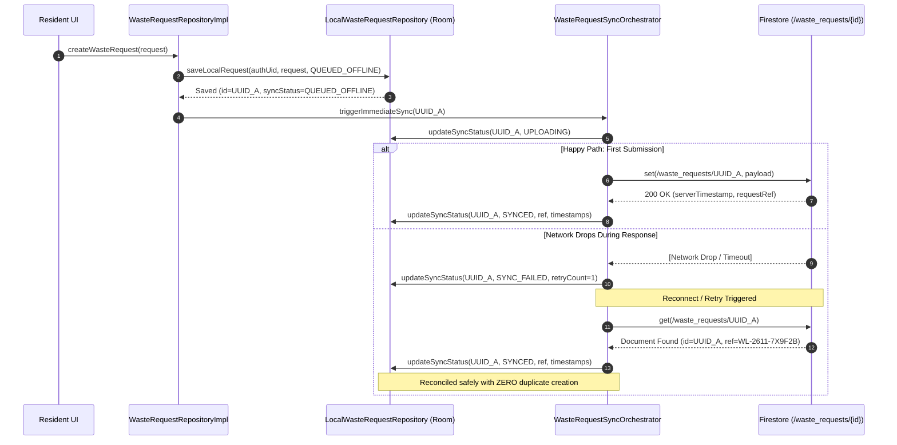
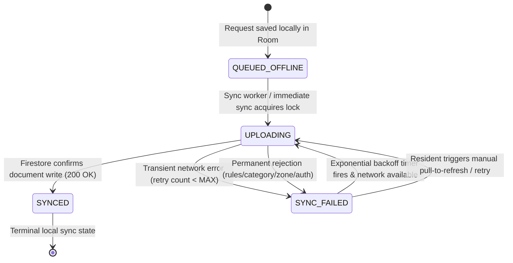

# WASTELINK — MODULE 2 PHASE 1C ARCHITECTURE SPECIFICATION
## Remote Synchronization & Repository Integration

**Document Version:** 1.0.0-ENTERPRISE
**Date:** November 6, 2026
**Status:** PROPOSED ARCHITECTURAL SPECIFICATION — AWAITING IMPLEMENTATION APPROVAL
**Target Branch:** `rebuild/modular-workspace`
**Starting Commit:** `32d9778`
**Author:** Senior Android Implementation Engineer
**Reviewer:** ChatGPT (Architecture Lead & Independent Reviewer)
**Baseline References:** `God_Tier_WasteLink_SRS.md`, `NEW_WasteLink_SRS_Implementation_Plan.md`, `firestore.rules`, `docs/MODULE_2_RESIDENT_REQUEST_ARCHITECTURE.md`, `docs/MODULE_2_PHASE_1B_IMPLEMENTATION_REPORT.md`

---

## 1. Executive Summary & Architectural Scope

Module 2 Phase 1C establishes the reliable, authenticated synchronization bridge between locally persisted resident waste collection requests in SQLite Room and the remote Cloud Firestore backend.

### Core Architecture Principles:
1. **Local Immediacy & Persistence Truth:** Local persistence (`local_waste_requests`) remains the immediate source of truth for offline, uncommitted, and queued resident requests.
2. **Server-Authoritative Operational Truth:** Cloud Firestore (`/waste_requests/{requestId}`) remains the exclusive authoritative source of truth for accepted municipal operations, dispatch state machines, server timestamps, and canonical request references.
3. **Trusted Authentication & Zero Identity Masquerading:** The synchronization engine derives identity exclusively from the application's trusted, server-verified authentication session (`SessionState.Authenticated`). User-supplied UIDs from UI or parameters are never trusted as proof of caller identity.
4. **Deterministic Idempotency:** The client-generated UUID v4 idempotency key (`id == clientGeneratedId == documentId`) guarantees that retries, network drop-offs, and concurrent worker executions can never create duplicate remote requests.
5. **Strict Quarantine of Unmapped Historical Records:** Records bearing `serviceZoneId == "legacy_unmapped_zone"` are permanently quarantined in `SYNC_FAILED` status and cannot be synchronized until explicit administrative or resident zone resolution occurs.

---

## 2. Module Hierarchy & Component Architecture

```mermaid
graph TD
    subgraph UI_Layer [":feature:resident (Phase 2 - UI & Presentation)"]
        WizardVM["RequestWizardViewModel"]
    end

    subgraph Domain_Layer [":core:domain (Phase 1A - Domain Foundation - CLOSED)"]
        WasteRequest["WasteRequest (Pure Entity)"]
        WasteRequestRepo["WasteRequestRepository (Domain Contract)"]
        SessionState["SessionState (Auth Domain Model)"]
    end

    subgraph Data_Layer [":core:data (Phase 1B & 1C - Persistence & Sync Engine)"]
        LocalRepo["LocalWasteRequestRepository"]
        RoomDB["WasteLinkDatabase (Room v2)"]
        LocalRequestsDao["LocalWasteRequestDao"]
        WasteRequestLocalMapper["WasteRequestLocalMapper"]

        SyncOrchestrator["WasteRequestSyncOrchestrator"]
        SyncWorker["WasteRequestSyncWorker (WorkManager)"]
        WasteRequestRepoImpl["WasteRequestRepositoryImpl"]
        ConnectivityObserver["NetworkConnectivityObserver"]
    end

    subgraph Remote_Layer [":core:firebase (Phase 1C - Remote Data Access)"]
        RemoteDataSource["WasteRequestRemoteDataSource"]
        FirestoreRemoteDS["FirestoreWasteRequestRemoteDataSource"]
        WasteRequestDto["WasteRequestDto (Firestore Model)"]
        WasteRequestRemoteMapper["WasteRequestRemoteMapper"]
        AuthRepo["AuthRepository (Module 1 Foundation)"]
        Firestore["FirebaseFirestore (/waste_requests/{id})"]
    end

    WizardVM --> WasteRequestRepo
    WasteRequestRepoImpl ..|> WasteRequestRepo
    WasteRequestRepoImpl --> LocalRepo
    WasteRequestRepoImpl --> SyncOrchestrator

    SyncOrchestrator --> LocalRepo
    SyncOrchestrator --> RemoteDataSource
    SyncOrchestrator --> AuthRepo
    SyncOrchestrator --> ConnectivityObserver
    SyncWorker --> SyncOrchestrator

    LocalRepo --> RoomDB
    RoomDB --> LocalRequestsDao

    FirestoreRemoteDS ..|> RemoteDataSource
    FirestoreRemoteDS --> Firestore
    FirestoreRemoteDS --> WasteRequestRemoteMapper
    WasteRequestRemoteMapper --> WasteRequestDto
    WasteRequestRemoteMapper --> WasteRequest
```

---

## 3. Remote Data-Source Contract & DTO Specifications

### 3.1 Remote Data Source Contract (`:core:data` / `:core:firebase`)

```kotlin
package com.waste.link.data.remote

import com.waste.link.domain.model.WasteRequest
import com.waste.link.data.remote.dto.WasteRequestDto

/**
 * Result of a remote request creation or synchronization attempt.
 */
sealed interface RemoteRequestOutcome {
    /**
     * Request confirmed by Cloud Firestore.
     * @property confirmedDto Authoritative document returned or confirmed by the server.
     * @property requestRef Authoritative human-readable reference allocated by backend.
     * @property serverCreatedAtEpochMs Authoritative creation timestamp.
     * @property serverUpdatedAtEpochMs Authoritative update timestamp.
     */
    data class Success(
        val confirmedDto: WasteRequestDto,
        val requestRef: String,
        val serverCreatedAtEpochMs: Long,
        val serverUpdatedAtEpochMs: Long
    ) : RemoteRequestOutcome

    /**
     * Document with this clientGeneratedId already exists in Firestore for this clientUid.
     * Idempotently reconciled without creating duplicates.
     */
    data class AlreadyExists(
        val existingDto: WasteRequestDto,
        val requestRef: String,
        val serverCreatedAtEpochMs: Long,
        val serverUpdatedAtEpochMs: Long
    ) : RemoteRequestOutcome

    /**
     * Permanent failure: Request rejected by Firestore Security Rules, schema validation,
     * inactive category, outside service zone, or account restriction.
     * Non-retryable without user modification or account standing correction.
     */
    data class Rejected(
        val errorCode: String,
        val message: String,
        val requiresUserIntervention: Boolean = true
    ) : RemoteRequestOutcome

    /**
     * Transient network or infrastructure failure: Timeout, socket dropped, Firestore UNAVAILABLE.
     * Safe for bounded exponential backoff retry.
     */
    data class TransientFailure(
        val cause: Throwable,
        val message: String = cause.message ?: "Transient network error during sync."
    ) : RemoteRequestOutcome
}

/**
 * Remote data-source contract for waste collection requests.
 */
interface WasteRequestRemoteDataSource {
    /**
     * Submits a validated request to Cloud Firestore (/waste_requests/{id}).
     *
     * Invariants:
     * - [authenticatedUid] must match [request.clientUid].
     * - Target path: `/waste_requests/${request.clientGeneratedId}`.
     * - Idempotency: Uses `set()` semantics. If document exists, retrieves existing document
     *   to prevent duplicate allocation.
     */
    suspend fun createRequest(
        authenticatedUid: String,
        request: WasteRequest
    ): RemoteRequestOutcome

    /**
     * Fetches a remote request by ID to reconcile local state or check remote existence.
     */
    suspend fun getRequestById(
        authenticatedUid: String,
        requestId: String
    ): RemoteRequestOutcome
}
```

### 3.2 Firestore Data Transfer Object (`WasteRequestDto`)

Adheres strictly to the key whitelist specified in `firestore.rules` lines 591–601:

```kotlin
package com.waste.link.data.remote.dto

import com.google.firebase.Timestamp
import com.google.firebase.firestore.DocumentId
import com.google.firebase.firestore.ServerTimestamp

data class WasteRequestDto(
    @DocumentId
    val id: String = "",
    val clientGeneratedId: String = "",
    val requestRef: String = "",
    val clientUid: String = "",
    val lat: Double = 0.0,
    val lng: Double = 0.0,
    val geohash: String = "",
    val serviceZoneId: String = "",
    val pickupAddress: String = "",
    val category: String = "",
    val volumeTier: String = "",
    val notes: String = "",
    val gatePhotoUrl: String? = null,
    val gatePhotoBase64: String? = null,
    val pocPhotoUrl: String? = null,
    val pocPhotoBase64: String? = null,
    val photos: List<String>? = null,
    val status: String = "PENDING_DISPATCH",
    val assignedTruckId: String? = null,
    val priceTzs: Long? = null,
    val currency: String = "TZS",
    val residentPhoneNumber: String? = null,
    val collectorPhoneNumber: String? = null,
    val failureReason: String? = null,
    val agreedPrice: Long? = null,
    @ServerTimestamp
    val createdAt: Timestamp? = null,
    @ServerTimestamp
    val updatedAt: Timestamp? = null,
    val assignedAt: Timestamp? = null,
    val enRouteAt: Timestamp? = null,
    val arrivedAt: Timestamp? = null,
    val collectedAt: Timestamp? = null,
    val completedAt: Timestamp? = null,
    val failedAt: Timestamp? = null
)
```

---

## 4. Authentication and UID Isolation Strategy

### 4.1 Trusted Identity Derivation
- The synchronization engine never accepts a caller-supplied UID from arguments, intent extras, or local records as proof of authorization.
- Identity is derived strictly from `AuthRepository.sessionState.value`:
  ```kotlin
  val currentSession = authRepository.sessionState.value
  if (currentSession !is SessionState.Authenticated || !currentSession.isServerVerified) {
      return SyncResult.AuthUnavailable("Session is not server-verified active")
  }
  val authenticatedUid = currentSession.user.uid
  ```
- If the current session is `Unauthenticated`, `AuthenticatedCachedOffline`, or has standing `RESTRICTED`, `SUSPENDED`, or `BANNED`, remote synchronization halts immediately.

### 4.2 Cross-Account Leakage Prevention
- **Primary Key Isolation:** In SQLite Room, requests are composite-keyed by `(id, clientUid)`.
- **Worker Scoping:** When `WasteRequestSyncOrchestrator` queries Room for pending uploads, it queries strictly:
  `localWasteRequestDao.getRequestsBySyncStatus(clientUid = authenticatedUid, syncStatus = QUEUED_OFFLINE)`.
- **Identity Invariant Enforcement:** Before dispatching an upload, the orchestrator asserts:
  `check(request.clientUid == authenticatedUid) { "Security violation: Cross-UID upload attempted" }`.
- **Session Termination & Logout:**
  - Upon user sign-out (`authRepository.logout()`), all active WorkManager jobs for the session are cancelled immediately.
  - Queued requests belonging to User A remain encrypted in SQLite Room under User A's UID.
  - When User B logs in, User B's sync runs exclusively for `clientUid == "user_b"`. User A's requests are never read, uploaded, mutated, or deleted.

---

## 5. Idempotency & Duplicate Prevention Strategy

### 5.1 Three-Layer Duplicate Prevention Architecture



1. **Deterministic Document ID:** The Firestore document path is explicitly `/waste_requests/${request.clientGeneratedId}`. Firestore's document model guarantees that multiple writes to the same document ID update or set that single document rather than generating multiple documents.
2. **Pre-flight Existence Check on Retry:** On any retry following an ambiguous network disconnect, the remote data source checks `exists(/waste_requests/{id})`. If the document was already committed before the connection dropped, it retrieves the canonical server record and marks local persistence as `SYNCED` without repeating the write.
3. **Canonical Request Reference Allocation:** Once committed, the human-readable reference `requestRef` (e.g. `WL-2611-7X9F2B`) and authoritative timestamps (`createdAt`, `updatedAt`) are retrieved from Firestore and updated in Room.

---

## 6. Synchronization State Machine & Transitions

### 6.1 State Machine Specification



### 6.2 Transition Invariants & Guard Rules

| From State | To State | Trigger / Guard | Persistence Mutation | Observable Outcome |
| :---: | :---: | :--- | :--- | :--- |
| `QUEUED_OFFLINE` | `UPLOADING` | Orchestrator selects eligible record; active network verified; auth UID matches. | `syncStatus = UPLOADING`, `lastSyncAttemptEpochMs = now()`. | `SyncEvent.UploadStarted` |
| `UPLOADING` | `SYNCED` | Server returns 200 OK with confirmed document data. | `syncStatus = SYNCED`, `requestRef = serverRef`, `syncErrorMessage = null`. | `SyncEvent.UploadSucceeded` |
| `UPLOADING` | `SYNC_FAILED` | Network timeout, socket error, or server unavailable. `retryCount < MAX_RETRIES` (3). | `syncStatus = SYNC_FAILED`, `retryCount++`, `syncErrorMessage = error.message`. | `SyncEvent.RetryScheduled` |
| `UPLOADING` | `SYNC_FAILED` | Rule violation (PERMISSION_DENIED), invalid zone, invalid category, account locked. | `syncStatus = SYNC_FAILED`, `syncErrorMessage = permanentReason`. | `SyncEvent.RequestRejected` |
| `SYNC_FAILED` | `UPLOADING` | Backoff elapsed with network available, or explicit user-initiated retry. | `syncStatus = UPLOADING`, `lastSyncAttemptEpochMs = now()`. | `SyncEvent.UploadStarted` |

### 6.3 Recovery of Interrupted Uploads (`UPLOADING` Crash Guard)
- If the app process terminates while a record is in state `UPLOADING`:
  - On application startup or when `WasteRequestSyncOrchestrator` initializes, it runs `recoverInterruptedUploads(authenticatedUid)`.
  - Any record with `syncStatus == UPLOADING` and `lastSyncAttemptEpochMs < now - 60_000` (1 minute stale threshold) is reset to `QUEUED_OFFLINE`.
  - The next sync cycle evaluates the deterministic document ID against Firestore, avoiding duplicate creation or deadlock.

---

## 7. Retry, Backoff & Error Classification Policy

### 7.1 Error Classification Engine

```kotlin
sealed interface SyncErrorClassification {
    val isTransient: Boolean
    val isPermanent: Boolean get() = !isTransient

    data class TransientNetwork(val cause: Throwable) : SyncErrorClassification {
        override val isTransient: Boolean = true
    }

    data class ServerQuotaOrThrottled(val retryAfterMs: Long?) : SyncErrorClassification {
        override val isTransient: Boolean = true
    }

    data class SecurityRuleRejection(val reason: String) : SyncErrorClassification {
        override val isTransient: Boolean = false
    }

    data class InvalidConfiguration(val invalidField: String, val detail: String) : SyncErrorClassification {
        override val isTransient: Boolean = false
    }

    data class AccountRestricted(val standing: String) : SyncErrorClassification {
        override val isTransient: Boolean = false
    }

    data class QuarantinedLegacyRecord(val reason: String) : SyncErrorClassification {
        override val isTransient: Boolean = false
    }
}
```

### 7.2 Bounded Exponential Backoff Parameters
- **Initial Retry Delay:** 3,000 ms (3 seconds)
- **Multiplier:** 2.0
- **Jitter:** $\pm 20\%$ randomization to prevent thundering herd on server reconnection
- **Maximum Retry Count:** 3 automatic retries
- **Maximum Backoff Delay:** 60,000 ms (60 seconds)
- **Permanent Error Policy:** When classified as `isPermanent == true`, `retryCount` is not incremented, automatic background retries are disabled, and `syncErrorMessage` describes the exact domain cause requiring user or administrative intervention.

---

## 8. Legacy Migration Quarantine Policy

### 8.1 Invariant Rules for Historical Records
1. **Never Automatically Sync:** A record with `serviceZoneId == WasteLinkMigrations.LEGACY_UNMAPPED_ZONE_ID` ("legacy_unmapped_zone") must NEVER be passed to `WasteRequestRemoteDataSource.createRequest()`.
2. **Never Fabricate Zones:** The synchronizer will never substitute `"zone_kinondoni"` or any default municipal zone.
3. **Queue Exclusion:**
   - In Room, legacy records reside with `syncStatus = 'SYNC_FAILED'`.
   - `LocalWasteRequestDao.getRequestsBySyncStatus(uid, QUEUED_OFFLINE)` naturally excludes them.
   - The sync orchestrator applies an explicit secondary defensive filter:
     ```kotlin
     if (request.serviceZoneId == WasteLinkMigrations.LEGACY_UNMAPPED_ZONE_ID) {
         emitEvent(SyncEvent.LegacyRecordQuarantined(request.id))
         return // quarantine: do not synchronize
     }
     ```
4. **Resolution Prerequisite:** Only when a future migration or explicit user profile prompt associates the historical request with a verified, active municipal zone will its `syncStatus` transition to `QUEUED_OFFLINE`.

---

## 9. Offline Connectivity & WorkManager Orchestration

### 9.1 Network Connectivity Observation (`:core:common`)
- `NetworkConnectivityObserver` leverages Android `ConnectivityManager.NetworkCallback`.
- Exposes a cold `Flow<NetworkStatus>` (`Available`, `Lost`, `Unavailable`).
- When network status transitions from `Lost` to `Available`, the observer notifies `WasteRequestSyncOrchestrator` to evaluate queued requests for the currently authenticated user.

### 9.2 WorkManager Background Sync (`:core:data`)
- **Worker Class:** `WasteRequestSyncWorker` extends `CoroutineWorker`.
- **Constraints:**
  - `NetworkType.CONNECTED`
  - `requiresBatteryNotLow(false)` (waste collection request sync is low data volume, high priority)
- **Execution Policy:**
  - Immediate sync: `ExistingWorkPolicy.KEEP` with unique work name `sync_requests_${authenticatedUid}`.
  - Periodic sync: Bounded fallback checking every 15 minutes while connected.
- **Thread Safety & Non-Blocking Guarantee:** All Room queries, network requests, and mapping operations execute on `Dispatchers.IO`. The resident UI remains 100% fluid and non-blocking.

---

## 10. Operational Observability & Event Model

### 10.1 Observable Sync Events (`:core:data`)

```kotlin
sealed interface SyncEvent {
    val timestampEpochMs: Long

    data class UploadStarted(
        val requestId: String,
        val clientUid: String,
        override val timestampEpochMs: Long = System.currentTimeMillis()
    ) : SyncEvent

    data class UploadSucceeded(
        val requestId: String,
        val requestRef: String,
        override val timestampEpochMs: Long = System.currentTimeMillis()
    ) : SyncEvent

    data class UploadFailed(
        val requestId: String,
        val errorMessage: String,
        val isRetryable: Boolean,
        val retryAttempt: Int,
        override val timestampEpochMs: Long = System.currentTimeMillis()
    ) : SyncEvent

    data class RetryScheduled(
        val requestId: String,
        val retryAttempt: Int,
        val nextAttemptDelayMs: Long,
        override val timestampEpochMs: Long = System.currentTimeMillis()
    ) : SyncEvent

    data class AuthUnavailable(
        val reason: String,
        override val timestampEpochMs: Long = System.currentTimeMillis()
    ) : SyncEvent

    data class RequestRejected(
        val requestId: String,
        val reason: String,
        override val timestampEpochMs: Long = System.currentTimeMillis()
    ) : SyncEvent

    data class DuplicateReconciled(
        val requestId: String,
        val requestRef: String,
        override val timestampEpochMs: Long = System.currentTimeMillis()
    ) : SyncEvent

    data class LegacyRecordQuarantined(
        val requestId: String,
        override val timestampEpochMs: Long = System.currentTimeMillis()
    ) : SyncEvent
}
```

- Events are published to a shared `SharedFlow<SyncEvent>` in `WasteRequestSyncOrchestrator`.
- Zero error swallowing: every catch block either emits a typed `SyncEvent` or rethrows domain-specific exceptions.

---

## 11. Domain & Repository Integration

### 11.1 `WasteRequestRepositoryImpl` Integration Blueprint

```kotlin
package com.waste.link.data.repository

import com.waste.link.domain.model.WasteRequest
import com.waste.link.domain.repository.CreateWasteRequestOutcome
import com.waste.link.domain.repository.WasteRequestRepository
import com.waste.link.data.local.model.LocalSyncStatus
import javax.inject.Inject
import javax.inject.Singleton

@Singleton
class WasteRequestRepositoryImpl @Inject constructor(
    private val localRepository: LocalWasteRequestRepository,
    private val syncOrchestrator: WasteRequestSyncOrchestrator,
    private val authRepository: AuthRepository
) : WasteRequestRepository {

    override suspend fun createWasteRequest(request: WasteRequest): CreateWasteRequestOutcome {
        val session = authRepository.sessionState.value
        if (session !is SessionState.Authenticated || !session.isServerVerified) {
            return CreateWasteRequestOutcome.Failure(
                error = IllegalStateException("Cannot create request: User is not authenticated with server-verified standing.")
            )
        }
        val authUid = session.user.uid
        if (request.clientUid != authUid) {
            return CreateWasteRequestOutcome.Failure(
                error = IllegalArgumentException("Request clientUid ('${request.clientUid}') does not match authenticated user ('$authUid').")
            )
        }

        // 1. Persist immediately to Room as QUEUED_OFFLINE
        val localSaved = localRepository.saveLocalRequest(
            authenticatedUid = authUid,
            request = request,
            syncStatus = LocalSyncStatus.QUEUED_OFFLINE
        )

        // 2. Trigger synchronization orchestrator
        return syncOrchestrator.synchronizeSingleRequest(authUid, localSaved.id)
    }
}
```

---

## 12. Acceptance Criteria & Test Strategy Matrix

| ID | Required Behavior | Test Strategy | Verification Target |
| :---: | :--- | :--- | :--- |
| **AC-01** | Authenticated resident syncs eligible request | Execute sync with server-verified session; verify Room transitions to `SYNCED`. | `WasteRequestSyncOrchestratorTest` |
| **AC-02** | Unauthenticated user cannot sync requests | Attempt sync with `SessionState.Unauthenticated`; verify sync halts with `AuthUnavailable`. | `WasteRequestSyncOrchestratorTest` |
| **AC-03** | User A's requests cannot be uploaded under User B | Attempt to sync User A request with User B session; verify rejection with zero remote writes. | `WasteRequestSyncOrchestratorTest` |
| **AC-04** | Repeated retries do not duplicate remote requests | Simulate 3 retries on same request; verify single Firestore document set at `/waste_requests/{id}`. | `FirestoreWasteRequestRemoteDataSourceTest` |
| **AC-05** | Server rejection does not produce false success | Simulate Firestore `PERMISSION_DENIED`; verify Room transitions to `SYNC_FAILED`, not `SYNCED`. | `WasteRequestSyncOrchestratorTest` |
| **AC-06** | Network failure preserves request locally | Simulate network disconnect during sync; verify request remains in Room with `SYNC_FAILED` and retry scheduled. | `WasteRequestSyncOrchestratorTest` |
| **AC-07** | Interrupted upload recovers safely after restart | Mark record as `UPLOADING` with stale timestamp; run recovery; verify reset to `QUEUED_OFFLINE`. | `WasteRequestSyncOrchestratorTest` |
| **AC-08** | Concurrent sync attempts do not duplicate | Launch 5 concurrent coroutines synchronizing same request; verify exactly one remote write executed. | `WasteRequestSyncOrchestratorTest` |
| **AC-09** | Account switching cannot leak queued requests | User A queues requests; user logs out; User B logs in; verify User B sync touches 0 User A records. | `LocalWasteRequestRepositoryTest` & `SyncTest` |
| **AC-10** | Legacy unmapped records remain excluded | Load migrated record with `legacy_unmapped_zone`; run sync; verify record is skipped and quarantined. | `WasteRequestSyncOrchestratorTest` |
| **AC-11** | Invalid categories & service zones rejected | Submit request with inactive category or unmapped zone; verify rejection without corrupting local DB. | `WasteRequestRemoteDataSourceTest` |
| **AC-12** | Server-generated references and timestamps persisted | On 200 OK from server, verify canonical `requestRef` and `createdAt` are saved to Room. | `WasteRequestSyncOrchestratorTest` |
| **AC-13** | Retry limits and backoff behave as specified | Force repeated network failures; verify backoff timing and termination after 3 attempts. | `WasteRequestSyncOrchestratorTest` |
| **AC-14** | Phase 1A and 1B regression tests continue passing | Run `./gradlew :core:domain:testDebugUnitTest :core:data:testDebugUnitTest`. | Gradle Test Runner |
| **AC-15** | Application builds successfully | Run `./gradlew :app:assembleDebug`. | Gradle Build |

---

## 13. Bounded Implementation Roadmap & Phase 1C Authorization Gate

Implementation must proceed in strict, bounded engineering increments:

- **Increment 1: Remote Data-Source & DTO Contracts**
  - Implement `WasteRequestDto`, `RemoteRequestOutcome`, `WasteRequestRemoteDataSource` interface and `FirestoreWasteRequestRemoteDataSource` in `:core:firebase`.
  - Add unit tests validating serialization, Firestore rule key compliance, and mock/emulator responses.
- **Increment 2: Synchronization Orchestrator & State Machine**
  - Implement `WasteRequestSyncOrchestrator` in `:core:data` with error classification, exponential backoff, and state transitions.
  - Implement `NetworkConnectivityObserver` in `:core:common`.
  - Add unit tests for AC-01 through AC-10.
- **Increment 3: WorkManager Integration & Background Recovery**
  - Implement `WasteRequestSyncWorker` with network constraints and stale `UPLOADING` recovery.
  - Add integration tests for crash recovery, account switching, and concurrent sync prevention.
- **Increment 4: Repository Integration & Final Verification**
  - Implement `WasteRequestRepositoryImpl` connecting domain `createWasteRequest()` to persistence and orchestrator.
  - Execute full test suite, regression suite, emulator-backed integration tests, and assemble verification.
  - Compile final implementation report and present for independent review.

**Status:** PROPOSED ARCHITECTURAL SPECIFICATION — AWAITING IMPLEMENTATION APPROVAL.
