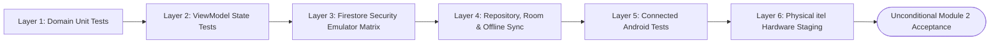

# WASTELINK — MODULE 2: RESIDENT OPERATIONS & REQUEST FLOW ACCEPTANCE CHECKLIST

**Document Version:** 2.1.0-ENTERPRISE (FINAL PRE-AUTHORIZATION REVISION)  
**Date:** November 5, 2026  
**Status:** ACCEPTANCE AUDIT & TEST MATRIX SPECIFICATION (READY FOR PHASE 1 AUTHORIZATION)  
**Target Branch:** `rebuild/modular-workspace`  
**Reviewer:** Lead Technical Director (GPT)  
**Author:** Implementation Engineer (Antigravity Mobile & Architecture Team)  
**Reference Specification:** [`docs/MODULE_2_RESIDENT_REQUEST_ARCHITECTURE.md`](file:///c:/Users/JogerBee/Desktop/WasteLink/docs/MODULE_2_RESIDENT_REQUEST_ARCHITECTURE.md)

---

## 1. Executive Definition of Done (DoD)

Module 2 will only be marked **ACCEPTED** and merged when every verification checkpoint across all six testing layers is satisfied:

- [x] 100% of pure Kotlin domain unit tests passing (state machine, coordinate bounds, enum conversions, validation invariants).
- [ ] 100% of ViewModel presentation, wizard navigation (Category $\rightarrow$ Location $\rightarrow$ Volume $\rightarrow$ Confirm), and draft retention tests passing.
- [ ] 100% of Firestore security rules tests passing on the local emulator (including field whitelist, PoC enforcement, server-authoritative timestamps, and transition-by-transition tests).
- [ ] Room caching, WorkManager offline synchronization, and multi-user logout isolation verified.
- [ ] Connected Android UI journey test passing on device/emulator without ANR or layout shift.
- [ ] Live staging test executed on physical itel hardware (`099176437J003629`).
- [ ] Zero paid API keys, zero Google Maps Platform billing dependencies.
- [ ] No regression to Module 1 authentication, session restoration, active suspension, or security rules.

---

## 2. Layer 1: Pure Domain Unit Tests (`:core:domain`)

Target test directory: `core/domain/src/test/java/com/waste/link/domain/`

| Test ID | Test Scenario | Expected Outcome | Verification Command | Status |
| :---: | :--- | :--- | :--- | :---: |
| **UT-DOM-01** | Instantiate `GeoCoordinates` with valid coordinates (`-6.7924, 39.2083`). | Object created without exception. | `./gradlew :core:domain:testDebugUnitTest` | **PASSED** |
| **UT-DOM-02** | Instantiate `GeoCoordinates` with invalid latitude (`-91.0` or `95.0`). | Throws `IllegalArgumentException("Latitude out of bounds")`. | `./gradlew :core:domain:testDebugUnitTest` | **PASSED** |
| **UT-DOM-03** | Instantiate `GeoCoordinates` with invalid longitude (`-185.0` or `181.0`). | Throws `IllegalArgumentException("Longitude out of bounds")`. | `./gradlew :core:domain:testDebugUnitTest` | **PASSED** |
| **UT-DOM-04** | **Verified Geohash Test**: Compute 7-character Geohash from Dar es Salaam coordinates (`-6.7924, 39.2083`). | Returns exact verified base-32 string: **`"kygck5q"`** (not `kxnd47q`). | `./gradlew :core:domain:testDebugUnitTest` | **PASSED** |
| **UT-DOM-05** | Validate `DynamicWasteCategory` parsing from valid ID string. | Returns valid domain entity with correct special handling and hazardous flags. | `./gradlew :core:domain:testDebugUnitTest` | **PASSED** |
| **UT-DOM-06** | **No Silent Fallback Test**: Attempt to resolve an unknown category ID (`"unknown_waste_type"`). | **Throws `UnknownWasteCategoryException`**. Does **not** fall back to `HOUSEHOLD`. | `./gradlew :core:domain:testDebugUnitTest` | **PASSED** |
| **UT-DOM-07** | **Inactive Category Test**: Attempt to select a category with `isActive == false`. | **Throws `InactiveCategoryException`**. | `./gradlew :core:domain:testDebugUnitTest` | **PASSED** |
| **UT-DOM-08** | Validate `VolumeTier.fromId()` with valid IDs (`"small_bag"`, `"standard_bin"`). | Returns corresponding `VolumeTier` constant. | `./gradlew :core:domain:testDebugUnitTest` | **PASSED** |
| **UT-DOM-09** | **No Silent Fallback Test**: Attempt to parse an unknown volume tier ID (`"huge_tank"`). | **Throws `UnknownVolumeTierException`**. Does **not** fall back to `STANDARD_BIN`. | `./gradlew :core:domain:testDebugUnitTest` | **PASSED** |
| **UT-DOM-10** | Validate `VolumeTier` bag capacity calculation for logistics heuristics. | `SMALL_BAG` yields 2 bags, `STANDARD_BIN` yields 5 bags, `LARGE_LOAD` yields 15 bags, `TRUCK_LOAD` yields 40 bags. | `./gradlew :core:domain:testDebugUnitTest` | **PASSED** |
| **UT-DOM-11** | **Collision-Safe Reference Tag**: Format reference tag from deterministic UUID high bits. | Generates `WL-YYMM-XXXXXX` (Crockford Base32, 6 chars). Matches regex `^WL-[0-9]{4}-[0-9A-Z]{6}$`. | `./gradlew :core:domain:testDebugUnitTest` | **PASSED** |
| **UT-DOM-12** | Validate state machine: `DRAFT` to `PENDING_DISPATCH`. | Permitted when resident active and coordinates present. | `./gradlew :core:domain:testDebugUnitTest` | **PASSED** |
| **UT-DOM-13** | Validate state machine: `PENDING_DISPATCH` to `CANCELLED`. | Permitted when actor is resident owner. | `./gradlew :core:domain:testDebugUnitTest` | **PASSED** |
| **UT-DOM-14** | Validate forbidden transition: `PENDING_DISPATCH` to `COMPLETED` by resident. | Rejects with domain error: `InvalidStateTransitionException`. | `./gradlew :core:domain:testDebugUnitTest` | **PASSED** |
| **UT-DOM-15** | Validate forbidden transition: `ASSIGNED_TO_FLEET` to `CANCELLED` by resident. | Rejects with domain error: `CancellationLockedException`. | `./gradlew :core:domain:testDebugUnitTest` | **PASSED** |
| **UT-DOM-16** | Validate transition: `ARRIVED_AT_LOCATION` to `COLLECTION_VERIFIED` requires PoC photo. | Throws `MissingProofOfCollectionException` if photo payload is null or blank. | `./gradlew :core:domain:testDebugUnitTest` | **PASSED** |
| **UT-DOM-17** | Validate transition: `ARRIVED_AT_LOCATION` to `FAILED` requires failure photo & reason. | Throws `MissingFailureEvidenceException` if failure photo or reason is missing. | `./gradlew :core:domain:testDebugUnitTest` | **PASSED** |
| **UT-DOM-18** | Coordinate bounds check against active `ServiceZone`. | Coordinates inside active bounds return `true`; coordinates outside return `false`. | `./gradlew :core:domain:testDebugUnitTest` | **PASSED** |

---

## 3. Layer 2: ViewModel Presentation & Wizard Tests (`:feature:resident`)

Target test directory: `feature/resident/src/test/java/com/waste/link/feature/resident/`

| Test ID | Test Scenario | Expected Outcome | Verification Command | Status |
| :---: | :--- | :--- | :--- | :---: |
| **UT-VM-01** | Initial Wizard State on `NewRequestViewModel` launch. | Sequence is Category $\rightarrow$ Location $\rightarrow$ Volume $\rightarrow$ Confirm. Initial state is `Step 1: Category`. | `./gradlew :feature:resident:testDebugUnitTest` | PENDING |
| **UT-VM-02** | Select category `HOUSEHOLD` on Step 1. | `selectedCategory` updates to `HOUSEHOLD`; Step 1 "Continue" button becomes enabled. | `./gradlew :feature:resident:testDebugUnitTest` | PENDING |
| **UT-VM-03** | Select hazardous category `HAZARDOUS` on Step 1. | Displays educational safety advisory ("Quotation will be provided by municipal dispatch"); sets hazmat tag. | `./gradlew :feature:resident:testDebugUnitTest` | PENDING |
| **UT-VM-04** | Advance from Step 1 (Category) to Step 2 (Location). | Navigates forward to Step 2; progress bar advances to 50%. | `./gradlew :feature:resident:testDebugUnitTest` | PENDING |
| **UT-VM-05** | GPS location granted and resolved on Step 2. | `location` updates with coordinates; camera centers; reverse-geocoding triggered. | `./gradlew :feature:resident:testDebugUnitTest` | PENDING |
| **UT-VM-06** | GPS permission denied by user on Step 2. | Emits `ShowLocationRationaleDialog`; manual pin-drop enabled as fallback. | `./gradlew :feature:resident:testDebugUnitTest` | PENDING |
| **UT-VM-07** | Manual map pin drop on Step 2. | Coordinates update; debounced reverse-geocoder triggers after 500ms. | `./gradlew :feature:resident:testDebugUnitTest` | PENDING |
| **UT-VM-08** | **No City Center Auto-Submission**: Open map with GPS disabled. | City center coordinates are camera center only. "Continue" remains **disabled** until pin is touched. | `./gradlew :feature:resident:testDebugUnitTest` | PENDING |
| **UT-VM-09** | **Service Zone Guard**: Location dropped outside active service zone. | Displays warning: `"Location is outside active collection zones"`; "Continue" disabled. | `./gradlew :feature:resident:testDebugUnitTest` | PENDING |
| **UT-VM-10** | Advance from Step 2 (Location) to Step 3 (Volume). | Step 3 displays volume tiers with bag equivalents. Progress bar advances to 75%. | `./gradlew :feature:resident:testDebugUnitTest` | PENDING |
| **UT-VM-11** | Back-navigation from Step 3 (Volume) to Step 2 (Location). | Step 2 restores previously dropped pin coordinates and address without re-querying GPS. | `./gradlew :feature:resident:testDebugUnitTest` | PENDING |
| **UT-VM-12** | Advance from Step 3 (Volume) to Step 4 (Confirm). | Summary cards display Category, Location, Volume, and Notes with section "Edit" chevrons. | `./gradlew :feature:resident:testDebugUnitTest` | PENDING |
| **UT-VM-13** | Tap "Edit Location" on Step 4 (Confirm). | Jumps directly to Step 2; saving changes returns directly to Step 4. | `./gradlew :feature:resident:testDebugUnitTest` | PENDING |
| **UT-VM-14** | Duplicate request detected (active request within 100m). | Emits `DuplicateRequestWarningEvent`; surfaces advisory modal with existing request link. | `./gradlew :feature:resident:testDebugUnitTest` | PENDING |
| **UT-VM-15** | Submit request succeeds. | `isLoading` toggles `true -> false`; emits `NavigateToSubmitted(docId, reqRef)`. | `./gradlew :feature:resident:testDebugUnitTest` | PENDING |
| **UT-VM-16** | Submit request offline (no network). | Saves to Room with `LocalSyncStatus.QUEUED_OFFLINE`; enqueues WorkManager; emits `NavigateToSubmitted`. | `./gradlew :feature:resident:testDebugUnitTest` | PENDING |
| **UT-VM-17** | Draft auto-save and launch prompt. | App kill mid-wizard restores state on next launch via prompt: "Continue your pickup request?". | `./gradlew :feature:resident:testDebugUnitTest` | PENDING |
| **UT-VM-18** | Cancel request while `PENDING_DISPATCH`. | Calls repository `cancelRequest`; updates UI state to `CANCELLED`. | `./gradlew :feature:resident:testDebugUnitTest` | PENDING |
| **UT-VM-19** | Cancel request fails because collector accepted concurrently. | Surfaces error toast: `"Request already dispatched; cancellation locked."`. | `./gradlew :feature:resident:testDebugUnitTest` | PENDING |

---

## 4. Layer 3: Firestore Security Emulator Test Matrix (`firestore-rules-tests`)

Target test suite: `firestore-rules-tests/test/waste_requests.spec.mjs`

| Test ID | Security Scenario | Expected Result | Emulator Assertion | Status |
| :---: | :--- | :--- | :--- | :---: |
| **SEC-REQ-01** | Unauthenticated user attempts to create a waste request. | **REJECTED** | `HTTP 403 PERMISSION_DENIED` | PENDING |
| **SEC-REQ-02** | Authenticated user with role `COLLECTOR` attempts to create a request. | **REJECTED** | `HTTP 403 PERMISSION_DENIED` | PENDING |
| **SEC-REQ-03** | Resident with unverified email (`email_verified: false`) attempts to create a request. | **REJECTED** | `HTTP 403 PERMISSION_DENIED` | PENDING |
| **SEC-REQ-04** | Resident with account status `SUSPENDED` attempts to create a request. | **REJECTED** | `HTTP 403 PERMISSION_DENIED` | PENDING |
| **SEC-REQ-05** | Active Resident creates request for their own UID (`clientUid == auth.uid`) with status `PENDING_DISPATCH`. | **ALLOWED** | `HTTP 200 OK` | PENDING |
| **SEC-REQ-06** | Resident attempts to create request on behalf of another user (`clientUid != auth.uid`). | **REJECTED** | `HTTP 403 PERMISSION_DENIED` | PENDING |
| **SEC-REQ-07** | **ID Mismatch Spoofing**: `reqData.id != requestId` or `reqData.clientGeneratedId != requestId`. | **REJECTED** | `HTTP 403 PERMISSION_DENIED` (`id == clientGeneratedId == requestId` required) | PENDING |
| **SEC-REQ-08** | **Server Timestamp Spoofing**: Resident attempts to submit client-fabricated `createdAt != request.time`. | **REJECTED** | `HTTP 403 PERMISSION_DENIED` (`reqData.createdAt == request.time` required) | PENDING |
| **SEC-REQ-09** | **Service Zone Spoofing**: Resident submits request with non-existent or inactive `serviceZoneId`. | **REJECTED** | `HTTP 403 PERMISSION_DENIED` (`exists(/service_zones/...) && isActive == true`) | PENDING |
| **SEC-REQ-10** | **Inactive Category Spoofing**: Resident submits request with category having `isActive == false`. | **REJECTED** | `HTTP 403 PERMISSION_DENIED` (`exists(/waste_categories/...) && isActive == true`) | PENDING |
| **SEC-REQ-11** | **Price / Currency Manipulation**: Resident submits non-null `priceTzs` or currency != `'TZS'`. | **REJECTED** | `HTTP 403 PERMISSION_DENIED` (`priceTzs == null && currency == 'TZS'`) | PENDING |
| **SEC-REQ-12** | Resident attempts to create request with privileged initial status (`COMPLETED` or `ASSIGNED_TO_FLEET`). | **REJECTED** | `HTTP 403 PERMISSION_DENIED` | PENDING |
| **SEC-REQ-13** | Resident owner reads their own active waste request. | **ALLOWED** | `HTTP 200 OK` | PENDING |
| **SEC-REQ-14** | Resident attempts to read another resident's waste request. | **REJECTED** | `HTTP 403 PERMISSION_DENIED` | PENDING |
| **SEC-REQ-15** | **New Identity Schema**: Assigned collector reads request (`assignedCollectorUid == auth.uid`). | **ALLOWED** | `HTTP 200 OK` | PENDING |
| **SEC-REQ-16** | Unassigned collector reads request (`assignedCollectorUid != auth.uid`). | **REJECTED** | `HTTP 403 PERMISSION_DENIED` | PENDING |
| **SEC-REQ-17** | Administrator with custom claim `admin: true` reads any request. | **ALLOWED** | `HTTP 200 OK` | PENDING |
| **SEC-REQ-18** | Resident cancels own request while status is `PENDING_DISPATCH`. | **ALLOWED** | `HTTP 200 OK` (status -> `CANCELLED`) | PENDING |
| **SEC-REQ-19** | Resident cancels own request after status transitioned to `ASSIGNED_TO_FLEET`. | **REJECTED** | `HTTP 403 PERMISSION_DENIED` | PENDING |
| **SEC-REQ-20** | **Strict Field Whitelist Test**: Resident attempts to alter `lat`, `lng`, `geohash`, or `pickupAddress` on an existing request. | **REJECTED** | `HTTP 403 PERMISSION_DENIED` (Immutable post-submission) | PENDING |
| **SEC-REQ-21** | **Strict Field Whitelist Test**: Resident attempts to alter `category`, `volumeTier`, or `clientUid` on an existing request. | **REJECTED** | `HTTP 403 PERMISSION_DENIED` | PENDING |
| **SEC-REQ-22** | **Strict Field Whitelist Test**: Resident updates allowed fields (`notes`, `gatePhotoBase64`, `updatedAt`) while `PENDING_DISPATCH`. | **ALLOWED** | `HTTP 200 OK` | PENDING |
| **SEC-REQ-23** | **PoC Mandatory Test**: Collector transitions `ARRIVED_AT_LOCATION` to `COLLECTION_VERIFIED` without `pocPhotoUrl` or `pocPhotoBase64`. | **REJECTED** | `HTTP 403 PERMISSION_DENIED` | PENDING |
| **SEC-REQ-24** | **PoC Mandatory Test**: Collector transitions `ARRIVED_AT_LOCATION` to `COLLECTION_VERIFIED` with valid photo payload. | **ALLOWED** | `HTTP 200 OK` | PENDING |
| **SEC-REQ-25** | **Step Skipping Test**: Collector attempts to transition `ARRIVED_AT_LOCATION` directly to `COMPLETED`. | **REJECTED** | `HTTP 403 PERMISSION_DENIED` (Must progress via `IN_TRANSIT_TO_DUMP`) | PENDING |
| **SEC-REQ-26** | **Failure Evidence Test**: Collector transitions to `FAILED` without photo evidence and reason. | **REJECTED** | `HTTP 403 PERMISSION_DENIED` | PENDING |
| **SEC-REQ-27** | **Dispute Expiry Test**: Resident attempts to transition to `DISPUTED` 50 hours after completion (> 48h). | **REJECTED** | `HTTP 403 PERMISSION_DENIED` (Dispute window expired) | PENDING |
| **SEC-REQ-28** | **Admin Transition Test**: Admin attempts invalid transition (`COMPLETED` to `PENDING_DISPATCH`). | **REJECTED** | `HTTP 403 PERMISSION_DENIED` | PENDING |
| **SEC-REQ-29** | **No Deletion Test**: Any user (Resident, Collector, or Admin) attempts to delete a request document. | **REJECTED** | `HTTP 403 PERMISSION_DENIED` (`allow delete: if false`) | PENDING |

---

## 5. Layer 4: Repository, Room & Offline Sync Integration Tests (`:core:data`)

Target test directory: `core/data/src/test/java/com/waste/link/data/repository/`

| Test ID | Test Scenario | Expected Outcome | Verification Command | Status |
| :---: | :--- | :--- | :--- | :---: |
| **IT-REP-01** | Create request online: writes to Firestore using deterministic `clientGeneratedId` and saves to Room. | Returns `Result.success(documentId)`; Room record status set to `SYNCED`. | `./gradlew :core:data:testDebugUnitTest` | PENDING |
| **IT-REP-02** | Create request offline: network unavailable. | Saves to Room table `cached_waste_requests` as `QUEUED_OFFLINE`; enqueues `OfflineSyncWorker`. | `./gradlew :core:data:testDebugUnitTest` | PENDING |
| **IT-REP-03** | WorkManager runs upon `NetworkType.CONNECTED`. | Syncs pending records to Firestore via idempotent `set(doc)`; updates local status to `SYNCED`. | `./gradlew :core:data:testDebugUnitTest` | PENDING |
| **IT-REP-04** | Multi-User Logout Isolation: User A queues an offline request, then logs out. User B logs in. | `OfflineSyncWorker` detects `currentAuthUid != request.clientUid`; rejects sync under User B. | `./gradlew :core:data:testDebugUnitTest` | PENDING |
| **IT-REP-05** | Stream user requests via `getUserRequests(uid)`. | Emits list ordered by `createdAt DESC`; updates dynamically on Firestore snapshots. | `./gradlew :core:data:testDebugUnitTest` | PENDING |
| **IT-REP-06** | Stream single request via `watchRequest(id)`. | Emits live updates when collector updates status (`EN_ROUTE`, `ARRIVED`). | `./gradlew :core:data:testDebugUnitTest` | PENDING |
| **IT-REP-07** | Fetch categories from `/waste_categories`. | Returns Firestore documents mapped to `DynamicWasteCategory`; caches locally for offline use. | `./gradlew :core:data:testDebugUnitTest` | PENDING |
| **IT-REP-08** | **Mappers Separation Test**: Map between `WasteRequest` and `LocalWasteRequestRecord`. | Bidirectional transformations preserve all fields without dropping or modifying data. | `./gradlew :core:data:testDebugUnitTest` | **PASSED (Phase 1B)** |

### 5.1 Phase 1B Local Persistence & Repository Foundation Acceptance Matrix

Target test directory: `core/data/src/test/java/com/waste/link/data/`

| ID | Required Behavior | Pass Condition | Test Target | Status |
| :---: | :--- | :--- | :--- | :---: |
| **P1B-01** | Save draft | Draft is persisted and can be retrieved | `LocalWasteRequestRepositoryTest` | **PASSED** |
| **P1B-02** | Update draft | Updated values survive database reload | `LocalWasteRequestRepositoryTest` | **PASSED** |
| **P1B-03** | Restore draft | Draft survives database close/reopen | `LocalWasteRequestRepositoryTest` | **PASSED** |
| **P1B-04** | Delete draft | Deleted draft is no longer returned | `LocalWasteRequestRepositoryTest` | **PASSED** |
| **P1B-05** | UID isolation | User A cannot retrieve User B's draft | `LocalWasteRequestRepositoryTest` | **PASSED** |
| **P1B-06** | UID write isolation | User A cannot overwrite User B's draft | `LocalWasteRequestRepositoryTest` | **PASSED** |
| **P1B-07** | Save local request | Request can be reconstructed as the same domain data | `LocalWasteRequestRepositoryTest` | **PASSED** |
| **P1B-08** | Request uniqueness | Duplicate user/request ID is handled deterministically | `LocalWasteRequestRepositoryTest` | **PASSED** |
| **P1B-09** | Request isolation | User A cannot retrieve User B's local request | `LocalWasteRequestRepositoryTest` | **PASSED** |
| **P1B-10** | Update isolation | User A cannot update User B's local request | `LocalWasteRequestRepositoryTest` | **PASSED** |
| **P1B-11** | Delete isolation | User A cannot delete User B's local request | `LocalWasteRequestRepositoryTest` | **PASSED** |
| **P1B-12** | Queue retrieval | Only the current user's queued records are returned | `LocalWasteRequestRepositoryTest` | **PASSED** |
| **P1B-13** | Sync-state separation | Local state does not alter domain lifecycle status | `LocalWasteRequestRepositoryTest` | **PASSED** |
| **P1B-14** | No false confirmation | Local insertion never reports remote creation success | `LocalWasteRequestRepositoryTest` | **PASSED** |
| **P1B-15** | Transaction integrity | Failed multi-step writes do not leave partial state | `LocalWasteRequestRepositoryTest` | **PASSED** |
| **P1B-16** | Migration | Existing data survives the introduced migration (v1 -> v2) | `WasteLinkMigrationTest` | **PASSED** |
| **P1B-17** | Empty UID | Blank or missing UID fails safely | `LocalWasteRequestRepositoryTest` | **PASSED** |
| **P1B-18** | Mapping | Supported domain fields round-trip without silent loss | `WasteRequestLocalMapperTest` | **PASSED** |

---

## 6. Layer 5: Connected Android UI Journey Tests (`:app` / `:feature:resident`)

Target test directory: `app/src/androidTest/java/com/waste/link/`

| Test ID | Journey Scenario | Measurable Pass/Fail Criteria | Device Target | Status |
| :---: | :--- | :--- | :---: | :---: |
| **E2E-RES-01** | Complete 4-Step Wizard Journey. | Sequence is Category $\rightarrow$ Location $\rightarrow$ Volume $\rightarrow$ Confirm. Lands on Submitted Screen with `WL-YYMM-XXXXXX`. | Emulator / Physical Phone | PENDING |
| **E2E-RES-02** | Wizard Back-Stack Integrity. | Pressing system back on Step 3 returns to Step 2 with pin coordinates intact; pressing back on Step 2 returns to Step 1 with category intact. | Emulator / Physical Phone | PENDING |
| **E2E-RES-03** | Configuration Change (Screen Rotation) in Wizard. | Rotating device on Step 2 preserves map camera, selected coordinates, and notes without resetting wizard to Step 1. | Emulator / Physical Phone | PENDING |
| **E2E-RES-04** | Submission Back-Stack Clearing. | Tapping "Back to Home" on Submitted Screen clears wizard screens from back stack; pressing back from Resident Home exits app rather than returning to confirmation. | Emulator / Physical Phone | PENDING |
| **E2E-RES-05** | Live Request Card on Dashboard. | Submitting request causes `ResidentHomeScreen` to display active tracking card with status badge `"Looking for collector..."`. | Emulator / Physical Phone | PENDING |
| **E2E-RES-06** | Memory Leak & Responsiveness Audit. | Repeatedly opening and closing the MapLibre wizard 5 times results in stable heap allocation (< 120MB) with no OutOfMemoryError and zero ANR. | Physical Phone / Emulator | PENDING |

---

## 7. Layer 6: Physical itel Phone Live Staging Verification Matrix

Target device: Physical itel Android phone (`Device ID: 099176437J003629`) connected to live remote Staging (`wastelink-27595`).

| Step | Hardware Verification Scenario | Execution Steps | Expected Result | Pass/Fail Criteria | Status |
| :---: | :--- | :--- | :--- | :--- | :---: |
| **DEV-01** | GPS Fix Acquisition | Open wizard on phone with GPS enabled. | Location permission dialog appears; on grant, blue location marker centers on physical location. | Coordinates match real location within 30m. | PENDING |
| **DEV-02** | Manual Pin Drop on Vector Map | Drag and tap map on a nearby road. | MapLibre renders OpenFreeMap vector tiles; pin moves to tapped position; address text updates within 1s. | No ANR, no memory crash, vector tiles load clearly. | PENDING |
| **DEV-03** | Service Zone Guard | Tap a coordinate outside configured service zones. | UI displays warning: `"Location is outside active collection zones"`; "Continue" disabled. | User blocked from submitting out-of-boundary requests. | PENDING |
| **DEV-04** | Live Remote Submission | Complete form and tap "Submit Pickup". | Progress spinner displays; request writes to live Firestore `waste_requests`; submitted screen shows `WL-YYMM-XXXXXX`. | Firestore document exists under `/waste_requests/{id}` on project `wastelink-27595`. | PENDING |
| **DEV-05** | Offline Airplane Mode Test | Turn on Airplane Mode; complete wizard and submit. | App immediately shows "Request saved offline" badge; does not freeze or crash. | Saved in local SQLite Room DB; enqueued in WorkManager. | PENDING |
| **DEV-06** | Offline Auto-Recovery | Turn off Airplane Mode. | WorkManager triggers; request uploads to Staging Firestore; status updates to `PENDING_DISPATCH`. | Document visible in Firestore within 60s of reconnection. | PENDING |
| **DEV-07** | Real Cancellation Test | On active tracking card, tap "Cancel Request" and confirm dialog. | Status updates to `CANCELLED`; card dismisses; Firestore reflects `status: "CANCELLED"`. | Resident cannot re-activate; history marks request as cancelled. | PENDING |
| **DEV-08** | Touch Target & Visual Polish | Audit all wizard buttons, chips, and steppers on itel screen. | All touch targets `>= 48dp`; font readability meets accessibility standards; no layout clipping. | Responsive tap animations and smooth scrolling. | PENDING |

---

## 8. Module 1 Regression Verification Matrix

To ensure zero regression to the accepted Module 1 authentication and identity foundation:

| Test ID | Regression Target | Expected Behavior | Verification Check | Status |
| :---: | :--- | :--- | :--- | :---: |
| **REG-M1-01** | Resident Authentication & Session Revival | Cold launch restores cached session and navigates to `resident_home` without flashing login. | `testDebugUnitTest` | PENDING |
| **REG-M1-02** | Unverified Email Redirection | Resident with unverified email attempting to enter wizard is redirected to `verify_email`. | Navigation Guard Check | PENDING |
| **REG-M1-03** | Suspended Account Active Lock | Resident suspended while creating or tracking a request immediately transitions to `account_status_lock`. | Snapshot Listener Test | PENDING |
| **REG-M1-04** | Collector & Admin Route Isolation | Resident cannot navigate to `collector_dashboard` or `admin_shell`. | NavHost Route Guard | PENDING |
| **REG-M1-05** | Zero Client Privilege Escalation | Resident cannot mutate their own `role` or `accountStatus` in Firestore. | Firestore Rules Test | PENDING |

---

## 9. Sign-Off & Governance Record

| Role | Name | Review Status | Date | Notes |
| :--- | :--- | :---: | :---: | :--- |
| **Lead Technical Director** | GPT | **PENDING REVIEW** | — | Awaiting architectural clearance of revised v2.1 specification |
| **Product Owner** | User | **PENDING APPROVAL** | — | Awaiting design document sign-off |
| **Implementation Engineer** | Antigravity Mobile Team | **FINALIZED & HARDENED** | November 5, 2026 | All 9 technical corrections fully incorporated |
