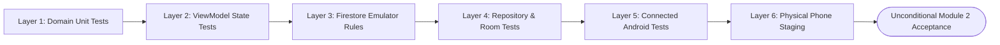

# WASTELINK — MODULE 2: RESIDENT OPERATIONS & REQUEST FLOW ACCEPTANCE CHECKLIST

**Document Version:** 1.0.0-ENTERPRISE  
**Date:** November 5, 2026  
**Status:** ACCEPTANCE AUDIT & TEST MATRIX SPECIFICATION  
**Target Branch:** `rebuild/modular-workspace`  
**Reviewer:** Lead Technical Director (GPT)  
**Author:** Implementation Engineer (Antigravity Mobile & Architecture Team)  
**Reference Specification:** [`docs/MODULE_2_RESIDENT_REQUEST_ARCHITECTURE.md`](file:///c:/Users/JogerBee/Desktop/WasteLink/docs/MODULE_2_RESIDENT_REQUEST_ARCHITECTURE.md)

---

## 1. Executive Definition of Done (DoD)

Module 2 will only be marked **ACCEPTED** and merged when every verification checkpoint across all six testing layers is satisfied:

- [ ] 100% of pure Kotlin domain unit tests passing.
- [ ] 100% of ViewModel presentation and transition tests passing.
- [ ] 100% of Firestore security rules tests passing on the local emulator.
- [ ] Room caching and WorkManager offline synchronization verified.
- [ ] Connected Android UI journey test passing on device/emulator.
- [ ] Live staging test executed on physical itel hardware (`099176437J003629`).
- [ ] Zero paid API keys, zero Google Maps billing dependencies.
- [ ] No regression to Module 1 authentication, session restoration, or security rules.

---

## 2. Layer 1: Pure Domain Unit Tests (`:core:domain`)

Target test directory: `core/domain/src/test/java/com/waste/link/domain/`

| Test ID | Test Scenario | Expected Outcome | Verification Command | Status |
| :---: | :--- | :--- | :--- | :---: |
| **UT-DOM-01** | Instantiate `GeoCoordinates` with valid coordinates (`-6.7924, 39.2083`). | Object created without exception. | `./gradlew :core:domain:testDebugUnitTest` | PENDING |
| **UT-DOM-02** | Instantiate `GeoCoordinates` with invalid latitude (`-91.0` or `95.0`). | Throws `IllegalArgumentException("Latitude must be between -90 and 90")`. | `./gradlew :core:domain:testDebugUnitTest` | PENDING |
| **UT-DOM-03** | Instantiate `GeoCoordinates` with invalid longitude (`-185.0` or `181.0`). | Throws `IllegalArgumentException("Longitude must be between -180 and 180")`. | `./gradlew :core:domain:testDebugUnitTest` | PENDING |
| **UT-DOM-04** | Compute 7-character Geohash from Dar es Salaam coordinates (`-6.7924, 39.2083`). | Generates correct Geohash prefix matching geospatial boundaries (`"kxnd47q"`). | `./gradlew :core:domain:testDebugUnitTest` | PENDING |
| **UT-DOM-05** | Validate `WasteCategory` enumeration mapping from string IDs (`"household"`, `"construction"`). | Matches canonical enum constants; throws or defaults safely on unknown ID. | `./gradlew :core:domain:testDebugUnitTest` | PENDING |
| **UT-DOM-06** | Validate `VolumeTier` bag capacity calculation for pricing heuristics. | `SMALL_BAG` yields 2 bags, `STANDARD_BIN` yields 5 bags, `LARGE_LOAD` yields 15 bags. | `./gradlew :core:domain:testDebugUnitTest` | PENDING |
| **UT-DOM-07** | Format user-facing reference string from random seed (`REQ-XXXX`). | Matches regex `^REQ-[1-9][0-9]{3}$`. | `./gradlew :core:domain:testDebugUnitTest` | PENDING |
| **UT-DOM-08** | Validate state transition rule: `DRAFT` to `PENDING_DISPATCH`. | Permitted when resident active and coordinates present. | `./gradlew :core:domain:testDebugUnitTest` | PENDING |
| **UT-DOM-09** | Validate state transition rule: `PENDING_DISPATCH` to `CANCELLED`. | Permitted when actor is resident owner. | `./gradlew :core:domain:testDebugUnitTest` | PENDING |
| **UT-DOM-10** | Validate forbidden transition: `PENDING_DISPATCH` to `COMPLETED` by resident. | Rejects with domain error: `InvalidStateTransitionException`. | `./gradlew :core:domain:testDebugUnitTest` | PENDING |
| **UT-DOM-11** | Validate forbidden transition: `ASSIGNED_TO_FLEET` to `CANCELLED` by resident. | Rejects with domain error: `CancellationLockedException`. | `./gradlew :core:domain:testDebugUnitTest` | PENDING |

---

## 3. Layer 2: ViewModel Presentation & Wizard Tests (`:feature:resident`)

Target test directory: `feature/resident/src/test/java/com/waste/link/feature/resident/`

| Test ID | Test Scenario | Expected Outcome | Verification Command | Status |
| :---: | :--- | :--- | :--- | :---: |
| **UT-VM-01** | Initial Wizard State on `NewRequestViewModel` launch. | `selectedCategory == null`, `selectedVolume == null`, `location == null`, `isContinueEnabled == false`. | `./gradlew :feature:resident:testDebugUnitTest` | PENDING |
| **UT-VM-02** | Select category `HOUSEHOLD`. | `selectedCategory` updates to `HOUSEHOLD`; Step 1 "Continue" button becomes enabled. | `./gradlew :feature:resident:testDebugUnitTest` | PENDING |
| **UT-VM-03** | Select volume `STANDARD_BIN`. | `selectedVolume` updates; Step 2 "Continue" button becomes enabled. | `./gradlew :feature:resident:testDebugUnitTest` | PENDING |
| **UT-VM-04** | Back-navigation from Step 2 to Step 1. | Category selection remains preserved (`HOUSEHOLD`); wizard does not wipe prior input. | `./gradlew :feature:resident:testDebugUnitTest` | PENDING |
| **UT-VM-05** | GPS location granted and resolved. | `location` updates with coordinates; camera centers; reverse-geocoding triggered. | `./gradlew :feature:resident:testDebugUnitTest` | PENDING |
| **UT-VM-06** | GPS permission denied by user. | Emits `ShowLocationRationaleDialog`; manual pin-drop enabled as fallback. | `./gradlew :feature:resident:testDebugUnitTest` | PENDING |
| **UT-VM-07** | Manual map pin drop at `(-6.7800, 39.2100)`. | Coordinates update; debounced reverse-geocoder triggers after 500ms. | `./gradlew :feature:resident:testDebugUnitTest` | PENDING |
| **UT-VM-08** | Reverse-geocoder throws IOException / network timeout. | Gracefully falls back to string `"Coordinates: -6.7800, 39.2100"`; does not crash. | `./gradlew :feature:resident:testDebugUnitTest` | PENDING |
| **UT-VM-09** | Notes input exceeding 280 characters. | Input truncated or rejected at 280 characters; character counter displays `280/280`. | `./gradlew :feature:resident:testDebugUnitTest` | PENDING |
| **UT-VM-10** | Duplicate request detected (active request within 100m). | Emits `DuplicateRequestWarningEvent`; CTA prompts confirmation dialog. | `./gradlew :feature:resident:testDebugUnitTest` | PENDING |
| **UT-VM-11** | Submit request succeeds. | `isLoading` toggles `true -> false`; emits `NavigateToSubmitted(docId, reqRef)`. | `./gradlew :feature:resident:testDebugUnitTest` | PENDING |
| **UT-VM-12** | Submit request fails with network error. | `isLoading` toggles `false`; error snackbar surfaced; inputs preserved for retry. | `./gradlew :feature:resident:testDebugUnitTest` | PENDING |
| **UT-VM-13** | Cancel request while `PENDING_DISPATCH`. | Calls repository `cancelRequest`; updates UI state to `CANCELLED`. | `./gradlew :feature:resident:testDebugUnitTest` | PENDING |
| **UT-VM-14** | Cancel request fails because collector accepted concurrently. | Surfaces error toast: `"Request already dispatched; cancellation locked."`. | `./gradlew :feature:resident:testDebugUnitTest` | PENDING |

---

## 4. Layer 3: Firestore Security Emulator Test Matrix (`firestore-rules-tests`)

Target test suite: `firestore-rules-tests/test/waste_requests.spec.mjs`

| Test ID | Security Scenario | Expected Result | Emulator Assertion | Status |
| :---: | :--- | :--- | :--- | :---: |
| **SEC-REQ-01** | Unauthenticated user attempts to create a waste request. | **REJECTED** | `HTTP 403 PERMISSION_DENIED` | PENDING |
| **SEC-REQ-02** | Authenticated user with role `COLLECTOR` attempts to create a request. | **REJECTED** | `HTTP 403 PERMISSION_DENIED` | PENDING |
| **SEC-REQ-03** | Resident with unverified email (`email_verified: false`) attempts to create a request. | **REJECTED** | `HTTP 403 PERMISSION_DENIED` | PENDING |
| **SEC-REQ-04** | Resident with account status `SUSPENDED` attempts to create a request. | **REJECTED** | `HTTP 403 PERMISSION_DENIED` | PENDING |
| **SEC-REQ-05** | Active Resident creates request for their own UID (`clientUid == auth.uid`) with status `PENDING_DISPATCH`. | **ALLOWED** | `HTTP 200 OK` | PENDING |
| **SEC-REQ-06** | Resident attempts to create request on behalf of another user (`clientUid != auth.uid`). | **REJECTED** | `HTTP 403 PERMISSION_DENIED` | PENDING |
| **SEC-REQ-07** | Resident attempts to create request with privileged initial status (`COMPLETED` or `ASSIGNED_TO_FLEET`). | **REJECTED** | `HTTP 403 PERMISSION_DENIED` | PENDING |
| **SEC-REQ-08** | Resident attempts to create request with pre-set `assignedTruckId` or `agreedPrice`. | **REJECTED** | `HTTP 403 PERMISSION_DENIED` | PENDING |
| **SEC-REQ-09** | Resident attempts to create request with coordinates out of bounds (`lat: 95.0`). | **REJECTED** | `HTTP 403 PERMISSION_DENIED` | PENDING |
| **SEC-REQ-10** | Resident owner reads their own active waste request. | **ALLOWED** | `HTTP 200 OK` | PENDING |
| **SEC-REQ-11** | Resident attempts to read another resident's waste request. | **REJECTED** | `HTTP 403 PERMISSION_DENIED` | PENDING |
| **SEC-REQ-12** | Assigned approved collector reads request (`assignedTruckId == auth.uid`). | **ALLOWED** | `HTTP 200 OK` | PENDING |
| **SEC-REQ-13** | Unassigned collector reads request (`assignedTruckId != auth.uid`). | **REJECTED** | `HTTP 403 PERMISSION_DENIED` | PENDING |
| **SEC-REQ-14** | Administrator with custom claim `admin: true` reads any request. | **ALLOWED** | `HTTP 200 OK` | PENDING |
| **SEC-REQ-15** | Resident cancels own request while status is `PENDING_DISPATCH`. | **ALLOWED** | `HTTP 200 OK` (status -> `CANCELLED`) | PENDING |
| **SEC-REQ-16** | Resident cancels own request after status transitioned to `ASSIGNED_TO_FLEET`. | **REJECTED** | `HTTP 403 PERMISSION_DENIED` | PENDING |
| **SEC-REQ-17** | Resident attempts to alter category or coordinates on an existing request. | **REJECTED** | `HTTP 403 PERMISSION_DENIED` | PENDING |
| **SEC-REQ-18** | Any user (Resident, Collector, or Admin) attempts to delete a request document. | **REJECTED** | `HTTP 403 PERMISSION_DENIED` (`allow delete: if false`) | PENDING |

---

## 5. Layer 4: Repository & Offline Cache Integration Tests (`:core:data`)

Target test directory: `core/data/src/test/java/com/waste/link/data/repository/`

| Test ID | Test Scenario | Expected Outcome | Verification Command | Status |
| :---: | :--- | :--- | :--- | :---: |
| **IT-REP-01** | Create request online: writes to Firestore and caches locally to Room. | Returns `Result.success(documentId)`; Room record status set to `SYNCED`. | `./gradlew :core:data:testDebugUnitTest` | PENDING |
| **IT-REP-02** | Create request offline: network unavailable. | Saves to Room table `cached_waste_requests` as `PENDING_OFFLINE`; enqueues `OfflineSyncWorker`. | `./gradlew :core:data:testDebugUnitTest` | PENDING |
| **IT-REP-03** | WorkManager runs upon `NetworkType.CONNECTED`. | Syncs pending records to Firestore; updates local records to `SYNCED`. | `./gradlew :core:data:testDebugUnitTest` | PENDING |
| **IT-REP-04** | Stream user requests via `getUserRequests(uid)`. | Emits list ordered by `createdAt DESC`; updates dynamically on Firestore snapshots. | `./gradlew :core:data:testDebugUnitTest` | PENDING |
| **IT-REP-05** | Stream single request via `watchRequest(id)`. | Emits live updates when collector updates status (`EN_ROUTE`, `ARRIVED`). | `./gradlew :core:data:testDebugUnitTest` | PENDING |

---

## 6. Layer 5: Connected Android UI Journey Tests (`:app` / `:feature:resident`)

Target test directory: `app/src/androidTest/java/com/waste/link/`

| Test ID | Journey Scenario | Expected Outcome | Device Target | Status |
| :---: | :--- | :--- | :---: | :---: |
| **E2E-RES-01** | Complete 4-Step Wizard Journey. | Resident enters wizard, selects Household, selects Standard Bin, confirms location, submits request, and lands on Submitted Screen with reference `REQ-XXXX`. | Emulator / Physical Phone | PENDING |
| **E2E-RES-02** | Wizard Back-Stack Integrity. | Pressing system back button on Step 3 returns to Step 2 with volume tier intact; pressing back on Step 2 returns to Step 1 with category intact. | Emulator / Physical Phone | PENDING |
| **E2E-RES-03** | Configuration Change (Screen Rotation) in Wizard. | Rotating device on Step 3 preserves map camera, selected coordinates, and notes without resetting wizard to Step 1. | Emulator / Physical Phone | PENDING |
| **E2E-RES-04** | Submission Back-Stack Clearing. | Tapping "Back to Home" on Submitted Screen clears wizard screens from back stack; pressing back from Resident Home exits app rather than returning to confirmation. | Emulator / Physical Phone | PENDING |
| **E2E-RES-05** | Live Request Card on Dashboard. | Submitting request causes `ResidentHomeScreen` to display active tracking card with status badge `"Looking for collector..."`. | Emulator / Physical Phone | PENDING |

---

## 7. Layer 6: Physical itel Phone Live Staging Verification Matrix

Target device: Physical itel Android phone (`Device ID: 099176437J003629`) connected to live remote Staging (`wastelink-27595`).

| Step | Hardware Verification Scenario | Execution Steps | Expected Result | Pass/Fail Criteria | Status |
| :---: | :--- | :--- | :--- | :--- | :---: |
| **DEV-01** | GPS Fix Acquisition | Open wizard on phone with GPS enabled. | Location permission dialog appears; on grant, blue location marker centers on physical location. | Coordinates match real location within 30m. | PENDING |
| **DEV-02** | Manual Pin Drop on Vector Map | Drag and tap map on a nearby road. | MapLibre smoothly renders OpenFreeMap vector tiles; pin moves to tapped position; address text updates within 1s. | No ANR, no memory crash, vector tiles load clearly. | PENDING |
| **DEV-03** | Live Remote Submission | Complete form and tap "Submit Pickup". | Progress spinner displays; request writes to live Firestore `waste_requests`; submitted screen shows `REQ-XXXX`. | Firestore document exists under `/waste_requests/{id}` on project `wastelink-27595`. | PENDING |
| **DEV-04** | Offline Airplane Mode Test | Turn on Airplane Mode; complete wizard and submit. | App immediately shows "Request saved offline" badge; does not freeze or crash. | Saved in local SQLite Room DB; enqueued in WorkManager. | PENDING |
| **DEV-05** | Offline Auto-Recovery | Turn off Airplane Mode. | WorkManager triggers; request uploads to Staging Firestore; status updates to `PENDING_DISPATCH`. | Document visible in Firestore within 60s of reconnection. | PENDING |
| **DEV-06** | Real Cancellation Test | On active tracking card, tap "Cancel Request" and confirm dialog. | Status updates to `CANCELLED`; card dismisses; Firestore reflects `status: "CANCELLED"`. | Resident cannot re-activate; history marks request as cancelled. | PENDING |
| **DEV-07** | Performance & Touch Target Check | Audit all wizard buttons, chips, and steppers on itel screen. | All touch targets `>= 48dp`; font readability meets accessibility standards; no layout clipping. | Fluid 60fps scrolling and responsive tap animations. | PENDING |

---

## 8. Sign-Off & Governance Record

| Role | Name | Review Status | Date | Notes |
| :--- | :--- | :---: | :---: | :--- |
| **Lead Technical Director** | GPT | **PENDING REVIEW** | — | Awaiting architectural clearance |
| **Product Owner** | User | **PENDING APPROVAL** | — | Awaiting design document sign-off |
| **Implementation Engineer** | Antigravity Mobile Team | **DESIGN COMPLETED** | November 5, 2026 | Architecture & Checklist ready for review |
