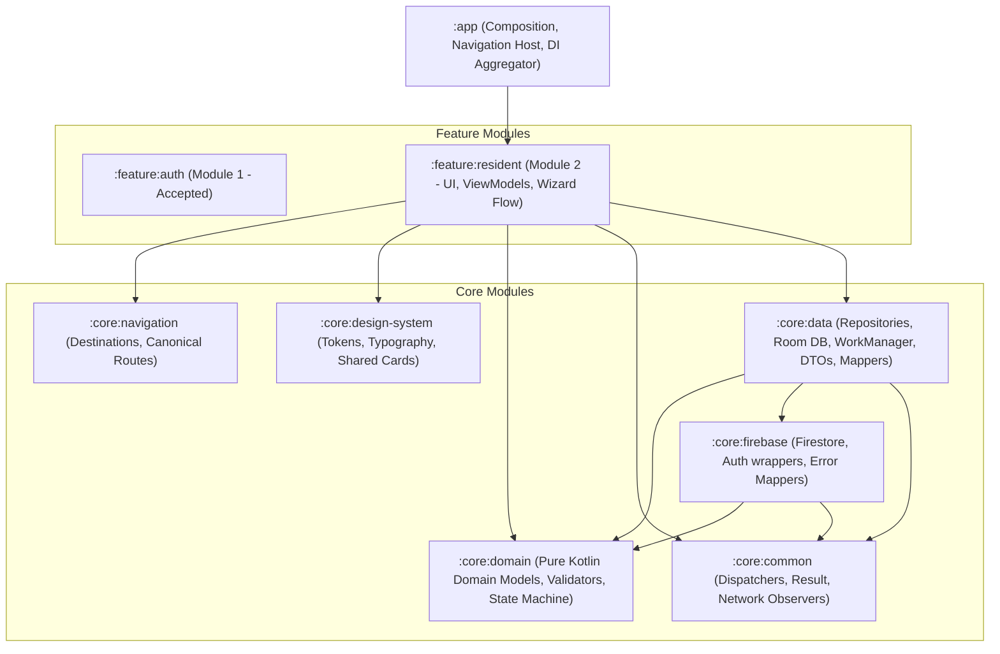
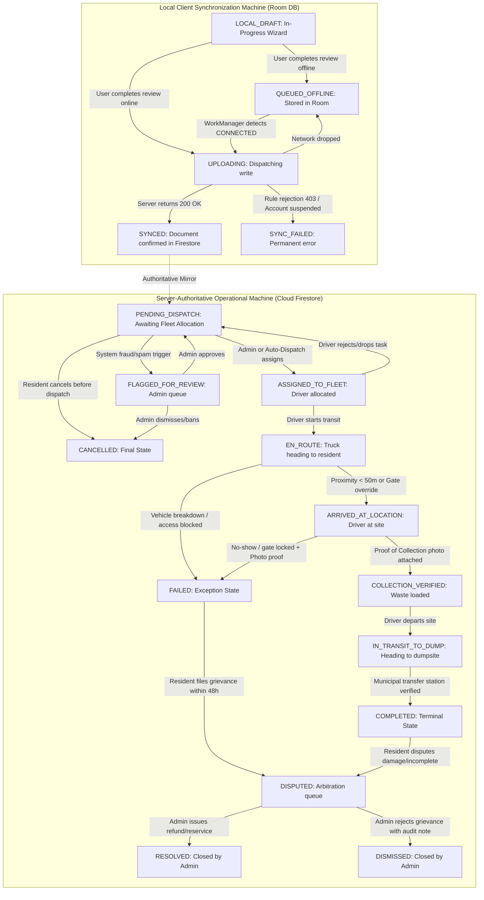
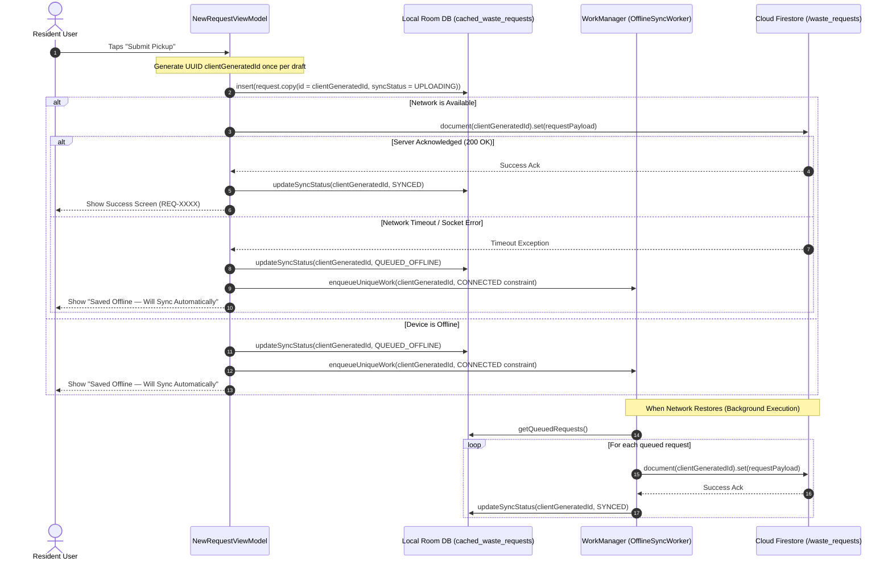

# WASTELINK — MODULE 2: RESIDENT OPERATIONS & REQUEST FLOW ARCHITECTURE SPECIFICATION

**Document Version:** 2.0.0-ENTERPRISE (POST-REVIEW HARDENED)  
**Date:** November 5, 2026  
**Status:** REVISED ARCHITECTURAL SPECIFICATION (AWAITING LEAD AUTHORIZATION)  
**Target Branch:** `rebuild/modular-workspace`  
**Reviewer:** Lead Technical Director (GPT)  
**Author:** Implementation Engineer (Antigravity Mobile & Architecture Team)  
**Baseline References:** `God_Tier_WasteLink_SRS.md`, `WasteLink_AplusRequirements(Dont alter this, Read only).md`, `docs/WORKFLOW_ARCHITECTURE.md`, `docs/MODULAR_ARCHITECTURE.md`, `origin/legacy/original-app`

---

## 1. Architectural Context & Module Boundaries

### 1.1 Objective
Module 2 establishes the complete, production-grade Resident lifecycle for WasteLink:
- Configurable waste category discovery from remote Firestore configuration.
- A validated, accessible 4-step request creation wizard (Category, Volume, Location, Review).
- Explicit, zero-cost location acquisition via MapLibre Compose, OpenFreeMap, and Android native Geocoder.
- Service zone validation preventing out-of-boundary submissions.
- Decoupled offline request queuing, transactional idempotency, and explicit synchronization tracking.
- Real-time resident request history, status synchronization, and server-authoritative cancellation.

### 1.2 Module Hierarchy & Clean Separation of Concerns
In accordance with `docs/MODULAR_ARCHITECTURE.md`, code is partitioned strictly across the architectural layers:



### 1.3 Strict Architectural Invariants
1. **Pure Domain Core (`:core:domain`)**: Zero Android SDK imports, zero Compose dependencies, zero Firebase libraries. All entities (`WasteRequest`, `WasteCategory`, `VolumeTier`, `GeoCoordinates`, `RequestLifecycleStatus`) and state machine transitions are written in pure Kotlin.
2. **Decoupled Local vs Server State**: Local synchronization states (`LOCAL_DRAFT`, `QUEUED_OFFLINE`, `SYNCING`, `SYNCED`, `SYNC_FAILED`) are strictly separated from server-authoritative operational states (`PENDING_DISPATCH`, `ASSIGNED_TO_FLEET`, etc.). Local states never pollute remote Firestore documents.
3. **Zero-Cost Financial Infrastructure**: Map rendering, tile display, and geocoding operate at **$0.00 infrastructure cost**. No Google Maps Platform billing, paid geocoding APIs, or paid tile services are used.
4. **Immutable Security Guardrails**: Residents can only create requests for their own UID with status `PENDING_DISPATCH`. After submission, coordinates, geohash, address, owner UID, category, volume, assignment, price, and operational timestamps are **strictly immutable** to the resident. Updates are governed by an explicit whitelist.

---

## 2. Requirement Traceability Matrix (A+ Product Specification)

This matrix establishes 100% explicit traceability to `WasteLink_AplusRequirements(Dont alter this, Read only).md` (REQ-029 through REQ-040). No requirements are omitted.

| REQ ID | Title & Summary | Architectural Treatment | Module Placement & Status | Dependency & Rationale |
| :---: | :--- | :--- | :---: | :--- |
| **REQ-029** | **Multi-Step Wizard State Machine**<br>Sealed step state (`Category`, `Volume`, `Location`, `Confirm`) with validated forward-only transitions and back navigation preserving prior inputs. | `NewRequestViewModel` maintains sealed `WizardStep` state. Slide animations (300ms) with progress bar. | **Module 2 (Core)**<br>`IMPLEMENT IN MODULE 2` | Core wizard experience. Implemented in `:feature:resident`. |
| **REQ-030** | **Firestore-Backed Configurable Categories**<br>Categories loaded dynamically from `/config/waste_categories` rather than hardcoded enums. Remote updates without app releases. | `WasteCategoryRepository` fetches from Firestore collection `/config/waste_categories`, cached locally in Room/DataStore with bundled fallback. | **Module 2 (Core)**<br>`IMPLEMENT IN MODULE 2` | Prevents hardcoded business logic. Managed via `:core:data`. |
| **REQ-031** | **Location Capture via Map + GPS**<br>FusedLocationProvider + manual pin-drop override + reverse geocoding with 500ms debouncing. | MapLibre Compose + OpenFreeMap tiles. High accuracy GPS with rationale. Android native `Geocoder` debounced at 500ms. | **Module 2 (Core)**<br>`IMPLEMENT IN MODULE 2` | Implemented in `:feature:resident` with zero-cost map engine. |
| **REQ-032** | **Volume & Server-Side Pricing/Logistics Mapping**<br>Volume tiers mapped to weight/logistics heuristics server-side. | Canonical `VolumeTier` enum with physical volume descriptions and bag equivalents. Price calculation marked as ESTIMATE on client; final price determined server-side. | **Module 2 (Core)**<br>`IMPLEMENT IN MODULE 2` | Final settlement contract executed in Module 6 (Financials). |
| **REQ-033** | **Confirmation Summary Screen**<br>Aggregate wizard state into read-only summary; edit links jump back to specific steps preserving all other data. | `NewRequestConfirmScreen` renders section cards with deep edit links to step 1, 2, or 3. Inline button loading state. | **Module 2 (Core)**<br>`IMPLEMENT IN MODULE 2` | Full review flow prior to atomic submission. |
| **REQ-034** | **Optimistic Submission & Acknowledgment**<br>Client-generated UUID (`clientGeneratedId`); immediate UI acknowledgment; graceful rollback on failure. | Write to Room DB and firestore with deterministic `document(clientGeneratedId)`. Displays checkmark screen (`REQ-XXXX`). | **Module 2 (Core)**<br>`IMPLEMENT IN MODULE 2` | Guarantees non-blocking resident experience. |
| **REQ-035** | **Draft Auto-Save & Explicit Resume Prompt**<br>Persist in-progress wizard state locally; prompt user to resume on next launch rather than silent restore. | Draft saved to Room `resident_drafts` table scoped by `userId`. On wizard entry, dialog prompts: "Continue your pickup request?". | **Module 2 (Core)**<br>`IMPLEMENT IN MODULE 2` | Respects user intent; survives process death and phone calls. |
| **REQ-036** | **Field-Level Validation & Error Prevention**<br>Next button disabled with helper hints until required inputs pass validation. Double-validated on server. | Client-side validation in `RequestValidator` + Firestore Security Rules schema assertions (`canCreateWasteRequest`). | **Module 2 (Core)**<br>`IMPLEMENT IN MODULE 2` | Defense-in-depth: client UI gating + server-enforced security rules. |
| **REQ-037** | **Request Type Presets / Templates**<br>Allow saving a request configuration as a reusable template document under `/users/{uid}/templates`. | "Save as template" toggle on Confirm screen saves payload to `/users/{uid}/templates/{templateId}`. | **Module 2 (Contract Defined)**<br>`IMPLEMENT IN MODULE 2` | Data model and Firestore subcollection contract implemented. Template quick-chips on dashboard surfaced. |
| **REQ-038** | **Cancellation Window Logic**<br>Allow cancellation only while status is `PENDING_DISPATCH`. Server-enforced via Firestore rules. | UI exposes Cancel button conditionally. Firestore rule asserts `existingData.status == 'PENDING_DISPATCH' && newData.status == 'CANCELLED'`. | **Module 2 (Core)**<br>`IMPLEMENT IN MODULE 2` | Full atomic race protection between resident and collector. |
| **REQ-039** | **Accessibility for Wizard Flow**<br>Semantic labels, live regions, minimum 48dp touch targets, TalkBack announcements per step. | All Compose components specify `Modifier.semantics` and `contentDescription`. Screen titles announced via `AccessibilityLiveRegion`. | **Module 2 (Core)**<br>`IMPLEMENT IN MODULE 2` | Integrated into `:core:design-system` and wizard composables. |
| **REQ-040** | **Server-Side Duplicate Prevention**<br>Detect existing pending requests within geographic cooldown window before allowing new submission. | 1. Client pre-flight query checks user's active requests within 100m.<br>2. Idempotency key prevents duplicate writes on network retry.<br>3. Cooldown timestamp enforced. | **Module 2 (Core)**<br>`IMPLEMENT IN MODULE 2` | Dual client advisory check + server idempotency enforcement. |

---

## 3. Authoritative Request Lifecycle & Synchronization State Machine

### 3.1 Strict Separation of Concepts
To prevent architectural confusion, WasteLink strictly isolates two distinct state machines:
1. **Server-Authoritative Operational State (`RequestLifecycleStatus`)**: The authoritative state of the request in Cloud Firestore, mutated only by permitted actors and validated by security rules.
2. **Local Client Synchronization State (`LocalSyncStatus`)**: The state of the request record on the local Android device (Room database), tracking network persistence and WorkManager progress.



### 3.2 Canonical State Definitions & Vocabulary Reconciliation
Historical baselines used differing naming conventions. The following table establishes the canonical standard and explicit migration mappings:

| Canonical Operational Status | Historical / Legacy Aliases | Owning / Mutating Actor | Definition & Boundary Conditions |
| :--- | :--- | :--- | :--- |
| `PENDING_DISPATCH` | `PENDING`, `pending`, `NEW` | Resident (create), Collector (drop), Admin | Request has been validated and committed to Firestore. Awaiting fleet allocation. |
| `FLAGGED_FOR_REVIEW` | `FLAGGED`, `SHADOW_BANNED` | Cloud Function, Admin | Request flagged for administrative review due to user status or cooldown violation. |
| `ASSIGNED_TO_FLEET` | `ASSIGNED`, `assigned` | Admin, Auto-Dispatch Engine | A specific driver UID and vehicle unit have been assigned. Cancellation is now locked. |
| `EN_ROUTE` | `en_route`, `STARTED` | Assigned Collector | Driver has pressed "Start Route" and is actively traveling toward pickup coordinates. |
| `ARRIVED_AT_LOCATION`| `ARRIVED`, `AT_GATE` | Assigned Collector (or GPS geofence) | Driver is within 50 meters of the pickup coordinates. |
| `COLLECTION_VERIFIED`| `VERIFIED`, `PICKED_UP` | Assigned Collector | Driver has taken custody of waste and attached mandatory Proof of Collection (PoC) photo. |
| `IN_TRANSIT_TO_DUMP` | `IN_TRANSIT`, `HAULING` | Assigned Collector | Driver has departed pickup location and is en route to an authorized municipal dump. |
| `COMPLETED` | `completed`, `DONE` | Assigned Collector, Transfer Station | Waste has been weighed and offloaded at municipal facility. Eco-points awarded. |
| `CANCELLED` | `cancelled`, `USER_CANCELLED`| Resident Owner, Admin | Request cancelled prior to dispatch. Terminal state. |
| `FAILED` | `FAILED_NO_SHOW`, `ABORTED` | Assigned Collector | Pickup could not be completed. Mandatory photo proof and failure reason required. |
| `DISPUTED` | `disputed`, `IN_DISPUTE` | Resident Owner | Resident submitted a formal grievance regarding a `FAILED` or `COMPLETED` pickup within 48 hours. |
| `RESOLVED` | `resolved` | Admin strictly | Admin resolved dispute with refund or re-service. Terminal state. |
| `DISMISSED` | `dismissed` | Admin strictly | Admin dismissed dispute with explanation. Terminal state. |

### 3.3 Complete Transition-by-Transition Enforcement Matrix

| Transition | From State | To State | Triggering Actor | Mandatory Preconditions & Validation Rules | Failure / Rejection Result |
| :---: | :---: | :---: | :---: | :--- | :--- |
| **TR-01** | `None` | `PENDING_DISPATCH` | Resident Owner | `clientUid == auth.uid`, active resident, verified email, valid coordinates within active service zone, valid category, volume tier, `assignedTruckId == null`, `agreedPrice == null`. | `HTTP 403 PERMISSION_DENIED`. UI keeps draft intact. |
| **TR-02** | `PENDING_DISPATCH` | `CANCELLED` | Resident Owner | `clientUid == auth.uid`, existing status `PENDING_DISPATCH`. No fields modified except `status` and `updatedAt`. | If collector accepted concurrently, write fails; UI informs user request is already en route. |
| **TR-03** | `PENDING_DISPATCH` | `FLAGGED_FOR_REVIEW`| Cloud Function / Admin | Cooldown anomaly, duplicate address flag, or restricted resident status detected. | Diverted to Admin Operations console. |
| **TR-04** | `FLAGGED_FOR_REVIEW`| `PENDING_DISPATCH` | Admin strictly | Admin verifies resident legitimacy and clears request for dispatch. | Audit log recorded. |
| **TR-05** | `PENDING_DISPATCH` | `ASSIGNED_TO_FLEET`| Admin / Dispatcher | Collector is approved, active, on-duty, and has capacity < 100%. Sets `assignedTruckId`, `assignedCollectorUid`, `assignedAt`. | Race condition prevented via atomic Firestore transaction. |
| **TR-06** | `ASSIGNED_TO_FLEET` | `PENDING_DISPATCH` | Assigned Collector / Admin | Driver drops job due to breakdown or shift expiry. `assignedTruckId` reset to null. | Returns to active dispatch pool. |
| **TR-07** | `ASSIGNED_TO_FLEET` | `EN_ROUTE` | Assigned Collector | `assignedTruckId == auth.uid`. Sets `enRouteAt == request.time`. | Rejected if collector is not the assigned driver. |
| **TR-08** | `EN_ROUTE` | `ARRIVED_AT_LOCATION`| Assigned Collector / GPS | Haversine distance < 50m or manual arrival confirmed. Sets `arrivedAt == request.time`. | Triggers resident arrival notification. |
| **TR-09** | `EN_ROUTE` | `FAILED` | Assigned Collector | Route completely blocked or emergency breakdown. Mandatory `failureReason` and photo evidence. | Diverted to failed queue; resident notified. |
| **TR-10** | `ARRIVED_AT_LOCATION`| `COLLECTION_VERIFIED`| Assigned Collector | **Mandatory Proof of Collection (PoC)**: `pocPhotoUrl` or `pocPhotoBase64` must be attached. Sets `collectedAt == request.time`. | **REJECTED** if photo payload is absent. |
| **TR-11** | `ARRIVED_AT_LOCATION`| `FAILED` | Assigned Collector | Resident no-show or gate locked. Mandatory photo proof of closed gate/missing trash + `failureReason`. | Sets `failedAt == request.time`. |
| **TR-12** | `COLLECTION_VERIFIED`| `IN_TRANSIT_TO_DUMP` | Assigned Collector | Driver departs pickup location toward transfer station. | Resident tracking updates to "In Transit". |
| **TR-13** | `IN_TRANSIT_TO_DUMP` | `COMPLETED` | Assigned Collector / Dump Geofence | Truck coordinates intersect municipal dumpsite polygon. Sets `completedAt == request.time`. | Awards +10 GreenPoints; surfaces rating prompt. |
| **TR-14** | `FAILED` / `COMPLETED` | `DISPUTED` | Resident Owner | `clientUid == auth.uid`. Time since `updatedAt` <= 48 hours. Sets `disputeReason`. | Created in `/service_disputes`; status updated to `DISPUTED`. |
| **TR-15** | `DISPUTED` | `RESOLVED` | Admin strictly | Admin reviews evidence and issues resolution note (`adminResolutionNote`). | Terminal state. Audit log written. |
| **TR-16** | `DISPUTED` | `DISMISSED` | Admin strictly | Admin reviews evidence and dismisses grievance with explanation. | Terminal state. Audit log written. |

---

## 4. Firestore Security Rules Specification

### 4.1 Identified Vulnerability Gaps in Existing Rules
A thorough audit of the existing `firestore.rules` (lines 588–740) revealed four security weaknesses that must be remediated in the design:

1. **Vulnerability 1 — Flawed Resident Blacklist Permitted Coordinate & Identity Tampering**:
   The current resident update rule (`lines 682-688`) uses a blacklist:
   ```javascript
   !newData.diff(existingData).affectedKeys().hasAny(['id', 'requestRef', 'clientUid', 'category', 'volumeTier', ...])
   ```
   **Security Gap**: This blacklist omits `lat`, `lng`, `geohash`, `pickupAddress`, and `residentPhoneNumber`. A malicious resident could alter their pickup location to another district after creating the request while keeping the status `PENDING_DISPATCH`.
   **Remediation**: Replace the blacklist with an explicit **whitelist**:
   ```javascript
   newData.diff(existingData).affectedKeys().hasOnly(['status', 'notes', 'gatePhotoBase64', 'gatePhotoUrl', 'updatedAt'])
   ```
2. **Vulnerability 2 — Missing Proof of Collection at Collection Verification**:
   In `isValidCollectorRequestTransition` (`lines 657-659`), transitioning from `ARRIVED_AT_LOCATION` to `COLLECTION_VERIFIED` only asserted `isTimestampOrPositiveInt(newData.collectedAt)`. Proof of Collection (`hasProofOfCollection`) was only checked on `COMPLETED`.
   **Security Gap**: A driver could mark a collection verified without providing photographic proof of waste pickup.
   **Remediation**: Require `hasProofOfCollection(newData)` directly on transition to `COLLECTION_VERIFIED`.
3. **Vulnerability 3 — Step Skipping to Completed**:
   The existing rule allowed:
   ```javascript
   existingData.status in ['ARRIVED_AT_LOCATION', 'COLLECTION_VERIFIED', 'IN_TRANSIT_TO_DUMP'] && newData.status == 'COMPLETED'
   ```
   **Security Gap**: A driver could bypass municipal dumpsite verification and jump straight from arrival to completion.
   **Remediation**: Enforce strict sequential progression: `COMPLETED` can only be reached from `IN_TRANSIT_TO_DUMP`.
4. **Vulnerability 4 — Unverified Failure Transitions**:
   The existing rule permitted `FAILED` with only a text string `failureReason`.
   **Remediation**: Require photographic evidence of access denial or missing trash whenever `FAILED` is triggered from `ARRIVED_AT_LOCATION`.

### 4.2 Hardened Security Rules Blueprint

```javascript
// =========================================================================
// REVISED SPECIFICATION FOR /waste_requests/{requestId}
// =========================================================================

function hasAllowedWasteRequestKeys(data) {
  return data.keys().hasOnly([
    'id', 'clientGeneratedId', 'requestRef', 'clientUid', 'geohash', 'lat', 'lng',
    'serviceZoneId', 'pickupAddress', 'category', 'volumeTier', 'notes',
    'gatePhotoBase64', 'pocPhotoBase64', 'gatePhotoUrl', 'pocPhotoUrl',
    'status', 'assignedCollectorUid', 'assignedVehicleId', 'assignedTruckId',
    'assignedAt', 'enRouteAt', 'arrivedAt', 'collectedAt', 'completedAt',
    'failedAt', 'failureReason', 'failurePhotoUrl', 'failurePhotoBase64',
    'priceTzs', 'currency', 'residentPhoneNumber', 'collectorPhoneNumber',
    'disputeReason', 'adminResolutionNote', 'createdAt', 'updatedAt'
  ]);
}

function canCreateWasteRequest(requestId, reqData) {
  return isActiveResident(request.auth.uid)
    && hasAllowedWasteRequestKeys(reqData)
    && reqData.id == requestId
    && reqData.clientUid == request.auth.uid
    && isValidNonEmptyString(reqData.clientGeneratedId, 16, 64)
    && isValidNonEmptyString(reqData.requestRef, 8, 32)
    && isValidNonEmptyString(reqData.serviceZoneId, 2, 64)
    && isValidNonEmptyString(reqData.pickupAddress, 2, 300)
    && isValidNonEmptyString(reqData.category, 2, 60)
    && isValidNonEmptyString(reqData.volumeTier, 2, 60)
    && isValidLat(reqData.lat)
    && isValidLng(reqData.lng)
    && isValidNonEmptyString(reqData.geohash, 5, 12)
    && reqData.status == 'PENDING_DISPATCH'
    && (!('assignedCollectorUid' in reqData) || reqData.assignedCollectorUid == null)
    && (!('assignedVehicleId' in reqData) || reqData.assignedVehicleId == null)
    && (!('assignedTruckId' in reqData) || reqData.assignedTruckId == null)
    && (!('assignedAt' in reqData) || reqData.assignedAt == null)
    && (!('enRouteAt' in reqData) || reqData.enRouteAt == null)
    && (!('arrivedAt' in reqData) || reqData.arrivedAt == null)
    && (!('collectedAt' in reqData) || reqData.collectedAt == null)
    && (!('completedAt' in reqData) || reqData.completedAt == null)
    && (!('failedAt' in reqData) || reqData.failedAt == null)
    && (!('failureReason' in reqData) || reqData.failureReason == null)
    && (!('pocPhotoUrl' in reqData) || reqData.pocPhotoUrl == null)
    && (!('pocPhotoBase64' in reqData) || reqData.pocPhotoBase64 == null)
    && (!('priceTzs' in reqData) || reqData.priceTzs == null)
    && (!('collectorPhoneNumber' in reqData) || reqData.collectorPhoneNumber == null)
    && isTimestampOrPositiveInt(reqData.createdAt)
    && isTimestampOrPositiveInt(reqData.updatedAt);
}

function canUpdateWasteRequest(existingData, newData) {
  return hasAllowedWasteRequestKeys(newData)
    && isTimestampOrPositiveInt(newData.updatedAt)
    && (
      // Branch 1: Resident Owner (Strict Whitelist: notes, gatePhoto, or cancellation)
      (
        isActiveResident(request.auth.uid)
        && existingData.clientUid == request.auth.uid
        && existingData.status == 'PENDING_DISPATCH'
        && newData.diff(existingData).affectedKeys().hasOnly([
             'status', 'notes', 'gatePhotoBase64', 'gatePhotoUrl', 'updatedAt'
           ])
        && (newData.status == 'PENDING_DISPATCH' || newData.status == 'CANCELLED')
      )
      // Branch 2: Resident Dispute Filing (Within 48 hours of terminal state)
      || (
        isActiveResident(request.auth.uid)
        && existingData.clientUid == request.auth.uid
        && existingData.status in ['COMPLETED', 'FAILED']
        && newData.status == 'DISPUTED'
        && newData.diff(existingData).affectedKeys().hasOnly([
             'status', 'disputeReason', 'updatedAt'
           ])
        && isValidNonEmptyString(newData.disputeReason, 10, 1000)
      )
      // Branch 3: Assigned Collector (Strict Operational Progression)
      || (
        isApprovedActiveCollector(request.auth.uid)
        && (existingData.assignedCollectorUid == request.auth.uid || existingData.assignedTruckId == request.auth.uid)
        && isValidCollectorRequestTransition(existingData, newData)
      )
      // Branch 4: Administrator (Dispatch, Allocation, Pricing, Dispute Arbitration)
      || (
        isAdmin()
        && !newData.diff(existingData).affectedKeys().hasAny([
             'id', 'clientGeneratedId', 'requestRef', 'clientUid', 'createdAt'
           ])
      )
    );
}
```

---

## 5. Location, Service Zones & Map Infrastructure

### 5.1 Service Zone Architecture & Bounds Enforcement
To prevent requests being submitted in unserviceable wilderness or outside municipal jurisdictions:
1. **Service Zone Model**:
   Municipal service zones are defined in Firestore `/service_zones/{zoneId}`:
   ```kotlin
   data class ServiceZone(
       val zoneId: String,          // e.g., "TZ-DSM-KINONDONI"
       val name: String,            // "Kinondoni Municipality"
       val minLat: Double,          // Bounding Box Min Latitude
       val maxLat: Double,          // Bounding Box Max Latitude
       val minLng: Double,          // Bounding Box Min Longitude
       val maxLng: Double,          // Bounding Box Max Longitude
       val isActive: Boolean = true
   )
   ```
2. **Pre-Submission Boundary Validation**:
   - When a pin is selected (via GPS or manual placement), coordinates are checked against cached active `ServiceZone` boundaries.
   - If coordinates fall outside all active zones:
     - The UI displays an explicit warning banner: `"Location is outside active municipal collection zones."`
     - The "Continue" button on Step 3 remains **disabled**.
   - No request can be submitted without an assigned `serviceZoneId`.
3. **Removal of City Center Fallback**:
   - The previous default coordinate (`-6.7924, 39.2083`) is **strictly prohibited as a submission value**.
   - It is used **only** as the initial visual camera center when the map opens if GPS is disabled.
   - The resident must explicitly tap or drag the pin to set a confirmed location before Step 3 validation passes.

### 5.2 OpenFreeMap & MapLibre Operational Reality
To ensure engineering honesty and operational resilience:
- **No Enterprise SLA**: OpenFreeMap is a community-supported open tile service without uptime guarantees.
- **Attribution Requirement**: The map view includes required legal attribution: `"© OpenMapTiles © OpenStreetMap contributors"`.
- **Tile Caching**: MapLibre's local tile cache stores downloaded vector tiles in app storage, allowing previously viewed map areas to render offline.
- **Graceful Map Degradation**:
  If vector tiles fail to load due to network outage or CDN downtime:
  1. The map canvas displays a dark textured grid with coordinate indicators.
  2. Pin dragging remains 100% operational (coordinates update on drag).
  3. The resident can manually type their address and landmark description into the text field.
  4. The request flow is never blocked by a tile outage.

---

## 6. Offline Queuing, Idempotency & Session Lifecycle

### 6.1 Deterministic Idempotency Key Architecture
To eliminate duplicate requests caused by network timeouts or repeated button presses:



### 6.2 Session Boundary & Logout Isolation
What happens to queued offline requests during authentication state changes?
1. **User Identity Binding**:
   Every record in Room `cached_waste_requests` includes `clientUid`.
2. **Account Sign-Out Guard**:
   If the resident initiates a sign-out while requests are in state `QUEUED_OFFLINE`:
   - An explanatory warning dialog is presented:
     `"You have 1 pending request waiting to upload. Signing out will pause sync until you sign back in."`
   - If the user confirms sign-out: WorkManager tasks for that user are cancelled. Queued records remain encrypted in Room tied to `clientUid`.
3. **Multi-User Isolation**:
   If User B logs into the same physical device, `OfflineSyncWorker` verifies:
   ```kotlin
   val currentAuthUid = authRepository.getCurrentUserId()
   if (currentAuthUid != request.clientUid) {
       // DO NOT SYNC: Foreign user credentials must never upload another user's request
       return Result.retry() // Suspended until original owner authenticates
   }
   ```
   This prevents cross-account data leakage and security rule rejections.

---

## 7. Canonical Data Contracts & Models

### 7.1 Pure Domain Model (`:core:domain`)

```kotlin
package com.waste.link.domain.model

enum class WasteCategory(
    val id: String,
    val displayName: String,
    val isHazardous: Boolean = false,
    val requiresSpecialHandling: Boolean = false
) {
    HOUSEHOLD("household", "Household Waste"),
    CONSTRUCTION("construction", "Construction Debris", requiresSpecialHandling = true),
    GARDEN("garden", "Garden & Organic"),
    ELECTRONIC("electronic", "E-Waste & Batteries", requiresSpecialHandling = true),
    HAZARDOUS("hazardous", "Hazardous & Medical", isHazardous = true, requiresSpecialHandling = true),
    BULK_ITEMS("bulk", "Bulky Furniture & Scrap", requiresSpecialHandling = true);

    companion object {
        fun fromId(id: String?): WasteCategory =
            entries.find { it.id.equals(id, ignoreCase = true) } ?: HOUSEHOLD
    }
}

enum class VolumeTier(
    val id: String,
    val displayName: String,
    val volumeDescription: String,
    val bagEquivalent: Int
) {
    SMALL_BAG("small_bag", "Small Bag", "1 – 3 standard bags (~50L)", 2),
    STANDARD_BIN("standard_bin", "Standard Bin", "240L municipal wheelie bin", 5),
    LARGE_LOAD("large_load", "Large Load", "Half pickup bed (~1.5 m³)", 15),
    TRUCK_LOAD("truck_load", "Truck Load", "Full tipper truck (~5.0 m³)", 40);

    companion object {
        fun fromId(id: String?): VolumeTier =
            entries.find { it.id.equals(id, ignoreCase = true) } ?: STANDARD_BIN
    }
}

enum class RequestLifecycleStatus {
    PENDING_DISPATCH,
    FLAGGED_FOR_REVIEW,
    ASSIGNED_TO_FLEET,
    EN_ROUTE,
    ARRIVED_AT_LOCATION,
    COLLECTION_VERIFIED,
    IN_TRANSIT_TO_DUMP,
    COMPLETED,
    CANCELLED,
    FAILED,
    DISPUTED,
    RESOLVED,
    DISMISSED
}

enum class LocalSyncStatus {
    LOCAL_DRAFT,
    QUEUED_OFFLINE,
    UPLOADING,
    SYNCED,
    SYNC_FAILED
}

data class GeoCoordinates(
    val latitude: Double,
    val longitude: Double
) {
    init {
        require(latitude in -90.0..90.0) { "Latitude out of bounds: $latitude" }
        require(longitude in -180.0..180.0) { "Longitude out of bounds: $longitude" }
    }
}

data class WasteRequest(
    val id: String,                         // Equals clientGeneratedId
    val clientGeneratedId: String,          // UUID v4 idempotency key
    val requestRef: String,                 // User-friendly reference: WL-YYMM-XXXX
    val clientUid: String,                  // Owner resident UID
    val coordinates: GeoCoordinates,        // Latitude & Longitude
    val geohash: String,                    // 7-character Geohash
    val serviceZoneId: String,              // Validated municipal zone ID
    val pickupAddress: String,              // Human-readable address
    val category: WasteCategory,            // Validated category
    val volumeTier: VolumeTier,              // Validated volume tier
    val notes: String = "",                 // Resident landmark notes
    val gatePhotoUrl: String? = null,       // Gate reference photo URL
    val gatePhotoBase64: String? = null,    // Fallback Base64 gate photo
    val pocPhotoUrl: String? = null,        // Driver PoC photo URL
    val pocPhotoBase64: String? = null,     // Driver PoC Base64
    val status: RequestLifecycleStatus = RequestLifecycleStatus.PENDING_DISPATCH,
    val syncStatus: LocalSyncStatus = LocalSyncStatus.SYNCED,
    val assignedCollectorUid: String? = null,// Assigned Driver UID
    val assignedVehicleId: String? = null,  // Truck plate / unit ID
    val assignedTruckId: String? = null,    // Backward-compatibility alias
    val priceTzs: Long? = null,             // Integer monetary units in TZS
    val currency: String = "TZS",           // Explicit currency ISO code
    val residentPhoneNumber: String? = null,// E.164 phone string
    val collectorPhoneNumber: String? = null,// Assigned collector phone
    val failureReason: String? = null,      // Reason if status == FAILED
    val failurePhotoUrl: String? = null,    // Photo evidence of failure
    val disputeReason: String? = null,      // Resident grievance text
    val adminResolutionNote: String? = null,// Admin arbitration note
    val createdAtEpochMs: Long = System.currentTimeMillis(),
    val updatedAtEpochMs: Long = System.currentTimeMillis(),
    val assignedAtEpochMs: Long? = null,
    val enRouteAtEpochMs: Long? = null,
    val arrivedAtEpochMs: Long? = null,
    val collectedAtEpochMs: Long? = null,
    val completedAtEpochMs: Long? = null,
    val failedAtEpochMs: Long? = null
)
```

---

## 8. Module 2 Live Tracking Boundaries & Future Dependencies

To avoid promising functionality that depends on unbuilt infrastructure, the exact scope of tracking in Module 2 is established:

```mermaid
graph LR
    subgraph Module_2_Scope ["MODULE 2: RESIDENT CORE (IN SCOPE)"]
        M2_1[Live Firestore Snapshot Listener on User Requests]
        M2_2[Status Stepper: Pending -> Assigned -> En Route -> Arrived -> Done]
        M2_3[Cancel Button: Active strictly during PENDING_DISPATCH]
        M2_4[Historical Feed: Chronological paginated request list]
        M2_5[Driver Contact Card: Displays collector phone via WhatsApp intent if En Route]
    end

    subgraph Future_Modules_Scope ["FUTURE MODULE DEPENDENCIES (DEFERRED)"]
        M3[Module 3: Collector Node - Telemetry Publisher] -->|Broadcasts truck GPS every 5s| M5
        M5[Module 5: Operations & Fleet Engine] -->|Publishes /truckTelemetry/{id}| F_Map[Moving Truck Marker on Map]
        M5 -->|Calculates OSRM driving distance| F_ETA[Real dynamic ETA countdown]
        M8[Module 8: FCM Notifications] -->|Triggers when truck < 50m| F_Push[Geofence Proximity Push Alert]
    end

    M2_2 -.->|Awaits Telemetry Stream| F_Map
    M2_2 -.->|Awaits Distance Matrix| F_ETA
```

- **In Scope for Module 2**:
  - Live status synchronization via Firestore document listener.
  - Status progression stepper card on `ResidentHomeScreen` and `ResidentTrackingScreen`.
  - Conditional cancellation action.
  - Full request history feed with status filtering chips.
  - Driver WhatsApp contact intent using assigned driver phone number once dispatched.
- **Formally Deferred to Future Modules**:
  - **Moving Truck Marker**: Awaits Module 3 (Collector Location Publisher) & Module 5 (Fleet Telemetry).
  - **Dynamic ETA Countdown**: Awaits Module 5 (OSRM Waypoint Matrix API).
  - **Proximity Push Notifications**: Awaits Module 8 (FCM Notification Engine).
  - **Proof of Collection Capture**: Awaits Module 3 (Collector Camera & Image Pipeline).

---

## 9. Category, Hazmat & Pricing Policy

### 9.1 Remote Category Configuration Schema (`/config/waste_categories/{id}`)
Categories are remotely driven via Firestore documents:
```json
{
  "id": "hazardous",
  "displayNameEn": "Hazardous & Medical",
  "displayNameSw": "Taka Hatari na za Dawa",
  "isHazardous": true,
  "requiresSpecialHandling": true,
  "baseEstimateTzs": 15000,
  "warningAdvisoryEn": "Hazardous waste requires specialized licensed disposal. Medical sharps and chemical waste must be double-bagged.",
  "warningAdvisorySw": "Taka hatari zinahitaji wataalamu maalum. Sindano na kemikali lazima zifungwe vizuri.",
  "isActive": true,
  "version": 1
}
```

### 9.2 Hazmat Handling Safeguards
When a resident selects `HAZARDOUS` or `ELECTRONIC`:
1. The wizard presents an explicit educational warning banner highlighting municipal safety regulations.
2. The request is tagged with `requiresSpecialHandling: true` in Firestore.
3. Ordinary tricycle and light compactor collectors cannot accept hazardous loads; dispatch is restricted to certified hazardous waste disposal units.

---

## 10. Unresolved Product Decisions (Submitted for Leadership Review)

The following product decisions remain open for final confirmation by the Product Owner and Lead Technical Director:

1. **Hazardous Waste Tariff Policy**:
   *Current Design*: Hazardous waste displays an estimated tariff advisory (`15,000 TZS base`), but final pricing is set by municipal dispatch.  
   *Decision Required*: Should the app require upfront municipal dispatcher quotation before dispatching hazardous loads, or allow immediate submission?
2. **Cancellation Fee Window**:
   *Current Design*: Free cancellation while `PENDING_DISPATCH`. Cancellation completely disabled once `ASSIGNED_TO_FLEET`.  
   *Decision Required*: Is a grace period (e.g. 2 minutes post-assignment) required, or is instant locking upon driver allocation the desired municipal policy?
3. **Multi-Photo Gate References**:
   *Current Design*: Single gate photo (WebP < 50KB) compressed and stored directly.  
   *Decision Required*: Is a single landmark photo sufficient for Phase 1, or should multi-photo gallery storage via Cloud Storage be brought forward?
