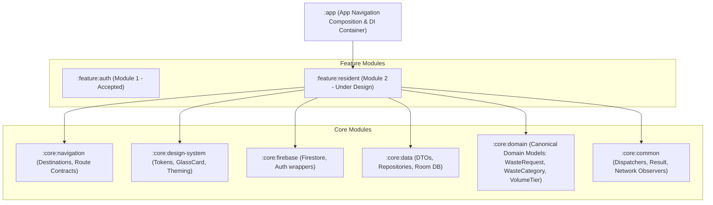
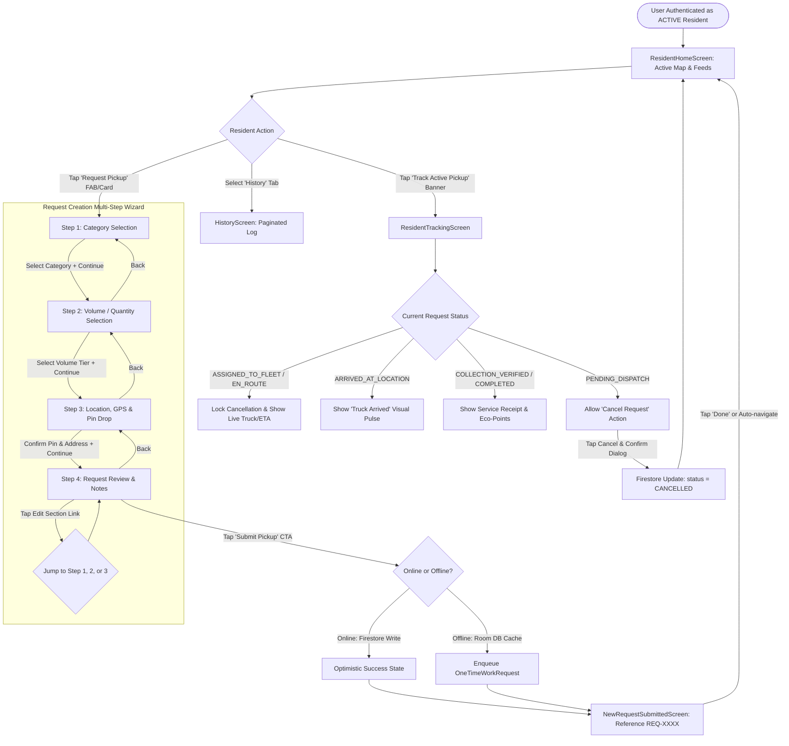
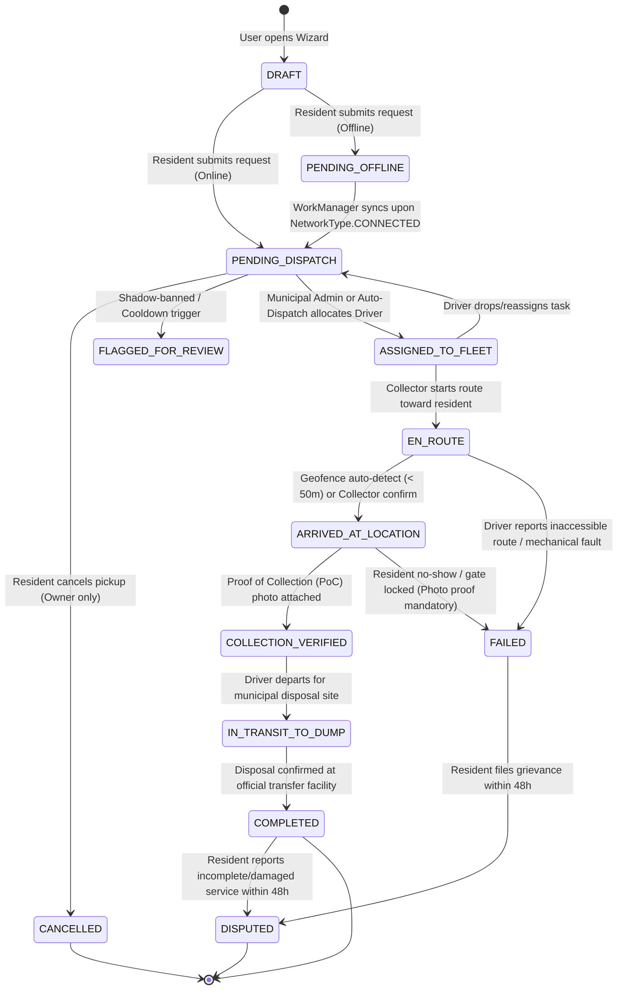

# WASTELINK — MODULE 2: RESIDENT OPERATIONS & REQUEST FLOW ARCHITECTURE SPECIFICATION

**Document Version:** 1.0.0-ENTERPRISE  
**Date:** November 5, 2026  
**Status:** ARCHITECTURE DESIGN & INVESTIGATION (READY FOR LEAD REVIEW)  
**Target Branch:** `rebuild/modular-workspace`  
**Reviewer:** Lead Technical Director (GPT)  
**Author:** Implementation Engineer (Antigravity Mobile & Architecture Team)  
**Baseline References:** `God_Tier_WasteLink_SRS.md`, `WasteLink_AplusRequirements(Dont alter this, Read only).md`, `docs/WORKFLOW_ARCHITECTURE.md`, `docs/MODULAR_ARCHITECTURE.md`, `origin/legacy/original-app`

---

## 1. Architectural Context & Module Boundaries

### 1.1 Objective
Module 2 establishes the end-to-end Resident lifecycle: from dashboard entry, through a validated 4-step request creation wizard (Category, Volume, Location & Pin Drop, Confirmation), to optimistic submission, live status synchronization, and historical tracking.

### 1.2 Module Placement in the Gradle Hierarchy
In accordance with `docs/MODULAR_ARCHITECTURE.md`, Module 2 is encapsulated in `:feature:resident` while contributing canonical domain models to `:core:domain` and remote data sources to `:core:data` and `:core:firebase`:



### 1.3 Strict Module Invariants
1. **Zero UI/Framework Leakage to Domain**: `:core:domain` remains 100% pure Kotlin with zero Android SDK, zero Compose, and zero Firebase dependencies.
2. **Design System Uniformity**: All resident UI components leverage `:core:design-system` dark theme tokens (`DarkBackground #0F1115`, `DarkCard #16181C`, `EmeraldGreen #10B981`, `AmberWarning #F59E0B`, `DarkBorder #262930`).
3. **No Unilateral Status Escalation**: The client application cannot set or alter privileged lifecycle states (e.g., cannot mark a request `COMPLETED`, `ASSIGNED_TO_FLEET`, or `COLLECTION_VERIFIED`).
4. **Zero-Cost Infrastructure**: Map rendering, location acquisition, and reverse-geocoding utilize zero-billing open infrastructure (MapLibre Compose, OpenFreeMap, Android Native `Geocoder`). No Google Maps billing or paid APIs are introduced.

---

## 2. Complete Resident Journey & Navigation Flow

### 2.1 High-Level Resident State Flow


### 2.2 Screen Interaction Contracts

| Screen Composable | Route Key | Allowed Inputs / Interactions | Required Validations | Transitions & Fallbacks |
| :--- | :--- | :--- | :--- | :--- |
| **`ResidentHomeScreen`** | `resident_home` | - Quick Action Chips<br>- Active Request Tracker Card<br>- Live Map Background<br>- Pull-to-Refresh | Resident must be `ACTIVE` and `email_verified`. If suspended, redirects to `account_status_lock`. | Tap "Request Pickup" -> opens Category Wizard.<br>Tap active card -> `resident_tracking/{id}`. |
| **`NewRequestCategoryScreen`** | `request_category` | - 2-column Category Grid<br>- Back navigation<br>- "Continue" Button | Must select exactly 1 category (`HOUSEHOLD`, `CONSTRUCTION`, `GARDEN`, `ELECTRONIC`, `HAZARDOUS`, `BULK_ITEMS`). | "Continue" disabled until category selected. Back exits wizard with draft preserved. |
| **`NewRequestVolumeScreen`** | `request_volume` | - Volume Tier Cards<br>- Quantity Stepper<br>- Back button<br>- "Continue" Button | Must select valid `VolumeTier` (`SMALL_BAG`, `STANDARD_BIN`, `LARGE_LOAD`, `TRUCK_LOAD`). | Forward to `request_location`. Back returns to `request_category` preserving choice. |
| **`NewRequestLocationScreen`** | `request_location` | - GPS Auto-locate Button<br>- MapLibre Pin Drag / Tap<br>- Manual Address Input<br>- Landmark Notes (max 280 chars) | Latitude in `[-90, 90]`, Longitude in `[-180, 180]`, Address length `>= 2 chars`. | If GPS denied, surfaces educational rationale; allows manual pin-drop. Forward to `request_confirm`. |
| **`NewRequestConfirmScreen`** | `request_confirm` | - Read-only Summary Cards<br>- "Edit" Chevron links<br>- "Save as Template" Switch<br>- "Submit Request" CTA | Duplicate active request check: cannot submit if resident already has pending request at identical location. | Tap Submit -> Disables CTA, shows inline spinner, submits to repository. On success -> `request_submitted/{id}`. |
| **`NewRequestSubmittedScreen`** | `request_submitted/{id}` | - Animated Checkmark<br>- Monospace Reference Tag (`REQ-XXXX`)<br>- Estimated ETA Advisory<br>- "Back to Home" CTA | Validates document ID and reference. | Tap "Back to Home" or 3-second auto-timeout pops back stack to `resident_home`. |
| **`ResidentTrackingScreen`** | `resident_tracking/{id}` | - Real-time Map with Driver Marker<br>- ETA Countdown Pill<br>- Driver Contact (WhatsApp link)<br>- "Cancel Request" Button (conditional) | "Cancel" button ONLY enabled while status is `PENDING_DISPATCH`. Hidden once `ASSIGNED_TO_FLEET`. | Back returns to `resident_home`. Cancel prompts confirmation modal before Firestore mutation. |
| **`HistoryScreen`** | `resident_history` | - Chronological Request List<br>- Status Badges<br>- Filter Chips (All, Active, Completed)<br>- Pull-to-refresh | Queries Firestore `/waste_requests` where `clientUid == auth.uid` ordered by `createdAt DESC`. | Tap item -> opens read-only detail bottom sheet. |

---

## 3. Canonical Request State Machine

### 3.1 State Hierarchy & Allowed Transitions
The WasteLink Request Lifecycle is strictly unidirectional. Transitioning directly from `PENDING_DISPATCH` to `COMPLETED` or bypassing field verification is strictly prevented by Firestore Security Rules.



### 3.2 Formal Transition & Permission Matrix

| Transition | Initial State | Target State | Permitted Actor | Mandatory Invariants & Preconditions | Rejection / Rollback Consequence |
| :---: | :---: | :---: | :---: | :--- | :--- |
| **T-01** | `DRAFT` | `PENDING_DISPATCH` | `RESIDENT` | - Resident status `ACTIVE` and `email_verified == true`.<br>- Valid category, volume tier, and GPS coordinates.<br>- `assignedTruckId`, `agreedPrice`, and timestamps must be null. | Rejection via rule: `403 PERMISSION_DENIED`. Wizard remains on confirm screen with error banner. |
| **T-02** | `DRAFT` | `PENDING_OFFLINE` | `RESIDENT` (Client local) | Device has no internet connection. Payload persisted to Room `cached_waste_requests`. | WorkManager retries with exponential backoff until `CONNECTED`. |
| **T-03** | `PENDING_DISPATCH` | `CANCELLED` | `RESIDENT` (Owner) | - Document `clientUid == request.auth.uid`.<br>- Status must be strictly `PENDING_DISPATCH`.<br>- Cannot mutate category, location, or server fields. | If collector was assigned concurrently, cancellation is blocked with "Request has already been dispatched". |
| **T-04** | `PENDING_DISPATCH` | `ASSIGNED_TO_FLEET` | `ADMIN` / System Dispatch | - Collector must be `ACTIVE`, `APPROVED`, and `ON_DUTY`.<br>- Collector capacity must be `< 100%`. | Driver queue collision rejected via atomic Firestore transaction. |
| **T-05** | `ASSIGNED_TO_FLEET` | `EN_ROUTE` | `COLLECTOR` (Assigned) | `assignedTruckId == request.auth.uid`. Timestamp `enRouteAt` recorded. | Collector app shows error dialog if unassigned. |
| **T-06** | `EN_ROUTE` | `ARRIVED_AT_LOCATION` | `COLLECTOR` (Assigned) | Haversine distance `< 50m` or manual gate override. Timestamp `arrivedAt` recorded. | Resident receives live arrival notification and vibration burst. |
| **T-07** | `ARRIVED_AT_LOCATION`| `COLLECTION_VERIFIED` | `COLLECTOR` (Assigned) | Proof of Collection (PoC) image payload (Base64 or Storage URL) attached. `collectedAt` set. | State transition blocked if photo is missing. |
| **T-08** | `ARRIVED_AT_LOCATION`| `FAILED` | `COLLECTOR` (Assigned) | Mandatory photo proof of blocked access or missing trash + `failureReason` string. | Alert displayed on resident home screen with WhatsApp dispute link. |
| **T-09** | `COLLECTION_VERIFIED`| `IN_TRANSIT_TO_DUMP` | `COLLECTOR` (Assigned) | Truck departs pickup coordinates. | Resident tracking screen updates to "In Transit". |
| **T-10** | `IN_TRANSIT_TO_DUMP` | `COMPLETED` | `COLLECTOR` / Cloud Function | Vehicle reaches municipal dumpsite geofence polygon. `completedAt` set. | Resident awarded +10 GreenPoints; rating sheet surfaced. |

### 3.3 Server-Authoritative State Enforcement Invariant
Under no circumstances may a resident client mutate the `status` field to any state other than `CANCELLED`. Security rules strictly assert:
```javascript
existingData.clientUid == request.auth.uid
&& existingData.status == 'PENDING_DISPATCH'
&& newData.status in ['PENDING_DISPATCH', 'CANCELLED']
```
Any attempt to spoof an assignment, verify collection, or self-complete a request results in immediate transaction termination and security audit logging.

---

## 4. Data Architecture & Canonical Contracts

### 4.1 Domain Models (`:core:domain`)
Pure Kotlin entities with zero framework dependencies:

```kotlin
package com.waste.link.domain.model

import java.time.Instant

enum class WasteCategory(val id: String, val displayName: String) {
    HOUSEHOLD("household", "Household Waste"),
    CONSTRUCTION("construction", "Construction Debris"),
    GARDEN("garden", "Garden & Organic"),
    ELECTRONIC("electronic", "E-Waste & Batteries"),
    HAZARDOUS("hazardous", "Hazardous & Medical"),
    BULK_ITEMS("bulk", "Bulky Furniture & Scrap")
}

enum class VolumeTier(val id: String, val displayName: String, val approximateBags: Int) {
    SMALL_BAG("small_bag", "Small Bags (1-3)", 2),
    STANDARD_BIN("standard_bin", "Standard Wheelie Bin (240L)", 5),
    LARGE_LOAD("large_load", "Large Load (Truck Bed 1/2)", 15),
    TRUCK_LOAD("truck_load", "Full Tipper Truck Load", 40)
}

enum class WasteRequestStatus {
    DRAFT,
    PENDING_DISPATCH,
    ASSIGNED_TO_FLEET,
    EN_ROUTE,
    ARRIVED_AT_LOCATION,
    COLLECTION_VERIFIED,
    IN_TRANSIT_TO_DUMP,
    COMPLETED,
    CANCELLED,
    FAILED,
    FLAGGED_FOR_REVIEW,
    DISPUTED
}

data class GeoCoordinates(
    val latitude: Double,
    val longitude: Double
) {
    init {
        require(latitude in -90.0..90.0) { "Latitude must be between -90 and 90 degrees." }
        require(longitude in -180.0..180.0) { "Longitude must be between -180 and 180 degrees." }
    }
}

data class WasteRequest(
    val id: String,
    val requestRef: String,
    val clientUid: String,
    val coordinates: GeoCoordinates,
    val geohash: String,
    val pickupAddress: String,
    val category: WasteCategory,
    val volumeTier: VolumeTier,
    val notes: String = "",
    val gatePhotoUrl: String? = null,
    val gatePhotoBase64: String? = null,
    val pocPhotoUrl: String? = null,
    val status: WasteRequestStatus = WasteRequestStatus.PENDING_DISPATCH,
    val assignedTruckId: String? = null,
    val agreedPrice: Double? = null,
    val residentPhoneNumber: String? = null,
    val collectorPhoneNumber: String? = null,
    val failureReason: String? = null,
    val createdAtEpochMs: Long = System.currentTimeMillis(),
    val updatedAtEpochMs: Long = System.currentTimeMillis(),
    val enRouteAtEpochMs: Long? = null,
    val arrivedAtEpochMs: Long? = null,
    val collectedAtEpochMs: Long? = null,
    val completedAtEpochMs: Long? = null,
    val failedAtEpochMs: Long? = null
)
```

### 4.2 Firestore Document Schema (`/waste_requests/{requestId}`)

| Field Name | Type | Nullable | Description & Invariant Rules |
| :--- | :--- | :---: | :--- |
| `id` | String | NO | Auto-generated Firestore Document ID matching `docRef.id`. |
| `requestRef` | String | NO | User-facing reference code (e.g., `REQ-4921`). Formatted `REQ-[1000-9999]`. |
| `clientUid` | String | NO | UID of creating resident. Must equal `request.auth.uid`. |
| `lat` | Double | NO | Latitude coordinate. Valid range `[-90.0, 90.0]`. |
| `lng` | Double | NO | Longitude coordinate. Valid range `[-180.0, 180.0]`. |
| `geohash` | String | NO | 7-character geohash for geospatial boundary indexing and fleet proximity queries. |
| `pickupAddress` | String | NO | Human-readable reverse-geocoded string (2 - 300 characters). |
| `category` | String | NO | Canonical uppercase name of `WasteCategory` (e.g., `"HOUSEHOLD"`). |
| `volumeTier` | String | NO | Canonical uppercase name of `VolumeTier` (e.g., `"STANDARD_BIN"`). |
| `notes` | String | NO | Optional resident notes / landmark hints (0 - 280 characters). |
| `gatePhotoUrl` | String | YES | Storage URL of compressed gate/landmark reference image. |
| `gatePhotoBase64` | String | YES | Fallback Base64 encoded WebP string (max 50KB) for zero-storage operation. |
| `pocPhotoUrl` | String | YES | Driver Proof of Collection photo URL. Restricted write: Collector only. |
| `pocPhotoBase64` | String | YES | Driver Proof of Collection Base64 string. Restricted write: Collector only. |
| `status` | String | NO | Current canonical state. Default on creation: `"PENDING_DISPATCH"`. |
| `assignedTruckId` | String | YES | UID of assigned collector. Must be null on creation. |
| `agreedPrice` | Double | YES | Agreed service tariff in TZS. Must be null on creation; set by Admin/Collector. |
| `residentPhoneNumber` | String | YES | International E.164 phone string (e.g., `+255712345678`). |
| `collectorPhoneNumber`| String | YES | International E.164 phone string of assigned driver. |
| `failureReason` | String | YES | Populated only when `status == "FAILED"`. |
| `createdAt` | Timestamp/Int | NO | Server-authoritative timestamp on document creation. |
| `updatedAt` | Timestamp/Int | NO | Server-authoritative timestamp on document mutation. |

---

## 5. Security & Permission Architecture

### 5.1 Enforced Relationship-Based Access Control (ReBAC)
Access to `/waste_requests` is governed by strict relationship rules rather than open collection reads:
1. **Resident Owner**: `resource.data.clientUid == request.auth.uid` grants read access to all own historical and active requests.
2. **Assigned Collector**: `resource.data.assignedTruckId == request.auth.uid` grants read access and operational update access only while assigned.
3. **Municipal Administrator**: `request.auth.token.admin == true` grants universal visibility, manual fleet allocation, and dispute arbitration.
4. **Public / Unauthenticated**: Zero read access; `HTTP 403 PERMISSION_DENIED` strictly enforced.
5. **Deletion**: Deletions are forbidden across all roles (`allow delete: if false`). Requests form an immutable audit log.

### 5.2 Composite Query Indexes
To support live real-time filtering, offline ordering, and dispatch pagination without full-table scans, the following composite indexes in `firestore.indexes.json` are mandated:

```json
[
  {
    "collectionGroup": "waste_requests",
    "queryScope": "COLLECTION",
    "fields": [
      { "fieldPath": "clientUid", "order": "ASCENDING" },
      { "fieldPath": "createdAt", "order": "DESCENDING" }
    ]
  },
  {
    "collectionGroup": "waste_requests",
    "queryScope": "COLLECTION",
    "fields": [
      { "fieldPath": "clientUid", "order": "ASCENDING" },
      { "fieldPath": "status", "order": "ASCENDING" },
      { "fieldPath": "createdAt", "order": "DESCENDING" }
    ]
  },
  {
    "collectionGroup": "waste_requests",
    "queryScope": "COLLECTION",
    "fields": [
      { "fieldPath": "assignedTruckId", "order": "ASCENDING" },
      { "fieldPath": "status", "order": "ASCENDING" }
    ]
  }
]
```

---

## 6. Location & Mapping Architecture

### 6.1 Provider Evaluation & Zero-Cost Financial Analysis
In accordance with system directives, no paid map tiles, paid geocoding APIs, or Google Maps Platform billing accounts may be introduced.

| Component | Selected Technology | Licensing / Cost | Billing Requirement | Performance & Reliability |
| :--- | :--- | :---: | :---: | :--- |
| **Vector Map Engine** | **MapLibre Compose** (`org.maplibre.compose:0.13.0`) | Open Source (BSD 2-Clause) | **ZERO** (No credit card or billing) | Hardware-accelerated Metal/Vulkan vector rendering with custom styling. |
| **Map Tile Provider** | **OpenFreeMap** (`https://tiles.openfreemap.org/styles/bright`) | Free Public CDN | **ZERO** (No API key, no rate limits for app usage) | Fast vector tile caching, full road network for Dar es Salaam, Dodoma, Arusha. |
| **GPS Acquisition** | **Google Play Services Location** (`FusedLocationProviderClient`) | Free Google Play Service | **ZERO** | Battery-efficient GPS + Wi-Fi cell tower triangulation (`PRIORITY_HIGH_ACCURACY`). |
| **Reverse Geocoding**| **Android Native Geocoder** (`android.location.Geocoder`) | Built-in Android OS | **ZERO** | On-device / OS system geocoding service; zero HTTP API quotas. |

### 6.2 GPS Lifecycle, Denial Recovery & Debounced Pin-Drop
1. **Permission Sequence**:
   - The application checks `ACCESS_FINE_LOCATION` and `ACCESS_COARSE_LOCATION`.
   - If granted: FusedLocationProvider requests high accuracy location and animates the map camera to current coordinates with a 15.0 zoom level.
   - If denied: An in-app educational rationale card explains why location is required for waste truck dispatch. If permanently denied by OS, the user is offered a 1-tap intent to open Android App Settings.
2. **Manual Pin Drop & Fallback**:
   - Even without GPS permission, the resident can pan and tap anywhere on the MapLibre canvas to drop a manual pickup pin.
   - Default fallback coordinates center on Dar es Salaam city center (`lat: -6.7924, lng: 39.2083`).
3. **Debounced Reverse Geocoding**:
   - When the user drags or taps the map pin, the new coordinates trigger reverse-geocoding via `android.location.Geocoder` with a **500ms debounce**.
   - If the geocoder returns an empty list or network error, the UI gracefully falls back to displaying formatted coordinate strings (`"Coordinates: -6.7924, 39.2083"`) while allowing the resident to enter a manual street/landmark description in the text field.

---

## 7. Offline Resilience, Caching & Concurrency

### 7.1 Offline Queue Architecture (Room + WorkManager)
To accommodate intermittent mobile data coverage in East Africa:
1. When a resident submits a request with no active network connectivity (`NetworkConnectivityObserver.isOnline == false`), the request is saved locally to Room table `cached_waste_requests` with status `PENDING_OFFLINE`.
2. A WorkManager `OneTimeWorkRequest` (`OfflineSyncWorker`) is enqueued with the constraint:
   `Constraints.Builder().setRequiredNetworkType(NetworkType.CONNECTED).build()`.
3. The UI immediately transitions to `NewRequestSubmittedScreen`, displaying an informative offline badge: `"Request saved offline. Will automatically dispatch when connectivity returns."`
4. When connectivity resumes, `OfflineSyncWorker` executes a transactional write to Firestore, updates the local record status to `SYNCED`, and triggers an in-app banner confirming remote dispatch.

### 7.2 Duplicate Submission Protection
1. **Idempotency Key**: Every draft generates a unique UUID `clientGeneratedId`. Multiple rapid taps on "Submit Request" reuse the same ID, preventing duplicate document creation in Firestore.
2. **Coincidence / Cooldown Check**: Before writing a new request, the client queries active requests for the user:
   `clientUid == uid AND status IN ['PENDING_DISPATCH', 'ASSIGNED_TO_FLEET', 'EN_ROUTE']`.
   If an active request already exists at coordinates within 100 meters, the UI presents an advisory modal: `"You already have a pending pickup nearby (#REQ-XXXX). Do you want to submit another?"`

---

## 8. Technical Risks & Migration Strategy from Legacy Code

### 8.1 Evaluated Legacy Code Assets (`origin/legacy/original-app`)

| Legacy Asset | Assessment | Migration Action |
| :--- | :--- | :--- |
| `NewRequestCategoryScreen.kt` | Working Compose UI, uses hardcoded colors and material theme. | Migrate to `:feature:resident`, update to use `:core:design-system` dark theme tokens and strings. |
| `NewRequestVolumeScreen.kt` | Working volume selector with illustrated icons. | Migrate to `:feature:resident`, adapt to canonical `VolumeTier` domain model. |
| `NewRequestLocationScreen.kt` | Working MapLibre integration with OpenFreeMap and Geocoder fallback. | Extract map rendering to reusable component, integrate debounced geocoding and manual address input. |
| `NewRequestConfirmScreen.kt` | Working summary card with edit links. | Migrate to `:feature:resident`, integrate template saving and duplicate check. |
| `NewRequestSubmittedScreen.kt` | Working confirmation view with reference number. | Migrate to `:feature:resident`, wire back-navigation to resident home. |
| `ResidentHomeScreen.kt` | Monolithic screen combining map, active cards, and bottom sheet. | Decompose into clean composables (`ResidentDashboard`, `ActiveRequestCard`, `RecentActivityFeed`). |
| `WasteRequestRepositoryImpl.kt` | Direct Firestore calls, shadow-ban check, storage upload. | Refactor into clean interface in `:core:data` with Result monad and explicit error mappers. |
| `Room Database & Worker` | `WasteRequestEntity`, `WasteRequestDao`, `OfflineSyncWorker`. | Refactor to `:core:data` adhering to pure domain model mapping. |

### 8.2 Identified Technical Risks & Mitigation Plan

| Risk | Severity | Root Cause | Technical Mitigation |
| :--- | :---: | :--- | :--- |
| **1. Memory Leak from MapLibre Recomposition** | MEDIUM | MapLibre camera state and GeoJson sources can trigger memory leaks if recreated on every Compose recomposition. | Memoize `rememberCameraState` and `rememberGeoJsonSource` outside recomposition scopes. Cleanly dispose map resources in `DisposableEffect`. |
| **2. Geocoder Blocking UI Thread** | MEDIUM | Legacy code called `Geocoder.getFromLocation()` synchronously inside coroutines without proper dispatcher isolation. | Wrap all Geocoder invocations in `withContext(Dispatchers.IO)` with explicit 3-second timeout and string fallback. |
| **3. Concurrent Cancellation Collision** | HIGH | Resident taps "Cancel" at the exact moment a driver accepts the pickup in the field. | Enforce atomic Firestore transaction: cancellation fails with a friendly message if status changed from `PENDING_DISPATCH`. |
| **4. Base64 vs Storage Quota Spike** | LOW | Storing large photos as Base64 in Firestore documents risks hitting the 1MB document size limit. | Enforce strict image compression to WebP `< 50KB` and max dimensions `800x600` before Base64 encoding. |
