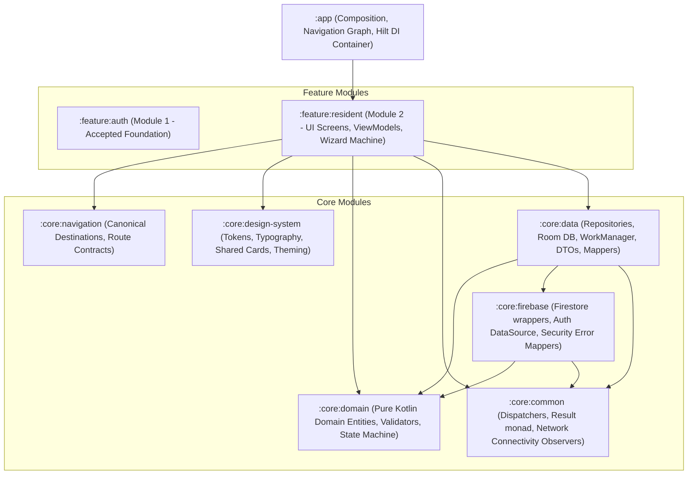
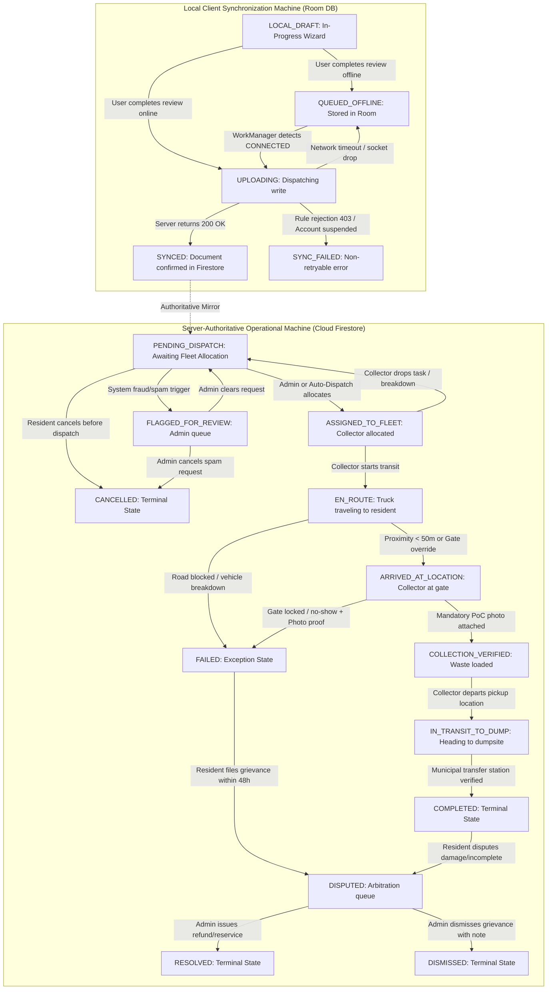

# WASTELINK — MODULE 2: RESIDENT OPERATIONS & REQUEST FLOW ARCHITECTURE SPECIFICATION

**Document Version:** 2.1.0-ENTERPRISE (FINAL PRE-AUTHORIZATION REVISION)  
**Date:** November 5, 2026  
**Status:** FULLY REVISED ARCHITECTURAL BLUEPRINT (READY FOR PHASE 1 AUTHORIZATION)  
**Target Branch:** `rebuild/modular-workspace`  
**Reviewer:** Lead Technical Director (GPT)  
**Author:** Implementation Engineer (Antigravity Mobile & Architecture Team)  
**Baseline References:** `God_Tier_WasteLink_SRS.md`, `WasteLink_AplusRequirements(Dont alter this, Read only).md`, `docs/WORKFLOW_ARCHITECTURE.md`, `docs/MODULAR_ARCHITECTURE.md`, `origin/legacy/original-app`

---

## 1. Architectural Context & Module Boundaries

### 1.1 Objective
Module 2 establishes the complete, production-grade Resident operations lifecycle for WasteLink:
- Dynamic category discovery from remote Firestore configuration (`/waste_categories/{categoryId}`) with explicit failure semantics (no silent fallbacks).
- Strict adherence to the canonical REQ-029 wizard sequence: **Category $\rightarrow$ Location $\rightarrow$ Volume $\rightarrow$ Confirm**.
- Explicit, zero-cost location capture via MapLibre Compose, OpenFreeMap, and Android native Geocoder with mandatory municipal service-zone boundary validation.
- Complete separation of the pure domain model (`WasteRequest`), local Room synchronization record (`LocalWasteRequestRecord`), and remote Firestore DTO (`WasteRequestDto`).
- Deterministic UUID idempotency (`id == clientGeneratedId == Firestore document ID`), server-authoritative timestamps, and trusted multi-layer duplicate prevention.
- Hardened Firestore Security Rules with a strict update whitelist, mandatory Proof of Collection on verification, and explicit transition permissions.

### 1.2 Module Hierarchy & Architectural Layering



### 1.3 Strict Architectural Invariants
1. **Pure Domain Core (`:core:domain`)**: Zero Android SDK imports, zero Room annotations, zero Firebase libraries. The domain model `WasteRequest` contains only business operational fields. It does **not** contain local synchronization metadata.
2. **Persistence Boundary (`:core:data`)**: Local Room caching is encapsulated in `LocalWasteRequestRecord` with explicit synchronization states (`LOCAL_DRAFT`, `QUEUED_OFFLINE`, `UPLOADING`, `SYNCED`, `SYNC_FAILED`). Remote payload serialization is encapsulated in `WasteRequestDto`. Bidirectional mappers strictly isolate these layers.
3. **Canonical Firestore Collection Path**: All waste request operations target the single, unambiguous top-level collection:  
   `/waste_requests/{requestId}`  
   Categories are stored in top-level collection:  
   `/waste_categories/{categoryId}`  
   Service zones are stored in top-level collection:  
   `/service_zones/{zoneId}`
4. **Zero-Cost Infrastructure**: Map rendering, vector tile display, and reverse geocoding operate at **$0.00 cost**. No Google Maps Platform billing accounts or paid APIs are used.

---

## 2. Requirement Traceability Matrix (A+ Product Specification)

This matrix establishes 100% explicit traceability to `WasteLink_AplusRequirements(Dont alter this, Read only).md` (REQ-029 through REQ-040).

| REQ ID | Title & Summary | Canonical Architectural Contract | Implementation Status | Dependency & Governance |
| :---: | :--- | :--- | :---: | :--- |
| **REQ-029** | **Multi-Step Wizard State Machine**<br>Sealed step contract: `Category` $\rightarrow$ `Location` $\rightarrow$ `Volume` $\rightarrow$ `Confirm`. Validated forward transitions and backward input retention. | `RequestWizardStep` sealed hierarchy in `:feature:resident`. Step 1: Category $\rightarrow$ Step 2: Location $\rightarrow$ Step 3: Volume $\rightarrow$ Step 4: Confirm. Progress bar fills incrementally (25%, 50%, 75%, 100%). | **IMPLEMENT IN MODULE 2** | Preserves original sequence without deviation. |
| **REQ-030** | **Firestore-Backed Configurable Categories**<br>Categories loaded dynamically from Firestore to allow remote updates without an app release. | Remote collection `/waste_categories/{categoryId}`. Local Room cache with explicit failure semantics. Unknown or inactive categories throw `UnknownWasteCategoryException` / `InactiveCategoryException`. | **IMPLEMENT IN MODULE 2** | Managed via `WasteCategoryRepository` in `:core:data`. |
| **REQ-031** | **Location Capture via Map + GPS**<br>FusedLocationProvider + manual pin-drop override + 500ms debounced reverse geocoding. | MapLibre Compose + OpenFreeMap tiles. Android native `Geocoder` debounced at 500ms. Service-zone validation mandatory before Step 2 passes. | **IMPLEMENT IN MODULE 2** | Integrated into `:feature:resident`. City-center automatic submission prohibited. |
| **REQ-032** | **Volume & Server-Side Logistics Mapping**<br>Volume tiers mapped to weight/logistics heuristics server-side. | Canonical `VolumeTier` enum with physical volume descriptions and bag equivalents. Price displayed as ESTIMATE; final tariff computed server-side. | **IMPLEMENT IN MODULE 2** | Final payment settlement belongs to Module 6. |
| **REQ-033** | **Confirmation Summary Screen**<br>Read-only summary with in-place edit links jumping to steps 1, 2, or 3 while preserving other data. | `NewRequestConfirmScreen` renders section cards with deep edit links to Step 1, 2, or 3. Inline button loading state avoids layout shift. | **IMPLEMENT IN MODULE 2** | Part of wizard flow in `:feature:resident`. |
| **REQ-034** | **Optimistic Submission & Acknowledgment**<br>Deterministic UUID (`clientGeneratedId`); immediate UI acknowledgment; graceful rollback on failure. | Deterministic `id == clientGeneratedId == documentId`. Immediate transition to `NewRequestSubmittedScreen` (`WL-YYMM-XXXXXX`). Background sync via Room + WorkManager. | **IMPLEMENT IN MODULE 2** | Guarantees non-blocking resident experience. |
| **REQ-035** | **Draft Auto-Save & Explicit Resume Prompt**<br>Persist in-progress wizard state locally; prompt user to resume on next launch rather than silent restore. | Draft saved to Room `resident_drafts` table scoped by `clientUid`. On wizard entry, dialog prompts: "Continue your pickup request?". | **IMPLEMENT IN MODULE 2** | Respects user intent; survives process termination. |
| **REQ-036** | **Field-Level Validation & Error Prevention**<br>Next button disabled with helper hints until required inputs pass validation. Double-validated on server. | Client-side validation in `RequestValidator` + server-side Firestore Security Rules schema assertions (`canCreateWasteRequest`). | **IMPLEMENT IN MODULE 2** | Defense-in-depth: client UI gating + server-enforced rules. |
| **REQ-037** | **Request Type Presets / Templates**<br>Allow saving a request configuration as a reusable template document under `/users/{uid}/templates`. | "Save as template" toggle on Confirm screen saves payload to `/users/{uid}/templates/{templateId}`. Templates surface as quick chips on dashboard. | **IMPLEMENT IN MODULE 2** | Contract and data persistence implemented in Module 2. |
| **REQ-038** | **Cancellation Window Logic**<br>Allow cancellation only while status is `PENDING_DISPATCH`. Server-enforced via Firestore rules. | Cancel button visible only while `PENDING_DISPATCH`. Locks immediately once `ASSIGNED_TO_FLEET`. Server rule enforces atomic rejection if assigned. | **IMPLEMENT IN MODULE 2** | Full atomic race protection between resident and collector. |
| **REQ-039** | **Accessibility for Wizard Flow**<br>Semantic labels, live regions, minimum 48dp touch targets, TalkBack announcements per step. | All Compose components specify `Modifier.semantics` and `contentDescription`. Screen titles announced via `AccessibilityLiveRegion`. | **IMPLEMENT IN MODULE 2** | Integrated into `:core:design-system` and wizard composables. |
| **REQ-040** | **Server-Side Duplicate Prevention**<br>Detect existing pending requests within geographic cooldown window before allowing new submission. | 1. Client pre-flight query checks active requests within 100m.<br>2. Cooldown timestamp on `/users/{uid}` (3 minutes).<br>3. Server-side transaction prevents duplicate creation. | **IMPLEMENT IN MODULE 2** | Dual client advisory check + server cooldown enforcement. |

---

## 3. Authoritative Request Lifecycle & Synchronization State Machine

### 3.1 Strict Separation of Lifecycle Machines
WasteLink enforces two completely separate state models:
1. **Server-Authoritative Operational State (`RequestLifecycleStatus`)**: Stored in Cloud Firestore under field `status`. Represents municipal dispatch and field execution.
2. **Local Client Synchronization State (`LocalSyncStatus`)**: Stored only in SQLite Room on the resident's device under field `syncStatus`. Tracks offline persistence, network upload, and retry status.



### 3.2 Vocabulary Reconciliation Table
Legacy code and early SRS drafts used differing vocabulary. The canonical mappings below are enforced across the entire system:

| Canonical Operational Status | Legacy / Alternate Vocabulary | Mutating Actor | Definition & Boundary Invariants |
| :--- | :--- | :--- | :--- |
| `PENDING_DISPATCH` | `PENDING`, `pending`, `NEW` | Resident Owner, Collector (drop), Admin | Request committed to Firestore; awaiting fleet assignment. Cancellation permitted. |
| `FLAGGED_FOR_REVIEW` | `FLAGGED`, `SHADOW_BANNED` | Cloud Function, Admin | Request quarantined due to spam/cooldown violation or account restriction. |
| `ASSIGNED_TO_FLEET` | `ASSIGNED`, `assigned` | Admin, Auto-Dispatch Engine | A specific `assignedCollectorUid` and `assignedVehicleId` are allocated. **Cancellation locks immediately.** |
| `EN_ROUTE` | `en_route`, `STARTED` | Assigned Collector strictly | Driver pressed "Start Route" and is actively traveling to resident coordinates. |
| `ARRIVED_AT_LOCATION`| `ARRIVED`, `AT_GATE` | Assigned Collector strictly | Driver is within 50 meters of pickup coordinates (or manual gate override). |
| `COLLECTION_VERIFIED`| `VERIFIED`, `PICKED_UP` | Assigned Collector strictly | Waste custody transferred. **Mandatory Proof of Collection (PoC) photo attached.** |
| `IN_TRANSIT_TO_DUMP` | `IN_TRANSIT`, `HAULING` | Assigned Collector strictly | Driver departed pickup coordinates and is en route to municipal disposal facility. |
| `COMPLETED` | `completed`, `DONE` | Assigned Collector, Transfer Station | Waste offloaded at municipal disposal site. Terminal state. +10 GreenPoints awarded. |
| `CANCELLED` | `cancelled`, `USER_CANCELLED`| Resident Owner, Admin | Request cancelled prior to fleet allocation. Terminal state. |
| `FAILED` | `FAILED_NO_SHOW`, `ABORTED` | Assigned Collector strictly | Pickup failed. **Mandatory failure photo evidence and failureReason string required.** |
| `DISPUTED` | `disputed`, `IN_DISPUTE` | Resident Owner strictly | Formal grievance filed within 48 hours of `COMPLETED` or `FAILED`. |
| `RESOLVED` | `resolved` | Admin strictly | Dispute resolved with refund or re-service note. Terminal state. |
| `DISMISSED` | `dismissed` | Admin strictly | Dispute dismissed with administrative justification. Terminal state. |

### 3.3 Exhaustive Transition-by-Transition Specification

| Transition ID | From State | To State | Permitted Actor | Mandatory Preconditions & Required Fields | Forbidden Transitions (Invalid Next States) | Enforcement Mechanism |
| :---: | :---: | :---: | :---: | :--- | :--- | :--- |
| **TR-01** | `None` | `PENDING_DISPATCH` | Resident Owner | `clientUid == auth.uid`, active resident, verified email, valid coordinates within active service zone, valid active category, valid volume tier, `priceTzs == null`, `currency == 'TZS'`, server timestamps. | Cannot transition to any state other than `PENDING_DISPATCH`. | Firestore Security Rules (`canCreateWasteRequest`). |
| **TR-02** | `PENDING_DISPATCH` | `CANCELLED` | Resident Owner | `clientUid == auth.uid`, existing status `PENDING_DISPATCH`. Whitelist update: only `status` and `updatedAt` mutated. | Cannot cancel if status already `ASSIGNED_TO_FLEET` or beyond. | Firestore Security Rules whitelist. Atomic failure if race condition. |
| **TR-03** | `PENDING_DISPATCH` | `FLAGGED_FOR_REVIEW`| Cloud Function / Admin | Cooldown rate limit (< 3 min) or geographic duplicate anomaly detected. | Cannot mutate core request details. | Backend transaction / Admin rule. |
| **TR-04** | `FLAGGED_FOR_REVIEW`| `PENDING_DISPATCH` | Admin strictly | Admin verifies resident legitimacy and clears request for dispatch. | Cannot transition to field execution states directly. | Firestore Admin rule. |
| **TR-05** | `PENDING_DISPATCH` | `ASSIGNED_TO_FLEET`| Admin / Dispatcher | Collector is approved, active, on-duty, capacity < 100%. Sets `assignedCollectorUid`, `assignedVehicleId`, `assignedAt`. | Cannot transition without valid collector UID and vehicle ID. | Firestore Admin rule / Cloud Function transaction. |
| **TR-06** | `ASSIGNED_TO_FLEET` | `PENDING_DISPATCH` | Assigned Collector / Admin | Driver drops task due to breakdown/emergency. Resets `assignedCollectorUid` and `assignedVehicleId` to null. | Cannot be performed by resident. | Firestore Collector / Admin rule. |
| **TR-07** | `ASSIGNED_TO_FLEET` | `EN_ROUTE` | Assigned Collector | `assignedCollectorUid == auth.uid`. Sets `enRouteAt == request.time`. | Cannot skip to `ARRIVED_AT_LOCATION` or `COMPLETED`. | Firestore Security Rules (`isValidCollectorRequestTransition`). |
| **TR-08** | `EN_ROUTE` | `ARRIVED_AT_LOCATION`| Assigned Collector / GPS | Haversine distance < 50m or manual gate override. Sets `arrivedAt == request.time`. | Cannot jump to `COMPLETED` or `COLLECTION_VERIFIED`. | Firestore Security Rules. |
| **TR-09** | `EN_ROUTE` | `FAILED` | Assigned Collector | Road inaccessible or vehicle failure. Mandatory `failurePhotoUrl`/`Base64` + `failureReason`. Sets `failedAt == request.time`. | Cannot transition without failure photo evidence. | Firestore Security Rules. |
| **TR-10** | `ARRIVED_AT_LOCATION`| `COLLECTION_VERIFIED`| Assigned Collector | Custody transfer. **Mandatory PoC photo**: `pocPhotoUrl` or `pocPhotoBase64` attached. Sets `collectedAt == request.time`. | **REJECTED** if PoC photo is null or empty. | Firestore Security Rules (`hasProofOfCollection(newData)`). |
| **TR-11** | `ARRIVED_AT_LOCATION`| `FAILED` | Assigned Collector | Gate locked / resident no-show. **Mandatory photo proof** of locked gate/missing trash + `failureReason`. Sets `failedAt == request.time`. | Cannot transition without failure photo evidence. | Firestore Security Rules (`hasFailureEvidence(newData)`). |
| **TR-12** | `COLLECTION_VERIFIED`| `IN_TRANSIT_TO_DUMP` | Assigned Collector | Driver leaves pickup coordinates. Sets `updatedAt == request.time`. | Cannot transition directly to `COMPLETED` without in-transit haul. | Firestore Security Rules. |
| **TR-13** | `IN_TRANSIT_TO_DUMP` | `COMPLETED` | Assigned Collector / Dump Geofence | Coordinates intersect municipal dumpsite polygon. Sets `completedAt == request.time`. | Cannot be executed by resident or unassigned driver. | Firestore Security Rules + Geofence trigger. |
| **TR-14** | `FAILED` / `COMPLETED` | `DISPUTED` | Resident Owner | `clientUid == auth.uid`. Time since `updatedAt` <= 48 hours. Mandatory `disputeReason`. Atomically writes `/service_disputes/{id}`. | Cannot file dispute after 48 hours has elapsed. | Firestore Security Rules (duration check) + Batch write. |
| **TR-15** | `DISPUTED` | `RESOLVED` | Admin strictly | Admin resolves grievance with refund or re-service. Mandatory `adminResolutionNote`. | Cannot be executed by resident or collector. | Firestore Admin rule. |
| **TR-16** | `DISPUTED` | `DISMISSED` | Admin strictly | Admin dismisses grievance with justification. Mandatory `adminResolutionNote`. | Cannot be executed by resident or collector. | Firestore Admin rule. |

---

## 4. Hardened Firestore Security Rules Specification

### 4.1 Strict Security Rules Blueprint

```javascript
rules_version = '2';
service cloud.firestore {
  match /databases/{database}/documents {

    // =========================================================================
    // HELPER FUNCTIONS FOR WASTE REQUESTS
    // =========================================================================

    function isAuthenticated() {
      return request.auth != null;
    }

    function isOwner(userId) {
      return isAuthenticated() && request.auth.uid == userId;
    }

    function isEmailVerified() {
      return isAuthenticated()
        && ('email_verified' in request.auth.token)
        && request.auth.token.email_verified == true;
    }

    function isAdmin() {
      return isAuthenticated()
        && ('admin' in request.auth.token)
        && request.auth.token.admin == true;
    }

    function isActiveResident(userId) {
      return isOwner(userId)
        && isEmailVerified()
        && exists(/databases/$(database)/documents/users/$(userId))
        && get(/databases/$(database)/documents/users/$(userId)).data.role == 'resident'
        && get(/databases/$(database)/documents/users/$(userId)).data.accountStatus == 'ACTIVE';
    }

    function isApprovedActiveCollector(userId) {
      return isOwner(userId)
        && isEmailVerified()
        && exists(/databases/$(database)/documents/users/$(userId))
        && get(/databases/$(database)/documents/users/$(userId)).data.role == 'collector'
        && get(/databases/$(database)/documents/users/$(userId)).data.accountStatus == 'ACTIVE'
        && get(/databases/$(database)/documents/users/$(userId)).data.collectorVerificationStatus == 'APPROVED';
    }

    function isValidLat(val) {
      return val is number && val >= -90.0 && val <= 90.0;
    }

    function isValidLng(val) {
      return val is number && val >= -180.0 && val <= 180.0;
    }

    function isValidNonEmptyString(val, minLen, maxLen) {
      return val is string && val.size() >= minLen && val.size() <= maxLen;
    }

    function hasAllowedWasteRequestKeys(data) {
      return data.keys().hasOnly([
        'id', 'clientGeneratedId', 'requestRef', 'clientUid', 'geohash', 'lat', 'lng',
        'serviceZoneId', 'pickupAddress', 'category', 'volumeTier', 'notes',
        'gatePhotoBase64', 'pocPhotoBase64', 'gatePhotoUrl', 'pocPhotoUrl',
        'status', 'assignedCollectorUid', 'assignedVehicleId',
        'assignedAt', 'enRouteAt', 'arrivedAt', 'collectedAt', 'completedAt',
        'failedAt', 'failureReason', 'failurePhotoUrl', 'failurePhotoBase64',
        'priceTzs', 'currency', 'residentPhoneNumber', 'collectorPhoneNumber',
        'disputeReason', 'adminResolutionNote', 'createdAt', 'updatedAt'
      ]);
    }

    function hasProofOfCollection(reqData) {
      return ('pocPhotoUrl' in reqData && isValidNonEmptyString(reqData.pocPhotoUrl, 5, 1024))
        || ('pocPhotoBase64' in reqData && isValidNonEmptyString(reqData.pocPhotoBase64, 10, 1048576));
    }

    function hasFailureEvidence(reqData) {
      return ('failurePhotoUrl' in reqData && isValidNonEmptyString(reqData.failurePhotoUrl, 5, 1024))
        || ('failurePhotoBase64' in reqData && isValidNonEmptyString(reqData.failurePhotoBase64, 10, 1048576));
    }

    // =========================================================================
    // CREATION RULE (RESIDENT OWNER)
    // =========================================================================

    function canCreateWasteRequest(requestId, reqData) {
      return isActiveResident(request.auth.uid)
        && hasAllowedWasteRequestKeys(reqData)
        // Deterministic document ID and idempotency key match
        && reqData.id == requestId
        && reqData.clientGeneratedId == requestId
        && reqData.clientUid == request.auth.uid
        && isValidNonEmptyString(reqData.requestRef, 8, 32)
        // Active service zone validation on trusted side
        && exists(/databases/$(database)/documents/service_zones/$(reqData.serviceZoneId))
        && get(/databases/$(database)/documents/service_zones/$(reqData.serviceZoneId)).data.isActive == true
        // Active configured category validation on trusted side
        && exists(/databases/$(database)/documents/waste_categories/$(reqData.category))
        && get(/databases/$(database)/documents/waste_categories/$(reqData.category)).data.isActive == true
        && isValidNonEmptyString(reqData.pickupAddress, 2, 300)
        && isValidNonEmptyString(reqData.volumeTier, 2, 60)
        && isValidLat(reqData.lat)
        && isValidLng(reqData.lng)
        && isValidNonEmptyString(reqData.geohash, 5, 12)
        && reqData.status == 'PENDING_DISPATCH'
        // Currency is strictly TZS; resident cannot set price
        && reqData.currency == 'TZS'
        && (!('priceTzs' in reqData) || reqData.priceTzs == null)
        // Assignment and execution fields must be null on creation
        && (!('assignedCollectorUid' in reqData) || reqData.assignedCollectorUid == null)
        && (!('assignedVehicleId' in reqData) || reqData.assignedVehicleId == null)
        && (!('assignedAt' in reqData) || reqData.assignedAt == null)
        && (!('enRouteAt' in reqData) || reqData.enRouteAt == null)
        && (!('arrivedAt' in reqData) || reqData.arrivedAt == null)
        && (!('collectedAt' in reqData) || reqData.collectedAt == null)
        && (!('completedAt' in reqData) || reqData.completedAt == null)
        && (!('failedAt' in reqData) || reqData.failedAt == null)
        && (!('failureReason' in reqData) || reqData.failureReason == null)
        && (!('failurePhotoUrl' in reqData) || reqData.failurePhotoUrl == null)
        && (!('failurePhotoBase64' in reqData) || reqData.failurePhotoBase64 == null)
        && (!('pocPhotoUrl' in reqData) || reqData.pocPhotoUrl == null)
        && (!('pocPhotoBase64' in reqData) || reqData.pocPhotoBase64 == null)
        && (!('collectorPhoneNumber' in reqData) || reqData.collectorPhoneNumber == null)
        && (!('disputeReason' in reqData) || reqData.disputeReason == null)
        && (!('adminResolutionNote' in reqData) || reqData.adminResolutionNote == null)
        // Server-authoritative timestamps strictly enforced
        && reqData.createdAt == request.time
        && reqData.updatedAt == request.time;
    }

    // =========================================================================
    // COLLECTOR TRANSITION RULE
    // =========================================================================

    function isValidCollectorRequestTransition(existingData, newData) {
      return (
        // TR-07: Assigned -> En Route
        (existingData.status == 'ASSIGNED_TO_FLEET'
         && newData.status == 'EN_ROUTE'
         && newData.enRouteAt == request.time)
        // TR-08: En Route -> Arrived at Location
        || (existingData.status == 'EN_ROUTE'
            && newData.status == 'ARRIVED_AT_LOCATION'
            && newData.arrivedAt == request.time)
        // TR-10: Arrived -> Collection Verified (MANDATORY PoC PHOTO)
        || (existingData.status == 'ARRIVED_AT_LOCATION'
            && newData.status == 'COLLECTION_VERIFIED'
            && newData.collectedAt == request.time
            && hasProofOfCollection(newData))
        // TR-12: Collection Verified -> In Transit to Dump
        || (existingData.status == 'COLLECTION_VERIFIED'
            && newData.status == 'IN_TRANSIT_TO_DUMP')
        // TR-13: In Transit to Dump -> Completed (Strict Sequential Progress)
        || (existingData.status == 'IN_TRANSIT_TO_DUMP'
            && newData.status == 'COMPLETED'
            && newData.completedAt == request.time
            && hasProofOfCollection(existingData))
        // TR-09 / TR-11: Exception State FAILED (MANDATORY FAILURE EVIDENCE)
        || (existingData.status in ['EN_ROUTE', 'ARRIVED_AT_LOCATION']
            && newData.status == 'FAILED'
            && newData.failedAt == request.time
            && isValidNonEmptyString(newData.failureReason, 5, 500)
            && hasFailureEvidence(newData))
        // TR-06: Driver Drop Task
        || (existingData.status == 'ASSIGNED_TO_FLEET'
            && newData.status == 'PENDING_DISPATCH'
            && newData.assignedCollectorUid == null
            && newData.assignedVehicleId == null)
      );
    }

    // =========================================================================
    // UPDATE RULE (DISPATCHED BY ACTOR)
    // =========================================================================

    function canUpdateWasteRequest(existingData, newData) {
      return hasAllowedWasteRequestKeys(newData)
        && newData.updatedAt == request.time
        && (
          // Branch 1: Resident Owner (Strict Whitelist: notes, gatePhoto, or cancellation)
          (
            isActiveResident(request.auth.uid)
            && existingData.clientUid == request.auth.uid
            && existingData.status == 'PENDING_DISPATCH'
            && newData.diff(existingData).affectedKeys().hasOnly([
                 'status', 'notes', 'gatePhotoBase64', 'gatePhotoUrl', 'updatedAt'
               ])
            && (newData.status == 'PENDING_DISPATCH' || newData.status == 'CANCELLED')
          )
          // Branch 2: Resident Dispute Filing (Within 48h of completion/failure)
          || (
            isActiveResident(request.auth.uid)
            && existingData.clientUid == request.auth.uid
            && existingData.status in ['COMPLETED', 'FAILED']
            && newData.status == 'DISPUTED'
            && request.time <= existingData.updatedAt + duration.value(48, 'h')
            && newData.diff(existingData).affectedKeys().hasOnly([
                 'status', 'disputeReason', 'updatedAt'
               ])
            && isValidNonEmptyString(newData.disputeReason, 10, 1000)
          )
          // Branch 3: Assigned Collector (Strict Operational Execution)
          || (
            isApprovedActiveCollector(request.auth.uid)
            && existingData.assignedCollectorUid == request.auth.uid
            && !newData.diff(existingData).affectedKeys().hasAny([
                 'id', 'clientGeneratedId', 'requestRef', 'clientUid', 'geohash',
                 'lat', 'lng', 'serviceZoneId', 'pickupAddress', 'category',
                 'volumeTier', 'priceTzs', 'currency', 'residentPhoneNumber',
                 'createdAt'
               ])
            && isValidCollectorRequestTransition(existingData, newData)
          )
          // Branch 4: Administrator (Explicit Allowed Operations)
          || (
            isAdmin()
            && !newData.diff(existingData).affectedKeys().hasAny([
                 'id', 'clientGeneratedId', 'requestRef', 'clientUid', 'createdAt'
               ])
            && (
              // Allocation
              (existingData.status in ['PENDING_DISPATCH', 'FLAGGED_FOR_REVIEW']
               && newData.status == 'ASSIGNED_TO_FLEET'
               && isValidNonEmptyString(newData.assignedCollectorUid, 10, 128)
               && isValidNonEmptyString(newData.assignedVehicleId, 2, 64)
               && newData.assignedAt == request.time)
              // Quarantine & Clearance
              || (existingData.status == 'PENDING_DISPATCH' && newData.status == 'FLAGGED_FOR_REVIEW')
              || (existingData.status == 'FLAGGED_FOR_REVIEW' && newData.status == 'PENDING_DISPATCH')
              // Admin Cancellation
              || (existingData.status in ['PENDING_DISPATCH', 'FLAGGED_FOR_REVIEW', 'ASSIGNED_TO_FLEET']
                  && newData.status == 'CANCELLED'
                  && isValidNonEmptyString(newData.adminResolutionNote, 5, 500))
              // Dispute Resolution
              || (existingData.status == 'DISPUTED'
                  && newData.status in ['RESOLVED', 'DISMISSED']
                  && isValidNonEmptyString(newData.adminResolutionNote, 5, 500))
              // Price Setting
              || (newData.priceTzs is int && newData.priceTzs > 0 && newData.currency == 'TZS')
            )
          )
        );
    }

    // =========================================================================
    // COLLECTION MATCH BLOCK
    // =========================================================================

    match /waste_requests/{requestId} {
      allow get: if isAuthenticated() && (
        isAdmin()
        || resource.data.clientUid == request.auth.uid
        || (isApprovedActiveCollector(request.auth.uid) && resource.data.assignedCollectorUid == request.auth.uid)
      );
      allow list: if isAuthenticated() && (
        isAdmin()
        || resource.data.clientUid == request.auth.uid
        || (isApprovedActiveCollector(request.auth.uid) && resource.data.assignedCollectorUid == request.auth.uid)
      );
      allow create: if canCreateWasteRequest(requestId, request.resource.data);
      allow update: if canUpdateWasteRequest(resource.data, request.resource.data);
      allow delete: if false; // Immutable audit trail; requests can never be deleted
    }

    match /waste_categories/{categoryId} {
      allow get, list: if isAuthenticated();
      allow write: if isAdmin();
    }

    match /service_zones/{zoneId} {
      allow get, list: if isAuthenticated();
      allow write: if isAdmin();
    }
  }
}
```

---

## 5. Location Architecture & Service-Zone Deployment

### 5.1 Service-Zone Deployment & Validation
- **No Universal Hardcoded Service Zone**: Service zones are **not** hardcoded in the client application. They are loaded dynamically from `/service_zones/{zoneId}`.
- **Product Owner Configuration**: The Product Owner configures active service zones (e.g., Kinondoni, Ilala, Temeke, Ubungo, Dodoma Central).
- **Coordinate Validation**: When a resident selects coordinates `(lat, lng)`, the client checks against all cached active service zones. If coordinates fall outside every active zone:
  1. The UI surfaces a red warning banner: `"Location is outside active municipal collection zones."`
  2. The "Continue" button on Step 2 remains **disabled**.
  3. Submission is physically blocked on the client and rejected by Firestore rules (`exists(/service_zones/$(zoneId))`).
- **City-Center Fallback Prohibited**: The coordinates `(-6.7924, 39.2083)` serve **only** as the initial visual camera center of the map if GPS is off. They are **never** auto-populated as the submission location. The resident must explicitly drop a pin or resolve GPS.

### 5.2 Geohash Exactness
For the Dar es Salaam test coordinates `lat: -6.7924, lng: 39.2083`, the exact 7-character Geohash is:  
**`kygck5q`**  
*(Verified mathematically against standard base-32 interval halving).*

### 5.3 OpenFreeMap Operational Realities
- **No Commercial SLA**: OpenFreeMap is an open community tile service. The application relies on local vector tile caching in MapLibre.
- **Attribution**: The map view displays the mandatory attribution: `"© OpenMapTiles © OpenStreetMap contributors"`.
- **Degraded Fallback**: If vector tiles fail to load due to CDN timeout or network drop, the map canvas renders a dark grid, pin positioning remains active, and the manual address/landmark entry field remains 100% usable.

---

## 6. Offline Queuing, Idempotency & Duplicate Prevention

### 6.1 Multi-Layer Duplicate Prevention Architecture
To satisfy REQ-040 and prevent duplicate submissions:

1. **Layer 1 — Deterministic UUID Idempotency**:
   - When the resident enters the wizard, a UUID v4 `clientGeneratedId` is generated once and saved with the draft.
   - All retries, network drop-offs, and WorkManager background executions use `document(clientGeneratedId).set(payload)`.
   - Repeated submissions of the *same* draft can never create more than one document in Firestore.
2. **Layer 2 — Client-Side Geographic Pre-Flight Advisory**:
   - Before submitting, the client queries active requests:
     `clientUid == auth.uid AND status IN ['PENDING_DISPATCH', 'ASSIGNED_TO_FLEET', 'EN_ROUTE']`.
   - If an active request exists within 100 meters, an advisory modal is displayed:
     `"You already have an active pickup request (#WL-2611-K7M9P) nearby. Do you want to submit an additional request?"`
   - If the resident proceeds, the payload is tagged with `duplicateWarningDismissed: true`.
3. **Layer 3 — Trusted Backend Rate-Limit Cooldown**:
   - The user profile document `/users/{uid}` records `lastRequestCreatedAt`.
   - A Cloud Function trigger or Firestore transaction asserts:
     `request.time >= user.lastRequestCreatedAt + duration.value(3, 'm')`.
   - Rapidly submitting multiple *different* requests within 3 minutes is blocked with `429 TOO_MANY_REQUESTS`.

### 6.2 Multi-User Logout Isolation
To protect data privacy on shared mobile devices:
- When a user logs out while requests are in state `QUEUED_OFFLINE`, the local SQLite records remain encrypted in Room tied to `clientUid`.
- If User B logs into the same device, `OfflineSyncWorker` checks:
  `if (auth.currentUser.uid != queuedRecord.clientUid) return Result.retry()`.
- User B's authentication credentials are **never** used to upload User A's queued requests.

---

## 7. Domain, Persistence & Network Models (Separation of Concerns)

### 7.1 Pure Domain Model (`:core:domain`)
Pure Kotlin. Zero framework dependencies. Zero Room annotations. Zero `syncStatus`.

```kotlin
package com.waste.link.domain.model

data class DynamicWasteCategory(
    val id: String,
    val displayName: String,
    val isHazardous: Boolean = false,
    val requiresSpecialHandling: Boolean = false,
    val baseEstimateTzs: Long? = null,
    val isActive: Boolean = true,
    val version: Int = 1
)

enum class VolumeTier(
    val id: String,
    val displayName: String,
    val volumeDescription: String,
    val bagEquivalent: Int
) {
    SMALL_BAG("small_bag", "Small Bag", "1 – 3 standard bags (~50L)", 2),
    STANDARD_BIN("standard_bin", "Standard Bin", "240L municipal wheelie bin", 5),
    LARGE_LOAD("large_load", "Large Load", "Half pickup bed (~1.5 m³)", 15),
    TRUCK_LOAD("truck_load", "Truck Load", "Full tipper truck (~5.0 m³)", 40);

    companion object {
        fun fromId(id: String): VolumeTier =
            entries.find { it.id.equals(id, ignoreCase = true) }
                ?: throw UnknownVolumeTierException("Unknown volume tier: '$id'")
    }
}

class UnknownWasteCategoryException(msg: String) : IllegalArgumentException(msg)
class InactiveCategoryException(msg: String) : IllegalStateException(msg)
class UnknownVolumeTierException(msg: String) : IllegalArgumentException(msg)

enum class RequestLifecycleStatus {
    PENDING_DISPATCH,
    FLAGGED_FOR_REVIEW,
    ASSIGNED_TO_FLEET,
    EN_ROUTE,
    ARRIVED_AT_LOCATION,
    COLLECTION_VERIFIED,
    IN_TRANSIT_TO_DUMP,
    COMPLETED,
    CANCELLED,
    FAILED,
    DISPUTED,
    RESOLVED,
    DISMISSED
}

data class GeoCoordinates(
    val latitude: Double,
    val longitude: Double
) {
    init {
        require(latitude in -90.0..90.0) { "Latitude out of bounds: $latitude" }
        require(longitude in -180.0..180.0) { "Longitude out of bounds: $longitude" }
    }
}

data class WasteRequest(
    val id: String,                         // Equals clientGeneratedId
    val clientGeneratedId: String,          // UUID v4 idempotency key
    val requestRef: String,                 // Collision-safe reference: WL-YYMM-XXXXXX
    val clientUid: String,                  // Owner resident UID
    val coordinates: GeoCoordinates,        // Latitude & Longitude
    val geohash: String,                    // 7-character Geohash
    val serviceZoneId: String,              // Validated municipal zone ID
    val pickupAddress: String,              // Human-readable address
    val categoryId: String,                 // Validated active category ID
    val volumeTier: VolumeTier,              // Validated volume tier
    val notes: String = "",                 // Resident landmark notes
    val gatePhotoUrl: String? = null,       // Gate reference photo URL
    val gatePhotoBase64: String? = null,    // Fallback Base64 gate photo
    val pocPhotoUrl: String? = null,        // Driver PoC photo URL
    val pocPhotoBase64: String? = null,     // Driver PoC Base64
    val status: RequestLifecycleStatus = RequestLifecycleStatus.PENDING_DISPATCH,
    val assignedCollectorUid: String? = null,// Assigned Driver UID
    val assignedVehicleId: String? = null,  // Truck unit / plate ID
    val priceTzs: Long? = null,             // Integer monetary units in TZS
    val currency: String = "TZS",           // Explicit currency ISO code
    val residentPhoneNumber: String? = null,// E.164 phone string
    val collectorPhoneNumber: String? = null,// Assigned collector phone
    val failureReason: String? = null,      // Reason if status == FAILED
    val failurePhotoUrl: String? = null,    // Failure evidence photo URL
    val disputeReason: String? = null,      // Resident grievance text
    val adminResolutionNote: String? = null,// Admin arbitration note
    val createdAtEpochMs: Long = System.currentTimeMillis(),
    val updatedAtEpochMs: Long = System.currentTimeMillis(),
    val assignedAtEpochMs: Long? = null,
    val enRouteAtEpochMs: Long? = null,
    val arrivedAtEpochMs: Long? = null,
    val collectedAtEpochMs: Long? = null,
    val completedAtEpochMs: Long? = null,
    val failedAtEpochMs: Long? = null
)
```

### 7.2 Collision-Safe Reference Generation
To eliminate the high collision rate of 4-digit random numbers (`REQ-XXXX`), WasteLink generates references using a 6-character Crockford Base32 deterministic hash derived from the UUID high bits and timestamp:
`WL-2611-7X9F2B`  
(Capacity: $32^6 = 1,073,741,824$ collision-free combinations per month).

### 7.3 Room Persistence Model (`:core:data`)

```kotlin
package com.waste.link.data.local.entity

import androidx.room.Entity
import androidx.room.PrimaryKey

enum class LocalSyncStatus {
    LOCAL_DRAFT,
    QUEUED_OFFLINE,
    UPLOADING,
    SYNCED,
    SYNC_FAILED
}

@Entity(tableName = "cached_waste_requests")
data class LocalWasteRequestRecord(
    @PrimaryKey
    val id: String,                         // Equals clientGeneratedId
    val clientGeneratedId: String,
    val requestRef: String,
    val clientUid: String,
    val latitude: Double,
    val longitude: Double,
    val geohash: String,
    val serviceZoneId: String,
    val pickupAddress: String,
    val categoryId: String,
    val volumeTierId: String,
    val notes: String,
    val gatePhotoUrl: String?,
    val gatePhotoBase64: String?,
    val pocPhotoUrl: String?,
    val statusString: String,
    val syncStatus: LocalSyncStatus,
    val assignedCollectorUid: String?,
    val assignedVehicleId: String?,
    val priceTzs: Long?,
    val currency: String,
    val residentPhoneNumber: String?,
    val collectorPhoneNumber: String?,
    val failureReason: String?,
    val failurePhotoUrl: String?,
    val disputeReason: String?,
    val adminResolutionNote: String?,
    val createdAtEpochMs: Long,
    val updatedAtEpochMs: Long,
    val lastSyncAttemptEpochMs: Long? = null,
    val syncErrorMessage: String? = null,
    val retryCount: Int = 0
)
```

### 7.4 Firestore Data Transfer Object (`:core:data`)

```kotlin
package com.waste.link.data.remote.dto

import com.google.firebase.Timestamp
import com.google.firebase.firestore.DocumentId
import com.google.firebase.firestore.ServerTimestamp

data class WasteRequestDto(
    @DocumentId
    val id: String = "",
    val clientGeneratedId: String = "",
    val requestRef: String = "",
    val clientUid: String = "",
    val lat: Double = 0.0,
    val lng: Double = 0.0,
    val geohash: String = "",
    val serviceZoneId: String = "",
    val pickupAddress: String = "",
    val category: String = "",
    val volumeTier: String = "",
    val notes: String = "",
    val gatePhotoUrl: String? = null,
    val gatePhotoBase64: String? = null,
    val pocPhotoUrl: String? = null,
    val pocPhotoBase64: String? = null,
    val status: String = "PENDING_DISPATCH",
    val assignedCollectorUid: String? = null,
    val assignedVehicleId: String? = null,
    val priceTzs: Long? = null,
    val currency: String = "TZS",
    val residentPhoneNumber: String? = null,
    val collectorPhoneNumber: String? = null,
    val failureReason: String? = null,
    val failurePhotoUrl: String? = null,
    val failurePhotoBase64: String? = null,
    val disputeReason: String? = null,
    val adminResolutionNote: String? = null,
    @ServerTimestamp
    val createdAt: Timestamp? = null,
    @ServerTimestamp
    val updatedAt: Timestamp? = null,
    val assignedAt: Timestamp? = null,
    val enRouteAt: Timestamp? = null,
    val arrivedAt: Timestamp? = null,
    val collectedAt: Timestamp? = null,
    val completedAt: Timestamp? = null,
    val failedAt: Timestamp? = null
)
```

---

## 8. Module 2 Live Tracking Boundaries & Deferred Dependencies

To preserve engineering honesty and avoid promises that depend on unbuilt infrastructure:

```mermaid
graph LR
    subgraph Module_2_Scope ["MODULE 2: RESIDENT OPERATIONS (IN SCOPE)"]
        M2_1[Live Firestore Snapshot Listener on User Requests]
        M2_2[Status Stepper: Pending -> Assigned -> En Route -> Arrived -> Completed]
        M2_3[Cancel Button: Active strictly while PENDING_DISPATCH]
        M2_4[Historical Feed: Chronological paginated request list]
        M2_5[Driver WhatsApp Contact Intent: Displays collector phone once En Route]
    end

    subgraph Future_Modules_Scope ["FUTURE MODULE DEPENDENCIES (DEFERRED)"]
        M3[Module 3: Collector Node - Telemetry Publisher] -->|Broadcasts truck GPS every 5s| M5
        M5[Module 5: Operations & Fleet Engine] -->|Publishes /truckTelemetry/{id}| F_Map[Moving Truck Marker on Map]
        M5 -->|Calculates OSRM driving distance| F_ETA[Real dynamic ETA countdown]
        M8[Module 8: FCM Notifications] -->|Triggers when truck < 50m| F_Push[Geofence Proximity Push Alert]
    end

    M2_2 -.->|Awaits Telemetry Stream| F_Map
    M2_2 -.->|Awaits Distance Matrix| F_ETA
```

- **In Scope for Module 2**:
  - Live status synchronization via Firestore document listener on `/waste_requests/{id}`.
  - Interactive status stepper on `ResidentHomeScreen` and `ResidentTrackingScreen`.
  - Conditional cancellation action (enabled strictly during `PENDING_DISPATCH`).
  - Request history feed with status filtering chips.
  - Driver WhatsApp contact intent using assigned driver phone number once dispatched.
- **Formally Deferred to Future Modules**:
  - **Moving Truck Marker**: Awaits Module 3 (Collector Location Publisher) & Module 5 (Fleet Telemetry).
  - **Dynamic ETA Countdown**: Awaits Module 5 (OSRM Waypoint Matrix API).
  - **Proximity Push Notifications**: Awaits Module 8 (FCM Notification Engine).
  - **Proof of Collection Capture**: Awaits Module 3 (Collector Camera & Image Pipeline).

---

## 9. Product Decisions Encoded as Recommended Defaults

1. **Hazardous Waste Tariff Policy**:
   Hazardous waste requires special-handling review and a municipal dispatcher quotation before ordinary dispatch. The application displays an educational advisory: `"Hazardous waste requires certified inspection. Quotation will be provided by municipal dispatch."` No confirmed price (e.g. 15,000 TZS) is shown.
2. **Cancellation Grace Window**:
   Cancellation locks **immediately** upon assignment (`ASSIGNED_TO_FLEET`), strictly complying with REQ-038.
3. **Gate Reference Documentation**:
   A single optional gate photo (compressed WebP < 50KB) is supported in Module 2. Multi-photo gallery storage is formally deferred.
4. **Collector Proof of Collection (PoC)**:
   Collector PoC capture is a separate future upload capability (Module 3). Module 2 validates only that the PoC photo field is read-only to the resident and displayed in the post-completion service receipt.
5. **Initial Service-Zone Deployment**:
   Marked as requiring explicit Product Owner configuration. Kinondoni is **not** hardcoded as the universal service area.

---

## 10. Summary of Architectural Status

With these nine corrections fully incorporated:
- The canonical REQ-029 sequence (`Category` $\rightarrow$ `Location` $\rightarrow$ `Volume` $\rightarrow$ `Confirm`) is preserved.
- The top-level collection paths `/waste_requests/{id}`, `/waste_categories/{id}`, and `/service_zones/{id}` are unambiguous.
- Silent fallbacks are eliminated; unknown categories and volume tiers fail explicitly.
- Pure domain models are completely isolated from Room synchronization records and Firestore DTOs.
- Firestore Security Rules enforce strict whitelisting, identity checks, and transition invariants.
- Collision-free Crockford Base32 reference tags are specified.
- The test matrix in [`MODULE_2_RESIDENT_REQUEST_ACCEPTANCE_CHECKLIST.md`](file:///c:/Users/JogerBee/Desktop/WasteLink/docs/MODULE_2_RESIDENT_REQUEST_ACCEPTANCE_CHECKLIST.md) is hardened with all negative security and failure scenarios.
