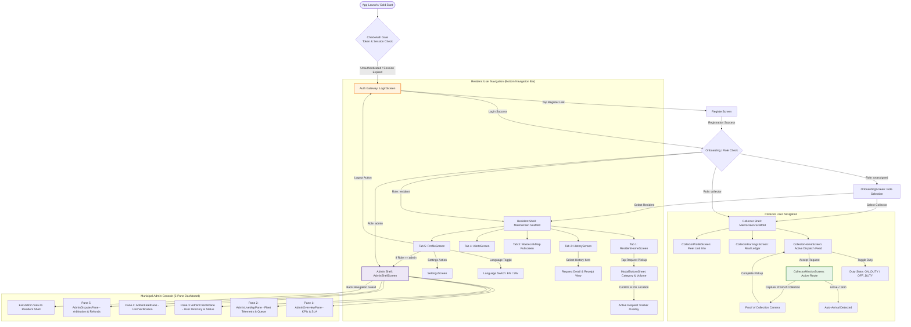
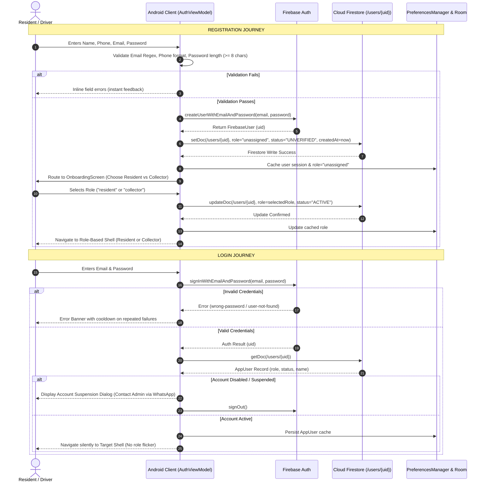
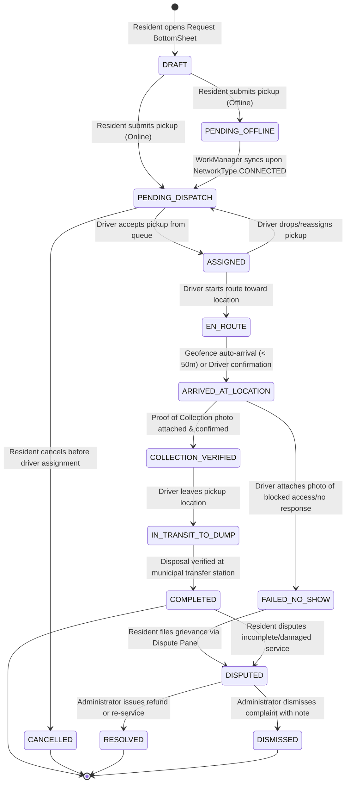
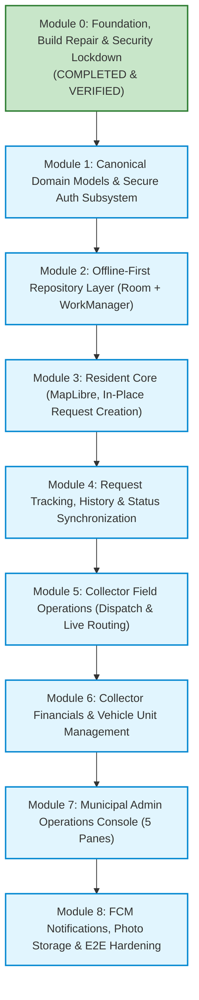

# WASTELINK — PRODUCT WORKFLOW ARCHITECTURE & FLOW-FIRST SPECIFICATION

**Document Version:** 1.0.0-ENTERPRISE  
**Date:** November 4, 2026  
**Audience:** Product Owner, Lead System Architect (ChatGPT), Senior Mobile Engineers  
**Source Baseline:** `God_Tier_WasteLink_SRS.md`, `WasteLink_AplusRequirements.md`, Android Jetpack Compose Codebase  

---

## 1. Executive Overview & Development Philosophy

WasteLink is an enterprise municipal solid waste logistics platform tailored for urban East Africa (principally Dar es Salaam, Dodoma, and Arusha, Tanzania). The application orchestrates coordination among three core operational personas:
1. **Residents / Commercial Clients (`CLIENT` / `resident`):** Municipal residents or businesses requesting on-demand or scheduled solid, recyclable, or hazardous waste pickups.
2. **Collectors / Fleet Operators (`DRIVER` / `collector`):** Field drivers operating compactor trucks, flatbed trucks, or tricycles executing pickups, navigating via live routing, and capturing cryptographic Proof of Collection (PoC).
3. **Municipal Administrators (`ADMIN` / `sysadmin`):** Municipal solid waste authorities and dispatchers overseeing live operations via GIS vector maps, managing fleets, arbitrating service disputes, and auditing compliance.

### The Flow-First Principle
Under the Flow-First Engineering Directive:
- **No isolated UI development:** Screens are never built without defined end-to-end user journeys.
- **Contract-first interactions:** Every interactive element (button, chip, slider) must map to a registered interaction contract with defined preconditions, business validations, loading states, success states, and failure recovery.
- **Strict Single-Module Progression:** A module is only complete when its end-to-end journey passes automated tests and emulator validation. Work on subsequent modules is blocked until the current module meets the Definition of Done.

---

## 2. Complete Application Navigation Architecture

The master navigation system is driven by a single-activity Jetpack Compose Navigation Host (`WasteLinkNavGraph`) with unidirectional state observation and route protection guards.

### Master Navigation Map



### Centralized Route Registry

| Route Key | Screen Composable | Allowed Roles | Entry Point | Exit Point | Hardware Back Button Behavior |
| :--- | :--- | :--- | :--- | :--- | :--- |
| `check_auth` | CircularProgressIndicator / Splash | Any | Cold app launch | `login`, `onboarding`, or Role Shell | Terminates app |
| `login` | `LoginScreen` | Unauthenticated | `check_auth`, Logout | `register`, `onboarding`, Role Shell | Exits app |
| `register` | `RegisterScreen` | Unauthenticated | `login` | `onboarding`, Role Shell | Pops to `login` |
| `onboarding` | `OnboardingScreen` | `unassigned` | `register`, `login` | `resident_home`, `collector_dashboard` | Prompts logout / cannot skip |
| `resident_home` | `ResidentHomeScreen` | `resident`, `admin` | `check_auth`, Role switch | Bottom bar navigation | Double-tap to exit |
| `history` | `HistoryScreen` | `resident`, `admin` | Bottom bar | Bottom bar navigation | Switches to `resident_home` |
| `map_view` | `WasteLinkMap` | `resident`, `admin` | Bottom bar | Bottom bar navigation | Switches to `resident_home` |
| `alerts` | `AlertsScreen` | `resident`, `admin` | Bottom bar | Bottom bar navigation | Switches to `resident_home` |
| `profile` | `ProfileScreen` | `resident`, `collector`, `admin` | Bottom bar | `settings`, `admin_shell`, `login` | Switches to `resident_home` |
| `settings` | `SettingsScreen` | All authenticated | `profile` | `profile` | Pops back to `profile` |
| `collector_dashboard` | `CollectorHomeScreen` | `collector`, `admin` | `check_auth`, Role switch | `collector_mission`, `profile` | Double-tap to exit |
| `collector_mission/{id}`| `CollectorMissionScreen` | `collector`, `admin` | `collector_dashboard` | `collector_dashboard` on completion | Warns: "Abort mission?" modal |
| `admin_shell` | `AdminShellScreen` | `admin` strictly | `profile` (Admin Portal) | `profile` | Returns to `profile` |

---

## 3. Authentication & Registration Flow Architecture

Per `REQ-AUTH-001` through `REQ-AUTH-011` and enterprise guidelines, authentication guarantees complete account provisioning, strict input validation, and zero client-side privilege escalation.

### Registration & Login State Machine



### Core Security Rules for Authentication
1. **Zero Client Elevation:** Client applications can only assign role `"resident"` or `"collector"` during onboarding. Role `"admin"` is rejected with `IllegalArgumentException` and strictly blocked by Firestore Security Rules.
2. **Session Revival:** On `MainActivity.onCreate()`, `checkCurrentUser()` validates `FirebaseAuth.currentUser`. If token is expired, silent refresh via `getIdToken(true)` is attempted before dropping to login.
3. **Session Revocation:** If an administrator disables a user in `AdminClientsPane`, Firestore snapshot updates trigger forced sign-out on the user device with an explanatory modal.

---

## 4. Resident Journey Map: End-to-End Waste Request Lifecycle

```mermaid
flowchart TD
    Start([Resident Opens App]) --> CheckLoc{Location Permission?}
    CheckLoc -->|Denied| RequestPerm[Educational Rationale & System Dialog]
    CheckLoc -->|Granted| ShowMap[Render MapLibre Vector Map at GPS]
    RequestPerm --> ShowMap
    
    ShowMap --> BottomBar[Bottom Action: Request Waste Pickup]
    BottomBar --> OpenSheet[Open ModalBottomSheet: In-Place Wizard]
    
    subgraph Request_Configuration ["Request Configuration"]
        OpenSheet --> SelectCategory[1. Select Waste Category: Organic, Plastic, E-Waste, Hazard]
        SelectCategory --> SelectVolume[2. Adjust Volume Slider: 1 - 10 Standard Bags]
        SelectVolume --> ReverseGeocode[3. Auto Reverse-Geocode Coordinates via Nominatim]
        ReverseGeocode --> AddLandmark[4. Optional: Landmark Note / Find My Gate Photo]
        AddLandmark --> CostEst[5. Real-Time Price Estimation Calculated]
    end

    CostEst --> SubmitBtn{Press Confirm Pickup}
    
    SubmitBtn --> NetworkCheck{Network Available?}
    
    NetworkCheck -->|Online| WriteFirestore[Write to /wasteRequests/{id} status: PENDING_DISPATCH]
    NetworkCheck -->|Offline| WriteRoom[Write to Room DB cached_waste_requests status: PENDING_OFFLINE]
    WriteRoom --> EnqueueWork[Enqueue WorkManager OneTimeWorkRequest with CONNECTED constraint]
    
    WriteFirestore --> ShowTracker[Dismiss Sheet & Show Active Tracker Card on Map]
    EnqueueWork --> ShowOfflineBanner[Show Offline Queue Banner & Local Tracker Card]
    
    ShowTracker --> CollectorEnRoute{Collector Dispatched?}
    CollectorEnRoute -->|Status: EN_ROUTE| LiveTelemetry[MapLibre interpolates truck pin from telemetry]
    CollectorEnRoute -->|Status: ARRIVED| ArrivedAlert[Trigger Arrival Banner & Vibration]
    ArrivedAlert -->|Status: COMPLETED| PickupDone[Show Pickup Complete Card & GreenPoints +10]
    PickupDone --> DisputeOption{Issue with pickup?}
    DisputeOption -->|Yes| OpenDispute[Submit Dispute to /service_disputes]
    DisputeOption -->|No| Done([Request Archived to History])
```

---

## 5. Collector Journey Map: Field Operations & Proof of Collection

```mermaid
flowchart TD
    Start([Driver Opens App]) --> DutyToggle{Toggle Duty State}
    DutyToggle -->|OFF DUTY| IdleState[Map in Standby - No Dispatch Ingestion]
    DutyToggle -->|ON DUTY| StartService[Start Foreground Service with FOREGROUND_SERVICE_LOCATION]
    
    StartService --> TelemetryLoop[Broadcast GPS Telemetry to /operational_units every 5s]
    StartService --> ListenRequests[Listen for PENDING_DISPATCH requests in assigned zone]
    
    ListenRequests --> IncomingJob[New Request Alert Card Appears]
    IncomingJob --> Decision{Driver Action within 60s}
    Decision -->|Reject| ReturnToFeed[Return to Pool for next driver]
    Decision -->|Accept| AssignRequest[Atomically update /wasteRequests/{id} status: ASSIGNED]
    
    AssignRequest --> OpenRoute[CollectorMissionScreen: Active Guidance]
    OpenRoute --> TurnByTurn[Real GPS Navigation with OSRM Waypoint Route]
    
    TurnByTurn --> ProximityCheck{Haversine Distance < 50m to Gate?}
    ProximityCheck -->|Yes| AutoArrived[Auto-transition status: ARRIVED_AT_LOCATION + Vibration]
    ProximityCheck -->|No| TurnByTurn
    
    AutoArrived --> ResidentContact{Resident Missing?}
    ResidentContact -->|Yes| WhatsAppSOS[Tap 1-Touch WhatsApp SOS: Pre-filled text to resident]
    WhatsAppSOS --> NoShowDecision{Resident unreachable?}
    NoShowDecision -->|Yes| MarkNoShow[Capture Photo Proof -> status: FAILED_NO_SHOW]
    
    ResidentContact -->|No / Trash Present| CapturePoC[Capture Mandatory Proof of Collection Photo]
    CapturePoC --> ValidatePhoto{Photo Verified & Compressed?}
    ValidatePhoto -->|Valid Base64/Storage URL| CompletePickup[Transition status: COLLECTION_VERIFIED -> COMPLETED]
    
    CompletePickup --> UpdateCapacity[Increment Vehicle Capacity Slider]
    CompletePickup --> LogEarnings[Record Earned Payout in Driver Transaction Ledger]
    LogEarnings --> ReadyNext[Return to Dispatch Feed]
```

---

## 6. Municipal Administrator Journey Map: Dispatch, Monitoring & Arbitration

```mermaid
flowchart TD
    AdminLaunch([Admin Launches AdminShellScreen]) --> RoleGuard{Verify Admin Role}
    RoleGuard -->|Unauthorized| DenyAccess[Force Exit to Resident Shell]
    RoleGuard -->|Authorized| LoadPanes[Initialize 5-Pane Dashboard]

    subgraph Admin_Panes ["Admin Multi-Pane Operational System"]
        PaneOverview["Pane 1: Overview & Analytics<br/>Real-time SLA, Active Requests, Fleet Count"]
        PaneLiveMap["Pane 2: Radar Live Map<br/>MapLibre canvas with vehicle pins & active pickups"]
        PaneClients["Pane 3: Client Directory<br/>Search users, inspect roles, toggle active/suspended"]
        PaneFleet["Pane 4: Fleet Management<br/>Verify driver documents, license plates, duty status"]
        PaneDisputes["Pane 5: Service Arbitration<br/>Inspect customer complaints, photo evidence, issue refunds"]
    end

    LoadPanes --> PaneOverview
    LoadPanes --> PaneLiveMap
    LoadPanes --> PaneClients
    LoadPanes --> PaneFleet
    LoadPanes --> PaneDisputes

    PaneLiveMap -->|Tap Unassigned Request| ManualDispatch[Select Driver with < 100% Capacity & Dispatch]
    PaneClients -->|Toggle User Status| UpdateUserDoc[Update /users/{uid} isActive: false -> Force Logout]
    PaneDisputes -->|Inspect Dispute| ArbitrateCase{Decision}
    ArbitrateCase -->|Refund Approved| IssueRefund[Log to /admin_actions_log & mutate dispute: RESOLVED]
    ArbitrateCase -->|Dismissed| DismissCase[Log to /admin_actions_log & mutate dispute: DISMISSED]
```

---

## 7. Waste Request Canonical State Machine & Lifecycle

Per `REQ-STATE-001` through `REQ-STATE-005`, the waste request lifecycle is strictly unidirectional. Arbitrary or out-of-order state transitions are prohibited by business logic and enforced by repository contracts.



### Transition Validation Rules

| Current State | Allowed Next States | Triggering Actor | Mandatory Preconditions |
| :--- | :--- | :--- | :--- |
| `DRAFT` | `PENDING_DISPATCH`, `PENDING_OFFLINE` | Resident | Category selected, volume > 0, valid latitude/longitude. |
| `PENDING_OFFLINE`| `PENDING_DISPATCH` | WorkManager | Active internet connection verified. |
| `PENDING_DISPATCH`| `ASSIGNED` | Driver / Admin | Driver must be `ACTIVE` and `ON_DUTY` with capacity < 100%. |
| `PENDING_DISPATCH`| `CANCELLED` | Resident | Allowed only while no driver is assigned. |
| `ASSIGNED` | `EN_ROUTE` | Driver | Driver clicks "Start Route". |
| `EN_ROUTE` | `ARRIVED_AT_LOCATION` | Driver / GPS Auto | GPS coordinates within 50 meters of target, or manual override. |
| `ARRIVED_AT_LOCATION`| `COLLECTION_VERIFIED` | Driver | Valid photo payload (Base64 or Storage URL) attached. |
| `ARRIVED_AT_LOCATION`| `FAILED_NO_SHOW` | Driver | Mandatory photo proof of missing trash / blocked gate. |
| `COLLECTION_VERIFIED`| `IN_TRANSIT_TO_DUMP` | Driver | Driver departs pickup location. |
| `IN_TRANSIT_TO_DUMP` | `COMPLETED` | Driver / Cloud Function | Vehicle reaches dump zone coordinates or driver confirms completion. |
| `COMPLETED` / `FAILED_NO_SHOW`| `DISPUTED` | Resident | Within 48 hours of service status update. |
| `DISPUTED` | `RESOLVED`, `DISMISSED` | Admin Strictly | Must log `AdminActionLog` with admin UID and resolution note. |

---

## 8. Button & Interaction Registry

Every interactive element in WasteLink has an explicit contract. No empty callbacks, stubbed toasts, or fabricated responses are permitted.

| Interaction ID | Screen / Component | Element Description | Preconditions | Triggered Business Action | Navigation Target | Loading Indicator | Failure Behavior |
| :--- | :--- | :--- | :--- | :--- | :--- | :--- | :--- |
| `INT-AUTH-001` | `LoginScreen` | "Sign In" Button | Valid email format, password >= 6 chars | `AuthViewModel.signIn(email, password)` | Route to role shell based on Firestore record | Button spinner | Error banner with shake animation |
| `INT-AUTH-002` | `LoginScreen` | "Register" Link | None | None | `Destinations.REGISTER` | None | N/A |
| `INT-AUTH-003` | `LoginScreen` | "Forgot Password" Link | Email field is not blank | `AuthViewModel.sendPasswordResetEmail(email)` | None (Inline confirmation) | CircularProgress | Snackbar with specific error string |
| `INT-AUTH-004` | `RegisterScreen` | "Create Account" Button | Valid name, phone, email, password >= 8 | `AuthViewModel.signUp(...)` | `Destinations.ONBOARDING` | Button spinner | Inline red error text under failed field |
| `INT-AUTH-005` | `OnboardingScreen` | "Resident" Role Card | User is authenticated with role `unassigned` | `AuthViewModel.setRole("resident")` | `Destinations.RESIDENT_HOME` | Full card shimmer | Error dialog with retry button |
| `INT-AUTH-006` | `OnboardingScreen` | "Collector" Role Card | User is authenticated with role `unassigned` | `AuthViewModel.setRole("collector")` | `Destinations.COLLECTOR_DASHBOARD` | Full card shimmer | Error dialog with retry button |
| `INT-RES-001` | `ResidentHomeScreen` | "Request Pickup" Fab/Button | GPS coordinates resolved | Opens `ModalBottomSheet` | In-place sheet | None | Prompts location retry if GPS null |
| `INT-RES-002` | `ResidentHomeScreen` | "Confirm Pickup" Button | Category selected, volume >= 1 bag | `ResidentHomeViewModel.createRequest(...)` | Sheet dismisses, active card appears | Button spinner | If offline, informs queued; else retry error |
| `INT-RES-003` | `ResidentHomeScreen` | "Cancel Request" Button | Request status is `PENDING_DISPATCH` | `ResidentHomeViewModel.cancelRequest(id)` | Active tracker dismisses | Progress ring | Error toast if already assigned |
| `INT-COL-001` | `CollectorHomeScreen` | "Duty Status" Switch | User is verified collector | `CollectorViewModel.toggleDuty(boolean)` | None (UI updates theme & feed) | Switch transition | Reverts switch state with error toast |
| `INT-COL-002` | `CollectorHomeScreen` | "Accept Job" Button | Job status is `PENDING_DISPATCH` | `CollectorViewModel.acceptJob(id)` | `Destinations.COLLECTOR_MISSION` | Button spinner | Alert: "Job claimed by another driver" |
| `INT-COL-003` | `CollectorMission` | "Capture PoC" Button | Arrived at location | Invokes camera intent | In-app camera preview | Shimmer | Camera permission error rationale |
| `INT-COL-004` | `CollectorMission` | "Complete Pickup" Button | PoC photo attached | `CollectorViewModel.completePickup(id, photo)`| `Destinations.COLLECTOR_DASHBOARD` | Fullscreen loader| Displays retry if upload fails |
| `INT-COL-005` | `CollectorMission` | "WhatsApp SOS" Button | Phone number present | Launches `intent://send?phone=...` | WhatsApp package | Loading modal | Fallback to Play Store if not installed |
| `INT-ADM-001` | `AdminOverviewPane` | "Export CSV" Button | User has `admin` role | Generates CSV string and invokes Share Intent | Android Sharesheet | Small spinner | Error snackbar if permission denied |
| `INT-ADM-002` | `AdminClientsPane` | "Toggle Active" Switch | Admin authenticated, target != self | `AdminViewModel.toggleUserActive(uid, bool)`| None (Table updates) | Row spinner | Error dialog |
| `INT-ADM-003` | `AdminDisputesPane` | "Issue Refund" Button | Dispute is `OPEN` | `AdminViewModel.resolveDispute(id, refund=true)`| Dialog dismisses | Button spinner | Error dialog if audit write fails |
| `INT-ADM-004` | `AdminDisputesPane` | "Dismiss Dispute" Button | Dispute is `OPEN` | `AdminViewModel.resolveDispute(id, refund=false)`| Dialog dismisses | Button spinner | Error dialog if audit write fails |
| `INT-PROF-001`| `ProfileScreen` | "Switch to Swahili" Button| None | `LocalizationManager.setLocale("sw")` | Recomposes in Swahili | Instant | Fallback to English |
| `INT-PROF-002`| `ProfileScreen` | "Admin Panel" Button | User role is `admin` in Firestore | Navigates to `Destinations.ADMIN_SHELL` | `AdminShellScreen` | None | Hidden if role != admin |
| `INT-PROF-003`| `ProfileScreen` | "Log Out" Button | Authenticated | `AuthViewModel.signOut()` | `Destinations.LOGIN` | Spinner dialog | Error toast |

---

## 9. Role-Permission Matrix

| Action / Capability | Unauthenticated | Resident (`resident`) | Collector (`collector`) | Administrator (`admin`) | Enforcement Mechanism |
| :--- | :---: | :---: | :---: | :---: | :--- |
| View Splash & Login | YES | YES | YES | YES | Navigation Routing |
| Self-Register Account | YES | NO (Already auth) | NO (Already auth) | NO | Client + Firebase Auth |
| Select Initial Role | Only if `unassigned` | NO | NO | NO | Repository constraint |
| Self-Assign Admin Role | **DENIED** | **DENIED** | **DENIED** | **DENIED** | Repository throws Exception + Firestore Rules |
| Create Waste Pickup | NO | YES | NO | YES (Test mode) | ViewModel + Repository |
| Cancel Pending Pickup | NO | YES (Owner only) | NO | YES | Firestore Rules (`auth.uid == userId`) |
| Toggle Collector Duty | NO | NO | YES | YES | Repository + Firestore |
| Accept Pickup Assignment | NO | NO | YES | YES | Atomic Firestore update |
| Capture PoC & Complete | NO | NO | YES | YES | Repository validation |
| View Driver Earnings | NO | NO | YES (Own ledger) | YES (All ledgers) | Firestore Security Rules |
| Access Admin Shell | **DENIED** | **DENIED** | **DENIED** | **GRANTED** | Composable Route Guard + Firestore Rules |
| Toggle User Account Status | **DENIED** | **DENIED** | **DENIED** | **GRANTED** | AdminViewModel + Firestore Rules |
| Arbitrate Disputes | **DENIED** | **DENIED** | **DENIED** | **GRANTED** | AdminViewModel + Firestore Rules |
| Export System CSV Reports | **DENIED** | **DENIED** | **DENIED** | **GRANTED** | AdminViewModel |

---

## 10. Module Dependency Map

Modules must be implemented in strictly linear order according to this Directed Acyclic Graph (DAG):



---

## 11. Integration and Automated Testing Strategy

To eliminate regressions and guarantee functional completeness, every module will undergo automated and manual verification:

### 1. Test Layers & Scope
1. **Domain Unit Tests (`testDebugUnitTest`):**
   - Pure Kotlin tests covering state transitions, input validators, permission matrices, and calculation helpers (pricing, Haversine distance, geohash).
   - Fast execution (< 10 seconds), zero Android framework dependencies.
2. **Repository & DAO Unit Tests:**
   - Tests covering offline Room insertions, cache query sorting, and sync flag toggles (`isSynced = false -> true`).
   - Mocked Firestore listeners testing snapshot emissions.
3. **ViewModel State Tests:**
   - Testing `StateFlow` emissions for `Loading`, `Success`, and `Error` states using `kotlinx.coroutines.test.runTest`.
   - Verifying that errors never leave the UI in an unhandled permanent spinner.
4. **On-Device Emulator UI & Journey Tests (`connectedAndroidTest`):**
   - End-to-end user journeys executed on the API 36 emulator (`Pixel_9a`).
   - Testing real back-navigation, configuration changes (screen rotations), and backgrounding/foregrounding session checks.

### 2. Definition of Done Checklist for Every Module
- [ ] Requirements from SRS mapped and documented.
- [ ] Domain models and repository interfaces defined.
- [ ] Implementation completed with zero dummy data or empty lambdas.
- [ ] Offline caching and network recovery handled.
- [ ] Loading and failure states handled with localized strings.
- [ ] Unit tests written and passing (`./gradlew testDebugUnitTest`).
- [ ] User journey validated on live Android emulator.
- [ ] All buttons registered in Interaction Registry.
- [ ] Code committed and pushed to feature branch on GitHub.

---

## 12. Unresolved Product Decisions (Pending Product Owner Confirmation)

The following items are strategic product choices requiring explicit Product Owner sign-off before their respective modules are built:

1. **Request Creation UX Finalization:**
   - *Status:* The codebase has both a 5-step wizard (`NewRequestCategoryScreen`, etc.) and an in-place `ModalBottomSheet` on `ResidentHomeScreen`.
   - *Architecture Recommendation:* Adopt the in-place `ModalBottomSheet` (matches Uber/Bolt pattern, completes in < 10 seconds per `REQ-RES-001`) and delete the 5 orphaned wizard files.
2. **Waste Pricing & Payment Gateway:**
   - *Status:* Data model has `isPaid` and `amountPaid`, but no pricing rules or payment SDKs exist.
   - *Decision Needed:* Will payments be mobile-money integrated (M-Pesa / Tigo Pesa via Daraja SDK) in-app, or handled via municipal monthly billing / cash-on-delivery?
3. **Driver Job Allocation Policy:**
   - *Status:* Currently, unassigned requests are visible to all drivers.
   - *Decision Needed:* Should jobs be broadcast to all on-duty drivers in a radius (first to accept gets the job), or automatically dispatched to the single closest driver with capacity < 100%?
4. **Map Tile Hosting Infrastructure:**
   - *Status:* Using demo endpoint `https://demotiles.maplibre.org/style.json`.
   - *Decision Needed:* Procure a MapTiler commercial key or self-host a vector tile server (Martin / OpenMapTiles) before production launch?
5. **Reverse Geocoding Infrastructure:**
   - *Status:* Using public OpenStreetMap Nominatim.
   - *Decision Needed:* Deploy a dedicated Nominatim proxy server or acquire a commercial Mapbox/Google Geocoding key to avoid OSM fair-use rate limit bans?

---
*End of Workflow Architecture Specification.*
